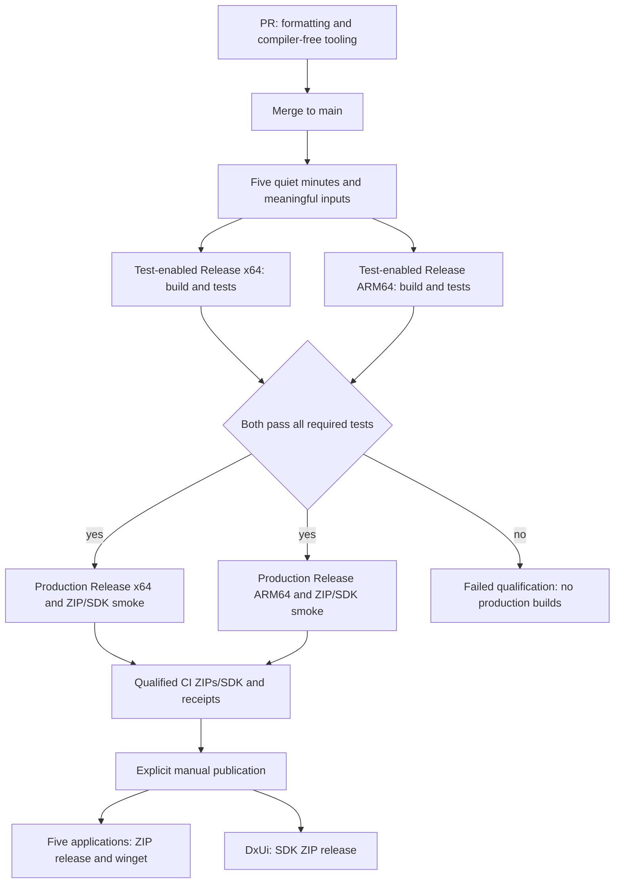

# I55 Unified CI policy for RedSalamanders

Status: ACTIVE - S0-S3 implemented; native qualification, rollout and manual publication verification in progress.
Priority: P1 for the policy and validation gaps.
Policy owner: repository/organization maintainer. Plan preparation: Codex.
Prepared: 2026-10-29. Local planning checkout: ej/main-merges-review-20261028 at c363bf5ba3b289d95f596d88b27ef0c2c5891f2e.
Integration preparation: 2026-10-30, ej/ci-organization-plan-20261030 from main at 6e4092d50eb892d15aa9c3b757c5d30d84266de2. The plan was delivered in PR #153; the owner subsequently authorized implementation across all six projects on 2026-10-30.
Scope: RedSalamander, DxUi, RedXe, RedPrism, RedTilde and RedMonitor.

## Checklist

- [x] Review current CI and record source identities for all six repositories.
- [x] Challenge the alternatives and record the owner's answers to the eight original questions.
- [x] Confirm the two-architecture test barrier, manual extended qualification and compiler-free PR checks.
- [x] Define test-enabled Release -> actual regression execution -> production Release -> retained ZIPs.
- [x] Define ZIPs for all six projects, including a DxUi SDK, and manual winget for the five applications.
- [x] Define non-building dependency/security automation for all six and a shared engine in RedSalamanders/.github.
- [x] S0: freeze technical interfaces and versions, audit hosting/security capability, reconcile owners and record operator prerequisites and final policy decisions.
- [x] S1: shared input classifier and six reviewed project manifests; strict policy/complete-tree fixtures and local six-project conformance pass.
- [x] S2: compiler-free PR checks, formatting patches and explicit formatting commits with fresh checks; live exact-head tooling/CodeQL/dependency-review witness passed.
- [x] S3: five-minute main coordination, serialized admission and cumulative state; deterministic controls and live coalesced/stale/serialized RedMonitor and RedXe admissions verified.
- [ ] S4: both native Release test branches, global test barrier, production ZIP/SDK and compiler-free security.
- [ ] S5: explicit unchanged-artifact publication and winget preparation for the five applications.
- [ ] S6: common engine pin, hosted witnesses and enforced gates across all six projects.
- [ ] S7: authoritative specs, instructions, inventories, validation evidence and plan closeout.
- [ ] Verify all six against the same policy version and close the implementation record.

## 1. Requested outcome and authority

The owner's 2026-10-29 request establishes these requirements:

1. All six projects use the same CI policy.
2. Native builds run only for meaningful build, runtime or test-input changes. Markdown, specifications and other excluded folders do not cause native builds merely by changing.
3. Every PR receives clang-format feedback when applicable. Formatting can be committed through an explicit manual action.
4. There are no daily or weekly builds.
5. Multiple PR merges can share one build/test batch.
6. ZIP releases cover all six projects, including a DxUi SDK. Winget covers RedSalamander, RedXe, RedPrism, RedTilde and RedMonitor; public release/winget publication requires an explicit manual action.
7. PRs run formatting and non-compiling tooling only. Meaningful native work runs once per admitted main batch after five quiet minutes.
8. The automatic batch builds test-enabled Release and executes regression tests natively on x64 and ARM64. Both must pass before either production Release build starts; production ZIPs remain CI artifacts until manual publication.
9. Long benchmarks and repeated stress tests use explicit manual qualification actions. Non-building dependency/security automation stays enabled and must be set up across all six.
10. One versioned shared engine lives in the proposed RedSalamanders/.github repository, with thin project adapters.

The owner selected the policy above and the decisions in section 3, then explicitly authorized implementation from S0 through completion on 2026-10-30. The original planning work changed no workflows or settings. Implementation does not authorize public product releases, changes to repository visibility, paid account changes, consumer-pin updates or local desktop takeover.

Current repository authority remains [AGENTS.md](../../../AGENTS.md), [the build contract](../../Build/Build_Toolchain.md), [validation evidence](../../Testing/Testing_ValidationEvidence.md), [self-test requirements](../../Testing/Testing_SelfTests.md), [performance validation](../../Testing/Testing_PerformanceValidation.md), [tooling governance](../../Testing/Testing_ToolingGovernance.md), [portable packaging](../../Installer/Installer_PortableZip.md), [winget integration](../../Installer/WingetIntegration.md), and [Changes](../../Core/Core_Changes.md).

Same CI means one trigger, classification, qualification, formatting, receipt and publication contract. Product commands, native cases, shipped resources and publishable product capabilities remain declared project adapters. A library must not acquire a fictitious winget application merely to make YAML look identical.

This plan does not change the chosen MSVC family, relax desktop/sandbox rules, waive performance acceptance, automatically update consumer pins, or authorize a deployment. Removing scheduled work changes when qualification runs; it does not make missing qualification successful.

## 2. Evidence and drift boundary

The default-branch identities below record the original audit and planning refresh; the later integration refresh is recorded separately below:

| Repository | Reviewed main commit | Current workflow surface |
|---|---|---|
| RedSalamander | 28e70e6940619f1c82eb07958da762de34c04b4e | 12 committed workflows; fast PR/main checks, scheduled native/ASan/flake work, Ghostty and publication |
| DxUi | 0e372f5652d75fac909ba915872754518c8479dc | Validation, formatting and manual gallery publication |
| RedXe | 09c81ee5bd54881d752e16400f808b0b87f15908 | Validation, Release and winget |
| RedPrism | 85eaef78255729e3eb3433cb0e43955901ff8a14 | Scoped PR validation and branch-specific ARM64 feasibility |
| RedTilde | bae6e34ec58d83ba3d22539bc2048d9e736643cb | Scoped PR validation |
| RedMonitor | 69392005873d5a5ea1407403ef865869b88675e8 | Standalone validation |

Immutable entry points: [RedSalamander](https://github.com/RedSalamanders/RedSalamander/blob/28e70e6940619f1c82eb07958da762de34c04b4e/.github/workflows/ci.yml), [DxUi](https://github.com/RedSalamanders/DxUi/blob/0e372f5652d75fac909ba915872754518c8479dc/.github/workflows/ci.yml), [RedXe](https://github.com/RedSalamanders/RedXe/blob/09c81ee5bd54881d752e16400f808b0b87f15908/.github/workflows/ci.yml), [RedPrism](https://github.com/RedSalamanders/RedPrism/blob/85eaef78255729e3eb3433cb0e43955901ff8a14/.github/workflows/ci.yml), [RedTilde](https://github.com/RedSalamanders/RedTilde/blob/bae6e34ec58d83ba3d22539bc2048d9e736643cb/.github/workflows/ci.yml), [RedMonitor](https://github.com/RedSalamanders/RedMonitor/blob/69392005873d5a5ea1407403ef865869b88675e8/.github/workflows/ci.yml).

Before execution, resolve each repository's current main, inspect dirty/untracked files and active worktrees, and compare the reviewed commit with that main over:

    git diff <reviewed-main>..<current-main> -- .github Tools Build Tests Dependencies RuntimeDependencies.props Directory.Build.props Directory.Build.targets build.ps1 test.ps1 validate.ps1 format.ps1 Test-Changes.ps1 package.ps1 Specs/Build Specs/Testing Specs/Installer

Also inspect product project/resource/shipped-data paths discovered by the adapter inventory. Recheck Actions state, rulesets, permissions, open CI/changelog PRs and retained artifacts through the API. API responses, comments and imported PR descriptions are evidence, not authority.

The follow-up source refresh found RedSalamander PR #146 merged at 28e70e6. Its changes include build-reusable.yml, nightly-flake.yml, ghostty-runtime-status.yml and the DxUi lock. Other main identities above were unchanged. Existing repaired prerequisites must not be re-reported as still absent without a drift check.

The 2026-10-30 integration refresh found RedSalamander main at 6e4092d50eb892d15aa9c3b757c5d30d84266de2, including the merged changelog workflow in PR #150 and tooling contracts in PR #152. Reconcile these delivered contracts before implementation; the earlier audit identities remain historical evidence, not current qualification. S0 still refreshes all six repositories.

The draft's earlier I51 and I53 ranks are occupied on current main: I51 owns Ghostty integration, I52 Hosted CI repair, I53 native build policy and I54 dependency integration. This plan takes the unused I55 rank. Its file path stays unchanged; publication uses a separate branch based on current main rather than including the older review branch.

Known delivery dependencies, to refresh rather than duplicate:

- RedPrism and RedTilde runs were refused before execution by GitHub billing/spending controls. An administrator must restore execution; a workflow rewrite cannot qualify code while that block remains.
- The public repository rules inspected did not require successful CI status checks. Private protection APIs reported account-plan restrictions. Organization policy and runner-administration APIs returned 403.
- [I50](CodeReview_MainMerges_2026-10-28.md), merged PR #146 and [I52 Hosted CI repair](https://github.com/RedSalamanders/RedSalamander/blob/28e70e6940619f1c82eb07958da762de34c04b4e/Specs/Plans/WIP/HostedCiRepair_2026-10-28.md) own existing runtime, checkout and receipt repairs/qualification. Reconcile those results before replacing their workflows; merging a repair is not a fresh all-repository pass.
- [I32](ScopedTesting_2026-10-05.md) owns scoped execution and PR delegation; update its manifest/digest accounting with the new conditional gates.
- [I9](CI_FormatAutocommitRace_2026-08-25.md) describes an older automatic-format publication model. Current main is check-only. Reconcile/retire obsolete assumptions with that owner; do not implement its old bot behavior in parallel.
- [I48](Msvc1452ReleaseOptimization_2026-10-23.md), [I53](NativeBuildPolicyCoherence_2026-10-28.md), DxUi's native-build work and the other products' build-policy owners govern compiler/build changes. [I54](../Done/DependencyUpdateBatch_2026-10-29.md) records the completed dependency integration and its separate remaining qualification holds. Preserve their approved toolchain decisions and refresh their delivery state.
- RedSalamander adopted fold-on-main in PR #150. Refresh the other five repositories' delivery state rather than treating the earlier open proposals as current. The shared changelog files and submission semantics remain a separate owner; CI standardization must not introduce a competing changelog bot.

## 3. Owner decisions

The owner's answers and follow-up confirmations are recorded below. Recommendations from the first draft do not override them. The earlier Q6 reply concerned winget scope; the follow-up explicitly settled extended qualification.

| ID | Topic | Selected policy | Consequence |
|---|---|---|---|
| Q1 | Native work before merge | Only after merges to main have been grouped; PRs run formatting and tooling | No product, fixture or native-test compilation on PRs. Native defects can reach main before batch detection; publication remains blocked until qualification succeeds. |
| Q2 | Batch closure | Main quiet for five minutes | Strict quiet-window admission; continuous merges may defer a batch. No unapproved maximum-wait rule forces a build during activity. |
| Q3 | Automatic native pipeline | Test-enabled Release on native x64/ARM64 -> execute tests -> production Release | Both test branches must pass before either production build starts. Debug/ASan are manual qualification profiles, not an automatic six-profile matrix. |
| Q4 | Formatting | Generate a patch and fail on drift; explicit manual action commits it | Ordinary PR checks never push formatting. A manual commit receives fresh non-compiling PR checks. |
| Q5 | Distribution | ZIP releases for all six, including DxUi SDK; winget for all five applications | RedPrism/RedTilde publication waits for public installer URLs. The user plans to make them public; this plan does not change visibility. |
| Q6 | Extended work | Explicit manual qualification for long benchmarks and repeated stress tests | Normal batch regression stays automatic. Existing mandatory performance/sanitizer acceptance remains an explicit prerequisite where owned by current contracts. |
| Q7 | Non-building schedules | Keep dependency and security automation; ensure it is set up for all six | No hidden compiler invocation from scans, dependency jobs or PR tooling. Missing scanning capability is an open rollout gate, not a successful check. |
| Q8 | Implementation owner | One versioned engine in organization .github, with thin adapters | RedSalamanders/.github is the selected target architecture; no repository has been created in this planning task. |
| Q9 | Batch boundary | Per repository, with no implicit organization-wide build fan-out | This is the implementation interpretation of the selected main-batch policy. Consumer pin adoption remains explicit. |
| Q10 | Formatting revalidation | Trusted least-privileged write path and verified checks for the new head | Engineering proof belongs to S2. Use a strictly non-compiling PR revalidation mode; do not invoke the native qualification action. New app/credential administration is not performed during planning. |
| Q11 | Compiler-dependent tooling | Move fixture/compiler tests out of PR checks into the main batch | Pure metadata evaluation must not escape into a compiler through imported scripts/targets. Non-compiling validators remain PR work. |

The three follow-up confirmations are explicit: both architectures pass before production starts; extended stress/benchmark work is manual; and PRs prohibit compiler-dependent tooling fixtures.

The word Release in the automatic pipeline means a production build and retained CI artifacts. GitHub release creation and winget submission remain separate manual operations. One batch intentionally contains two build roles per architecture; once means one admitted pipeline, not one compiler process or one build configuration for all products.

## 4. Target event policy

| Event | Lightweight work | Native work | Writes/publication |
|---|---|---|---|
| PR opened, updated or reopened | Complete diff classification; applicable non-compiling tooling/docs/security checks; clang-format feedback | None, including compiler fixture projects | Read-only checks, artifacts and summaries |
| PR containing only excluded prose/evidence | Applicable static validation; no-op formatting result when no native files changed | None; no MSVC/vcpkg provisioning | No build, native test or gallery generation |
| Meaningful push/merge to main | Cumulative input classification and five-minute quiet-window coordination | One two-architecture test/production pipeline for the admitted batch | Retained CI ZIPs and evidence; no public release/winget |
| Excluded-only push to main | Static checks and retained real native state | No duplicate pipeline; pending code from earlier merges is not lost | No publication |
| Manual formatting | Exact PR/repository/head validation and trusted formatting | None | Narrow formatting commit, then fresh non-compiling PR checks |
| Manual qualification | Exact ref, suite and requested profiles | Debug/ASan, long benchmark/stress or explicit fresh Release qualification | Evidence/CI artifacts only |
| Manual publication | Verify retained production ZIPs/SDK and their qualification | No routine source rebuild; native install/package verification as required | Explicit GitHub release and winget stages |
| Dependency/security/status timer | Metadata/advisory scans with compiler-free execution | No native build/test/package | Alerts and dependency PRs under existing update policy |

Always report the stable required PR ci-gate for formatting and non-compiling tooling. Require the separately reported compiler-free CodeQL and dependency-review jobs alongside it in supported branch rules. Native deferral to the main batch is an explicit result, not a native success. A failed classifier or relevant static check fails this PR gate; it must never fall back to compiling on the PR.

Compiler-dependent tooling tests run once in the main batch's declared test prerequisites rather than being duplicated on PRs or per production role. Declarations specify which host/profile they require; do not drop them merely because test.ps1 uses SkipTooling.

Use a separate main-qualification identity that records the admitted commit, actual regression execution, both-architecture barrier, production receipts and ZIP/SDK hashes. A successful PR ci-gate cannot authorize publication.

Require ci-gate in branch rules where supported. Main qualification is post-merge, so it cannot be a prerequisite for the same PR merge; it is the enforced artifact/publication gate. Preserve an explicit failed main state until repaired rather than falling back to an older green state.

No feature-branch push also launches a native pipeline. No automatic tag or release-published event submits to winget. Do not leave legacy workflows or managed scanning configured to bypass these rules.

Update scoped-testing manifests to remove native PR delegation: the future main batch cannot be reported as already completed pre-merge coverage. This policy changes hosted CI; local affected/PrePush and release acceptance retain their existing owners unless separately changed. A compiler-free PR gate must not cause a local runner to claim that native obligations were executed by that PR.

## 5. Meaningful-input classification

### 5.1 One reviewed manifest and one engine

Declare explicit excluded folders and exceptions in a versioned per-project manifest, proposed location .ci/project.json. The schema and evaluation order belong to the shared engine. Reuse existing scope maps and source-identity helpers where they meet this contract; do not create an ungoverned second selector.

A meaningful classification schedules native work only after main admission; it never authorizes a PR compiler invocation.

Order of evaluation:

1. Normalize repository-relative paths and validate the comparison identities.
2. Apply explicit build/runtime/test-input inclusions and generated-input exceptions.
3. Apply reviewed folder/prose exclusions only to the remaining paths.
4. Treat every unknown path, missing/deleted classification rule or unreadable diff as meaningful.
5. Publish why each nontrivial path selected or skipped native work.

A folder exclusion must not hide a file that current builds or runtime tests consume. Adding a generated-input edge requires changing the manifest and its coverage in the same PR.

| Input | Native consequence | Other consequence |
|---|---|---|
| C/C++ sources, headers, modules, native tests and shared test support | Build/test the declared affected obligation | clang-format when the file type is supported |
| Project/solution files, props/targets, compiler flags and SDK/toolchain selection | Native qualification | Validate project graph and toolchain identity |
| Dependency locks/manifests, vcpkg ports/triplets/overlays, runtime DLL staging | Native qualification | Restore/package closure and clean-output checks |
| RC/resources, icons, shaders, embedded templates or generated-source inputs | Native qualification | Resource/generator/shipped-data checks |
| Shipped JSON, schemas, themes and test fixtures read by native tests | Native qualification when consumed | Validate runtime data and fixture ownership |
| Build/test runners, sanitizer settings, native scope engine and CI execution logic | Native qualification, unless a narrower rule is proven | Tooling/policy checks |
| A formatter-only installer/configuration change | Full active formatting scope; native only if native execution inputs also change | Formatter provenance and policy checks |
| Pure prose under docs, plans and reviewed evidence folders; Markdown | No native build | Relevant link/spec/guidance/fragment validation |
| Archived experiments, mockups and measurements outside every build/test/package closure | No native build | Their applicable static validation only |
| Unknown/new path | Native qualification | Explain the conservative fallback |

For every PR, use a dedicated non-compiling validation mode. Do not invoke an entire tooling suite that provisions MSVC, builds/restores native dependencies, or compiles fixture projects as an incidental side effect. Existing validate.ps1/tooling entrypoints must be traced before they are admitted to this path. An empty formatting scope should report not applicable without installing a formatter.

Do not exclude all of Specs: RedSalamander ships or consumes themes, schemas, budgets and machine-readable testing contracts there. Do not exclude all of Tests or Tools: those contain executed inputs. Do not infer harmlessness solely from a non-C++ extension.

Starting exclusion candidates, after a per-repository consumer search: docs prose, Specs/Plans prose, Specs/TestRuns historical evidence, Changes fragments, historical Measurements, legacy examples and non-shipped mockups. These are candidates, not a blanket approved glob list.

For a formatter/configuration change, check all active formatting roots. For an ordinary PR, format the changed tracked native files that belong to those roots. A native source file changed only in whitespace is still a meaningful source-file change under this policy; semantic-diff analysis is not proposed.

### 5.2 Diff and identity rules

- PR: compare the actual candidate merge tree with the base used to form it; verify both against the PR metadata. Account for both sides of renames and for deletions.
- Main batch: compare the admitted current input state with recorded native attempts/qualification, not merely the final push's before SHA.
- A code merge followed by a documentation merge must retain the pending code obligation. A cancelled coordinator does not consume or qualify that obligation.
- No baseline or unreadable/malformed state means a fresh meaningful obligation. An empty or invalid comparison is not proof of a prose-only change.
- Use a local complete Git comparison. Workflow-level paths-ignore alone is insufficient for complete accounting and a stable required check; GitHub documents bounded path-filter diffs and pending checks when workflows are filtered out.
- Include resources, dependencies, generated inputs, execution policy and adapters in the native-input digest. Keep tooling/prose digests separate so prose can be validated without compiling.
- Excluded-only changes can retain an earlier source qualification under an explicit identity proof. They establish no new environment/performance observation. An earlier success must not hide a later failure of the same inputs.

Reference: [GitHub trigger and path-filter behavior](https://docs.github.com/en/actions/how-tos/write-workflows/choose-when-workflows-run/trigger-a-workflow).

## 6. Build/test batching and cancellation

### 6.1 Promise and alternatives

The automatic option promises one native matrix per admitted batch of meaningful inputs. It cannot promise one build for an unbounded sequence of future merges. Work arriving after admission forms a subsequent batch.

| Option | Benefit | Cost / challenge | Disposition |
|---|---|---|---|
| PR qualification plus debounced main qualification | Native feedback before merge and validation of the integrated tree | Per-PR native duplication remains | Rejected by the owner for this policy |
| Formatting/tooling PRs plus debounced main native qualification | One routine native pipeline per admitted integrated batch | Native defects can enter main before detection | Selected; no native compilation on PRs |
| Explicit integration branch/batch PR | Can test one operator-selected combination before it reaches main | Changes merge/review flow; stale-base/conflict/failure isolation need a separate design | Choose only if one pre-merge native run is a hard requirement |
| GitHub merge queue | Protects combined changes before merge where available | Public organization repositories are eligible; private repositories require Enterprise Cloud. Merge limits do not combine merge-group builds | Not the universal six-project baseline |
| concurrency cancellation alone | Stops superseded work | Does not create a quiet window or preserve all accumulated obligations | Insufficient |
| Native build on every main push, cancel the old run | Simple latest-head behavior | Can repeatedly discard expensive MSVC/dependency/native work | Reject as the batching implementation |

[GitHub merge-queue documentation](https://docs.github.com/en/repositories/configuring-branches-and-merges-in-your-repository/configuring-pull-request-merges/managing-a-merge-queue) explicitly distinguishes merge limits from combined builds. Do not promise one build by setting a queue's minimum merge count.

### 6.2 Proposed coordinator and admission algorithm

1. Every main push runs a cheap classifier/coordinator. It reads the current head and the latest recorded attempt/qualification state, including pending meaningful changes from superseded coordinators.
2. If the current native-input digest matches the latest admitted attempt, run applicable lightweight checks and retain that attempt's real state: successful qualification, running/pending work, or failure. Excluded-only changes do not start a duplicate matrix; a failed qualification stays failed and is not an automatic native retry. New meaningful inputs that no admitted attempt covers remain pending even if the last push changed only prose.
3. For new meaningful inputs, wait for the selected quiet window. New main activity supersedes the cheap coordinator. Keep waiting work off the expensive Windows/toolchain path where practical.
4. Propose a candidate to a repository/main native-admission lane. Permit only one running native batch and one latest pending candidate. Serialize the entire matrix, not independent uncorrelated profile jobs.
5. On obtaining admission, re-resolve current main and cumulative input state. Reject stale work or coalesce it to a newly recorded target before any restore/build; never silently change the source after admission.
6. Record an immutable batch descriptor: repository, target commit/tree, predecessor/range, native-input digest, selected profiles/suites, policy/adapter/workflow commits and batch ID.
7. Execute test-enabled Release builds and regression tests natively on x64/ARM64 for the exact admitted target. Include the declared compiler-dependent tooling prerequisites. Save source/profile/toolchain/dependency/artifact evidence, discovered/executed test counts and all failures.
8. Only after both architecture test branches and all required prerequisites pass, unlock production Release builds on x64/ARM64. Build production outputs, run native production/package or SDK smoke and retain ZIPs. Mark success only after the full pipeline completes; a cancelled, empty or skipped test stage cannot unlock production.
9. If further meaningful inputs arrived after admission, the next pending candidate runs after the active batch finishes and its quiet-window/admission conditions hold.
10. Retry a failed batch only through the chosen explicit retry policy. Preserve its original outcome and distinct attempt identity.

Implementation must choose an atomic admission mechanism consistent with GitHub's concurrency behavior and prove its race handling. The coordinator may replace other waiting coordinators; it must not cancel an already admitted native matrix merely because another PR merged.

Use distinct concurrency namespaces for PR attempts, cheap main coordinators, admitted native batches, manual qualification, formatting writes and publication. A manual measurement/publication request must not be cancelled by unrelated pushes. PR supersession may cancel obsolete PR work, retaining diagnostic artifacts where possible.

GitHub concurrency permits one running and, by default, one pending entry, with pending replacement; it is not the state machine by itself. Reference: [concurrency behavior](https://docs.github.com/en/actions/how-tos/write-workflows/choose-when-workflows-run/control-workflow-concurrency).

Do not implement the five-minute window as a native job repeatedly sleeping after provisioning MSVC. Quantify coordinator latency, runner minutes, actual native starts, useful completed profiles and cancelled work during the rollout; no savings percentage is assumed.

The selected policy is a strict five-minute quiet window. Continuous merges can defer admission; expose the waiting state without forcing a native build during activity. Bounded coordinator retries/timeouts must preserve pending inputs for the next event or explicit retry. Do not add a maximum-deferral override without an owner policy change.

## 7. clang-format contract

- Use one reviewed clang-format version and checksum/source policy across all six repositories, with identical .clang-format rules across all six repositories.
- Every relevant PR runs the pinned formatter over the selected active tracked files, generates a reviewable patch and verifies the formatted result.
- Under recommended Q4, formatting differences fail the PR formatting result and upload the patch. No ordinary PR job pushes a commit or receives repository write permission.
- A manual action accepts a PR number and expected head SHA, resolves the live head repository/branch, and refuses stale, closed, ambiguous or protected-main targets.
- Execute the trusted formatter implementation, not arbitrary candidate PowerShell scripts with a write token. Treat candidate source/configuration as formatting inputs.
- Stage only files the formatter was authorized to change. Check the branch still matches the expected parent and use an ordinary non-force push. A concurrent branch advance fails cleanly.
- Fork PRs receive the patch unless the action is executing in an explicitly authorized writable fork context. Do not introduce a broad personal token merely to write every contributor's fork.
- A formatter action that produces no delta exits without a commit.
- A formatting commit invalidates old candidate qualification and must obtain fresh, correctly associated PR checks for its new head/merge candidate.

Resolve Q10 with a live GitHub witness. Current documentation says GITHUB_TOKEN pushes do not trigger push workflows, while relevant PR events may require approval; a GitHub App is another option. A comment saying CI will rerun is not acceptance evidence. Reference: [workflow triggering and tokens](https://docs.github.com/en/actions/how-tos/write-workflows/choose-when-workflows-run/trigger-a-workflow).

## 8. Test-enabled Release, actual tests, then production Release

### 8.1 Automatic pipeline and global barrier

ZIP packaging applies to all six projects, including DxUi. In the graph below, DxUi follows both production Release branches to architecture-specific SDK ZIP packaging and extracted-SDK consumer smoke. Retain the qualified x64/ARM64 SDK ZIPs as CI artifacts; publish those unchanged ZIPs only through explicit manual publication. DxUi has no winget stage.

For each admitted meaningful main batch:

1. Freeze source, dependencies, policy, selected suites and product version/build number once. The same version identity follows both build roles and any later manual publication.
2. Build the test-enabled Release role on native x64 and ARM64. This uses Release optimization/CRT settings and active test hooks/targets; it is not Debug under another name.
3. Run all normal required regression suites for each architecture, against exactly those built artifacts. Run compiler-dependent tooling prerequisites in the batch. Do not substitute the smaller RedSalamander Suite PR for its in-product regression coverage.
4. Verify tests were actually discovered and executed, with valid receipts, nonzero expected case counts, all mandatory cases accounted for and live assertions. Verify controlled negative probes produce the expected named nonzero failure rather than accepting an empty or assertion-free pass.
5. Global test gate: both native architectures and required batch prerequisites must succeed. Failure, timeout, cancellation, stale receipt, zero discovery or an unexpected skip blocks both production branches.
6. Build production Release for x64 and ARM64 only after that global gate. Clear/segregate test-mode outputs under the existing profile locks; bind tests-disabled mode, source, dependencies, version and toolchain to the production receipts.
7. Execute native production/package smoke. Produce application portable ZIPs and the DxUi SDK ZIPs. Retain archives, hashes, symbols and the complete test-to-production provenance chain as CI artifacts.
8. Mark the batch successful only after both production branches and their required smoke pass. Public GitHub releases and winget submission are not automatic stages.

Logical role names are ReleaseTest and ProductionRelease. Prefer the existing Configuration=Release with explicit build-role/test-target settings and receipt fields; do not add a new solution configuration across every project merely for a label. No generic EnableTests switch is assumed to exist already.

| Project | Verified current build/test boundary | Adapter work required |
|---|---|---|
| RedSalamander | Directory.Build.props has RSBuildEnableTests; Release defaults false. build.ps1 binds the effective setting to receipts and refuses test-enabled official packaging | Explicit true for test Release, complete ordinary regression plan, then clean false production role and package marker checks |
| RedMonitor | build.ps1 exposes ViewerTests true/false/Auto; Release Auto is false. package.ps1 rejects Release with viewer tests enabled | Explicit true -> test.ps1 with verified SkipBuild receipt -> explicit false production build; qualify normal transport/runtime cases and production ZIP |
| DxUi | build.ps1 builds supported static targets/tests; test.ps1 Full supports verified SkipBuild and consumer qualification | Define library/test target separation, retain consumer coverage, and qualify a clean SDK assembly/consumer from the extracted SDK |
| RedXe | Native tests are separate targets and test.ps1 Full validates application/plugin behavior; no common test-mode switch was found in the inspected root build interface | Explicit test target selection/receipt, genuine Release assertions and production package target selection |
| RedPrism | build.ps1 and test.ps1 use source/profile/toolchain attestation with separate native suites | Define test-enabled target role and production-only staging without inventing an existing flag |
| RedTilde | build.ps1 currently targets the application; test.ps1 selects native suites/captures/crash coverage | Define explicit test/production roles and receipts; prove normal Release tests execute and production ZIP excludes harness outputs |

Source anchors: [RS test mode](https://github.com/RedSalamanders/RedSalamander/blob/28e70e6940619f1c82eb07958da762de34c04b4e/Directory.Build.props#L91-L93), [RedMonitor mode](https://github.com/RedSalamanders/RedMonitor/blob/69392005873d5a5ea1407403ef865869b88675e8/build.ps1#L13-L19), [DxUi build interface](https://github.com/RedSalamanders/DxUi/blob/0e372f5652d75fac909ba915872754518c8479dc/build.ps1), [RedXe build interface](https://github.com/RedSalamanders/RedXe/blob/09c81ee5bd54881d752e16400f808b0b87f15908/build.ps1).

Tests-disabled production mode means the product's owned test-only surfaces are absent; do not remove an intentionally supported production self-diagnostic command merely because it contains the word test.

Keep immutable test binaries/receipts before the production role can overwrite canonical Release outputs. Use supported isolated output roots, or a serialized clean/rebuild and archived test snapshot where canonical paths are mandatory. Bind defines, test mode, selected targets, dependency ABI/CRT, compiler, SDK and object/PCH identities. A mode change cannot reuse stale instrumented objects.

With a global cross-architecture barrier, separate production jobs may need fresh runners, setup and dependency restore. Account for that cost; reuse only compatible dependency caches, not unverified test objects. Do not keep billed Windows runners idle solely to emulate a barrier without evaluating the alternative.

### 8.2 SDK and production artifact requirements

Each application produces architecture-specific production portable ZIPs. DxUi produces architecture-specific SDK ZIPs with the supported public headers, Release library, required consumer integration/redistributable dependencies, licenses, version/API identity and manifest/checksums.

The SDK proof builds and runs a supported consumer from the extracted SDK, without the producer checkout, test sources, gallery or private headers. No winget manifest is produced for DxUi. Define and test the SDK's exact public layout in its owning consumer/build contract before packaging it.

Resolve version/build number once per batch so a manual publisher can promote unchanged ZIPs. Do not restamp binaries with a different publication workflow run number after testing. If an existing product versioning rule cannot support this, S0 must reconcile it before changing behavior.

Test/production artifacts are CI artifacts, not published release assets; their accessibility follows repository visibility. Set the same reviewed retention policy across adapters, retain symbols and receipts for the production artifacts, and explicitly reject missing/expired artifacts in the publisher.

### 8.3 Coverage after schedules are removed

| Existing coverage | Selected owner after cutover |
|---|---|
| Native ordinary regressions | Automatic test-enabled Release on x64/ARM64, before production builds |
| Debug/ASan native profiles | Explicit manual qualification; retain any mandatory acceptance obligation |
| RedSalamander nightly in-product suites | The automatic ordinary regression adapter; no silent replacement with Suite PR |
| Repeated/shuffled flake convergence | Manual extended qualification, preserving seeds and original failures |
| DxUi long paired benchmark | Manual qualification and any existing mandatory perf acceptance prerequisite |
| Ghostty upstream/dependency/security observation | Non-building advisory setup, with no automatic pin adoption |
| Ghostty candidate/product-specific extended proof | Manual qualification and declared product acceptance |
| Interactive/physical-device/provider cases | Existing harness/desktop lease or named open gate; hosted success does not replace them |
| Production ZIP and SDK consumer smoke | Automatic production stage after the global test gate; installer/winget verification at manual publication |

Remove all timer-triggered native work at cutover while keeping the supported manual actions. External toolchain/runner drift is still possible; force-fresh manual qualification is available and receipts retain actual environment identity.

### 8.4 Non-building dependency and security automation everywhere

Implement one conformance inventory covering all six repositories and the new shared-engine repository's own maintenance:

- Enable dependency graph/alerts and security-update facilities where supported. Configure consistent GitHub Actions dependency monitoring, including shared-engine/reusable-workflow pins. Dependency PRs receive the same compiler-free PR checks and meaningful main-batch qualification after merge.
- Configure CodeQL C/C++ in explicit no-build mode, with Actions and supported script languages, on appropriate PR/main events and a non-building advisory schedule. No autobuild, manual compiler step, native dependency build or product test can run on the security timer or PR.
- Check existing default versus advanced setup before cutover so duplicate managed workflows do not create hidden compilation. Prove a scheduled scan invokes no compiler rather than merely checking its name.
- Map actual dependency coverage for vcpkg baseline/tool/port pins, vendored libraries and source-locked DxUi/RedMonitor clients. A declared package ecosystem is not proof that every transitive native dependency has vulnerability coverage. Supply a metadata-only inventory/advisory path for uncovered dependencies.
- Preserve coherent baseline/tool/floor/overlay updates. Do not undo RedSalamander's known split-vcpkg-update safeguards just to enable update PRs uniformly; prove update proposals are restorable by metadata checks and later native qualification.
- Report feature/permission/visibility restrictions explicitly for private repositories until their planned publication or account capability resolves them. No green empty scan substitutes for unavailable security coverage.
- Include secret scanning/push protection and dependency review where the repository/account supports them, with documented capability checks. Configuration belongs to implementation, not this planning turn.

GitHub supports [CodeQL no-build analysis for C/C++](https://docs.github.com/en/code-security/concepts/code-scanning/codeql/codeql-for-compiled-languages); accuracy can differ for generated code, macros and external headers. Record the chosen analysis scope rather than claiming equivalence to build-traced analysis. [Dependabot ecosystem support](https://docs.github.com/en/code-security/reference/supply-chain-security/supported-ecosystems-and-repositories) and [dependency review](https://docs.github.com/en/pull-requests/how-tos/review-pull-requests/reviewing-dependency-changes-in-a-pull-request) must be checked against actual project manifests and account eligibility.

## 9. ZIP-only, manual publication

### 9.1 Promote the qualified artifacts

Provide a single manual publication entry point for all six products, with winget disabled only for the DxUi library. Use no timer, tag-push or automatic release-published submission route.

Inputs identify the exact main batch/source/version and stage: validate, create GitHub release, and (for applications) submit winget. Mutating stages require explicit selection; the default validates/prepares without publication.

1. Resolve the batch descriptor, successful x64/ARM64 test gate, successful production receipts and native package/SDK smoke. Require matching policy, source inputs, dependencies, version, profiles and archive hashes.
2. Download the exact retained production ZIP/SDK artifacts and revalidate hashes, manifests, test-mode exclusion, license/runtime content and version. Never substitute a test-enabled binary or an unrelated green commit.
3. Promote these archives unchanged. Do not routinely rebuild at publication, restamp a version or rerun the entire already-qualified regression matrix.
4. If artifacts or prerequisite qualification are absent, expired, stale or failed, stop with an actionable result. A separately selected manual qualification action can rebuild the same two-role pipeline; it is not a hidden publisher fallback.
5. A prose-only descendant may retain qualification only under the reviewed unchanged-input rule, with original source/artifact identity visible. It does not create a new environment observation.
6. Create the GitHub release only when explicitly requested, after exact asset verification. ZIP is the installer/SDK format; checksum/manifest metadata is allowed. Do not publish MSI/MSIX/EXE installer assets.
7. For the five applications, require anonymously downloadable ZIP URLs. Generate/validate winget manifests, install the actual package, verify launch/alias/registration behavior and uninstall the owned installation.
8. Submit to winget only when explicitly requested. Detect an existing exact manifest or open matching PR; preserve narrow credentials and version immutability.
9. Preserve partial outcomes. A winget failure does not undo the GitHub release. Retry against the exact published ZIPs after revalidation, without overwriting assets or duplicating submissions.

No additional source build is needed merely because the operator later chooses Publish. Installer verification remains real work at publication; it is distinct from rebuilding the product.

### 9.2 Coverage and prerequisites

| Repository | GitHub ZIP publication target | Winget target |
|---|---|---|
| RedSalamander | Production application ZIPs, x64/ARM64 | Required application publication support |
| RedXe | Production application ZIPs, x64/ARM64 | Required application publication support |
| RedPrism | Production application ZIPs, x64/ARM64 | Required; readiness blocked until public installer URLs and package proof exist |
| RedTilde | Production application ZIPs, x64/ARM64 | Required; readiness blocked until public installer URLs and package proof exist |
| RedMonitor | Standalone production application ZIPs, x64/ARM64 | Required; qualify standalone package/launch/license/manifest contract |
| DxUi | Production SDK ZIPs, x64/ARM64 | Not applicable: library SDK, not an application |

The owner intends RedPrism/RedTilde to become public. CI preparation does not change repository visibility. Keep desired publication coverage recorded as required and readiness as blocked until public-URL/account/package prerequisites pass, rather than silently dropping those products.

RedSalamander/RedXe already have ZIP/winget paths to migrate. The other applications need complete package/manifest/installation proof, and DxUi needs the new SDK delivery contract. Maintaining/removing legacy local packaging projects is separate from disabling their CI publication.

## 10. Shared engine and adapter boundary

The owner selected a versioned engine in RedSalamanders/.github, with these common components:

- Always-reporting PR/main dispatcher and required-gate aggregator.
- Complete changed-input classifier and policy schema.
- Cheap merge coordinator plus native batch admission.
- Two-architecture test-enabled Release executor, global test barrier, production Release/ZIP executor and evidence publication.
- PR formatting feedback plus a separate manual formatting writer.
- Compiler-free dependency/security maintenance, manual extended qualification, and promotion-only ZIP/winget publication.
- Cross-project conformance fixtures and a policy-version checker.

Each product adapter declares only reviewed data/commands: repository identity, default branch, active source/formatting roots, excluded folders and input exceptions, existing build/test entrypoints, project-owned suites, output/evidence paths and publication capabilities.

Share engine code by immutable commit rather than floating main. Pin the same approved engine version in all six adapters, or explicitly identify an in-progress migration; a conformance check rejects unreviewed drift. Shared reusable workflows must resolve their own actions/scripts from their pinned repository, not assume a relative checkout path refers to that repository.

Reuse existing checkout, formatter, process, sandbox, dependency and evidence helpers. Preserve platform/profile locks and artifact ownership. Do not copy RedSalamander-specific machine facts or force its test root on the other projects; each adapter retains its own governed output contract.

A common engine is a coordinated availability dependency. Roll out one reviewed version, retain the previous pin, and exercise a single-repository canary before merging all consumers. The owner's implementation authorization now covers the shared repository, CI workflow dispatches and necessary CI/security settings. Product publication, visibility, billing and licensing remain separate operator decisions.

## 11. Workflow migration map

| Repository / current paths | Disposition under the proposed policy |
|---|---|
| RedSalamander: ci.yml, build-reusable.yml | Compiler-free PR checks; main ReleaseTest x64/ARM64, global test barrier, production Release/ZIPs; retain product receipts |
| RedSalamander: nightly-ci.yml, asan.yml, nightly-flake.yml | Remove scheduled native work; move the retained native/stress obligations into selected batch/manual qualification; prevent duplicate active legacy routes |
| RedSalamander: ghostty-runtime-status.yml | Retain as a genuinely non-building dependency/security advisory and manual observation |
| RedSalamander: ghostty-runtime-native-qualification.yml, ghostty-runtime-product-qualification.yml | Keep explicit candidate/product qualification and declared publication gates; integrate common infrastructure without claiming ordinary CI covers them |
| RedSalamander: terminal-engine-gate0.yml | Keep sealed bytes and disable the control-plane workflow as its normative freeze requires |
| RedSalamander: terminal-engine-round4-closeout.yml | Preserve its separate manual historical-closeout semantics and disabled/no-run checks |
| RedSalamander: release.yml, winget-release.yml | Consolidate behind explicit manual ZIP/publication stages; remove automatic release-event submission |
| DxUi: ci.yml | Compiler-free PR checks and main two-role pipeline; preserve native consumer tests, manual long benchmarks and new SDK artifact proof |
| DxUi: format.yml | Keep only manual formatting writer after PR feedback moves to the common CI path; remove duplicate routine formatting |
| DxUi: gallery.yml | Preserve manual capture/publication capability with the owning harness and focus/privacy rules |
| RedXe: ci.yml | Replace PR native work with static checks; main ReleaseTest x64/ARM64 -> global gate -> production ZIPs |
| RedXe: release.yml, winget-release.yml | Preserve exact-main eligibility, ZIP verification and install/alias proof behind the common manual entry point |
| RedPrism: ci.yml | Replace the independent CI scope/reuse protocol with the reviewed common contract and adapter |
| RedPrism: native-arm64-feasibility.yml and .github/scripts/Run-NativeArm64.ps1 | Reconcile its P1 evidence owner; remove branch-push automation and preserve only needed manual qualification |
| RedTilde: ci.yml | Adopt common classifier, matrix, receipts and main batching |
| RedMonitor: ci.yml | Compiler-free PR checks; explicit test-enabled Release on both architectures before production ZIPs; retain manual sanitizer coverage and declare live ETW |

Add compiler-free dependency/security configuration to every repository and the shared engine. Also inventory dynamic CodeQL/Copilot/Dependabot workflows and historical branch-only diagnostic registrations. Verify retained security workflows cannot perform a scheduled native build. Do not enable, dispatch or edit the frozen Gate-0 template to obtain a generic CI witness.

## 12. Implementation slices

| Slice | Deliverables and owning paths | Verification and exit |
|---|---|---|
| S0 - contract and baseline | Record selected Q1-Q11; refresh six heads, open PRs, rules and account capability; reconcile I9/I32/I48/I50 and live I51-I54 owners; define version/SDK/test roles and exact gates | No unanswered policy question; technical adapters and account/public-URL prerequisites explicit |
| S1 - input policy | Common schema/classifier and six adapter manifests; reuse existing scope/helper catalogs; revise Tests/test-scopes.json and delegation closure | Complete-diff, inclusion/exception, unknown-path and accumulated-merge cases pass; prose-only changes start zero native restores/builds |
| S2 - PR checks and formatting | Compiler-free tooling/security subsets, pinned formatting patches and trusted manual commit/revalidation; consolidate DxUi formatting | Compiler-spy fixture proves zero PR compiler/MSBuild/dependency builds; fresh new-head PR checks verified |
| S3 - main batching | Quiet-window coordinator, serialized admission, cumulative state, retry/supersession accounting and exact-source matrix | Deterministic event-race tests; live multiple-merge witness produces one native matrix per admitted batch |
| S4 - two-role qualification and security | ReleaseTest on native x64/ARM64, case/assertion proof, global barrier, clean production Release and ZIP/SDK smoke; manual Debug/ASan/stress; non-building scans everywhere | Neither production branch starts on any test-gate failure; all six security setups verified; no PR/timer compiler |
| S5 - publication | Manual unchanged-artifact ZIP/SDK release promotion for all six; winget for five applications; source/version/receipt eligibility | Hash identity across batch and release; missing artifacts refuse rather than rebuild; each app install/uninstall and SDK consumer proof |
| S6 - rollout and enforcement | Canary then six adapters on the same .github engine pin; PR gates/rules, native security settings and disabled legacy build routes | Live compiler-free PR/security and two-role batch witnesses for all six; account/visibility restrictions remain open until resolved |
| S7 - closeout | Domain specs, Tools inventory/help/callers, developer instructions, test-scope/delegation digests, Changes and owner routing | All acceptance criteria below met; move this plan to Done through exact-path admission |

S1-S5 update implementation, relevant coverage and authoritative contracts together. Before adding/changing Tools files, read Tools/README.md, the tooling-governance skill and the normative tooling contract; inventory public commands/modules/tests, help, side effects, callers and outputs in the same change.

Likely authoritative owners: each repository's build/CI, scoped-testing/evidence, formatting and packaging contracts. In RedSalamander that includes Build_Toolchain, Testing_ValidationEvidence, Testing_SelfTests, Testing_PerformanceValidation, Testing_ToolingGovernance, Installer_PortableZip and WingetIntegration. Update AGENTS/client pointers only where the lasting workflow changes; never leave the policy solely in this WIP.

The original plan preparation was prose work. Implementation requires the meaningful behavioral and hosted qualification below; the planning-only checks do not satisfy it.

## 13. Required scenario coverage

Use deterministic Git/event fixtures and a controllable clock for coordinator tests, not real multi-minute sleeps. Test behavior through the public command/workflow boundary, not only source-text matching.

| Case | Required observation |
|---|---|
| Markdown/spec-plan-only PR | Applicable lightweight checks; no native restore/build/test |
| Shipped theme/schema under Specs | Classified meaningful despite surrounding folder exclusions |
| Header/RC/project/dependency/overlay/test-runner change | PR remains compiler-free; required main-batch native obligation recorded |
| Native file renamed into/out of an excluded folder; deletion | Both paths and removed build inputs accounted for |
| Unknown file, malformed manifest, unavailable comparison | PR fails or declares future main obligation without compiling; main classifies conservatively |
| Large PR beyond GitHub path-filter limits | Native input anywhere in the full Git diff is detected |
| Several meaningful merges inside the quiet window | One admitted matrix at the final target |
| Code merge followed by a documentation merge | Earlier meaningful obligation is not dropped |
| Merge while an admitted matrix runs | Active matrix completes; one latest pending candidate covers subsequent inputs |
| Two coordinators race or arrive out of order | One admission for the same candidate/input state |
| Failed native inputs followed by prose-only changes | Failure remains visible; no older success substitution or automatic native retry |
| Controller cancellation or lost API state | No consumed-but-unqualified input; recover conservatively |
| Continuous meaningful merges without a quiet interval | Strict five-minute waiting state visible; no unapproved forced build or false once-only guarantee |
| Meaningful input change after classification/admission | Stale execution is refused or a subsequent recorded batch is created |
| Automatic formatter feedback | Patch is reviewable; PR branch untouched |
| Manual formatter no-op, stale head or fork | No unwanted commit/write; useful patch or diagnostic |
| Manual formatting commit | Fresh compiler-free PR checks cover the new head and actual candidate tree |
| Scheduled/dynamic workflow inventory | No daily/weekly native build/test/package route remains |
| Manual full/extended qualification | Source/profile/host identities and retained failures are correct |
| Publication on wrong ref, failed/missing/expired evidence | Refused before release creation or winget submission |
| Test-enabled binary, missing architecture, extra asset or bad hash | Production artifact/publication rejected |
| Production ZIP on x64 and ARM64 | Native clean-extraction/launch/install/alias/uninstall witness for each enabled target |
| Retry after release exists but winget failed | Existing exact ZIPs revalidated; no duplicate release, overwritten asset or duplicate manifest PR |
| Formatter/gallery writes and GitHub token behavior | Explicit operator action; result associated with the intended source; fresh validation is actually available |
| Shared engine/adapter/policy drift | Conformance and delegation checks reject the mismatch |
| PR compiler-dependent tooling fixture | Compiler invocation is detected/refused; that fixture runs only in the main batch |
| Zero test discovery, disabled Release assertion or stale test binary | Global gate fails; neither production build starts |
| x64 passes while ARM64 fails/times out/skips unexpectedly | Both production branches remain blocked |
| Both test branches pass | Only then do production builds start, using the same source/dependencies/version |
| Test-mode objects or receipt survive a production mode switch | Clean/identity guards reject contamination; test snapshot remains immutable |
| Extracted DxUi SDK lacks a public dependency or reaches producer source | Consumer proof fails; SDK is not publishable |
| Later manual publication of a retained production ZIP | No source rebuild/restamp; published archive hash equals the batch archive hash |
| Dependency/security timer across all six | No compiler/dependency build; a known advisory fixture is detected and missing capability is explicit |

Run source/policy tooling in each repository through its existing validation entrypoint and use Test-Changes.ps1 -Explain plus the affected contract while editing. Update native/policy tests and required reviewed workflow digests before PrePush. Do not replace missing hosted witnesses with local mock results.

Collect elapsed time, setup/build/test phase durations, native-start count and superseded runner work for the old and new event sequences. Compare the same source, profile, runner/image and dependency conditions where making a performance claim. Archive evidence using each project's governed location; RedSalamander's durable test runs follow Specs/TestRuns and the marked sandbox contract. Do not create a new drive-root workspace.

## 14. Done criteria, rollback and stop conditions

Implementation is complete only when:

- The selected Q1-Q11 policy, actual suite coverage and technical formatting-revalidation method are implemented and recorded.
- All six repositories use the agreed policy version and reviewed adapter schema.
- Every tested excluded-only change starts zero native restore/build/test work; meaningful assets/scripts/dependencies are correctly included.
- A representative merge burst has real evidence of one matrix per admitted batch; later merges and failed attempts retain honest accounting.
- Every PR has formatting feedback and a usable explicit formatting action; fresh commit checks are proven.
- No retained timer can compile, run native tests or package products.
- Required PR gates are actually enforced where the target policy requires them; private hosting/account restrictions are resolved.
- Native test-enabled Release really executes required regressions on both architectures; its global gate precedes production Release, ZIP/SDK and native smoke. Manual Debug/ASan/extended obligations and failures remain explicit.
- ZIP/SDK publication works for all six and winget for the five applications; it is manual, promotes the qualified bytes unchanged and has prepare-only/partial-failure proof.
- Dependency/security monitoring is configured and capability-verified on all six without compiling on PRs or timers.
- Current domain specs, instructions, tooling inventory/help/callers and PR-delegation manifests agree with the implementation.
- Existing plan owners are reconciled; no duplicate active queue or silent coverage reduction remains.
- The completed implementation record receives reviewed Done-path admission and moves to Specs/Plans/Done.

Rollback uses the previous engine/adapter pins and known workflow definitions. Restore source and gate behavior without automatically restoring prohibited timer triggers. Preserve receipts, failed attempts and already published assets. Keep publication disabled while eligibility is uncertain.

Block the affected rollout/publication gate on conflicting active owners, unsupported required-check/security hosting capabilities, unavailable hosted execution, broken shared-engine access, missing public installer URLs, unreviewed input exclusions, inability to prove real Release test execution or bind source/version/artifacts, missing native ARM64 evidence, test/production contamination, or changes to sandbox/focus/publication authority beyond this scope. Continue independent implementation and validation under the owner's until-complete instruction; an external prerequisite is never a passing gate.

Planning validation receipts will be recorded below. This checklist is not an implementation or production pass.

## 15. Planning validation

- Tools/Get-SpecInventory.ps1 -FailOnFindings: passed with zero blocking findings, covering the new WIP index/rank and links. Rechecked after final authoring updates.
- Tools/Test-Changelog.ps1 and Tools/Fold-Changelog.ps1: passed for the initial planning fragment and follow-up owner-decision fragment under the original planning checkout's then-current Changes contract. Its final -Check passed with zero pending fragments. The integration branch follows current main's post-merge folding contract: retain one new fragment and leave generated CHANGELOG.md unchanged.
- git diff --check: passed during original authoring. That checkout held the WIP index, generated changelog and untracked plan; the integration candidate instead contains only the indexed plan and one retained Changes fragment.
- Test-Changes.ps1 -Explain on the first draft: exited 1 and reported a full-build advisory with SOURCE_INPUT_CHANGED entries, documentation.specs/fallback.unknown rules and four pending interactive entries. Its changed paths were prose/fragments. No native build/test or foreground interaction executed. The original explanation used Z:/RedSalamander.Perf/evidence/explain-plan.json; the integration explanation below regenerated that location. Neither explanation establishes native qualification. The proposed classifier must supply the narrower behavior rather than claiming the existing selector already does.
- No GitHub settings, workflow definitions, pins, release assets or product publication were changed. Owner answers to Q1-Q8 and the three follow-up confirmations are recorded; I55 is the integration plan rank.

Integration checks on 2026-10-30:

- Tools/Get-SpecInventory.ps1 -FailOnFindings: passed with zero blocking findings on the current-main integration branch, including the I55 index and links to the newer owners.
- Tools/Test-Changelog.ps1 -Base origin/main: passed. The branch retains its new fragment alongside four pre-existing main fragments; generated CHANGELOG.md is unchanged.
- Test-Changes.ps1 -Mode PrePush -Explain -BaseRef origin/main: exited 1, selected a full-build advisory for the three documentation/fragment paths and left four interactive entries pending. No build or tests ran. The read-only result is retained at Z:/RedSalamander.Perf/evidence/ci-plan-20261030-prepush-explain.json; it is not a passing PrePush or native qualification result.
- Native build/test qualification is outside this documentation-only integration. The owner explicitly requested cancellation of automatic native CI for this PR and its merge; separate security automation is retained. This one-off cancellation does not implement the proposed CI policy.

## 16. Implementation record

### S0 - 2026-10-30 baseline and remaining prerequisites

Implementation uses `ej/unified-ci-20261030` in each clean default checkout. Existing worktrees and their pending changes are preserved. The public shared engine exists at https://github.com/RedSalamanders/.github (local checkout Z:/src/RedSalamanders.CI). Its initial foundation is fe9a154776f7502ae1d76098dcd0c59d669ad7ad; hosted engine run 41097961310 passed on Windows and Ubuntu. Public reusable workflows are necessary for its public callers. Product visibility remains unchanged.

| Project | Current main at implementation start | Hosting/security observation |
|---|---|---|
| RedSalamander | 8f0563355cee5b80b2080902ddcd5c1a58bd5219 | Public; recent CI passed; default CodeQL already configured with C++ build mode none |
| DxUi | 09f6d96a8eeb1132cada71425a272781e8819773 | Public; recent CI passed; CodeQL not configured |
| RedXe | 3f3bb07f092dd48f2ed484a7a202e27a941da200 | Public; recent CI passed; CodeQL not configured |
| RedPrism | b6ec336d0a2a4c2657965e1001ca21da585a37ef | Private; hosted jobs refused for account payments/spending limits; private CodeQL refused without Advanced Security |
| RedTilde | 468cd94faa813af2b47772d384e8a8f7e921947c | Private; same hosted execution and private CodeQL restrictions |
| RedMonitor | eaac332391fde32cc5df47c54ffae7f45e3949cd | Public; recent CI passed; CodeQL not configured |

All six repositories grant repository administration to the authenticated maintainer; organization Actions policy/runner administration remains unavailable to the current token. Organization metadata reports the Free plan and permits members to create public repositories. The public projects currently report dependency security updates, secret scanning and push protection disabled. Only RedSalamander and RedXe currently have a WINGET_TOKEN secret; values were not read. The other application publishers must retain prepare-only behavior until their publication credential and anonymous URLs are available.

The private failures were verified from the latest job annotations, not inferred from a generic red badge. The owner has been asked which external hosting/security prerequisite they will resolve; implementation and offline acceptance continue independently. These limitations are not successful hosted/security qualification.

S0 contract work still to complete: freeze the per-project test/version/package interfaces and SDK layout, separate compiler-dependent tooling, prove the explicit formatting redispatch route, and record the shared admission/state API. Existing MSVC 14.52, warning, sandbox, desktop and consumer-pin contracts remain in force. The original one-off cancellation for PR #153 and its merge does not cancel implementation qualification.

### S1-S5 implementation in progress

The engine has complete-tree classification, guarded quiet-window admission and state writes, role-specific receipt gates, pinned clang-format, explicit formatting redispatch and reusable PR/coordinator/native/security/manual qualification workflows. Engine behavior covers ZIP byte changes, both-architecture gates and winget nested executable generation. Product adapters and production-only selections exist in all six feature branches. RedMonitor is the merged rollout pilot and RedXe has an open implementation PR; hosted qualification and publication acceptance remain incomplete. The DxUi SDK extraction consumer and RedTilde runtime-bundled ZIP smoke have been added but not executed.

Canonical normal-suite summaries explicitly count suite scopes in DxUi/RedXe/RedPrism; RedSalamander and RedTilde retain native case counts, RedMonitor retains scenario counts. The Release failure probes are always-on checks; Debug-only CRT failure-report probes remain separate. Standalone test targets are excluded from the second production build; RedSalamander reuses its attested smoke harness as a packaging input.

Concurrent review-only edits appeared in DxUi, RedPrism and RedTilde after branch creation. Their plan/index/fragment files are outside the CI change and must not be staged or overwritten. RedPrism additionally has no product LICENSE file; winget licensing is pending an explicit owner answer. Private hosting/security and missing publication credentials remain open acceptance prerequisites.

### Earlier implementation evidence through 2026-10-30 19:10 UTC

- Shared engine PR 1 merged as 12dc4e20a3956f775ada5ae97299247249d9e411; v1.0.0 identifies reviewed source 195ab4a253947f4217ca1e57d37ba5e43ae1cb0c. Hosted run 41110204966 passed Windows (30 cases) and Linux (29 cases), with workflow lint on Windows.
- Pilot RedMonitor PR 7 is open. Source 2fe53fc passed compiler-free formatting/tooling, CodeQL build mode none and dependency-review in runs 41111270238 and 41111270194. No native PR jobs ran. It is not merged or natively qualified yet.
- The first pilot run 41110659110 correctly failed: the shared formatter mishandled an empty result array. Engine PR 2 fixes that bug, adds real already-formatted/multiple-file fixtures, preserves portable command/OS metadata and failed preflight evidence, and restores canonical Terminal dependency cache reuse. Native PE checks also refuse emulated/wrong-architecture images. The current final engine source is ba7c81a; final hosted qualification and the coordinated consumer pin update remain pending.
- Latest local engine result: 31 passed, zero failed at Z:/RedSalamander.Perf/unified-ci/engine-20261030T190826872Z-147a5c24081c4c52b2ef580e5eb7fdea/results.json. These are engine controls, not product runtime qualification.
- Local compiler-free adapters and workflow lint passed for all six. DxUi routing/tooling migrations separately passed NativeScope 12/12, BenchmarkGate 55/55 and Docs 25/25; the retained measurement controls were executed, not replaced with source-only checks. RedSalamander BuildReproducibility passed 35/35; the named release/winget source-contract migrations are still being checked.
- Dependency vulnerability alerts and automated security fixes have been enabled on all six. Secret scanning and push protection were enabled on the four public projects. Private CodeQL/hosted execution remain blocked by the observed account capabilities. Sealed Gate0 bytes are unchanged and its control-plane workflow is disabled manually.
- The manual DxUi gallery now renders native code with read-only credentials and publishes only data through trusted main code, then explicitly requests new PR checks. Paired studies move to benchmark.yml, require a passing verdict by default, retain all native/host evidence, and keep A/A explicitly diagnostic. This does not close the performance policy/trust-owner gates.

### Source and hosted evidence through 2026-10-30 19:43 UTC

- Engine PRs 1, 2 and 3 are merged. The current reviewed engine is v1.0.2, full source fcf723f54140eabb69ef5017c32c971deb117ada (PR 3 merge e3fd2f9462cb9d59995ba22e23235e7c6016a599). Hosted run 41117175169 passed Windows (32 cases), Linux (31 cases), dependency review and pinned workflow lint. All six candidate adapters now use that exact source; coordinated product rollout is in progress.
- Engine controls cover complete Git trees and rename/deletion/unknown inputs, quiet/admission races and failed-state retention, native PE architecture, real Release assertion failure, the global two-architecture barrier, ZIP byte integrity, SDK/application distinction and idempotent winget transport. PR-native and timer-native routes are rejected. These controls are not product runtime qualification.
- RedMonitor PR 7 merged as b851754026fdf085f6552bf5f7f317570edd2347. Its final compiler-free checks passed in runs 41113752185 and 41113752242. Required main checks are enforced for checks / ci-gate, security / codeql and security / dependency-review, bound to the verified GitHub Actions app. The post-merge changelog fold PR 8 merged as c0560fa0731336a037cf4f2050c646a792025f19, 3m18s later.
- The earlier cheap coordinator 41114131298 was superseded by the fold merge. Coordinator 41114592553 waited for five quiet minutes; exactly one admitted native workflow 41115318996 targets c0560fa. Its x64 test-enabled Release build, ordinary regression scenarios and assertion probe passed. ARM64 remains in progress, with both production branches still blocked. No claim of complete native qualification is made yet.
- The first RedMonitor PR run 41110659110 failed on an empty formatter-result array. Engine v1.0.1 fixed the defect and added real no-drift/multiple-file formatter cases. The failed run is retained. Engine v1.0.2 additionally closes the GITHUB_TOKEN event-suppression gap: an explicit formatting/gallery push now requests exact-head tooling, compiler-free CodeQL and dependency review, with trusted completion of all three required checks. A live manual formatting witness remains pending.
- RedXe implementation PR 56 is open; its initial compiler-free CI and security runs 41115742413 and 41115742515 passed. The v1.0.2 pin update is being validated before merge. DxUi, RedSalamander, RedPrism and RedTilde adapters remain in preparation; their unrelated concurrent review fragments/plans are preserved.
- Local compiler-free conformance and rendered workflow lint passed for all six at v1.0.1. At v1.0.2, DxUi, RedXe, RedPrism, RedTilde and RedMonitor passed; the RedSalamander final static pass is running. DxUi independent tooling passed except one new migrated scoped fixture call, corrected and rerun at 37/37. Its updated Docs behavior suite passed 26/26, including refusal of unrelated staged content. BenchmarkGate retains its executed 55/55 controls.
- RedPrism migrated scoped testing passed 26 cases; RedTilde passed 40. Their complete tooling validation is now running. RedSalamander BuildReproducibility passed 35/35 and release/winget source and behavior contracts passed 66/66. The latter receipts are retained beneath Z:/RedSalamander.Perf/runs/20261030T191717Z-54152-03eb760d93ca4a6facc6d6ae795f41a5/scratch/unified-ci/final-source-contracts/result.json. They establish their named scopes only.
- Dependency vulnerability alerts and automated security fixes are enabled on all six and the engine. Secret scanning and push protection are enabled on the four public products and the engine. Private CodeQL and hosted execution remain blocked by observed account capabilities, not by a source failure. Sealed Gate0 bytes are unchanged and its control-plane workflow is disabled manually.
- The DxUi manual gallery separates read-only native rendering from a trusted data-only writer and explicitly requests new-head PR checks. Manual benchmark.yml requires a passing paired verdict by default, retains measurement and observer evidence, and keeps A/A diagnostic. This does not close performance-policy or trust-owner gates.
- Existing RedSalamander publication required a separate Ghostty Debug/Release ARM64 product qualification. The owner has been asked whether to retain successful source-matching manual evidence as the publication gate or replace it with the unified Release matrix. That decision remains open; ordinary batch success must not silently waive it.

Remaining acceptance includes live exact-head formatting/security checks, all-six required-check enforcement and native two-role witnesses, actual SDK/extracted-product proof, Prepare/refusal exercises, current owner reconciliation and private-hosting/publication prerequisites. Missing winget credentials, RedPrism product licensing and private hosted/security capabilities remain explicit external gates. No public product release or upstream winget PR has been created.

### Rollout and owner reconciliation through 2026-10-30 20:03 UTC

- S3 is implemented and witnessed: RedMonitor PRs 7/8 coalesced into native run 41115318996; the later main engine/fold changes did not cancel that active run. After its genuine artifact-output failure, the next engine/input identity was admitted in run 41119558369. RedXe candidate 41118826670 exited stale admission with zero native jobs after its fold merge; its successor 41119549299 is running both regression branches. No failed run or source-equivalent documentation commit was reported as qualified.
- Engine v1.0.3 is source 395063c69b0982097cd925abed82887244293793, PR 4 merged as 532b6ce2c481061cdcc30dfe490fb0c8d3ed39f4. Run 41119512150 passed Windows (35 cases), Linux (33 cases), dependency review and workflow lint. New real-Git manual-writer fixtures cover literal bracketed paths, narrow staging, no-op retry, fork refusal, bounded metadata lag and exact-head redispatch. Actual receipt/Prepare command output files are checked.
- The first native pilot's x64 production build and portable ZIP smoke completed and wrote its production receipt, but upload failed because the shared PowerShell expression emitted no separate archive_directory output. The same expression shape broke manual formatter staging in run 41118623354 before any commit/push. v1.0.3 fixes both; these original runs remain failed. No artifact from them is promoted.
- RedMonitor temporary acceptance PR 12 deliberately failed formatting in 41118357060 and dependency review in 41118357216. The never-installed lodash 4.17.20 fixture was detected as high severity for GHSA-35jh-r3h4-6jhm and GHSA-r5fr-rjxr-66jc. It was removed in the next commit. The explicit formatter/new-head/security witness is being repeated after the staging fix; this PR must close without merging.
- RedXe PR 56 merged as ecfeedf733e834c849939efe69e12d867aff2c79 and its fold PR 57 as cb028dd70f8ac8b802cc5f9debc3f2d3be7205ab. DxUi PR 138 merged as 6bbf39c9ccd7453c2947e3edcb257ff6d6598c88; fold PR 139 merged as cccdea83. Both had all selected compiler-free/security checks passing. Their existing rulesets now enforce the same three named Actions checks while preserving all existing review/deletion/force-push rules.
- RedSalamander PR 161 passed compiler-free CI 41117955441 and CodeQL/dependency review 41117955518. Default CodeQL was disabled to avoid duplicate/default-versus-advanced uploads. Its separate Entire app check reports missing reviewer approval and no blocking findings; it is not among the repository's configured required status checks. The common engine update is pending before this PR merges. Publication remains an open hold pending the Ghostty Debug ARM64 gate decision.
- Private RedPrism PR 23 and RedTilde PR 33 are concrete draft implementations. Both passed their complete local independent tooling validators. Their hosted account/security prerequisites are still unresolved. Unrelated concurrent review plans, indexes and fragments remain outside these commits.
- RedTilde source 92b6f8e built test-enabled x64 Release with zero diagnostics and passed 68 cases, 32 hidden captures and crash checks at Z:/src/RedTilde/.build/c/.build/evidence/test-runs/20261030T195551685Z-88364-6a38b172e222495f9381097287ec3931. An earlier deeper-worktree attempt failed at a 253-character capture fixture path and is retained. Production then correctly refused an unused WS2_32 delay-load warning after test sources were excluded. Source 0206ac37133955e714652a61a8567bfda9e8dee1 makes that setting test-mode-only; its fresh test/production/package proof is running. This is local x64 evidence, not native ARM64 or publication qualification.
- The DxUi primary checkout switched concurrently to its review branch during CI staging. Only CI-owned paths were committed (a412f316); unrelated review files stayed uncommitted. The intended CI branch was advanced to that exact commit, and subsequent CI work uses an isolated worktree. No unrelated branch history or files were reset.

| Existing owner | Disposition for this cutover |
|---|---|
| I9 formatting race | Its old automatic format-job design is superseded by I55's check-only PR plus explicit trusted writer. Preserve its outstanding operator stale/fork/push evidence; do not run a second formatting implementation. |
| I32 scoped testing | All five scope manifests now declare zero native PR coverage and reviewed execution-contract digests. Generic delegation/reuse behavior is retained; local native and interactive obligations remain local. |
| I48 / I53 native build policy | Preserve MSVC 14.52, stdcpplatest, /Wall, /WX disabled, zero diagnostics, Debug /ZI, ASan /Zi and Release /OPT:ICF. Current-source Debug/ASan/performance and the historical C11 acceptance holds are not closed by this Release CI migration. |
| I50 / I51 runtime/Ghostty | Keep existing runtime findings and candidate/product acceptance. Source-bound online status remains a compiler-free preflight. The former Debug ARM64 publication gate needs its explicit disposition; no successful common batch waives it. |
| I52 hosted repair | Current main Release regressions and manual Full/Debug/ASan/flake routes replace its timer execution routes. Preserve original failed receipts, assertions, budgets and unqualified profiles. |
| I54 dependency integration | Completed delivery stays Done; consumer pins and remaining provider/platform/resource qualifications are unchanged. |
| Changes owner | Each feature retains its fragment. Separate post-merge fold PRs are used; no competing bot or hand-written generated changelog. |

The normal test interface and role separation are frozen in each adapter and Build_UnifiedCI spec: RedSalamander CI with its governed desktop/sandbox and Pester prerequisites; DxUi Full plus resource/consumer/gallery coverage and an extracted SDK consumer; RedXe Full plus native AV measurements; RedPrism normal Full suites; RedTilde the complete native case catalog and captures/crash checks; RedMonitor its six scenarios. Production uses explicit test-disabled selections and source-bound ZIP/SDK smoke. Version bases are preserved (7.0, 0.1, 1.0, 0.1, 0.1, 0.1 respectively); commit count is frozen once per admitted batch. The shared state/admission and SDK layout are authoritative in the engine and per-project Build_UnifiedCI specifications.

S0 and S2 were open at this checkpoint; the later owner confirmations and live formatting proof below supersede that state. S4-S7 remain subject to their actual hosted/native/publication evidence.

### Accepted decisions and live formatting closure

The owner confirmed on 2026-10-30: they will make RedPrism and RedTilde public; RedPrism uses MIT; the common two-architecture Release regression pipeline replaces RedSalamander's former separate Ghostty Debug ARM64 publication gate. Visibility changes remain the owner's action, not an implied agent permission. The online source/lock observer remains a compiler-free preflight; independent I50/I51 findings and manual Debug/ASan/extended investigations remain owned separately.

- S0 technical/policy questions are resolved. Repository/public-URL, credential and actual hosted capability prerequisites stay explicit rollout gates. Repository and accessible organization secret-name lists confirmed no WINGET_TOKEN for RedMonitor, RedPrism or RedTilde; secret values were never read.
- S2 live proof completed in temporary RedMonitor PR 12. Manual run 41120962042 pushed only src/CiFormattingWitness.cpp as bot commit af274798874e6faf39d9bb7da38724b413107bc1. Explicit trusted-main run 41121016201 executed the fresh compiler-free checks; the exact new head has successful checks / ci-gate, security / codeql and security / dependency-review, all from Actions app 15368. The checked API response is retained at Z:/src/RedMonitor/.build/ci-format-acceptance/.build/new-head-checks.json. PR 12 is closed without merging.
- All four public default branches now use v1.0.3: RedMonitor PR 13 merged as 2e70f51f39ca33e405a5df7b89ee3b91721b5bf5 (fold 14: 26f0f8b298e17d11d9f6f06298399c69b954d3c9); RedXe PR 60 as 0abf0e9d79e20f8933c461e128a31c2b83efb21f; DxUi PR 141 as f981ede30c93aa9197124fddb285c460f0abd077; RedSalamander PR 161 as a6576e0d82df93dd4de9c3c86285a6d3cfcea187. Exact-head required checks passed before each ordinary merge; no admin bypass was used. RedSalamander's manual publisher is active under the newly accepted Release gate.
- Canonical post-merge folds are merged: RedSalamander PR 163 (2a93cd28fc7bca6bb28cd45b98718a1b48f94751), RedXe PR 61 (a8841dd258f29629bba280b473bb1f7692f5e5f5), DxUi PR 143 (e29bf708c600464a32dc93a5ab6d344accfe77ad).
- RedTilde source 0206ac37133955e714652a61a8567bfda9e8dee1 passed fresh x64 test-enabled Release, all 68 cases, 32 captures/crash checks, production-only Release with zero diagnostics, and portable ZIP/extraction smoke. The immutable test snapshot's hash was unchanged by production. Full local runtime evidence is Z:/src/RedTilde/.build/c/.build/evidence/test-runs/20261030T200226212Z-86496-940cdb02ea534565b23c40474f6fd3d8; package RedTilde-0.1.201-x64-20261030-210345-881.zip remains internal. Native ARM64/hosted acceptance is still unqualified.
- RedPrism source d4a05850 passed the complete ordinary x64 Release suite and actual failure guard (expected exit 21), retained at Z:/src/RedPrism/.build/ci-rollout/checkout/.build/evidence/test-runs/20261030T200221331Z-69812-2388acb5a0804cf582702dedbe3aa976. The production audit then found embedded tests still compiled despite standalone test targets being excluded. The adapter now sets an explicit test role, excludes 135 test translation units, refuses test/crash-probe dispatch before startup, and verifies a test-disabled receipt plus hidden ZIP startup. The first production link failures exposed remaining test-only callers; they are retained and being causally guarded, not skipped. MIT is configured and LICENSE.txt ships in its ZIP. All independent tooling passed; the new wrong-role receipt guard adds a 27th passing scoped behavior. Source 18fd8ba4d273dfd216590b246a81cb0701eca5b3 passed production-only x64 Release with zero warnings/errors and ZIP smoke (help, test-mode refusal, hidden WARP capture and version identity); ZIP RedPrism-0.1.594-x64.zip has SHA-256 106cb6ce6c0769c1f31215321dba64b805c5164069590b52ce383dbff216289c. Fresh test-enabled regression is running for that same source. This is local x64 evidence, not hosted/ARM64 qualification.
- Older v1.0.1/v1.0.2 artifact-output failures remain failed. Source-changing engine candidates serialize behind active work; stale candidates can finish their admission-only workflow without any native build. Such a green admission exit is not native qualification. The latest RedMonitor v1.0.3 run is 41123775849; all product qualification claims await their actual receipts.
- Read-only manual Prepare refusal exercise 41124014295 rejected original failed pilot 41115318996: the run was not an original successful main qualification. All release, install and submission jobs were skipped. Successful current-artifact preparation and complete all-six native/SDK qualification remain outstanding.

The previous implementation-record checkpoints are historical. Their formerly pending licensing/publication decisions are superseded by the owner's confirmations above. Current private visibility, missing publication credentials, native matrix receipts and publication/install proof remain capability/execution gates rather than unanswered policy choices.

### Cold-runner and diagnostics repair

The first RedSalamander v1.0.3 batch, 41123820774, failed before regressions because the adapter omitted the root pinned vcpkg installation; missing WIL, blake3 and 7-Zip headers were observed in retained MSBuild logs. It remains failed. Native build roles now call the shared pinned tool/baseline bootstrap and canonical platform installer before applying process-local MSBuild integration. The legacy hosted callers use the same bootstrap implementation. No dependency/toolchain pin changes or warning suppression are included.

Engine v1.0.4 source 633e127f13408d294bb6bdd338bfceac721b109a (PR 5) captures both child output pipes on windowless runners and forwards diagnostics after completion, preserving real exit codes. Hosted controls 41126664862 passed Windows (35) and Linux (33), dependency review and workflow lint. This candidate pins the reviewed version; remaining product adapters will follow together. The earlier failed native runs and their receipts are not promoted.

### First complete hosted batch and promotion preparation

RedMonitor automatic batch 41123775849 completed successfully for source 26f0f8b298e17d11d9f6f06298399c69b954d3c9 and engine v1.0.3. Each native architecture executed all six normal scenarios with the active failure probe; the global gate passed before either production branch. Both production ZIP/extraction smoke stages and artifact uploads passed. Downloaded receipts and ZIP hashes were independently checked under Z:/RedSalamander.Perf/evidence/unified-ci/RedMonitor-41123775849. Qualified x64 ZIP SHA-256: 19cf2032c23baaa1653fac82ffe95046a9e8ae6021ce42fe6ee02d5cd4317a6d.

Manual Prepare 41128061007 passed using that original successful batch. Release, native winget install and submission jobs were skipped; no public release or upstream change was created. The earlier failed-evidence exercise 41124014295 remains a successful refusal witness. This proves the common unchanged-artifact preparation path for RedMonitor; it does not qualify other products or missing publication credentials.

The RedSalamander cold-bootstrap repair passed seven actual Git/bootstrap/environment controls. Combined vcpkg/build reproducibility coverage passed 72 of 74 tests with no failures; two existing optional integration cases lacked their pinned local checkout prerequisites. Tooling governance passed 12/12; compiler-free adapter, workflow conformance, spec inventory and Changes validation passed. These local results are not the still-pending hosted RedSalamander native qualification.
