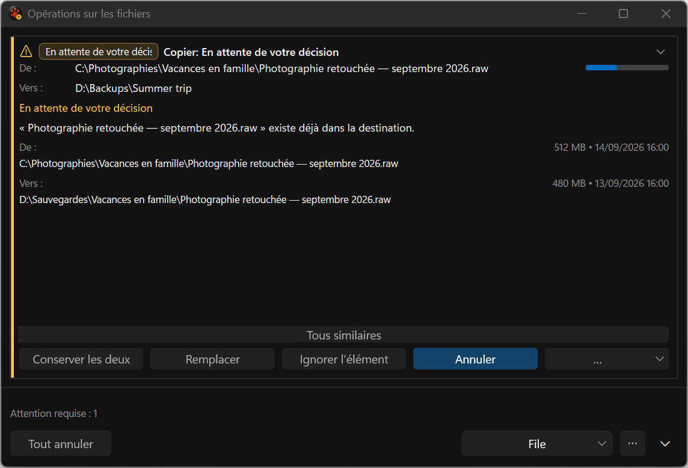
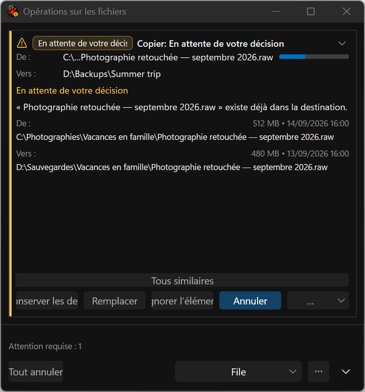

# Conflict actions — application captures, 19 September 2026

[Browse the gallery](gallery.html). These are **300 actual application-harness PNG captures across
119 deterministic static scenarios**, using the production renderer with synthetic presentation
models. They are not proposal mockups. The original review and ordinary-action pack remain intact.

The engine now publishes eligible collision actions in this order: Keep both, Replace, Skip, Cancel.
The French ordinary replacement label is **Remplacer**. Unavailable choices remain absent; Cancel
retains its safe default/Escape behavior. Scoped SkipAll stays in More. The native
[policy and integration evidence](../../../../../TestRuns/4cb089111a23/FileOps/2026-09-19_105819-i26-policy-candidate/README.md)
passes its focused Debug checks.

## Visual findings and remaining work

- At 760 DIP, scenario 33 shows all four French labels readable in the approved order.
- At 480 DIP, **Conserver les deux** and **Ignorer l'élément** clip. All actions are direct but the
  existing equal-width row still requires measured whole-button wrapping. This is evidence for the
  pending DxUi localized-layout fixture and consumer adoption, not visual acceptance.
- Source and destination are stacked. The richer full-width comparison, short-window body scrolling,
  readable status/footer text and visibly checked repeat-scope control remain unfinished.
- Both physical displays currently report 144 DPI. The second has only 648 physical pixels of work
  height. This captures two work areas, not fresh mixed-DPI or 96-DPI acceptance. September 16's
  native 96/144-DPI images remain historical evidence.
- This static run did not activate windows. Hover, focus and keyboard capture acceptance is separate;
  the focused Commands integration run used the existing notified desktop lease.

## Reproduction and provenance

`Run-AllTests.ps1 -Suite FileOps -CaseFilter FileOps_VisualGallery -Platform x64 -Configuration Debug
-TestRoot C:/RedSalamander.Perf -TimeoutMultiplier 3`, with `RSBuildEnableTests=true`.
Build: zero warnings/errors. Gallery passed 1/1, zero skips. Run:
`20260919T110356Z-72428-eb858098f6d448e8aafb8d4131e66e59`.
Full log: `C:/RedSalamander.Perf/evidence/i26-ui/i26-policy-gallery.log`.

[Manifest](capture-manifest.json) binds all PNG dimensions and SHA-256 values to source snapshot
`2a7136c4614ba746c09d426ba72792c9212510c290ccf6d2c4539667603e67f9`, build receipt
`2128d4c7009fe019ba5dabfd5043d411b16a99c2830941d8d85fa2a567688495`, HEAD
`a212edec433d658748ae1273cba68633c86de8b2` plus dirty inputs, and x64 Debug. The full receipt,
scenario/display tables and capture results are retained. The sandbox audit still reports 225
preserved pre-existing run directories; this run does not establish clean Full qualification.
