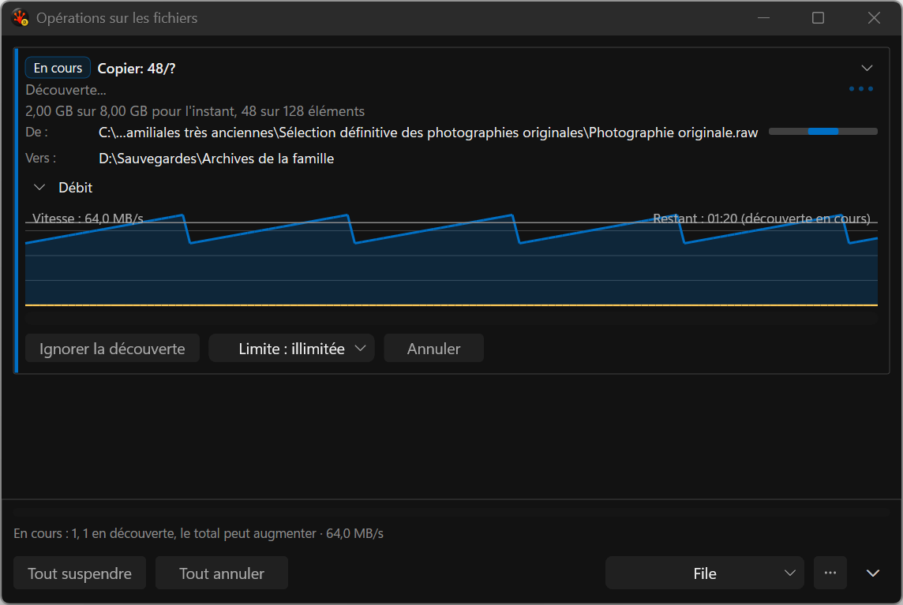

# French discovery action — before and after

Actual application captures from `cmd_pane_fileops_popup_throughput_disclosure`, using deterministic
running-copy data, long French paths, native 144 DPI, dark theme and reduced motion. Captures use
the governed harness without activation or desktop takeover. These are implementation evidence,
not proposal mockups. The [manifest](capture-manifest.json) binds each image to its build/workspace.

Before, at 480 DIP: the centered label is clipped within an 84-DIP button. Increasing window width
did not repair that fixed allocation.

After, the action receives the width of its actual hosted Body text plus 12 DIP padding per side.
One logical measurement is cached across paints and resizing. This makes the complete action
readable while preserving the speed-limit selector and Cancel target.

All four published images were inspected. The label fits at all three widths. The fixture also
resizes back to 480 DIP; its final capture replaces the initial 480 image while all timing rows
remain archived. The 480-DIP footer still clips text, long source paths remain elided, and graph
labels intersect plot content. These are remaining redesign work, not waived visual acceptance.

The [baseline archive](../../../../../TestRuns/4cb089111a23/Commands/2026-09-19_181400-i26-discovery-actions-baseline/README.md)
retains the failing geometry witness; the [candidate archive](../../../../../TestRuns/4cb089111a23/Commands/2026-09-19_181400-i26-discovery-actions-candidate/README.md)
retains the pass, unchanged fixture hash and paired Debug redraw data. Native mixed DPI, Release,
keyboard/UIA and general whole-button wrapping remain pending. Both implementation plans stay ACTIVE.

Reproduce with `RSBuildEnableTests=true` and `Tools/Run-AllTests.ps1 -Suite Commands
-CaseFilter cmd_pane_fileops_popup_throughput_disclosure -Platform x64 -Configuration Debug
-TestRoot S:/RedSalamander.Perf`. Archive artifacts before another run: automatically named completed
run directories can be removed by the runner's stale-run cleanup.
