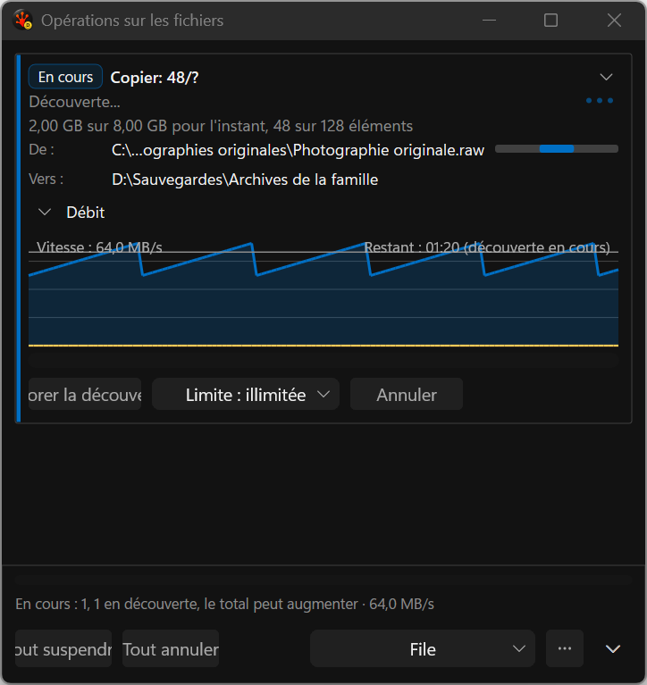
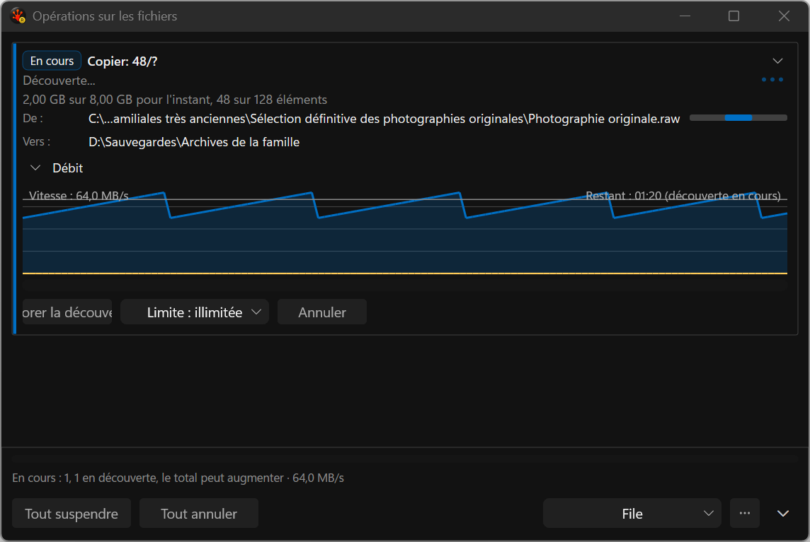

# French discovery progress — implementation evidence

These are actual production-popup captures from the deterministic application test harness. The
open-discovery fixture uses genuine `fr-FR` resources, long French paths, dark theme, reduced motion,
480/760-DIP widths and native 144 DPI. No desktop screenshot or focus takeover was used.

The retained unchanged-behavior witness failed because the French process rendered `2,00 MB of
8,00 MB so far, 3 of 13 items`. The candidate routes the same production render helper through the
active localized resource and asserts the complete sentence contains `pour l'instant` and `éléments`
with no `so far`. The focused progress contract and governed popup capture case pass.

Both images were inspected. The localized counter sentence is readable at both widths. They also
confirm unfinished adaptive layout work: the long source path truncates aggressively and the task
action row clips off the left edge, especially at 480 DIP. These images therefore qualify the
resource repair and capture path only; they are not P1 layout, mixed-DPI, keyboard/UIA or final visual
acceptance.

The screenshot helper found 1,952/387,172 expected foreground/background pixels at 480 DIP and
2,408/636,219 at 760 DIP. The [manifest](capture-manifest.json) binds image hashes, dimensions,
scenario, locale, DPI and the governed candidate workspace snapshot. Raw logs and complete runner
artifacts remain under `C:/RedSalamander.Perf/evidence/i26-ui/discovery-localization-*` and
`C:/RedSalamander.Perf/runs/discovery-localization-*`.

Reproduce with `RSBuildEnableTests=true` and
`Tools/Run-AllTests.ps1 -Suite Commands -CaseFilter cmd_pane_fileops_popup_throughput_disclosure
-Platform x64 -Configuration Debug -TestRoot C:/RedSalamander.Perf`.
