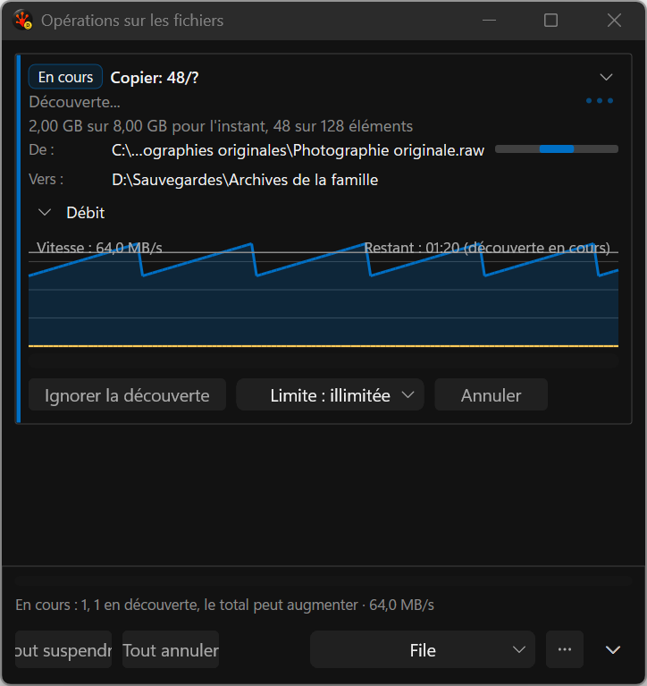
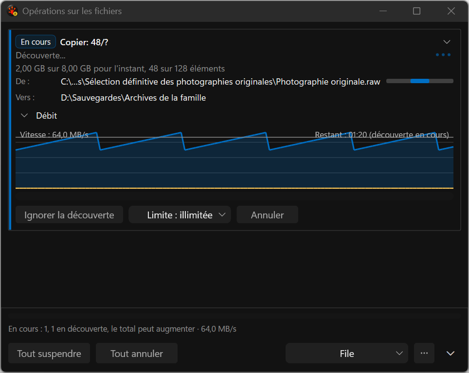

# French footer — before and after

These are actual deterministic application-harness captures, without activation or desktop takeover:
French running-copy fixture, long paths, dark theme, reduced motion, native 144 DPI. The
[manifest](capture-manifest.json) binds each PNG to its source/build identity. They are implementation
evidence, not generated concepts.

Before, the narrow window forces 72-DIP actions and clips the centered French labels:

After, action widths use their live hosted font plus 12 DIP padding per side. Pause/Resume reserves
the larger translated label. The mode selector uses the remaining space without losing its target.

All four images were inspected. Footer text is readable at all three widths; the final 480 capture
follows a resize back from 760. The guard checks actual padding, hit targets and absence of overlap.
Long paths still lose context, graph labels intersect plot content, and general whole-control
wrapping/measured footer height remain unfinished. These captures are not final visual acceptance,
native mixed-DPI, Release, or full paused/Resume/keyboard/UIA coverage.

The [baseline](../../../../../TestRuns/4cb089111a23/Commands/2026-09-19_184300-i26-footer-actions-baseline/README.md)
fails as expected and the [candidate](../../../../../TestRuns/4cb089111a23/Commands/2026-09-19_184300-i26-footer-actions-final/README.md)
passes with identical test source and paired Debug timing data. Both plans remain ACTIVE.

Reproduce with `RSBuildEnableTests=true` and `Tools/Run-AllTests.ps1 -Suite Commands
-CaseFilter cmd_pane_fileops_popup_throughput_disclosure -Platform x64 -Configuration Debug
-TestRoot S:/RedSalamander.Perf`. Preserve completed artifacts under the sandbox's evidence folder
before another run; stale-run cleanup can remove automatically named completed runs.
