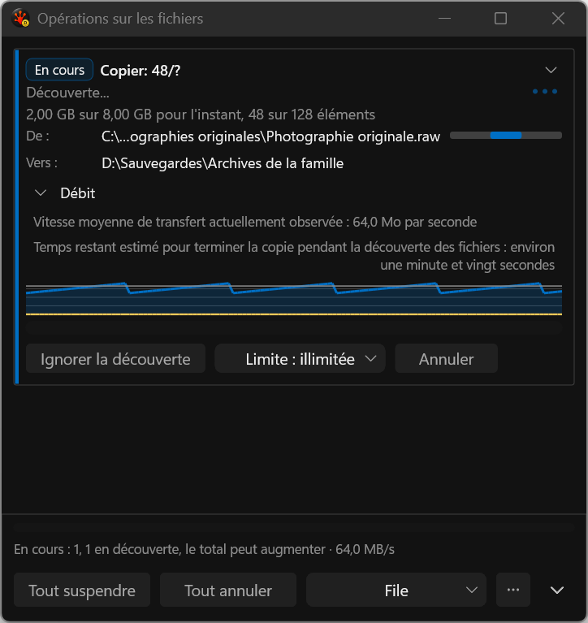

# Throughput labels above the plot

These are actual deterministic application-harness captures, not proposal mockups. Speed and remaining time occupy a measured text area above the history plot. Long labels stack vertically and wrap; the current-rate marker remains in the shared graph. The synthetic French example deliberately exceeds normal translation length.

| Evidence | Capture |
| --- | --- |
| Rejected intermediate: invisible centered labels | [760 DIP](rejected-hidden-labels__760dip__fr-FR__144dpi.png) |
| Shipping French discovery | [480 DIP](discovery-open__480dip__fr-FR__144dpi.png), [640 DIP](discovery-open__640dip__fr-FR__144dpi.png), [760 DIP](discovery-open__760dip__fr-FR__144dpi.png) |
| Normal expanded graph | [760 DIP](throughput-expanded__760dip__fr-FR__144dpi.png) |
| Synthetic long French, stacked and wrapped | [480 DIP](graph-labels-stacked__480dip__fr-FR__144dpi.png) |

All six images were visually reviewed. Native DPI is 144 on this machine; this is not a mixed-DPI pass. Pixel probes require visible text in each exact label rectangle, and DirectWrite bounds checks include vertical placement. The long-text fixture additionally checks complete UIA names, help and stable IDs. The three repeated corrected bounds checks report zero visible overflow; invisible trailing whitespace is recorded separately.

The [previous actual capture](../2026-09-19-single-surface/throughput-uncovered__760dip__fr-FR__144dpi.png) shows the history line crossing the label area. The rejected candidate above shows why successful EndDraw/state assertions alone are insufficient.

The [24/24 normal UI run](../../../../../TestRuns/4cb089111a23/Commands/2026-09-19_222308-i26-graph-labels-final-ui/README.md) and [3/3 French stress run](../../../../../TestRuns/4cb089111a23/Commands/2026-09-19_223447-i26-graph-labels-french-verified/README.md) retain full provenance. The latter still had one initializer warning, subsequently fixed with explicit array braces; warning-repair.json records that distinction. Resource/performance comparisons retain all A/B repetitions; timing acceptance remains open.

This is one implemented slice. Full-path keyboard access, remaining adaptive/conflict/Issues work, Release/Full, native mixed-DPI and final performance qualification remain open in I26. No canonical DxUi source, API or consumer pin changed here.
