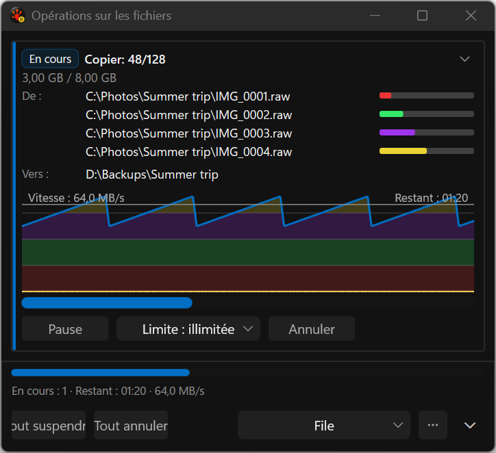
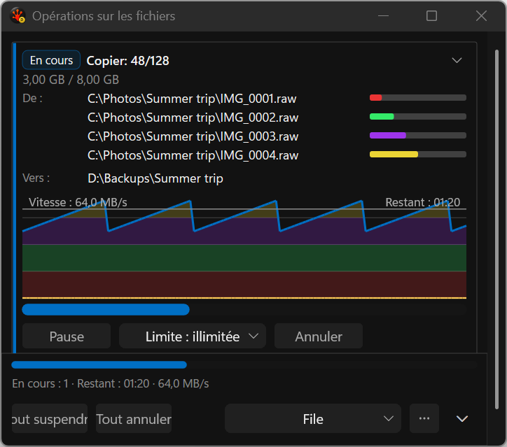

# Ordinary task actions — first implementation slice

The missing ordinary action row is restored. These are **actual application-harness captures** using
synthetic presentation fixtures and the production renderer, not proposal mockups.

- [Browse all 300 captures](gallery.html), covering 119 static scenarios in French.
- [Capture provenance and image hashes](capture-manifest.json), [scenario map](scenarios.tsv),
  [display map](displays.tsv), [build receipt](build-receipt.json), [capture result](capture-results.json).
- [Matched native regression and redraw evidence](../../../../../TestRuns/4cb089111a23/FileOps/2026-09-19_103033-i26-actions-candidate-v2/README.md).

The native regression passed the real geometry/hit-target checks and the existing pause, resize,
resume and cancellation sequence. The ordinary row now has its own 24-DIP height, independent of
conflict rows. Conflict policy, graph disclosure and measured French action wrapping are still pending.

Both monitors currently report **144 DPI**: DISPLAY1 is 3840×2160; DISPLAY5 is 2560×720, with a
648-pixel work-area height. The harness and a separate read-only per-monitor DPI query agree.
This run therefore verifies two monitor sizes, **not mixed DPI**. September's native 96-DPI evidence
remains historical; fresh 96-DPI acceptance is still required. No display settings were changed.

Reviewed representatives show the action row on both displays. At minimum width, footer labels still
clip. The short second display still requires list scrolling. These remain adaptive-layout work;
capture success does not mark them resolved. The interactive focus/hover lane was not rerun for this
slice. All captures used the non-activating harness; no desktop screenshot or takeover was used.





Reproduce from the repository root, with an initialized test sandbox and `RSBuildEnableTests=true`:

```powershell
./Tools/Run-AllTests.ps1 -Suite FileOps -CaseFilter FileOps_VisualGallery -Platform x64 -Configuration Debug -TestRoot C:/RedSalamander.Perf -TimeoutMultiplier 3
```

The capture run passed (1/1), with zero build warnings/errors. The rejected `-SkipBuild` attempt
produced no captures: the runner requires a full-solution receipt for that mode, whereas these focused
runs publish application-target receipts. Use the normal governed runner; do not bypass attestation.
The independent sandbox audit still lists 225 unrelated pre-existing run directories.
