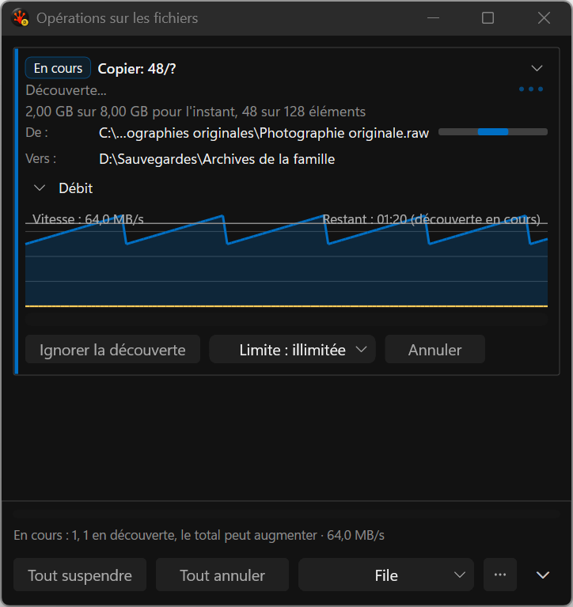
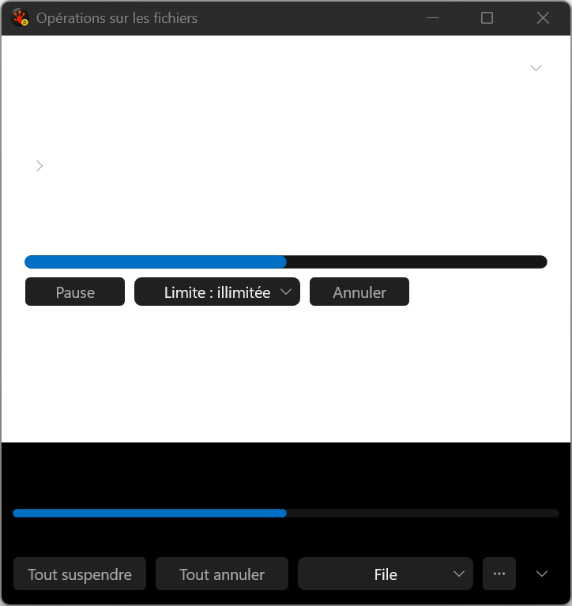

# Full-path access — focused implementation evidence

Ordinary running and completed source/destination rows now expose their full localized label and
Unicode path through the existing tooltip and UI Automation regions. The text is attached to the
same rectangle as its abbreviated display. Running Copy/Move shows the destination folder; a
completed task shows its recorded destination file. Bounded in-flight row slots update with the
current snapshot; replaced, retired and empty paths leave the current tree.

The unchanged French fixture fails before and passes in two candidate runs of three repetitions.
It checks actual raw UIA names/help, displayed-row IDs and positive visible screen bounds at
480/640/760/480 DIP, two active files including a supplementary Unicode character, replacement,
retirement, Delete, completed destination values and empty paths. The existing disclosure,
persistence, footer/discovery action and screenshot-content checks also pass in both candidates.
This does not implement keyboard copying, complete visible path detail or the conflict redesign.
Hover display and assistive-technology interaction remain to be qualified.

## Actual application captures

These are unmodified WGC captures made by the application's deterministic test harness, on native
144 DPI, French, dark theme and reduced motion. They do not activate the window. All four images
below were reviewed and are bound to source/build/run identities in [the manifest](capture-manifest.json).
The three successful images come from the final repetition. They show the retained visual layout;
the full-path semantic improvement is established by UIA assertions, not by these resting images.
Graph labels still overlap the plot and remain an open layout defect.

## Retained failure and performance limits

The repeated unchanged baseline lost legacy text/background while hosted controls remained. Its
three repetitions were rejected with `0x8007000D`, foreground/background probe counts both zero.
This is a failed capture, not an accepted representation of the UI or evidence of a path repair.
The recorded legacy EndDraw HRESULT stayed S_OK; that does not establish correct presentation.
The final candidate recovered without a renderer/harness change. The intermittent cause remains
unattributed and requires a focused follow-up, not more identical retries or weaker probes.

[All four runs and ordered samples](../../../../../TestRuns/4cb089111a23/Commands/2026-09-19_200946-i26-path-access-candidate-repeat/all-series.json)
retain the initial timing flags and the invalid capture repeat. The original baseline's twenty
eight-redraw batches have median 66,520 us and p95 67,643 us. Final candidate repetitions have
medians 66,328 / 66,327 / 66,572.5 us and p95 67,210 / 66,985 / 67,229 us. The first candidate's
p95 values were 133,511 / 67,286 / 131,318 us. Do not discard those spikes or pool the repetitions.
The failed baseline repeat has medians around 374 ms and cannot clear a non-regression gate.

These are focused Debug diagnostics. Release, Full qualification, native mixed DPI, presented FPS,
allocation/idle budgets and final performance acceptance remain open. The independently launched
Release application was preserved. No DxUi API, source, pin or library gallery pixel changed.
