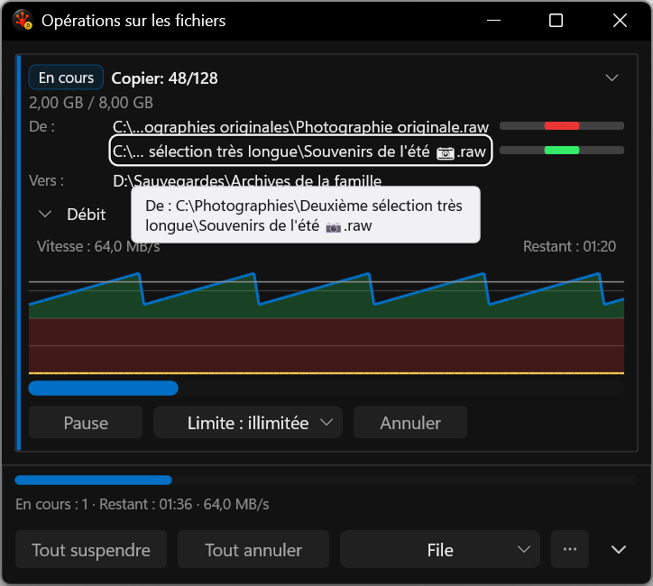

# Exact path access by keyboard

These are actual application-harness captures. A focused path reveals its complete localized value; Ctrl+C copies the exact provider path without the label or middle ellipsis. Tab and Shift+Tab follow the displayed order. Enter/Space reveal the detail, and Escape first dismisses it. Updating a row preserves its stable focus identity; removing it moves focus to a live control without invoking an action.

| State | Capture |
| --- | --- |
| Rejected intermediate: missing focus outline | [Rejected](rejected-missing-focus-outline.png) |
| Final French / Unicode keyboard focus | [480 DIP, native 144 DPI](path-keyboard-focused__480dip__fr-FR__144dpi.png) |

Both images were visually reviewed. Final acceptance requires a visible contrasting focus-outline pixel probe and acknowledged UIA focus, not only a host pointer. The native harness preserves the notification/desktop lease and cursor/foreground restoration. The clipboard fixture snapshots available formats before mutation and checks restoration; the initial restoration failure and compile-only attempt remain in TestRuns. All other captures in the native run remain non-activating.

This qualifies the captured path lengths and exact-copy interaction. A scrollable/selectable detail surface for arbitrary long values, screen-reader review, physical mixed-DPI, Release/Full and final performance acceptance remain open in I26. No canonical DxUi code/API/pin changed.

[path-keyboard-initial](../../../../../TestRuns/4cb089111a23/Commands/2026-09-19_233323-i26-path-keyboard-initial/README.md).

[path-keyboard-focus](../../../../../TestRuns/4cb089111a23/Commands/2026-09-19_234515-i26-path-keyboard-focus/README.md).

[path-keyboard-final](../../../../../TestRuns/4cb089111a23/Commands/2026-09-19_235421-i26-path-keyboard-final/README.md).
