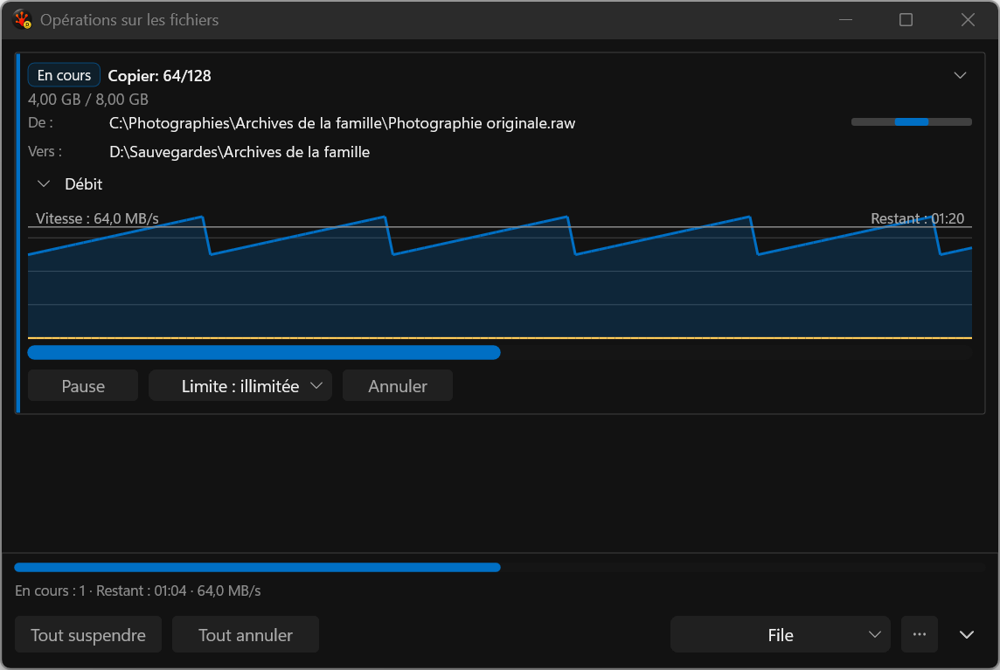

# One client presentation: capture repair

These are actual application screenshots produced by the deterministic WGC test harness, not
proposal mockups. The final eight-case x64 Debug run passes 24/24 (three repetitions per case).
The manifest records the immutable source/build identities and each PNG digest. All images were
visually reviewed; the final covered and 480-DIP discovery PNGs also exactly match the reviewed
intermediate images from the same production code.

The rejected baseline lost all legacy text/background while the hosted controls survived. Every
recorded legacy draw returned S_OK and its post-draw occlusion flag was set; target/client sizes
matched. The popup now prepares text/chrome as a command list on the existing DxUi device and
presents it with the controls. The retained failure does not establish why Windows/driver occlusion
changed between processes. Capture retries and pixel requirements were not relaxed.

The cover is an owned, disabled, non-activating sibling confined to the popup footprint. It is
removed before the uncovered capture. No desktop screenshot, focus takeover or independent app
termination is used. All images are native 144 DPI; width changes are not mixed-DPI qualification.

| Evidence | Image |
| --- | --- |
| REJECTED baseline: missing legacy layer | [480 DIP](rejected-legacy-occlusion__480dip__fr-FR__144dpi.png) |
| Final collapsed card | [480 DIP](throughput-collapsed__480dip__fr-FR__144dpi.png) |
| Final covered popup | [760 DIP](throughput-covered__760dip__fr-FR__144dpi.png) |
| Final uncovered popup | [760 DIP](throughput-uncovered__760dip__fr-FR__144dpi.png) |
| Final French discovery | [480 DIP](discovery-open__480dip__fr-FR__144dpi.png), [640 DIP](discovery-open__640dip__fr-FR__144dpi.png), [760 DIP](discovery-open__760dip__fr-FR__144dpi.png) |

The graph line still overlaps the speed/ETA label lane, and resting paths remain abbreviated.
Keyboard access to exact paths, remaining adaptive layout, device recreation, hidden/idle resources,
matched performance, Release and physical mixed-DPI gates remain open. The six accepted product
decisions and both implementation plans remain active.

Evidence: [final 24/24 run](../../../../../TestRuns/4cb089111a23/Commands/2026-09-19_211202-i26-paint-single-surface-qualified/README.md),
[rejected diagnostic baseline](../../../../../TestRuns/4cb089111a23/Commands/2026-09-19_204901-i26-paint-boundary-covered/README.md),
[intermediate stale-fixture failures](../../../../../TestRuns/4cb089111a23/Commands/2026-09-19_210624-i26-paint-single-surface-validation/README.md).
The final archive preserves the earlier compile/selector failures and original sandbox advisory,
plus the clean audit after the failed-build directory was preserved under the evidence root.
