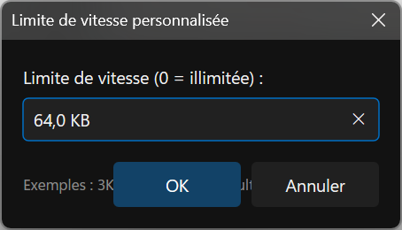
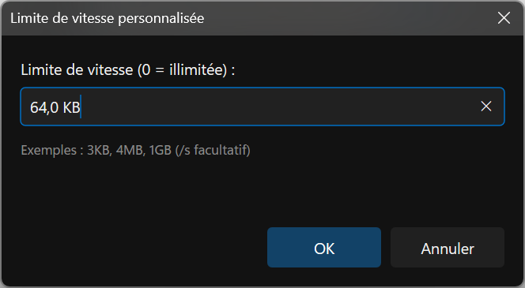
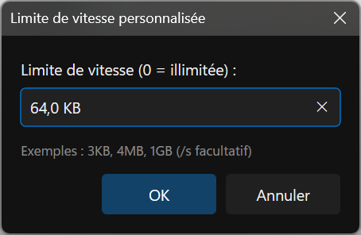
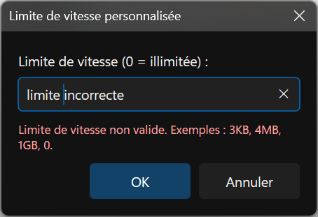
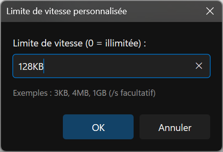

# French custom-speed dialog — measured reflow

Actual application-harness captures from the governed modal test, using French resources and native
144 DPI. The existing warning, desktop lease and restoration govern foreground use. No desktop
screenshot or simulated native-DPI claim is used. The [manifest](capture-manifest.json) binds all
five PNGs to source/build identities; these are implementation evidence, not proposal mockups.

The baseline's requested 300x142-DIP client puts the action row over the help text:

The final implementation measures label and help/error height, preserving separate input and action
rows. It creates on the owner's monitor before centering, preventing a default creation location
from choosing an unrelated initial DPI. The constrained dialog grows to fit its content; correction
does not shrink it while the user is editing.

All five images were inspected. Label, input, help/error and actions are readable and separated.
Images are from repetition three; all 60 timing samples and all three case results remain archived
even though the named captures are overwritten per repetition. The [four-run comparison](../../../../../TestRuns/4cb089111a23/Commands/2026-09-19_194500-i26-speed-layout-candidate-repeat/README.md)
retains the initial timing flag and both matched pairs. Native 96/144 transitions, an extremely
short-work-area scrolling fallback, live locale changes, Release and full keyboard acceptance remain
open. Both implementation plans stay ACTIVE.

Reproduce with `RSBuildEnableTests=true` and `Tools/Run-AllTests.ps1 -Suite Commands
-CaseFilter cmd_pane_fileops_speedLimit_prompt_uses_dxui_surface -SelfTestRepeat 3 -Platform x64
-Configuration Debug -TestRoot S:/RedSalamander.Perf`. Preserve artifacts under the sandbox's evidence
folder before another run. The case uses the existing modal foreground warning and desktop lease.
