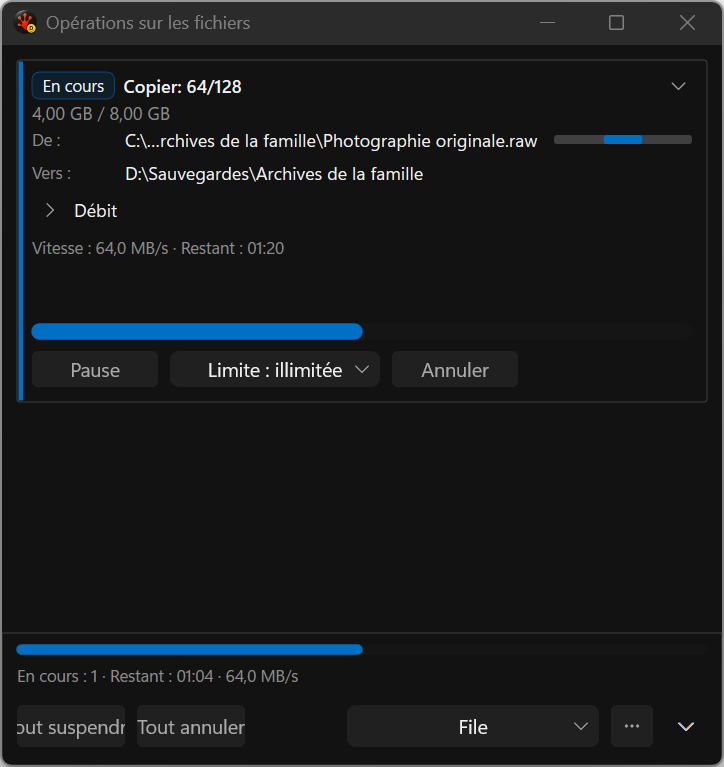
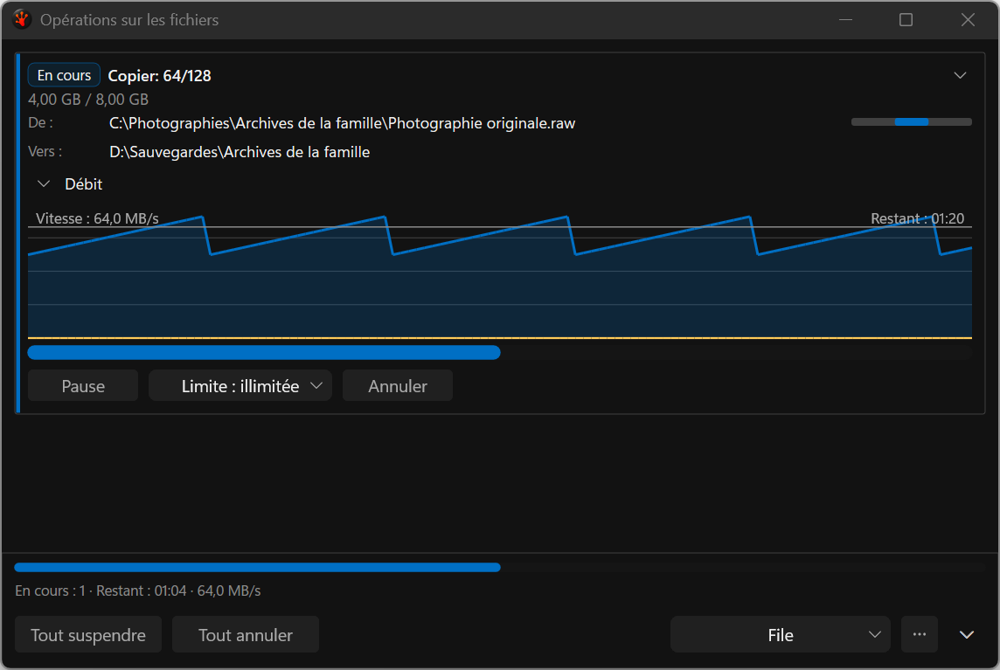

# Throughput capture validation — 19 September 2026

Eight actual application-harness images cover expanded/collapsed throughput at 480/760 DIP in
x64 Debug and test-enabled Release, dark theme, genuine French resources and native 144 DPI.
Every image was inspected. Both configurations now show the destination folder and readable legacy
text alongside the hosted controls. The [manifest](capture-manifest.json) binds hashes, dimensions,
locale and exact build/source identities. These are not mockups or full redesign acceptance.

## Capture integrity

Earlier [rejected images](../2026-09-19-throughput-disclosure/README.md) contained white/blank legacy
content despite passing state assertions. The defect is intermittent: adding probes alone produced
readable captures, including three repeated Debug cases, before the repaint change. Therefore a
Debug-only root cause or a proven renderer repair must not be inferred from the later passes.

The shared harness now accepts caller-owned color witnesses in client pixels. This fixture requires
both legacy label text (at least 8 pixels) and background (at least 100 pixels), with channel
tolerance 12. All final captures report 35 foreground and 4859 background matches. On mismatch the
helper retains the diagnostic PNG and requests a fresh non-activating paint while WGC is active,
with at most three frame attempts. It fails if the witness remains absent. The absent-magenta
negative control passes by correctly rejecting its capture; it is kept in raw test artifacts, not
the UI gallery. This establishes detection/rejection, not a reproduced transient recovery claim.

The fixture's native Debug suite passes 3/3, zero skips; Release passes 1/1, zero skips. Both builds
have zero warnings/errors and both sandbox audits are clean. Native layer checks cover 12 Debug
captures across the repetitions and 4 Release captures. Repetitions overwrite the same four PNG
names; all per-case results and all 16 witness rows remain retained. No desktop screenshot or focus
takeover was used. Other capture callers without probes still require independent inspection.

## Remaining UI work

The 480-DIP footer still clips its longer actions. Source paths still use the legacy truncation;
measured layout, full-width conflict comparison and complete path access remain open. The disclosure
label remains static beside its chevron. This pack does not qualify other themes, physical mixed
DPI, keyboard/UIA, full screenshot inventory or final performance/resource gates. The original
intermittent layer loss remains unattributed; a future rejected capture is a real failure to inspect.

## Reproduction and provenance

Set `RSBuildEnableTests=true`; run `Tools/Run-AllTests.ps1 -Suite Commands -Configuration Debug
-Platform x64 -CaseFilter cmd_pane_fileops_popup_throughput_disclosure -SelfTestRepeat 3
-TestRoot S:/RedSalamander.Perf`. Release uses `-Configuration Release` without the repeat option.

- [Pre-retry observation](../../../../../TestRuns/4cb089111a23/Commands/2026-09-19_170347-i26-capture-probe-baseline/README.md)
- [Final Debug evidence](../../../../../TestRuns/4cb089111a23/Commands/2026-09-19_170817-i26-capture-guard-debug/README.md)
- [Final Release evidence](../../../../../TestRuns/4cb089111a23/Commands/2026-09-19_171219-i26-capture-guard-release/README.md)

Both final builds bind source snapshot `3860bf5dceaa9fab857b1d13cc5f617efe7e24c8ebbdcac63fc5dd74a7e9212f`.
Production UI/library inputs and the consumer pin are unchanged by this harness-only slice.
