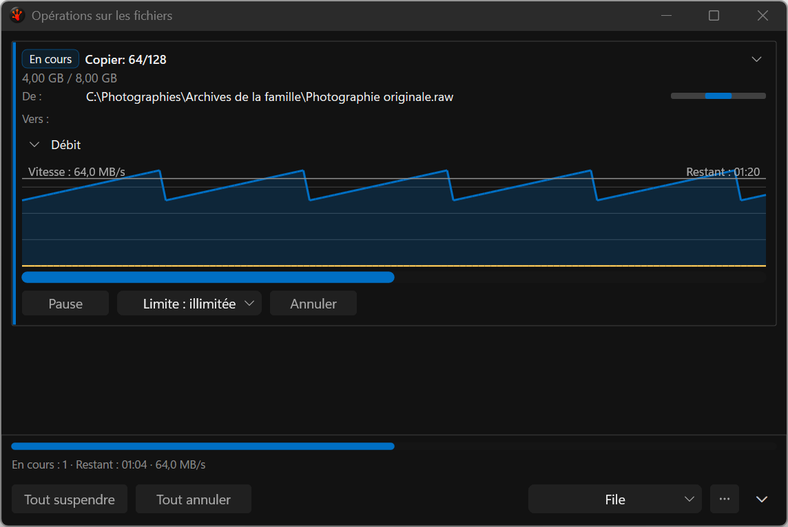
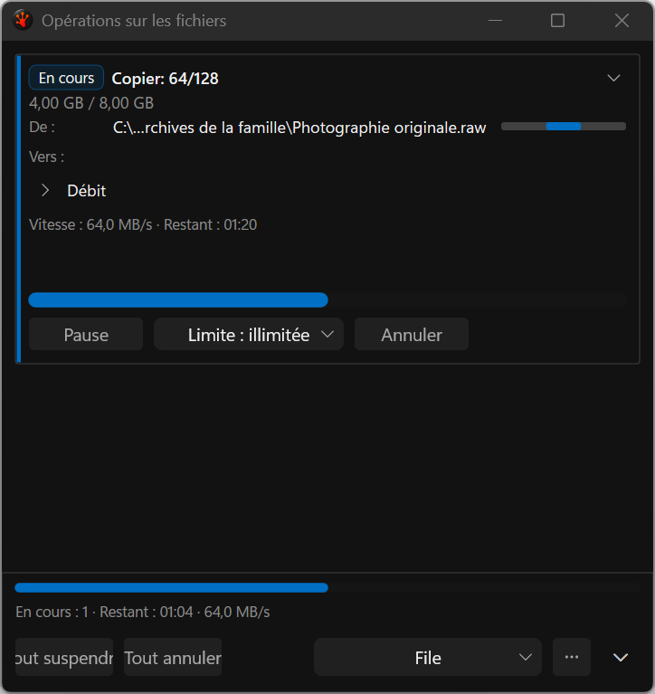

# Throughput disclosure — partial implementation evidence

Later [validated Debug/Release captures](../2026-09-19-throughput-capture-validation/README.md) supersede
this pack for current throughput display. This pack preserves the rejected frames and earlier fixture.

These are production-popup screenshots from the deterministic application test harness, not
mockups. The four [Release captures](screenshots/scenarios.tsv) show expanded/collapsed states at
480/760 DIP, dark theme, genuine French resources and native 144 DPI. All four were visually
inspected. The [manifest](capture-manifest.json) binds every PNG to its exact source/build receipt.

The disclosure preserves the outer window, keeps rate/ETA and actions available when collapsed,
and remembers the last explicit choice. Other live cards retain their own choice. Collapsed cards
remove their retained graph control; this does not establish a measured FPS improvement.

## Findings and limits

- Release text is readable in both states. The narrow footer still clips its longer actions.
- The Release fixture omitted `destinationFolder`, leaving `Vers :` empty. The final fixture now
  supplies it; those Release images remain accurately bound to the earlier source, not the correction.
- All four corrected-fixture Debug images in [rejected-debug](rejected-debug/scenarios.tsv) lose the
  legacy Direct2D text/background while retaining hosted controls. They are diagnostic failures,
  despite a passing state test and no failed EndDraw metric. Do not use them as an accepted gallery.
  Theme/language setup before popup creation did not fix Debug. The exact reproduction is below.
- Only the chevron is currently the disclosure hit target; the adjacent label is static. Full
  labelled activation, UIA ExpandCollapse and physical keyboard checks remain open.
- Legacy fixed card heights leave excess space; measured layout remains P1 work. Expanded zero/unknown
  graph text is still gated by the library's positive current-value marker. Collapsed unknown values
  use explicit rate/time-unavailable labels.
- These images establish neither fresh mixed-DPI nor light/high-contrast/long-path acceptance.

## Reproduction and evidence

Run `Tools/Run-AllTests.ps1 -Suite Commands -CaseFilter cmd_pane_fileops_popup_throughput_disclosure
-Configuration Debug -Platform x64 -TestRoot S:/RedSalamander.Perf`. For Release, set
`RSBuildEnableTests=true` explicitly before the same command with `-Configuration Release`.
The fixture uses `SaveWindowScreenshot`; its own windows use `SW_SHOWNOACTIVATE`, with no desktop
screenshot or focus takeover. Keep the runner's existing desktop lease/notification policy intact.

The [Debug state result](../../../../../TestRuns/4cb089111a23/Commands/2026-09-19_164036-i26-throughput-ui-debug/README.md)
and [Release result](../../../../../TestRuns/4cb089111a23/Commands/2026-09-19_163216-i26-throughput-ui-release/README.md)
each pass 1/1, zero skips and zero sandbox audit issues; both builds have zero warnings/errors.
The [retained baseline comparison](../../../../../TestRuns/4cb089111a23/Commands/2026-09-19_161917-i26-throughput-ui-first/README.md)
is a focused Debug redraw diagnostic. Full repository, resource, input and visual acceptance remain open.
