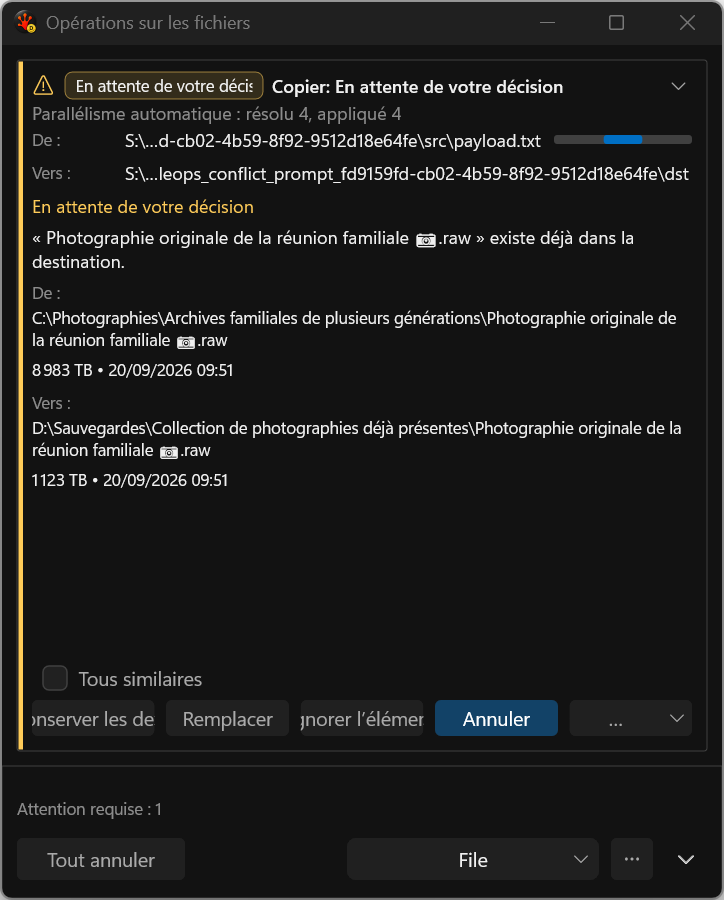
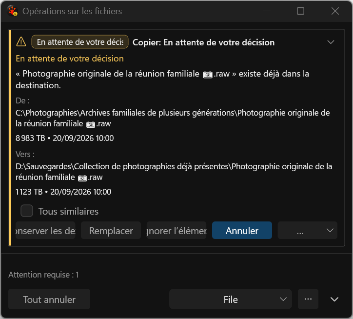
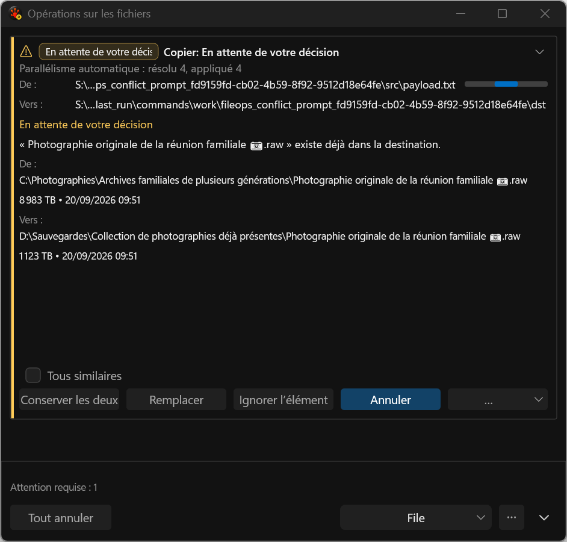
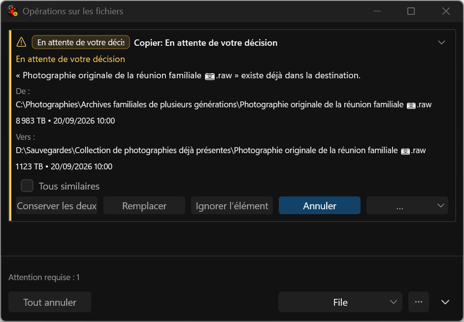
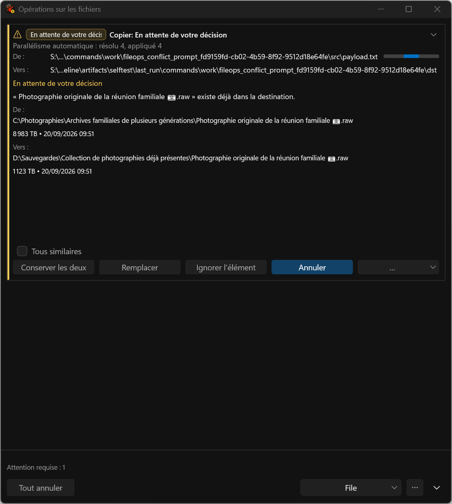
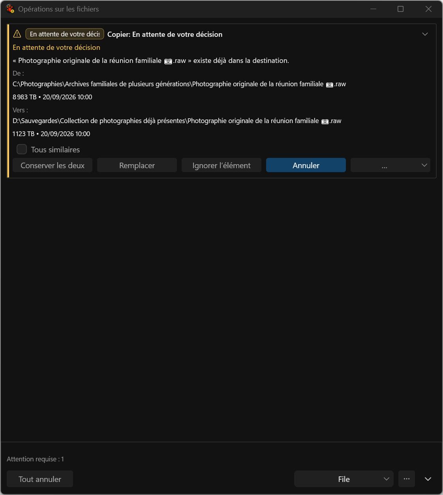

# Conflict decisions replace ordinary transfer details

These six application-harness captures were visually reviewed at native 144 DPI. Before, a pending decision retained ordinary source/destination paths, a mini-progress bar and concurrency text above the actual conflict. After, the decision context follows the card header directly. The card height uses its measured decision body, repeat-scope row and published action row instead of reserving the ordinary transfer/graph body.

The exact stacked paths and complete metadata remain; engine action/default/Escape rules are unchanged. The fixture checks the actual hosted tree because the old policy-only progress flag already reported false while the mini-bar was visibly painted. The unchanged baseline fails all three repetitions, the focused candidate passes 3/3 and the final nine-case set passes 25/27. Throughput repetitions 2 and 3 fail before clipboard mutation while retaining HTML Format (49344), HRESULT 0x800401D3; broad acceptance remains open. Baseline eight-redraw medians: 66,603 / 66,599 / 66,545 us; candidate: 66,570 / 66,559 / 66,552 us. Full samples/p95 and caveats remain in the [run comparison](../../../../../TestRuns/4cb089111a23/Commands/2026-09-20_095955-i26-conflict-clean-final/comparison.json).

French actions still clip at 480 DIP and the status badge truncates. Separate filename/parent fields, action wrapping, short-window scrolling and Issues redesign remain required. The outer window follows existing saved/requested geometry and can still contain unused space. These captures do not establish native mixed-DPI, screen-reader, Release or final performance/resource acceptance.

## 480 DIP

## 640 DIP

## 760 DIP

