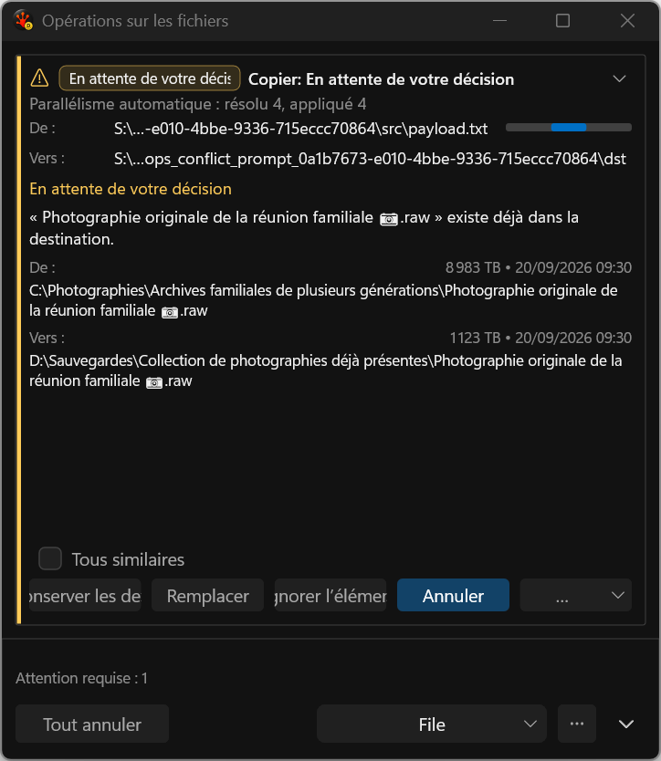
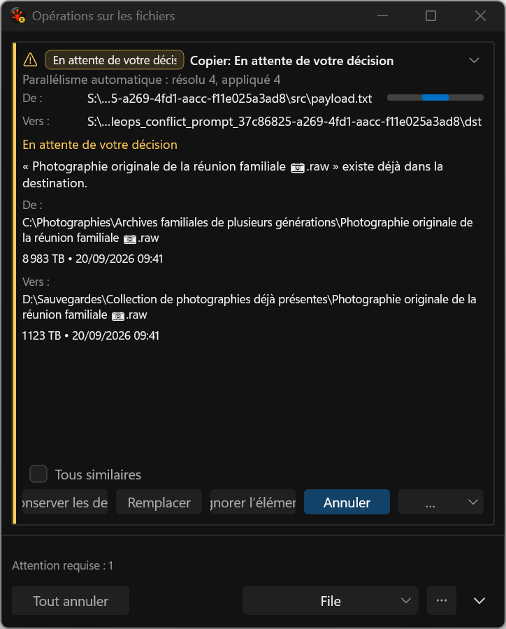
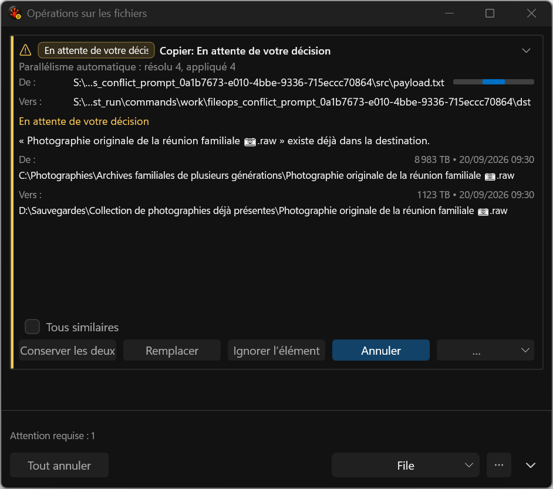
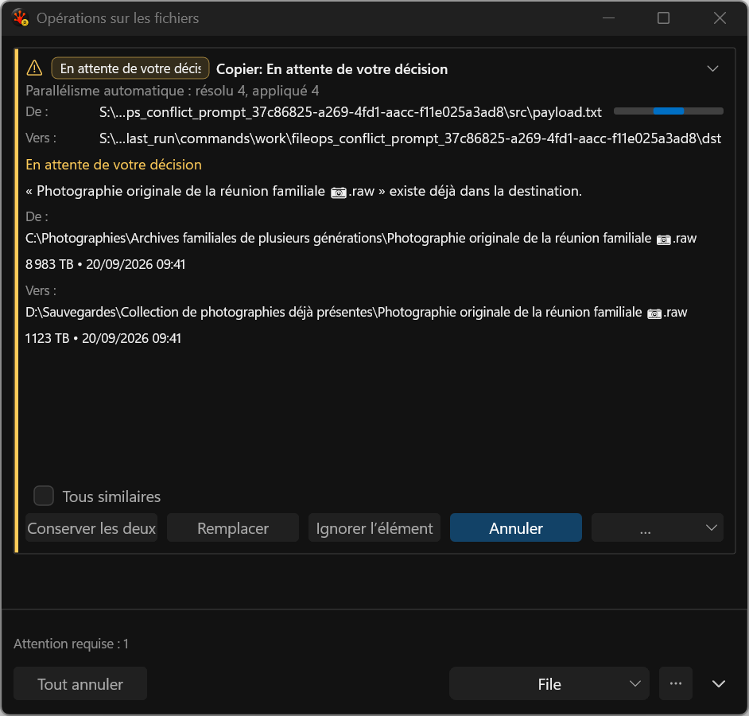
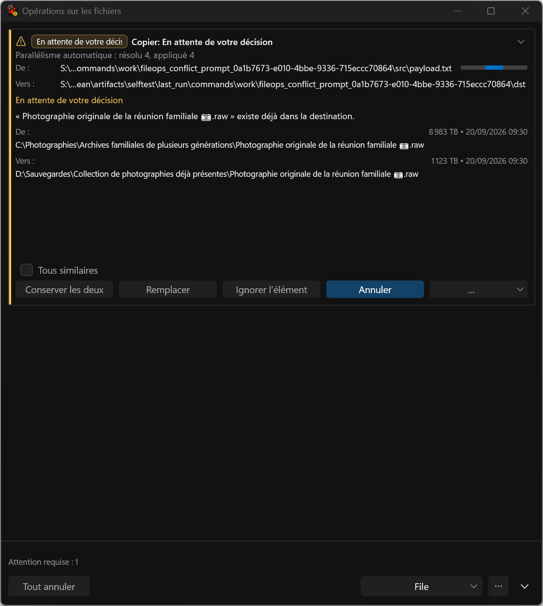
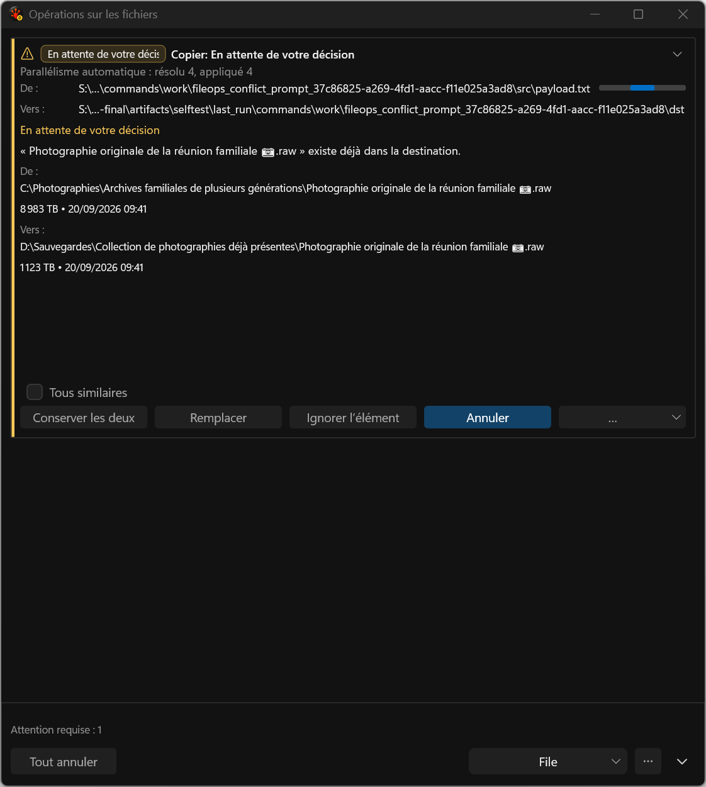

# Full-width conflict metadata rows

Actual application-harness captures, visually reviewed at native 144 DPI. The previous presentation placed size/date beside the heading in at most 48% of the content width. The implemented presentation gives each incoming/existing size/date value a complete wrapped row below its exact path, using the normal text foreground. This improves comparison width and exposes each metadata value through a stable, separate accessible role.

This is a bounded implementation step. At 480 DIP the French actions still clip; the waiting badge truncates, ordinary progress remains duplicated above the decision, and large empty space remains. Separate provider-qualified filename/parent fields, adaptive actions, short-height scrolling, general path detail and Issues redesign are still required. These images do not establish mixed-DPI or screen-reader acceptance. Timestamps and scratch paths come from the seeded real task; they are not frozen pixel inputs.

The clean old-renderer baseline fails 0/3 as expected at the new semantic requirement; the focused candidate passes 3/3 and the final nine-case regression set passes 27/27. Clean baseline and focused candidate use identical fixture bytes. Eight-redraw Debug medians are 66,526 / 66,560 / 66,621 us before and 66,523 / 66,528 / 66,581 us after; all samples/p95 and failed attempts are preserved. Changed card height means this is the same scenario, not equal rendered pixel area or final performance acceptance.

## 480 DIP

## 640 DIP

## 760 DIP

[Complete run comparison](../../../../../TestRuns/4cb089111a23/Commands/2026-09-20_094101-i26-conflict-rows-final/comparison.json).
