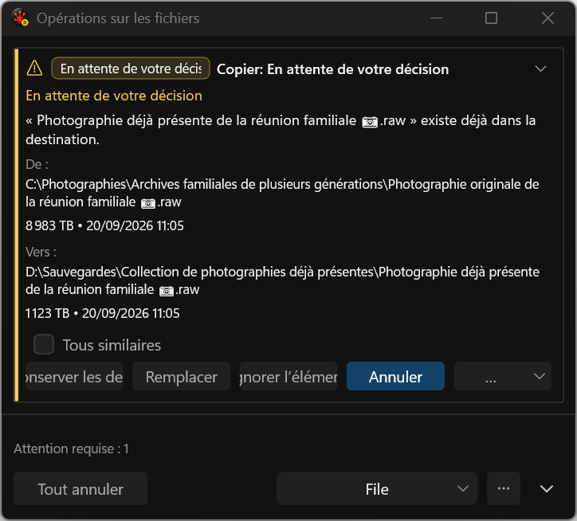
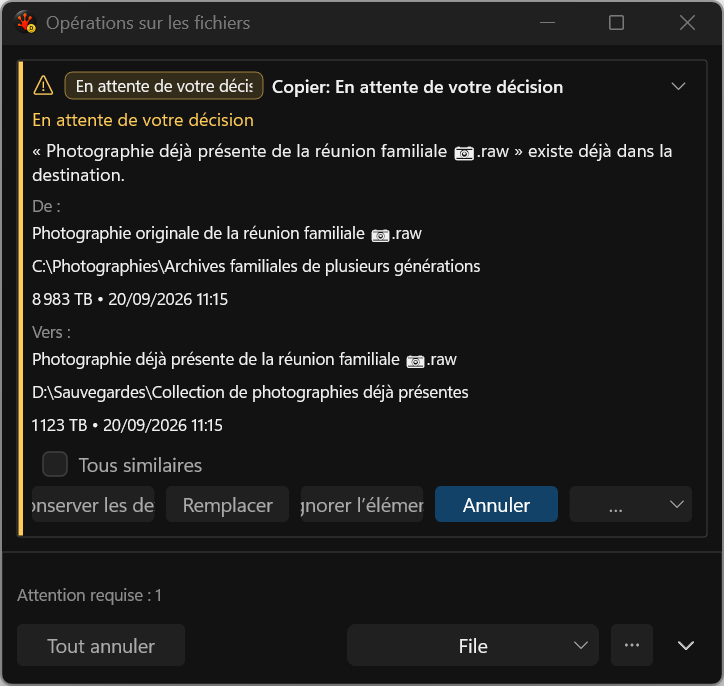
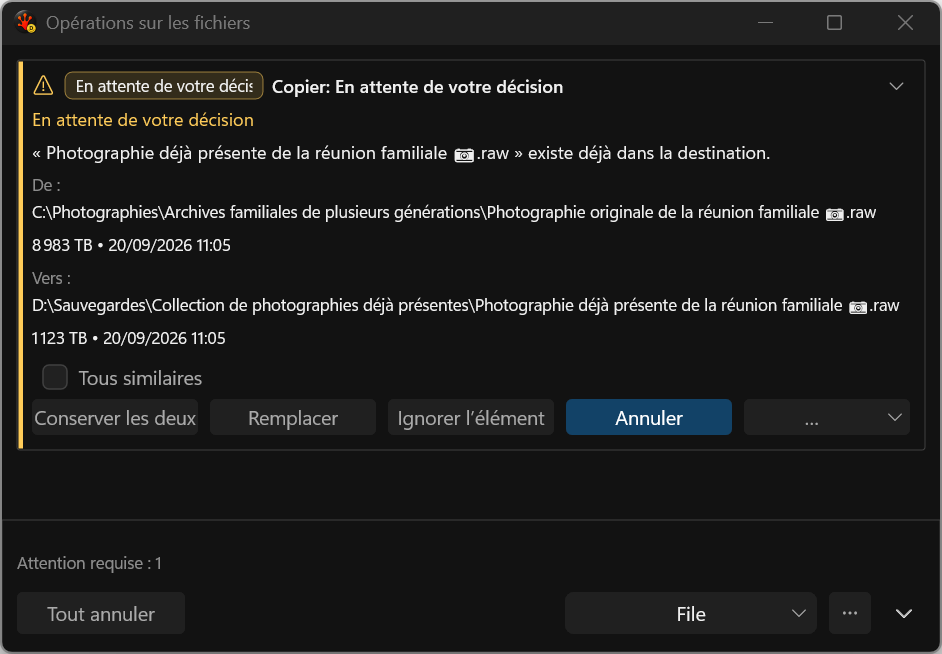
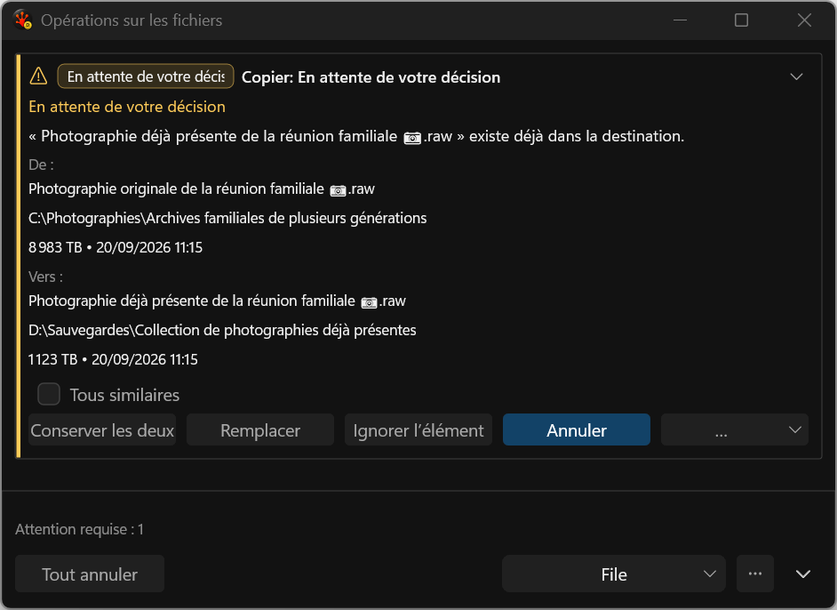
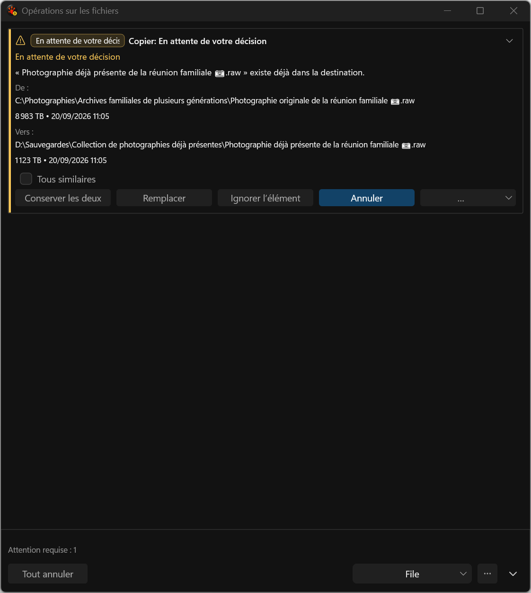
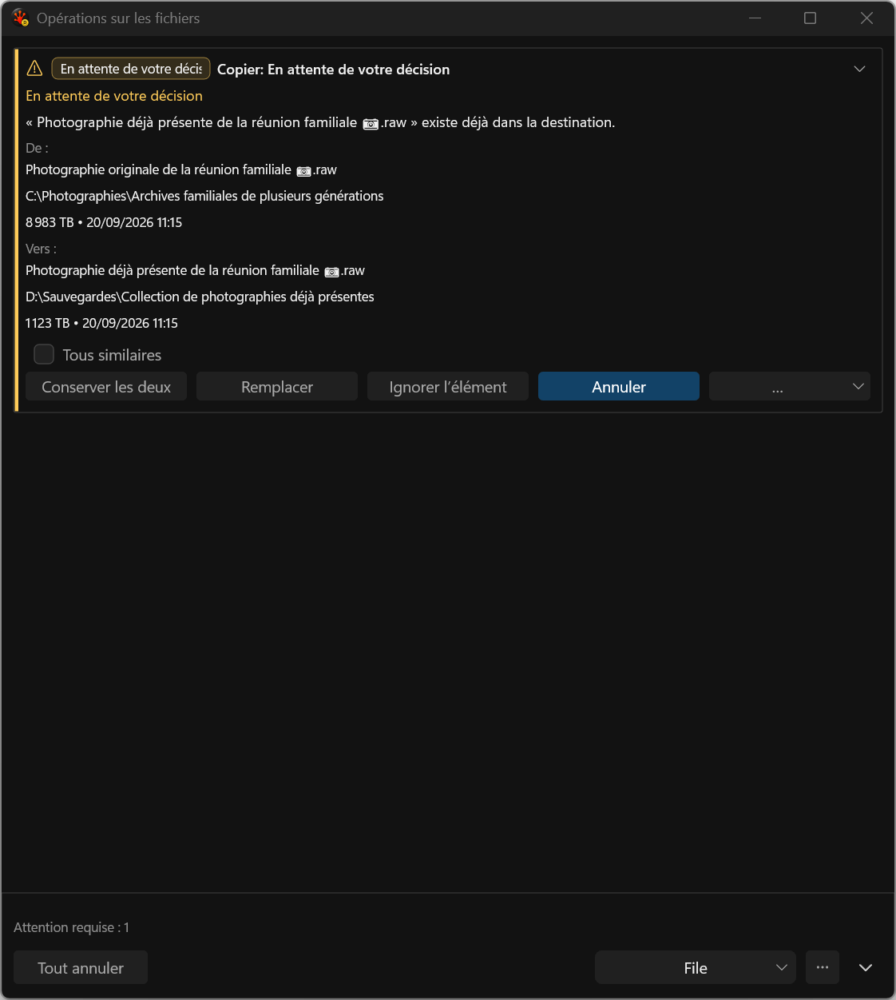
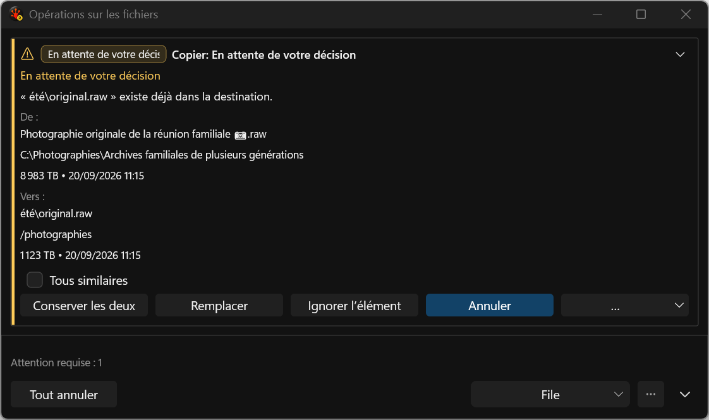
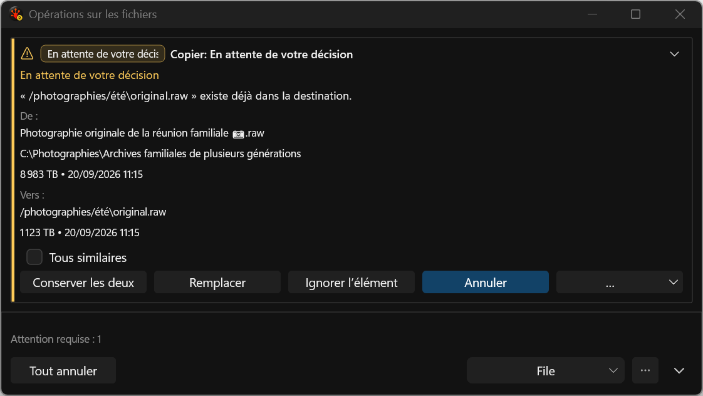

# Separate conflict filenames and locations

These application test-harness captures show the incoming filename and parent location on separate full-width rows, followed by metadata, with the existing item below. Names and locations wrap independently. Before, both were combined into one path paragraph. The new presentation makes long file names easier to compare without sacrificing location width.

The worker computes display facts from the selected transfer/delete item's admitted source and destination profiles. It never splits arbitrary provider paths using host filesystem rules. Missing profiles, unknown item identity, namespace roots and rename schedules keep the exact full path. The question uses the same qualified filename or the exact path fallback. This is display data only; action authority, defaults and decisions do not change.

The original renderer fails **0/3**; the first candidate passes **6/6**; the final eleven-case Debug set passes **33/33**, zero skips. The pure provider case checks multi-plan selection, different endpoint rules, literal backslashes in slash-only filenames, nested collisions and fallback cases. Real task publication, ordered full-width semantic rows and metadata pixels are covered. [All timing repetitions](../../../../../TestRuns/4cb089111a23/Commands/2026-09-20_111505-i26-conflict-paths-final/comparison.json) remain retained; changed painted work and Debug timings do not establish final Release FPS/resource acceptance.

French action labels and the status badge still clip at narrow width. Short-window scrolling, complete path selection/copy, remaining conflict/Issues design, fresh mixed-DPI and assistive-technology acceptance remain open. These are actual captures, not proposal mockups. The real seed supplies timestamps, so pixels are not frozen across runs.

## 480 DIP

## 640 DIP

## 760 DIP

## Provider path semantics

