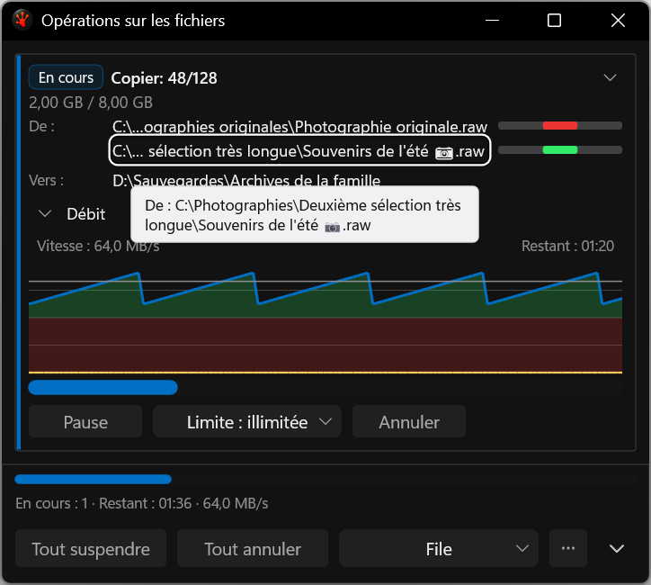
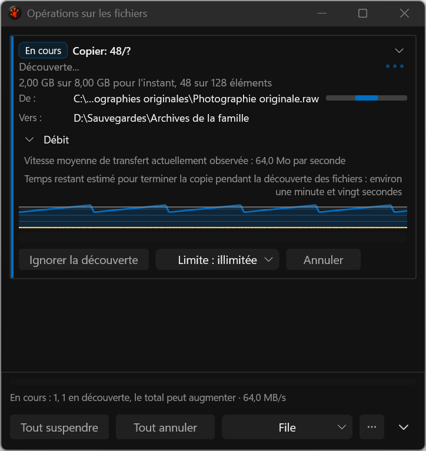
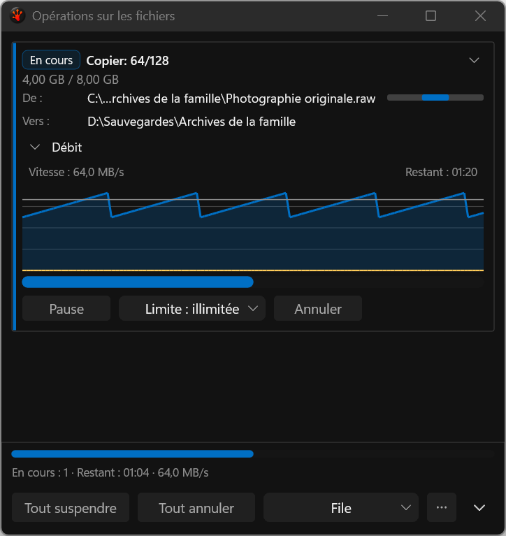
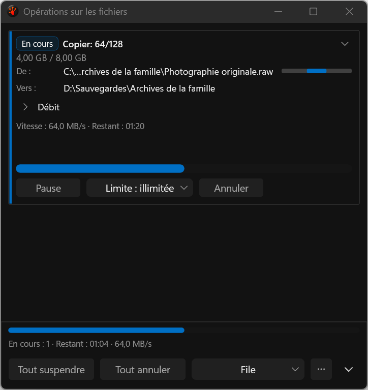

# Release popup qualification

These four actual application-harness captures were visually reviewed. They retain complete French labels, separate rate/ETA text, visible keyboard focus and exact Unicode tooltip content at native 144 DPI. Collapse deliberately preserves the outer window placement; remaining adaptive layout and conflict/Issues work stays open.

[24/24 results and audit history](../../../../../TestRuns/4cb089111a23/Commands/2026-09-20_003057-i26-path-keyboard-release/README.md).
