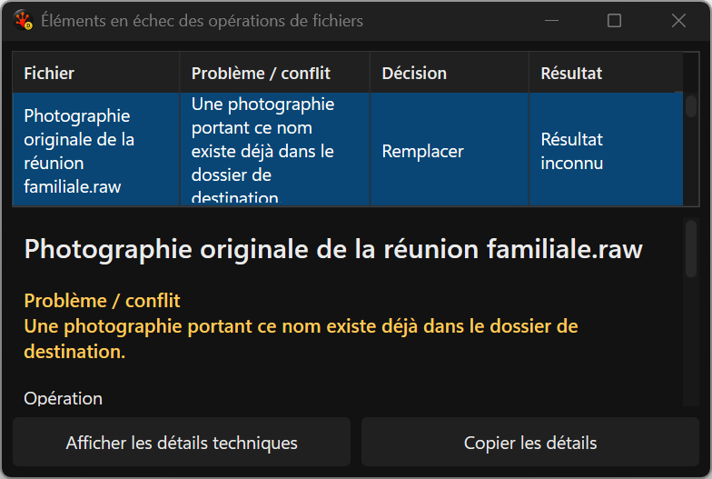
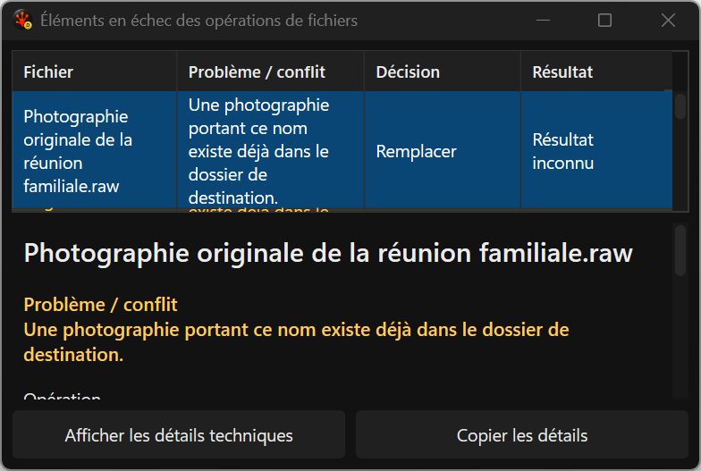
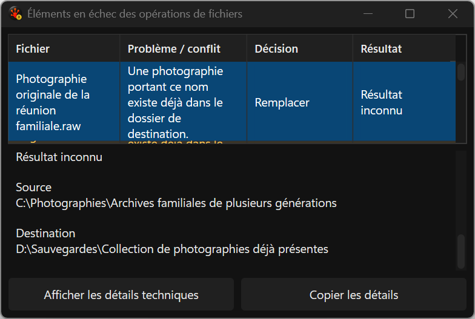
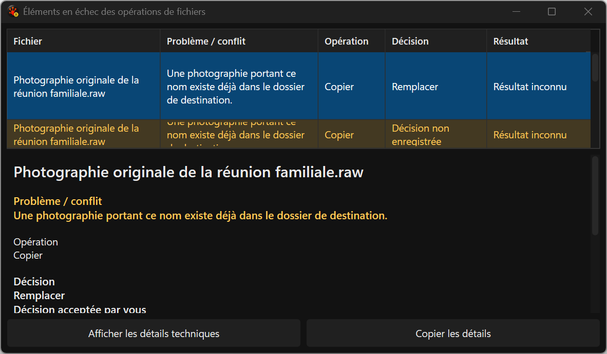

# Minimum-height Issues row — actual harness captures

The grid reserves its sort explanation, header and one complete primary row before
splitting space with the independently scrollable selected detail. Footer actions
remain fixed. The minimum client fixture is 520 × 320 DIP at native 144 DPI, French.

Baseline: 69 passed / 3 expected row-height failures. Candidate: **72/72**, no skips
or sandbox audit findings, full Debug build zero warnings/errors. Source/localization
Pester records **199/199**; its outer logging wrapper returned 1 because it redirected
the PassThru object before reading its count, not because a test failed. The complete
output remains in `C:/RedSalamander.Perf/evidence/i26-ui/primary-row-pester-v1.log`.

All 12 candidate primary-grid images were directly reviewed. First-row height and
French actions fit. **Final visual acceptance remains open**: the unchanged library
pin still clips/recenters text in partially visible later rows and does not enforce
the requested line clamp. The independent DxUi follow-up fixes that behavior but has
unresolved resource qualification. No new pin or overall completion is claimed.

The paired family refresh median/p95 is 1985/9339 -> 2109/10704 us; unchanged refresh
453/805 -> 497/738 us (15 samples each). Retain these variations; this is not a claim
of overall performance non-regression. Final paired consumer resource gates remain.

[Baseline receipts](../../../../../TestRuns/4cb089111a23/Commands/2026-09-21_072956-i26-primary-row-baseline-v1/README.md).
[Candidate receipts](../../../../../TestRuns/4cb089111a23/Commands/2026-09-21_073838-i26-primary-row-candidate-v1/README.md).

| Before | After: row fits, library overflow still pending |
| --- | --- |
|  |  |

