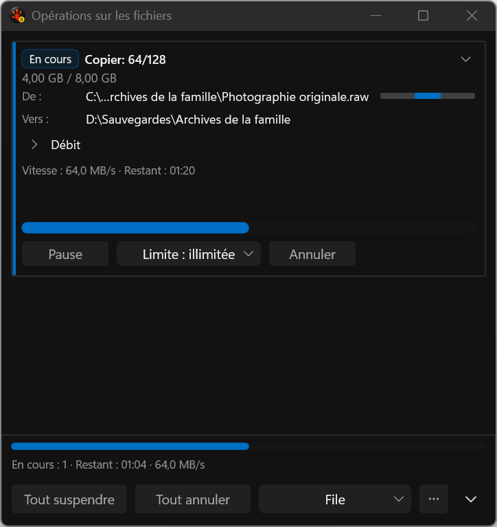
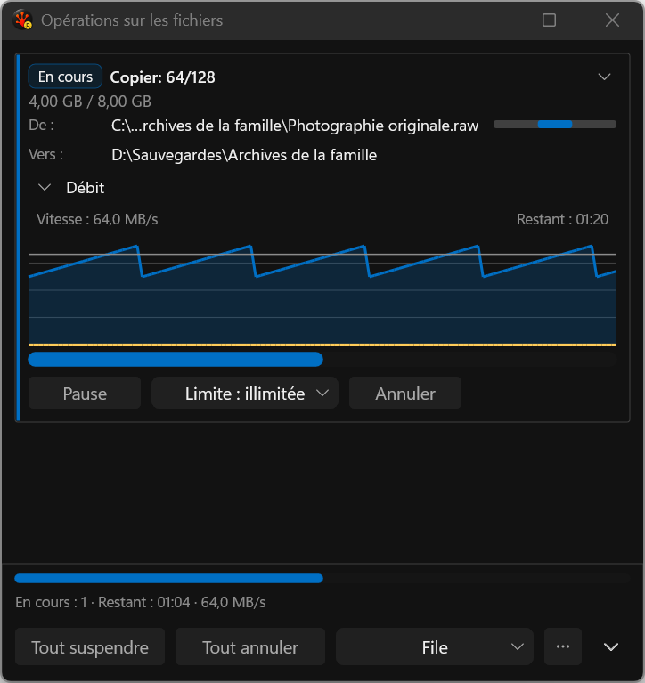
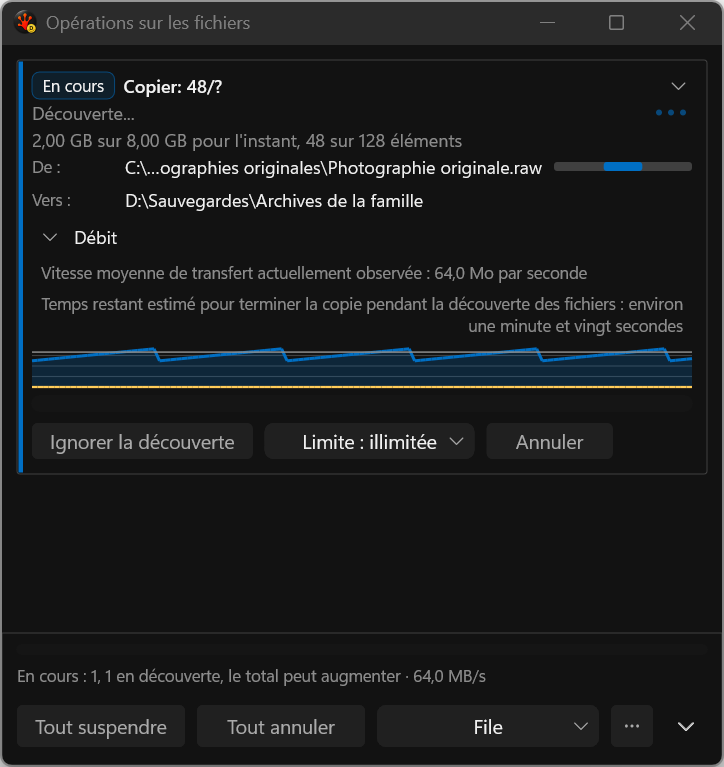

# Throughput persistence and restored size — actual harness captures

The saved popup geometry now survives its first layout after reopening. The prior
implementation restored the rectangle and then shrank it by 72 pixels (632 -> 560
at native 144 DPI), even with the same running task and collapsed throughput.
The fix preserves that first geometry using the existing expanded-placement
restoration path. Later content changes retain the normal growth policy; footer-only
mode retains its existing sizing and expanded-rectangle behavior.

The unchanged-product V3 fixture fails all three repetitions at that exact check.
The V4 broader popup matrix passes **21/21**, zero skips and disk-audit findings,
Debug build zero warnings/errors. It includes three repetitions of denied settings
replacement, recovery, both placement keys, exact-size reopen, footer-only recreation,
device-loss recovery, and 25-cycle resource lifetime checks with hidden-frame/host
release assertions. Absent optional settings correctly mean expanded by default.

All 16 PNGs below were reviewed through their nine distinct SHA-256 images. French
discovery, long stacked rate/ETA, expanded/collapsed plots and keyboard path focus
remain readable at their stated widths. `negative-control-missing-color.png` is the
retained expected semantic-probe rejection, not a separate successful capture claim;
its pixels match the wide expanded image. Covered/uncovered/recovery/idle captures
also match that image byte-for-byte. The window intentionally retains outer space
when a graph collapses. Card sizing, final interaction/DPI/AT/Release and overall
visual acceptance remain governed by the main plan, not closed by this slice.

Paired throughput redraw batches (15 samples each, microseconds): expanded median/p95
66,436/78,846 -> 66,579/76,709; collapsed 66,432/76,173 -> 66,355/79,161. The candidate
has broader test ordering, so retain the variation without claiming overall resource
non-regression. Process restart and actual external hot reload remain open.

[Baseline receipts](../../../../../TestRuns/4cb089111a23/Commands/2026-09-21_081753-i26-throughput-save-candidate-v3/README.md).
[Candidate receipts](../../../../../TestRuns/4cb089111a23/Commands/2026-09-21_082409-i26-throughput-save-candidate-v4/README.md).

