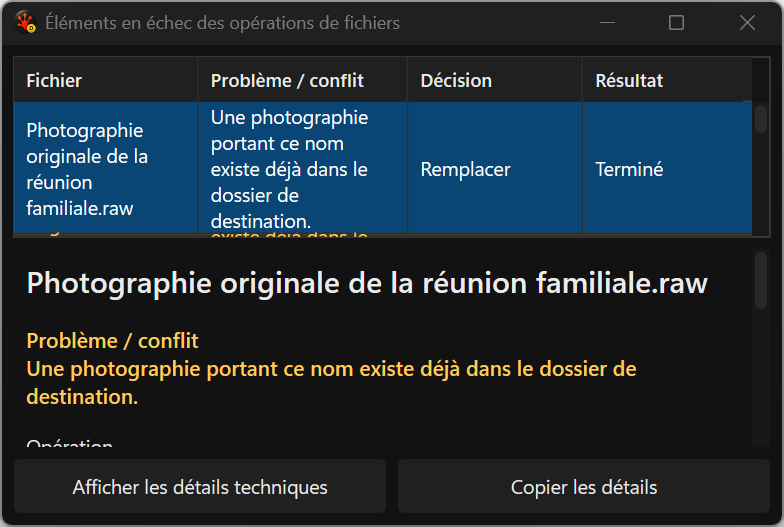
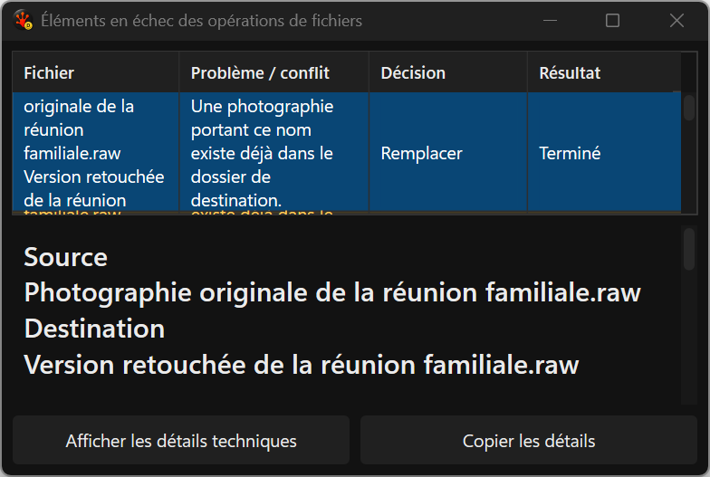
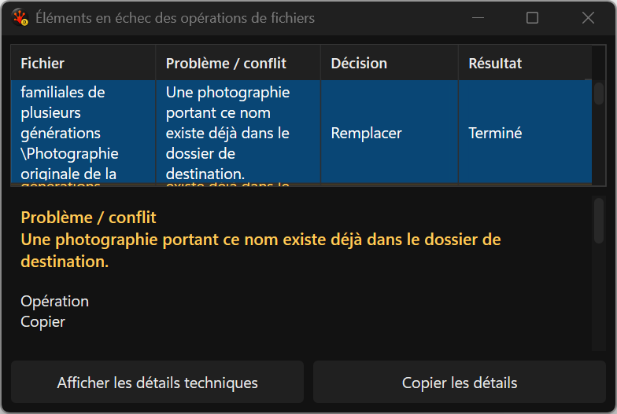
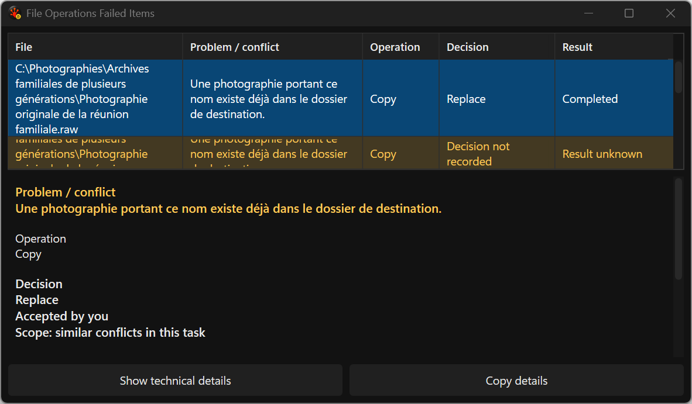

# Exact result observations — actual harness captures

Inline rename now records what happened separately from the accepted conflict choice.
The executor carries an exact prompt reference into its first terminal result. The
Issues grid and selected detail merge only that explicit identity, retaining separate
problem, choice and result. Missing/evicted facts stay unknown; contradictions cannot
select a truth by arrival order. Original diagnostics and mutation authority stay intact.

Focused x64 Debug: **9/9 real inline-rename checks, 75/75 Issues checks, 3/3 accepted-choice
matrix repetitions**; zero skips, build warnings/errors or disk-audit findings. The
unchanged-product witness passed Setup/Cleanup and failed the three new result assertions.
The strengthened final tests include actual completed-task TSV export, five independent
completion states, exact first-store retention with Info disabled, duplicates, wrong owner,
zero/mismatched generation, late originals, eviction, missing choices and complete copy.
JSONL independently retains all three real rename results with the correct prompt references.

These PNGs are actual production-renderer captures from deterministic synthetic Issues
fixtures. The Copy label belongs to the projection fixture; production Copy does not yet
carry an exact result reference and therefore remains unknown. The real rename integration
and export receipts establish the implemented producer. French 520-DIP client captures use
the existing native 144-DPI environment; the ordinary English view retains French fixture data.

The new completion cell and fixed French actions are readable. **Final visual acceptance
remains open:** current qualified DxUi still reflows/clips oversized and partially visible
grid cells. The separate library fix awaits resource/native qualification and explicit pin
adoption. Detailed names/results remain available through the independently scrolling detail
and exact copy. These captures do not close Release, mixed-DPI, AT or integrated performance.

The 15 final completion PNGs are byte-identical to their reviewed V1 family captures.
Paired inline execution median/p95: **54,357/147,661 → 56,845/145,321 µs**; the
stronger candidate also checks independent typed axes and actual export. Retained
authority nodes remain 10. Issues initial/unchanged refresh median/p95 are
2,061/11,516 and 475/542 µs; these alone are not paired resource acceptance.

[typed-result-baseline-v2 receipts](../../../../../TestRuns/4cb089111a23/FileOps/2026-09-21_083710-i26-typed-result-baseline-v2/README.md).

[typed-result-candidate-v2 receipts](../../../../../TestRuns/4cb089111a23/FileOps/2026-09-21_085949-i26-typed-result-candidate-v2/README.md).

[typed-result-issues-v2 receipts](../../../../../TestRuns/4cb089111a23/Commands/2026-09-21_090021-i26-typed-result-issues-v2/README.md).

[typed-result-decisions-v2 receipts](../../../../../TestRuns/4cb089111a23/Commands/2026-09-21_090135-i26-typed-result-decisions-v2/README.md).
