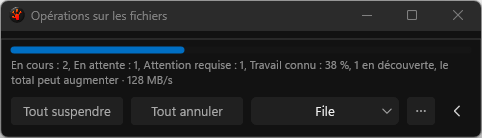
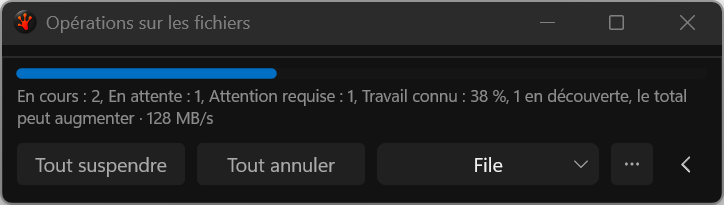
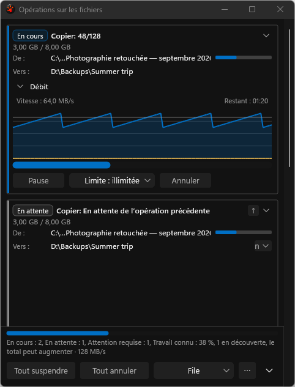

# Wrapped French footer: actual application captures

These are unmodified application PNGs from the deterministic, nonactivating test
harness, not mockups. They use the final footer source bound by
[candidate-inputs.json](candidate-inputs.json), Release build receipt
`ce4b906c61a6d1cf19f1b5d66fad72ea5789556a22f5cc0f99b43850bbd7c400`.

Run `20260923T105229Z-28376-e22cb67e77bc4be8be21e4219f9de2ca` passes all eight
new summary geometry checks on physical 96/144-DPI displays, at 480/760 DIP, in
footer-only and full modes. At the narrow width the complete French summary
wraps to two lines; all commands stay below it and Queue retains its hit target.

**This is a partial, overall failed gallery.** The harness captures 285 PNGs then
rejects the first blank confirmation using its semantic pixel witness. It records
0/1 case passes and zero sandbox-audit issues. Twenty-seven old images are absent
after that failure; the eight new summary fixtures are present. Of 277 images
shared with the retained pre-change baseline, 276 are byte-identical. The one
changed shared image is the rejected black confirmation. Nothing substitutes
for the missing images. See [comparison](gallery-comparison.json) and
[complete validation evidence](../../../../../TestRuns/4cb089111a23/Validation/2026-09-23_footer-summary-release/README.md).

## Narrow footer-only views

## Full mode

The wide counterparts retain one summary line. [SHA256SUMS.txt](SHA256SUMS.txt)
binds all original captures, scenario/display manifests and provenance. Full raw
logs/metrics remain under `C:/RedSalamander.Perf/evidence/i26-ui/footer-summary-final-20260923/`.

## Remaining review findings

The full-mode images also expose pre-existing defects outside this footer change:
the queued destination-menu affordance paints a clipped word into its small
chevron target, and an ordinary progress path can retain a filename wider than its
text rectangle. These need independent regressions and fixes. The footer summary
checks do not validate those controls. The [implementation plan](../../../../Done/UI_FileOperationsReview_2026-09-16.md)
remains WIP; native interaction, complete captures, resources and final integration
are still required.
