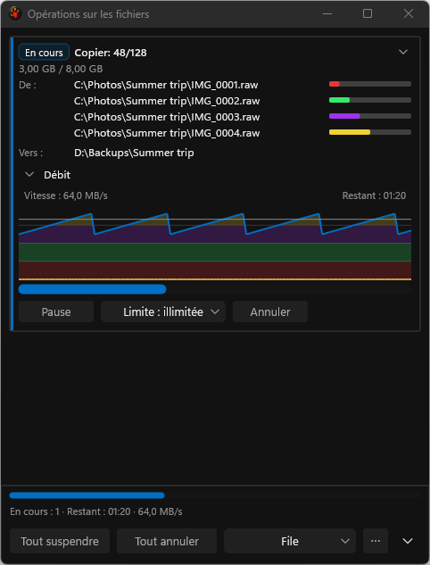
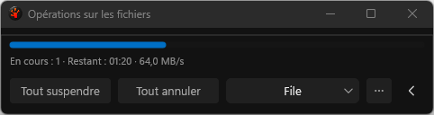
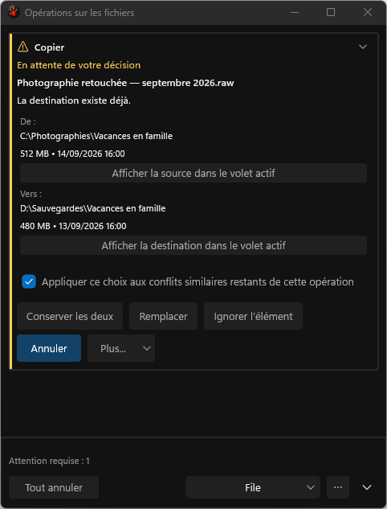

# Footer command flow: actual French application captures

This folder retains actual harness captures, not proposal mockups. The consumer now
wraps whole footer commands and reserves their resulting height instead of hiding
Queue when the row fills. Transfer-action widths are measured; Queue, Options and
Details remain one group. The current French captions still fit one row at 480 DIP.
ProductUiTests exercises longer measured captions that require two and three rows.
Native interaction with those wrapped rows remains a separate required check.

The initial `candidate/` capture set contains all 304 images from the production renderer
at physical **144 and 96 DPI**, including 480/760-DIP and theme variants. Eight baseline
views are retained beside it. The [comparison](gallery-comparison.json) binds every
baseline and candidate original; [candidate inputs](candidate-inputs.json) identify the
five changed source files in the isolated Release checkout.

**The initial gallery is not accepted as complete visual evidence.** All 20 confirmation
images in candidate run `20260923T095606Z-60568-7cdf6164d5d445118eff3507430b21a7` are black,
despite the harness returning success. All other 284 images are pixel-identical to the
baseline, and all dimensions/manifests match. A repair now waits for opaque confirmation
paint and requires semantic pixels through the existing bounded WGC capture helper.
Its validation remains in progress; rejected images must never be used as UI illustrations.

The application build and the fresh noninteractive PR gate pass, including the new layout
tests. [Full evidence, limits and paired timings](../../../../../TestRuns/4cb089111a23/Validation/2026-09-23_094710_footer-wrap-release/README.md)
include the 824 reported passes, zero failures/skips/audit findings, input/receipt identities,
the cold measurement increase and the outstanding native/resource checks.

## Reviewed unchanged views

Running copy at the supported minimum width, 96 DPI:

Footer-only mode at 96 DPI:

The conflict has one prominent filename, one waiting message, stacked source/destination
folders and a visible checked scope. It is unchanged by this footer component:

The remaining 144-DPI and long-name counterparts are in the complete directory.
[SHA256SUMS.txt](SHA256SUMS.txt) binds the unmodified originals and provenance files.
The [implementation plan](../../../../Done/UI_FileOperationsReview_2026-09-16.md) remains WIP.
