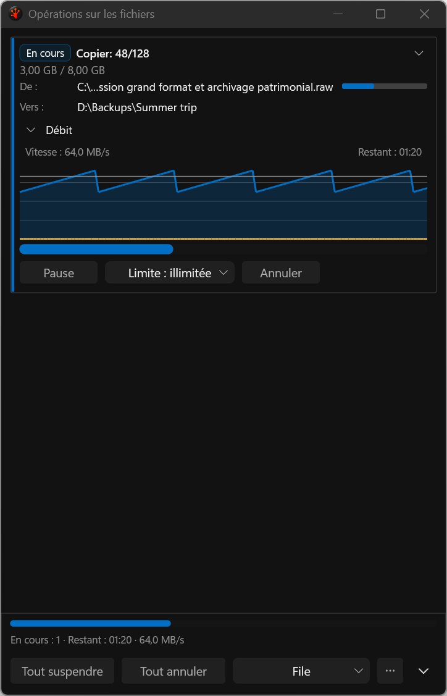
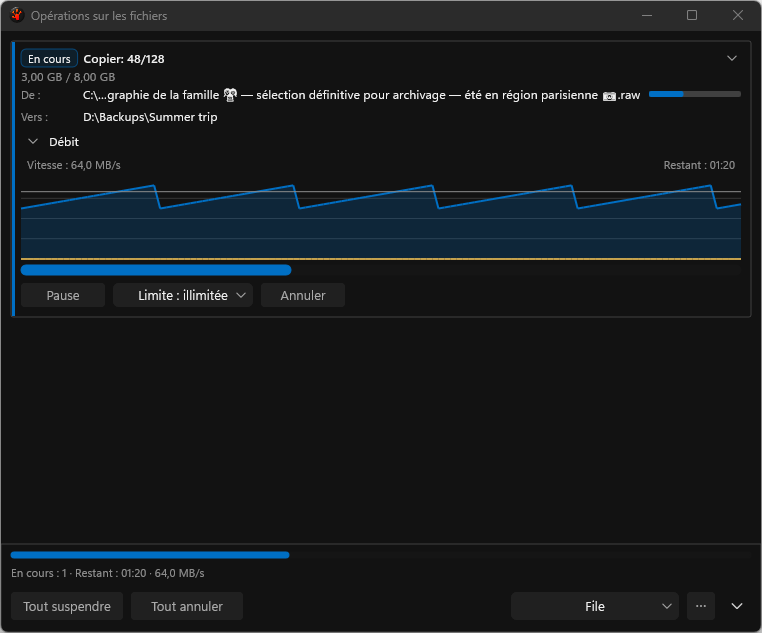
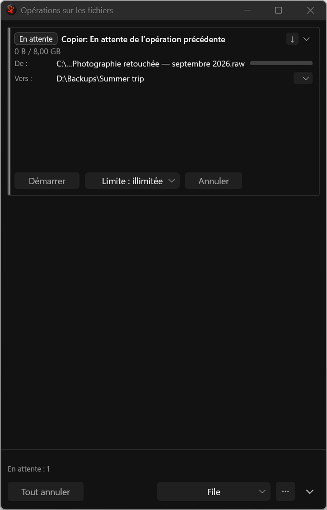

# Long filenames and destination-menu affordance

These unmodified application PNGs come from the deterministic, nonactivating French
test harness. They are actual captures, not proposal mockups. The source is bound by
[candidate-inputs.json](candidate-inputs.json), Release build receipt
`c45add5e7179adcc678eb3a1c0a792a15dae9948de81a04af1d35ebf087e0362`.

Run `20260923T113406Z-77608-19dc913e5a9c49e094a3bb648966b0be` passes ten destination-menu
checks, twelve painted-path checks and eight wrapped-footer checks at 480/760 DIP on
physical 96/144-DPI monitors. All eight new long-filename captures were visually reviewed.

The compact destination menu now paints its chevron without squeezing a caption into
the icon-sized target. Its French accessible name, tooltip and hit target remain present.
Ordinary progress paths abbreviate within an overwide filename at DirectWrite shaping
cluster boundaries. The actual painted string fits, remains valid Unicode and preserves
the `.raw` extension; the full path remains available through accessibility, tooltip and copy.
This change concerns ordinary progress paths. It does not replace the prominent filename
and stacked source/destination presentation used for decisions.

## Coverage and remaining limitations

The [scenario manifest](candidate/scenarios.tsv) and [display manifest](candidate/displays.tsv)
identify all 293 retained PNGs. Eight are new. Against the previous final-footer capture,
all 285 shared images retain their dimensions; 253 have identical pixels and 32 change.
The [comparison](gallery-comparison.json) records every shared image and its hashes.
The two new fixtures stress French source filenames, including combining accents and emoji;
their destination folder still uses the short inherited fixture. They do not establish
long French destination-folder coverage.

**The complete gallery still fails.** The first confirmation image is black and is retained
as rejected evidence. Its pixel witness fails despite completed opaque paint and an S_OK
draw result; the HWND render target reports occlusion. Later supplemental captures are
absent. No black or missing image qualifies the confirmation UI.

The serial paired warm redraw observations use the same named verification/delete scenes:
candidate eight-redraw medians range from 64.547 to 66.836 ms. This single pair does not
establish CPU, allocation, private-memory, hidden-work or final performance acceptance.
The path repair uses temporary cluster/boundary arrays when a row overflows; it adds no
persistent cache, surface or timer. Its resource cost remains subject to the integration gate.

[Validation packet](../../../../../TestRuns/4cb089111a23/Validation/2026-09-23_path-menu-release/README.md)
retains receipts, guards and paired metrics. [SHA256SUMS.txt](SHA256SUMS.txt) binds every
original capture and manifest. Full originals remain under
`C:/RedSalamander.Perf/evidence/i26-ui/path-and-menu-20260923/`.
Native keyboard/UIA journeys, DPI192, complete confirmation captures, combined DxUi pin,
resource advice and final Full acceptance remain open in the implementation plan.

The mixed running/queued captures also reveal excess empty space in an expanded queued card:
its transfer-card height still reserves a body that has no plot to paint. This is a separate
remaining density/layout issue. A repair must retain complete paths, destination inspection,
Start/speed/cancel controls, focus targets and measured row heights; simply cropping the card
would not be sufficient.
