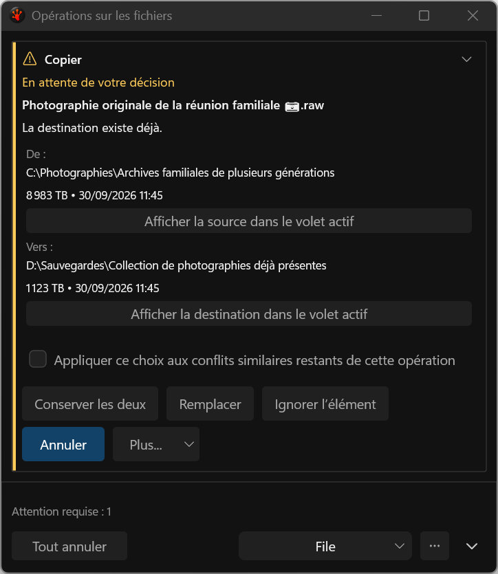
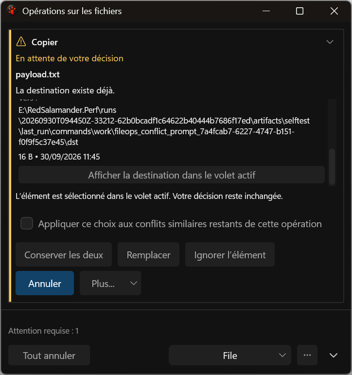
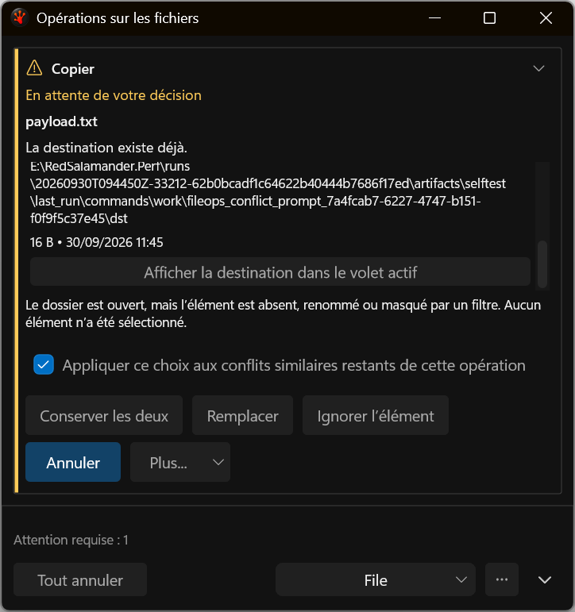
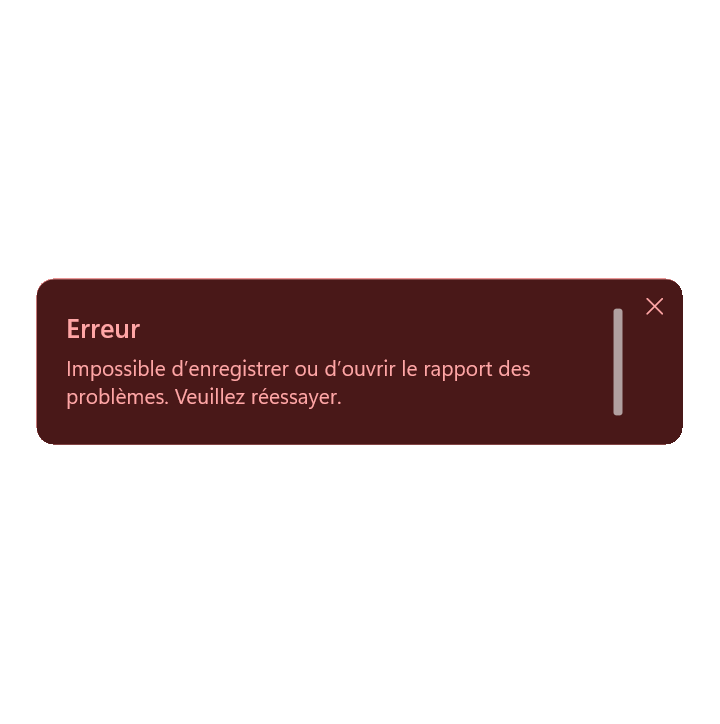

# Actual V22 interaction captures — September 30

These are deterministic application-harness captures, not proposal mockups. The 51 PNGs preserve
their original bytes; `manifest.json` binds each to its run, build receipt and SHA-256.
`visual-review.json` records review of all 36 distinct rendered images and aliases.
[Capture manifest](manifest.json) and [visual review](visual-review.json) identify the retained V22 images and their original run/build receipts. The governed external source locations remain recorded in the manifest; the proposed repository V22 packet was not archived.

At 480 DIP the common filename is a distinct heading shown once. Incoming and existing parent
folders remain stacked; measured French actions wrap as complete buttons. The bounded comparison
viewport scrolls independently of the fixed subject and decision controls.

Source/destination inspection selects the exact admitted item in the last-active pane without
resolving the conflict. Returning restores the same unresolved decision and invoking control.
Missing or filtered items receive an explicit explanation instead of a neighboring selection.

Export failure text now paints on the first presented frame and remains visible after reopening
and native resizing. Black pixels outside the shaped overlay are outside its displayed region.

The capture and journey passes are focused acceptance. The active I26 plan retains the current full
suite, complete gallery, mixed-DPI and paired-resource gates; these examples do not replace them.
