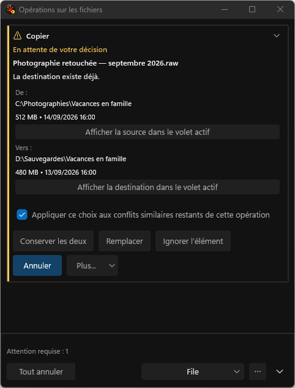
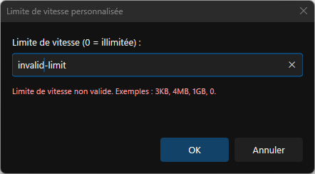

# Current File Operations harness gallery — September 30, 2026

This is the implemented V47 UI, captured by the deterministic application harness. It is not a
mockup. [Browse all 560 screenshots](index.md) or inspect the
[publication receipt](provenance/publication-receipt.json) and
[per-file source, hash and review ledger](provenance/gallery-provenance.json).

The static run passed 1/0/0 and produced 550 captures. The protected interaction run passed 1/0/0
and produced ten captures of actual keyboard, hover, pressed and same-window DPI transitions.
Both used clean test sandboxes. All 500 distinct PNG hashes match previously reviewed originals:
442 from the V24 review and 58 from V43. Root independently reconciled the complete set and viewed
three current originals. Exact byte reuse is distinguished from newly inspecting every duplicate.

The build is test-enabled x64 Debug, source HEAD `ccebd5af68eb45f2e9deed64a7063780e71eb1ce` plus
the frozen V47 source manifest, with explicitly adopted DxUi pin
`49c963f5751a6754e6b08e0362b96cfc7fc64414`. Build receipt:
`1606402fa029ceab2d5ea775ab75869217b1583d54e908fb1f7106e698c611cc`.
The provenance folder retains the exact build, fixture, run and visual-review records.

| Capture group | Run identity |
|---|---|
| Static | `20260930T205754Z-65632-890748afb5ff42869426f729d7b421bc` |
| Protected interaction | `20260930T205252Z-73948-5c3a6bf63ef1405cb66eb5d36a40fa99` |

The French file-conflict surface now places the common filename first, shows the waiting state
once, stacks the source and destination folders, and retains the four direct decisions. Folder
inspection has an explicit action for each role. At narrow widths, complete actions wrap rather
than losing their captions.

Repeat scope has a real checked state. The invalid-speed dialog separates its error/help and
action regions at physical 96 DPI. The full index also includes the light, high-contrast and rainbow
fixtures, confirmations, progress, unknown outcomes, Issues detail, disclosure and long-text states.

Static capture never activates the application. The interactive harness used its warning, exclusive
desktop lease, owned-window checks and focus/cursor restoration. It exercised physical 144→96→144
DPI on the same window. Two additional V47 repetitions passed; an earlier V46 forward-Tab failure
is retained as unreproduced, not claimed fixed by the diagnostic-only V47 change.

These receipts qualify the pictured scenarios and native 96/144-DPI interaction. They do not claim
200%/192-DPI, external assistive-technology execution, ARM64/ASan or completion of the remaining
Full/resource gates. The [implementation plan](../../../../Done/UI_FileOperationsReview_2026-09-16.md)
remains the authority for overall completion. Original September review captures remain intact.
