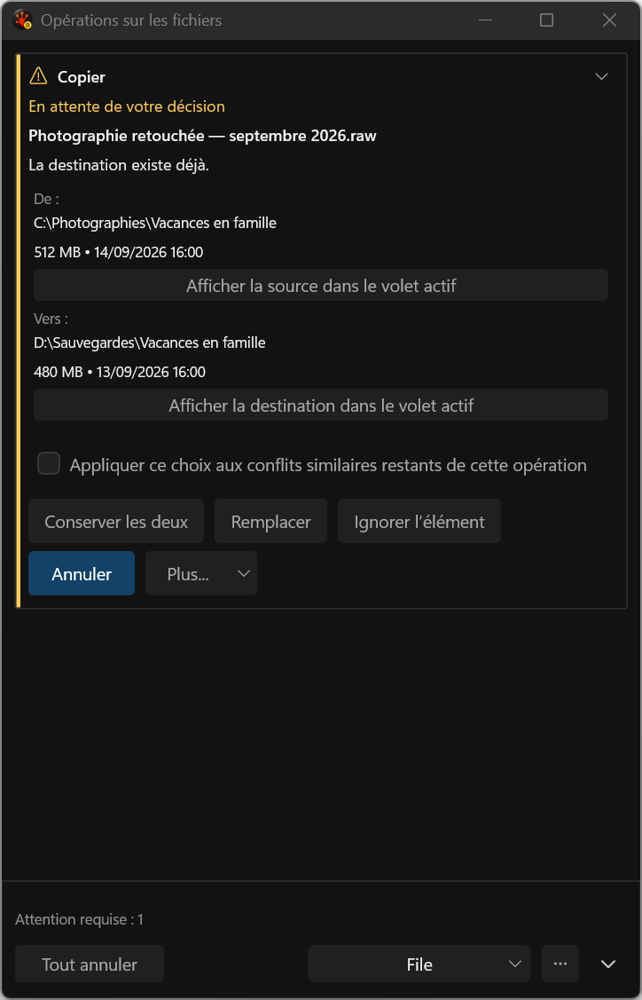
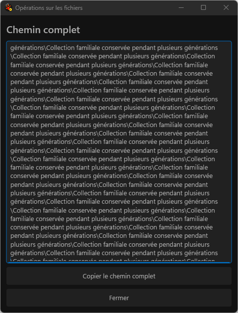

# File Operations harness gallery — October 1, 2026

These are application captures from the deterministic V55 harness, not proposal mockups.
[Browse all 572 screenshots with filters](gallery.html), the [complete Markdown index](index.md),
the [publication receipt](provenance/publication-receipt.json),
or the [source and image-review ledger](provenance/gallery-provenance.json).

The static run passed 1/0/0 and produced 562 captures. The protected run passed 1/0/0 and
produced ten keyboard, hover, pressed and native-DPI captures. Both sandboxes were clean.
All 512 distinct image hashes have review evidence: root inspected all 16 new original images;
496 match previously reviewed images byte for byte. No image was edited to simulate a pass.

| Evidence | Identity |
|---|---|
| Static run | `20261001T012949Z-76256-65bb89cb9d96432b893602e7fe21a367` |
| Protected run | `20261001T013754Z-81300-8feb927cdd0b48518e3da429111876e5` |
| x64 Debug solution receipt | `66a1bce053e7c1b78ea1236756ae350ffaeb5d42c0e6082d25545c5bf215ea29` |
| Frozen 85-logical/84-physical source manifest | `d0fccec5b902e58352c457d6f820ce4c7efd98ed6a423067e4bb9831ec4cdba1` |
| Explicit DxUi pin | `19ca44d95a0cd493fc7fb1a57f4d4ad227bdefc1` |

The original static wrapper rejected the normal `[tick]` prefix on two passing `PathDetailDpiHop`
trace rows. The corrected checker revalidated the same retained native run and copied inputs;
it did not repeat the application test. The original driver/failure remains retained, and the
static invocation records this postprocessing recovery explicitly.

The conflict view gives the common filename its own heading, states the pending decision once,
and stacks source and destination folders. Each role has a pane-inspection action. Complete French
decision captions wrap as whole buttons at narrow widths.

The full-path workspace adds selectable, scrollable Unicode text with Copy full path and Close.
The new long UNC fixture is captured at its root and after scrolling, in light and dark themes
on both physical monitors. Text, selection and hosted focus survive same-window 96→144-DPI movement;
caret paint stays inside the field. Ordinary task rows remain abbreviated, with the exact value
available through this workspace, copying and accessibility.

The separate protected run records a focused action's native 144→96→144-DPI round trip with
unchanged action identity and owned native focus. The live invalid-speed form also moves between
the monitors without activation, retaining its French error, edit selection and work-area fit.
The full index includes checked scope, confirmations, progress, unknown outcomes, Issues detail,
high contrast and rainbow themes.

This gallery preserves its original V55 visual and interaction scope: 562 static and ten protected
captures, 512 reviewed hashes and their recorded source/build/run identities. Broad Debug FileOps
remains V55 197/0/20; V65 did not recapture or relabel these images.
V65 x64 build status: passed, with zero warnings or errors. Release Full/Fresh `20261001T115346Z-104056-8e2cfb6a0b8049218c622dd915a2697e`:
2211 passed, 0 failed, 46 skipped (2257 total). The independent A78/B19 resource
review records acceptance for I26 with stated limits: the final matched Embedded presentation and logical-resource workload, with all eight processes and outliers retained; the earlier ProgramDatabase pair stays separate, without whole-product or driver-memory claims. The [I26 checkpoint](../../../../Done/UI_FileOperationsReview_2026-09-16.md)
and [V65 packet](../../../../../TestRuns/4cb089111a23/Validation/2026-10-01_i26-v65-final/README.md) record the current evidence and limits. Native 192-DPI, external AT,
consumer ARM64/ASan, I19 and H4 remain separate. Original September captures and prior galleries are unchanged.
