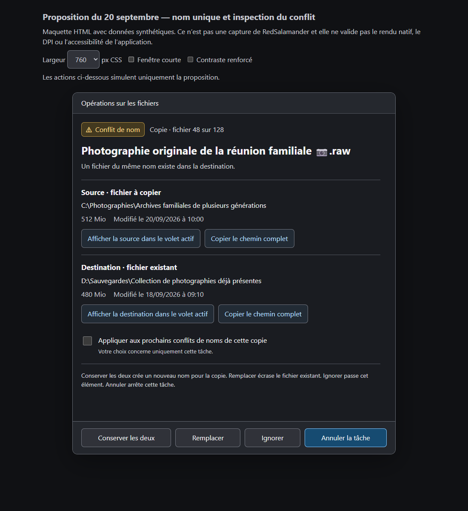
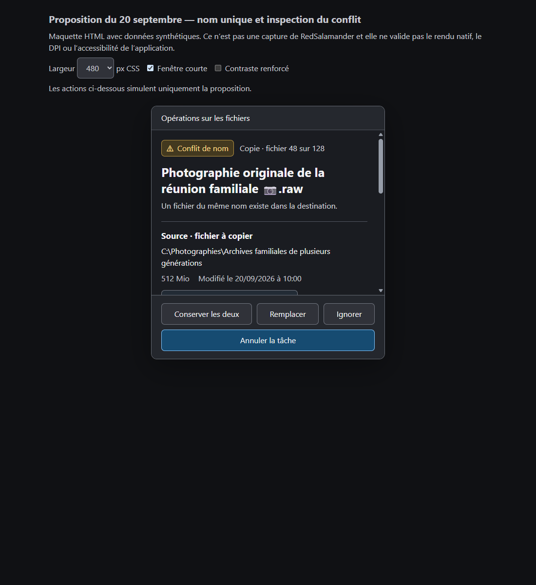

# File Operations: interaction review and revised conflict design

Reviewed 2026-09-20 after the user's supplied conflict-card image. **The current UI is not accepted.**
The spec now requires one prominent filename, one conflict indicator, two stacked parent folders,
complete action labels, and inspection of a pending conflict in the active file pane. Earlier
name/parent and metadata slices remain useful prerequisites; their passing tests did not assess
the information hierarchy that the user rejected.

Start with the [revised interactive proposal](../mockups/07-conflict-single-name-french.html),
[current native gallery](gallery.html), and [normative contract](../../../../UI/UI_FileOperationsPopup.md).
The proposal is an HTML simulation, clearly labelled separately from application screenshots.

## Evidence and limits

- Fresh **300 static + 9 interaction PNGs**, all produced by the application harness with French
  resources. Native captures report DISPLAY1 at 144 DPI and DISPLAY5 at 96 DPI; the latter has a
  672-physical-pixel work-area height. [Display facts](static-displays.tsv) and
  [interaction identities](input-interaction.tsv) are retained.
- **48 images inspected directly:** 39 representative static views across the flow and all nine
  interaction frames. [Review inventory](visual-review.json) identifies them; the other 261 captures
  are available and indexed, without an individual visual acceptance claim.
- The [static case](../../../../TestRuns/4cb089111a23/FileOps/2026-09-20_113651-i26-interaction-review-static/README.md)
  and [input case](../../../../TestRuns/4cb089111a23/FileOps/2026-09-20_114123-i26-interaction-review-input/README.md)
  each pass 1/1 with zero skips and disk-audit issues. Both builds report zero warnings/errors.
  Source is `3fc33f95f3ece9cfa1109c721e130d9af686e90e`, workspace snapshot
  `6174d1ab2428470c9d3992b649ce3c20aac43490d573d34a790733f071937e67`.
  [The manifest](capture-manifest.json) binds each original PNG to its build receipt and hash.
- Input capture uses the existing warning, desktop lease, foreground/capture checks and restoration.
  It proves those captured Tab/Shift+Tab/hover/press paths and the same-HWND 144 → 96 → 144 move.
  It does **not** exercise every action, initial default, Enter/Escape, full tab cycle, UIA or screen reader.
  The focused target differs between displays; those frames do not prove focus identity preservation.
- The broad catalog seeds synthetic `TaskSnapshot` presentation facts. Its conflict seeds do not
  supply the new admitted name/parent facts and therefore exercise the exact-path fallback. They
  must not be mistaken for qualification of the normal admitted-path hierarchy. Add production
  publication-backed fixtures for that path and retain an explicitly labelled fallback fixture.
- This is a review baseline, not revised-UI acceptance, Full/Release qualification or paired performance
  evidence. Initial combined-filter and SkipBuild attempts were rejected before capture; their
  [invocation notes](invocation-notes.json) and logs are retained. No failed attempt is counted as a pass.

## Findings and change in intent

| Finding | Evidence and current intent | Required improvement and user benefit |
|---|---|---|
| **F1 / P1 — critical labels are cropped** | [Ordinary conflict at 96 DPI](screenshots/33-decision-file-exists__dark__480dip__fr-FR__display2__96dpi.png), [live-output conflict](screenshots/54-decision-same-host-live-output__dark__480dip__fr-FR__display2__96dpi.png), [Recycle failure](screenshots/44-decision-recycle-failed__dark__480dip__fr-FR__display1__144dpi.png). Equal slots try to keep choices on one row. | Measure labels, icons and padding; wrap whole buttons, then multiline text only where needed. Measure badges too. The user must read the actual action, especially replacement and permanent deletion, before choosing. |
| **F2 / P1 — the conflict's subject is buried** | [Long French conflict](screenshots/108-decision-long-french-paths__dark__480dip__fr-FR__display1__144dpi.png) repeats the waiting state three times and puts the item in a quoted sentence and both full paths. The supplied user image shows the same hierarchy with a shorter question. | One prominent common filename, one complete conflict indicator, concise problem text without the name, Source above Destination showing folders and respective metadata. This exposes the decision subject immediately and frees space for evidence. Exact paths remain available on demand. |
| **F3 / P1 — pending inspection is missing** | [Completed menu](screenshots/95-menu-completed-more__dark__480dip__fr-FR__display1__144dpi__flyout.png) has Reveal/Open destination. Source dispatch filters to `task.finished` and uses its captured destination pane. It cannot inspect a pending conflict in the last-active pane. | Add explicit source/destination inspection next to each location. Navigate/select/focus the exact item, preserve the pending decision, and return through File Operations to the same card. Inspection supplies evidence without implying consent. |
| **F4 / P1 — task actions collide with the global footer** | [Running and queued on the short display](screenshots/30-running-and-queued__dark__480dip__fr-FR__display2__96dpi.png) paints queued Start/Limit/Cancel through the global summary/footer. | Reserve both footer and task-action space before scrolling bodies. Paint, hit testing, focus and UIA must use the same clipping/layout. Users can tell whether an action affects one task or all tasks. |
| **F5 / P1 — Issues selection does not reveal the issue** | [Populated](screenshots/104-issues-populated__dark__fr-FR__display2__96dpi.png), [selected](screenshots/105-issues-selected__dark__fr-FR__display2__96dpi.png), [scrolled](screenshots/106-issues-scrolled__dark__fr-FR__display2__96dpi.png). Technical columns take the initial width; multiline messages are cut through row boundaries. | Show file/problem/decision/result first and complete selected-row detail below. Preserve copy/export/sort/selection and qualified recovery. A selected row must let the user understand and act on its problem. |
| **F6 / P1 — queued destination controls are not readable** | [Queued task](screenshots/04-queued-start-now__dark__480dip__fr-FR__display1__144dpi.png) gives the destination control only a narrow fragment; [history](screenshots/107-destination-history__dark__480dip__fr-FR__display2__96dpi__flyout.png) truncates long folder choices. | Separate `Changer la destination` from inspection, give it a measured reachable action, distinguish similar locations by full detail and validate the selected qualified location before changing a queued task. |
| **F7 / P2 — scope and secondary actions are vague** | [Checked scope](screenshots/60-decision-apply-to-all-checked__dark__480dip__fr-FR__display1__144dpi.png) now has a visible checkmark, but `Tous similaires` does not explain its boundary. [More](screenshots/97-menu-conflict-more__dark__480dip__fr-FR__display1__144dpi__flyout.png) says `Tout ignorer`. | Show exact task/conflict scope in full, retain the visible checkmark, and explain scoped Skip All. Checkbox focus, checked state and accepted consent remain separate. This avoids interpreting a task-scoped grant as all operations. |
| **F8 / P2 — other states repeat or obscure their meaning** | [Paused](screenshots/14-paused__dark__480dip__fr-FR__display1__144dpi.png) repeats its state and displays an old speed beside paused history. [Unknown source](screenshots/23-move-source-unknown__dark__480dip__fr-FR__display2__96dpi.png) combines unknown and retained-source labels without clear subsets. [Empty](screenshots/01-empty__dark__480dip__fr-FR__display1__144dpi.png) is largely blank. | One phase label, qualified last-known rates, separately scoped outcomes, and an explicit empty state. A user should distinguish paused work, partial results, unknown facts and an empty window without guessing. |
| **F9 / P2 — confirmation consequences need clearer treatment** | [Copy](screenshots/102-confirmation-0__dark__fr-FR__display2__96dpi.png) uses blue paragraphs on a blue surface; [Move](screenshots/102-confirmation-4__dark__fr-FR__display1__144dpi.png) uses large button-like option rows. | Normal readable foreground for consequences; labelled options and complete disabled reasons. Preserve policy/defaults. Visual observation is not a numeric contrast certification; native color checks remain required. |
| **F10 / P2 — result and list-removal controls need explicit scope** | [Partial result](screenshots/21-move-source-kept__dark__480dip__fr-FR__display1__144dpi.png) truncates its outcome title; [completed group](screenshots/31-completed-group-expanded__dark__480dip__fr-FR__display2__96dpi.png) crops Clear. `Fermer` competes with window Close terminology. | Readable outcome/counts and clearly named removal from the list, distinct from stopping a task or hiding a window. Recoverable results retain useful actions before dismissal. |

Observed improvements are retained: ordinary running task actions are visible; checked scope has a
visible glyph; the [invalid speed dialog at 96 DPI](screenshots/100-speed-invalid__dark__fr-FR__display2__96dpi.png)
separates help/error from actions; the fallback renderer exposes readable Cancel all and Close.
These observations do not close each surface's full behavioral or accessibility gate.

## Revised conflict proposal

The [HTML proposal](../mockups/07-conflict-single-name-french.html) demonstrates 480/640/760 CSS-pixel
widths, short height, visible focus, wrapped labels and simulated inspect/return with preserved scope.
Six browser layouts have no detected label overflow; its focus/return simulation passes. Those
[browser checks](../mockups/07-conflict-single-name-browser-check.json) validate only the proposal,
not DxUi, Windows DPI or product UIA. Synthetic values are deliberately realistic and clearly labelled.

Full paths remain available through labelled copy/detail. Distinct qualified names (case,
normalization or rename differences) must remain visible; roots or unknown path profiles retain
an honest exact-path fallback. Neither a display name nor a navigation helper grants replacement
authority. The former generated conflict bitmaps 04/05 retain useful vertical structure but their
repeated-name/waiting copy is superseded by this proposal and the normative contract.

## Complete interaction inventory for implementation

This matrix covers every one of the **26 non-None `PopupHitTest::Kind` values**, menu commands,
adjacent surfaces and window/keyboard routes found in the current source. It inventories intended
outcomes; it does not assert that all outcomes ran in this review. Scene numbers refer to the fresh
gallery. **Observed** means pixels/input shown here; **source** means existing handlers/tests inspected;
**gap** means a required implementation or validation addition. All rows remain final-acceptance gates.
The [action-to-journey map](interaction-source-map.json) includes hashes of the seven inspected sources.

| Step | Journey and current evidence | Required trigger → outcome, including alternate paths |
|---|---|---|
| M01 | Enter/reopen/empty; scene 01, source | Open File Operations from menu/shortcut or operation. Show a clear empty state or real tasks. Close hides; reopening restores geometry and valid context without restarting work or stealing unrelated focus. |
| M02 | Copy/Move/Delete confirmation and options; scenes 102-0…9 observed | Keyboard/pointer changes link, verification, queue and bandwidth options; accepted typed choices reach the new task. Cancel/Close leave no operation. Disabled verification explains why; long errors and safe defaults fit. I18 retains appearance/consent policy. |
| M03 | Queue versus parallel for new tasks; `FooterQueueMode`, scene 94 | Choose a scheduling mode → correct checked menu state and intended future-task setting. Existing task decisions are unchanged. Escape/outside-click cancels the menu. |
| M04 | Start now; `TaskStartNow`, scenes 04/05 | Start an eligible queued task exactly once; overlap/authority refusal retains queue state and explanation. Revalidate if eligibility changes while focused or menu is open. |
| M05 | Queue order; `TaskQueueMoveUp/Down`, scenes 04/30 | Move one queued task → correct stable task order and boundary enablement, with retained focus/selection. A starting/completing task cannot make the action apply to another row. |
| M06 | Change queued destination; `TaskDestination`, scenes 04/107 | Choose the other pane or a distinct history location → intended queued task changes only after validation; cancel/refusal leaves it unchanged. Provider identity and long-folder disambiguation survive. Keep separate from M20 inspection. |
| M07 | Discovery skip; `TaskSkip`, scene 06 | Skip eligible precalculation → real transfer/discovery mode changes as specified; disabled/ineligible state explains itself. Do not imply skipping a conflicting file or the whole task. |
| M08 | Per-task pause/resume; `TaskPause`, scenes 10/14 | Pause/resume the named task; state and rate semantics acknowledge engine response. Progress callbacks, double clicks, late pause and task completion do not toggle a different task. |
| M09 | Per-task cancel; `TaskCancel`, scenes 15/25 | Cancel the named task → stopping then truthful canceled/partial result, with controls kept responsive. Repeated cancel is harmless; existing published files and retained sources remain explicit. |
| M10 | Global pause/resume/cancel; `FooterPauseResumeAll/CancelAll`, scenes 10/30 | Scope is all eligible active tasks and is distinguishable from M08/M09. Mixed paused/running/queued/conflicted/finished states retain engine policy. Late tasks and unsupported tasks have defined outcomes. |
| M11 | Speed menu/custom validation; `TaskSpeedLimit`, scenes 96/99–101 | Preset/custom value updates the exact task; invalid/empty/localized input shows complete error and cannot commit. Enter/Escape, cancel after invalid input, task removal and DPI change preserve value/focus. |
| M12 | Task expansion; `TaskToggleCollapse`, scenes 28/30 | Toggle one card with pointer/keyboard/UIA; hidden children stop input/render work. Preserve focus by identity and restore a safe header when a child becomes hidden. A pending decision stays recoverable. |
| M13 | Throughput; `TaskToggleThroughput`, scene 10 and prior implementation witnesses | Starts open; explicit collapse/expand updates live card and persisted preference as specified. New cards/restart/hot reload/failed save retain the correct ownership. Graph history, rate/ETA, geometry and idle behavior remain coherent. |
| M14 | Density/footer-only; `FooterDensity/ToggleDetails`, scenes 28/29/73/93 | Toggle display mode → reachable controls, proper saved outer placement and useful collapsed summary. This does not silently change throughput preference or accept hidden decisions. |
| M15 | Read/copy paths and long values; scenes 27/108, source | Keyboard can reach complete values and copy exact Unicode data; folder-copy and full-item-copy are distinct. No hover requirement. Provider separators, roots, extensions, RTL/surrogates and stale labels are retained correctly. |
| M16 | Conflict arrival/loading; scenes 33/57/108 | Publish one status and stable subject/context, then a complete allowed action set. No repeated waiting, fake progress, focus theft, premature actions, or metadata-result attachment to a newer prompt. Qualified and fallback fixtures are separate. |
| M17 | Decide; `TaskConflictAction`, scenes 33–59 | Pointer, Enter/Escape and UIA submit only the current immutable published action/generation. Eligible names use four direct actions with safe Cancel default; Recycle and same-host classes keep their own policy. Repeated/stale input cannot submit twice. Retain each class's real effect, refusal and result. |
| M18 | Repeat scope; `TaskConflictToggleApplyToAll`, scene 60 | Space/pointer/UIA toggle once with visible check and complete exact scope. Scope change alone grants no consent. Ineligible/Recycle cases omit it; reflow/prompt replacement and M20 return preserve only applicable state. |
| M19 | Additional scoped decisions; `TaskConflictMore`, scene 97 | Open/close/choose More by keyboard/pointer/UIA; explicit scoped Skip All sends the current allowed grant. Ordinary Skip is one-shot; focus returns safely on menu cancellation or stale policy. |
| M20 | Inspect source/destination during conflict; **gap** | Invoke beside a role → captured last-active pane navigates to qualified parent, selects/scrolls/focuses exact item. No file execution or operation mutation. Test both panes, changed profiles, nested remote paths, filtered/missing items, navigation failure and stale completion. |
| M21 | Return from inspection; **gap** | File Operations command restores the same unresolved card, scope, scroll and invoking control. If resolved/removed, show current truthful state. User focus changes suppress late focus theft; no accidental Enter/default submission. |
| M22 | Open Issues; `TaskCompletedMore`/Failed Items, scenes 95/103–106 | Open the appropriate record context without dismissing the task. Empty, pending, failed and partial data remain distinct. Issues provides inspection/recovery; pending consent stays on the authoritative card. |
| M23 | Issues selection/detail; scenes 104–106 observed, **detail gap** | Click/keyboard/UIA selection reveals full problem/decision/result/paths. Sort/append/eviction retains stable identity or clears it safely. Technical disclosure, detail scrolling and copy are reachable at short height. |
| M24 | Issues grid commands; source | Sort, resize/reorder columns, scroll and copy reflect visible column order and selected stable IDs. Saved state restores valid IDs; virtualization and stale UIA providers remain bounded/correct. Native tests exist but were not rerun by this gallery. |
| M25 | Reveal completed destination; `TaskCompletedMore`, scene 95 | Existing completed-task policy navigates to the captured destination pane/qualified context. Reveal selects the exact published item; Open destination opens the folder. Wrong/removed provider targets fail recoverably. This does not satisfy M20. |
| M26 | Recover retained sources; `TaskCompletedMore`, scenes 114/115 | Open source, select retained items and cut them again only for proven eligibility. Unknown outcomes omit mutation; nested/provider-qualified targets remain exact. Menu display alone is not executed recovery evidence. |
| M27 | Diagnostics/export; `TaskShowLog/TaskExportIssues`, scene 95 | Open the right log or export bounded truthful records. Cancel/write failure is recoverable; exported problem/decision/result and exact paths agree with the selected records. No inferred result from translated message parsing. |
| M28 | Dismiss/clear completed; `TaskDismiss/CompletedGroupToggle/CompletedGroupClear`, scenes 18/31/32 | Distinguish removing records from canceling work and window Close. Whole labels fit. Focus/selection after clearing is safe; active/unresolved cards remain. Repeated clear/dismiss handles concurrent completion. |
| M29 | Global options/auto-dismiss; `FooterOptions/AutoDismiss`, scene 93 | Menu check/radio states agree with saved preferences. Auto-dismiss applies only to eligible outcomes and does not erase actionable partial/unknown results. Escape/outside click and setting-save failure retain correct state. |
| M30 | Mixed tasks and informational cards; scenes 30/61–92 | Scroll/update/reorder multiple task types without overlapping fixed footer or invoking a neighboring task. Informational operations only expose controls actually supported by their producer; preserve their own cancellation/result contract. |
| M31 | Window/theme/DPI/fallback; scenes 98/109–113 | Resize and native 144→96→144 move retain exact focused action, readable text, hit/UIA bounds and reachable fixed controls. Distinguish hover/press/focus/disabled/check in all themes and reduced motion. Device loss/fallback keeps valid Cancel all and Close. |
| M32 | Close/Escape, lifetime and stale callbacks; source, **complete journey gate** | X hides an actionable pending prompt; Escape cancels according to published policy. Loading publication follows existing restoration rule. Hide/reopen, menu callback, provider completion, task removal and host teardown cannot invoke retired controls or retain hidden work. Restore owned fixture focus/cursor/clipboard state. |

Every row needs a deterministic initial fixture, a real trigger and assertions for the user-visible
and underlying outcome, plus failure/cancel/return. Add the documented screenshot states only after
those assertions establish the intended transition. Do not describe a source-existing test as newly
passed. Apply long French wording, constrained height, native mixed DPI, keyboard and UIA to the
affected route; a cross-product of every provider/theme/locale is not claimed by this finite matrix.

## Implementation and verification order

1. **R1 / next independent slice:** replace repeated status/name presentation with the common-heading
   design. Reuse admitted display facts and update real published-task fixtures, fallback fixtures,
   visible/UIA counts and reading order. Keep provider qualification and all action authority.
2. **R2:** adopt qualified DxUi measured actions through the existing successful-main CI/pin workflow,
   then fix complete labels, badge/header reflow, queued destination/Clear and short-body/footer bounds.
   Existing publication/merge approval is pending; this review does not grant it or justify a copied helper.
3. **R3:** implement M20/M21 using the existing pane-navigation transaction and stable prompt identity.
   Start with owned local files, then profile/failure/race cases and directed input/UIA acceptance.
4. **R4:** complete remaining confirmation/progress/Issues/recovery routes from M01–M32, with the
   existing I26 and DxUi ownership boundaries. Retain passing checkbox/speed/copy work.
5. **R5:** run the integrated behavioral/Fresh Full/Release/native DPI/AT and paired resource gates,
   refresh the after gallery and reconcile all unchecked plan items. Both plans stay ACTIVE until
   their own requirements pass; no provider/platform owner's deferred work is closed here.

For each rendering slice, retain the identical pre-change fixture and all repetitions. Measure
redraw/preparation and input-to-visible costs plus lifecycle/hidden resources; changed painted content
does not by itself prove a speedup. For inspection, measure navigation-to-selected-item latency and
bounded pending work, and prove no mutation operations. [Test requirements](../../../../Testing/Testing_PerformanceValidation.md)
own enduring validation rules.

## Review validation

[Integrity checks](integrity.json) verify all 309 copied PNG hashes/dimensions against raw harness
outputs, all seven source hashes, the 26-action inventory and local links. Both curated TestRuns
archives pass the pre-stage archive contract. Specification inventory reports zero blocking findings.
DxUi skill/spec/format checks pass; dependency validation passes on a clean tracked-source export with
the revised documents, preserving the unrelated ignored developer settings in the working checkout.
The [proposal provenance](proposal-provenance.json) keeps browser renders separate from native images.
No application or library source changed in this review; its new intended behavior still needs code.

## Source anchors

- [Popup action inventory](../../../../../RedSalamander/FolderWindow.FileOperations.Popup.h) and
  [rendering/dispatch](../../../../../RedSalamander/FolderWindow.FileOperations.Popup.cpp): 26 action kinds;
  `ShowDestinationMenu` changes a not-started task; `SubmitCompletedOverflowAction` requires a finished
  task for Reveal/Open destination. Do not reuse either route with incorrect pending/active-pane semantics.
- [Pane focus](../../../../../RedSalamander/FolderWindow.Interaction.cpp): `GetFocusedPane` delegates to
  `GetPaneFromChild`, whose fallback is the retained active pane when popup focus is outside the panes.
- [Issues](../../../../../RedSalamander/FolderWindow.FileOperations.IssuesPane.cpp) and
  [native Commands cases](../../../../../RedSalamander/SelfTest/Commands/Commands.Tests.FileOps.cpp):
  current sorting, stable selection, column state, copy, UIA and lifecycle witnesses. General selected
  detail and typed decision/result presentation remain implementation work.
- [Static/input driver](../../../../../RedSalamander/SelfTest/FileOperations/FolderWindow.FileOperations.Tests.VisualGallery.cpp)
  and [adjacent surfaces](../../../../../RedSalamander/SelfTest/FileOperations/FolderWindow.FileOperations.Tests.VisualGallerySurfaces.cpp):
  synthetic presentation, real French loader, production rendering and owned capture routes.
