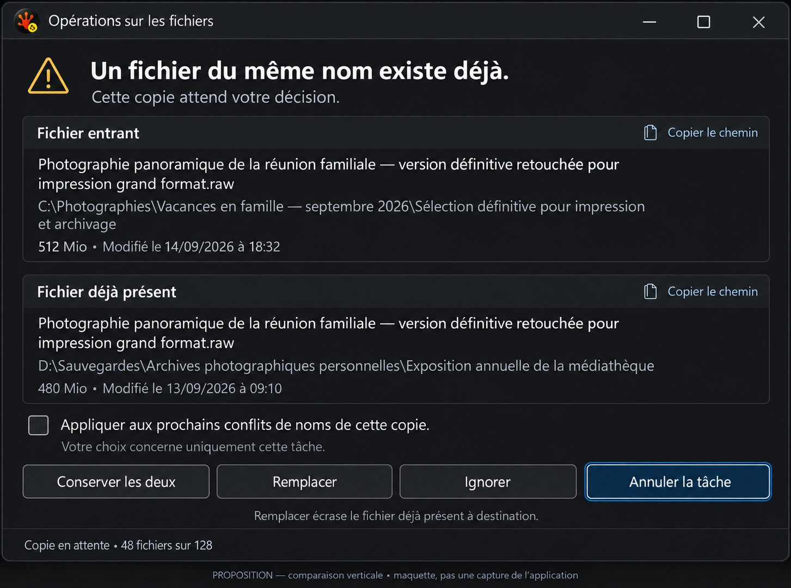
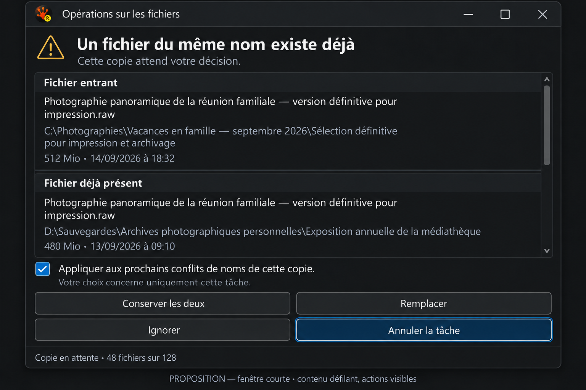
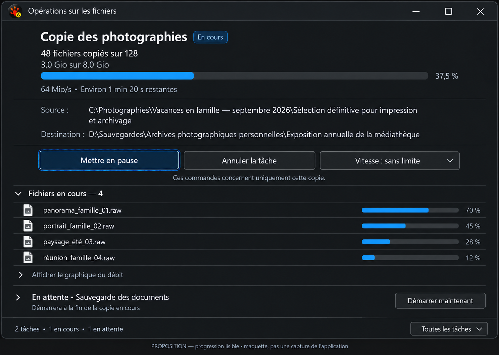

# File Operations: readable paths, decisions and results

October 1 status: the [V55 reviewed harness gallery](implementation/2026-10-01-v55-final/README.md)
contains 562 static and ten protected captures, with all 512 distinct image hashes reviewed.
The implemented conflict workspace presents the filename once, stacks the parent folders and
keeps complete French decisions available. Read-only full-path detail supports selection, exact
copy and scrolling; the adopted library fix contains the caret at native 96/144 DPI.
V65 x64 build status: passed, with zero warnings or errors. Release Full/Fresh `20261001T115346Z-104056-8e2cfb6a0b8049218c622dd915a2697e` records
2211 passed, 0 failed, 46 skipped (2257 total); the [V65 packet](../../../TestRuns/4cb089111a23/Validation/2026-10-01_i26-v65-final/README.md)
and [execution checkpoint](../../Done/UI_FileOperationsReview_2026-09-16.md) record current scope. The independent A78/B19
resource review records acceptance for I26 with stated limits: the final matched Embedded presentation and logical-resource workload, with all eight processes and outliers retained; the earlier ProgramDatabase pair stays separate, without whole-product or driver-memory claims. Published captures retain
their original V55 provenance; concept images remain proposals. Native 192-DPI, external AT,
consumer ARM64/ASan, I19 and H4 remain separate limits and owners.

## Historical implementation evidence

These dated slice notes retain their original scope and open gates. Use the current checkpoint above
for the combined implementation's status.

Latest ordinary-card refinement: [Delete without an empty byte graph](implementation/2026-09-21-deletion-progress/README.md).
Its shorter layout passes the native French gallery. The later
[clipboard ownership and inspection qualification](../../../TestRuns/4cb089111a23/Commands/2026-09-21-clipboard-ownership-native/README.md)
retains both failures and the successful canonical Commands run; the older clipboard
blocker is resolved. Broader I26 qualification remains open.

Latest retained-window refinement: [coherent Issues language changes](implementation/2026-09-21-issues-live-language/README.md).
The same window updates title, headings, actions, typed labels and accessible names
while preserving the selected record and saved column layout. Historical diagnostic
text remains unchanged. English/French captures and paired notification timings
are retained; these focused checks do not close Full/Release or resource gates.

Latest progress refinement: [measured French path labels](implementation/2026-09-21-path-label-fit/README.md).
Source/destination labels receive their measured width before the remaining path
is shortened. Delete uses deletion wording. Native 144/96-DPI label checks pass;
the [verification footer now agrees with its task bar](implementation/2026-09-21-verification-progress/README.md).

Current native update: [bounded comparison and complete decisions](implementation/2026-09-21-bounded-conflict-comparison/README.md).
One common filename or one bold row per differing name; one waiting state; stacked folders;
measured French actions; independent short-body scrolling; inspection feedback beside decisions.
Native Debug checks pass 21/21, then 6/6 unchanged confirmation; source/localization tests 199/199.
A transient monitor/DPI change invalidated the first candidate's matched timing claim. Its raw
measurements remain retained; a stable-display fixture is being qualified. Final resource, Release,
full interaction/native-DPI and broader I26 implementation gates remain open.

## Approved design

Design record revised 2026-09-20 with the user's interaction corrections, preserving all six accepted decisions.
**Approved design; current implementation and qualification are recorded above.** The common-name and inspection design supersedes
the repeated-name/waiting copy in the earlier concepts.

**Incoming and Existing are always stacked, in that order, at every window width.** Long file names and locations get the full content width. French text, a short work area, keyboard focus and pointer states are acceptance inputs, rather than optional polish. The earlier side-by-side decision mockup is superseded.

Start with the [screenshot gallery](gallery.html), [scenario inventory](scenario-inventory.md) and [validation record](validation.md). Actual application images come exclusively from the test harness. Generated concepts below are labelled separately and cannot prove text fit, DPI behavior or accessibility.

The [implementation plan](../../Done/UI_FileOperationsReview_2026-09-16.md) is complete for the qualified x64 I26 scope and is retained in Done.
The accepted product choices below retain their original meaning; this status does not close separately owned work.
Accepted choices: four direct conflict actions; French **Remplacer**; throughput **expanded by default**
with remembered disclosure state; scrolling bodies and reachable actions in short windows; complete
Issues detail with distinct conflict/decision/result meaning; and delivery of the whole review in phases.

The [inspection-control implementation evidence](implementation/2026-09-20-inspection-controls/README.md)
now covers full-width source/destination controls, exact pane selection and accessible French results.
Guarded foreground focus/hide/return now passes the focused native regression. Inspection feedback
fits above scope/actions, outside the scrolling comparison. The September 21 evidence supersedes
earlier narrow-action and short-body defects. Full state/configuration/performance acceptance remains open.

## What the new evidence changes

The [September 20 interaction review](interaction-review-2026-09-20/README.md) adds **309 fresh French
harness captures at native 144/96 DPI**, 48 directly inspected frames, and an inventory of all 26
popup action kinds plus menus, dialogs, navigation, failure and return paths. Capture success and
earlier focused test counts do not establish readable or complete UX. The review confirms cropped
actions/badges, repeated waiting text, footer overlap, truncated destination choices and unreadable
selected Issues detail. Checkbox visibility and speed-dialog spacing have improved.

The conflict's primary subject is now **one prominent filename**. Show one `Conflit de nom`
indicator and a short explanation without quoting the name again. Beneath it, Source then Destination
show their parent folders and individual metadata. Complete exact paths remain available through
labelled copy/detail. Different qualified leaf spellings remain explicit; unknown profiles use honest
exact-path fallback. These rules replace the earlier instruction to repeat the same filename in each
role. The [interactive French proposal](mockups/07-conflict-single-name-french.html) demonstrates this
hierarchy and short-window action wrapping; it is not native application validation.

Add `Afficher la destination dans le volet actif` next to the destination and the corresponding source
action. Inspection opens the qualified parent in the last-active pane and selects/focuses the exact
item, without deciding the conflict. Hide the popup only through its existing lifecycle on successful
inspection; reopening File Operations returns to the same decision, scope and invoking control.
Failed/stale/missing/filtered targets remain explicit. This new pending-conflict route differs from
completed-task Reveal and from changing a queued task's destination.

The [filename/location captures](implementation/2026-09-20-conflict-paths/README.md) now separate
names from parent locations at full width, Incoming above Existing. Qualified provider facts drive
the rows and conflict question; unknown profiles preserve the original full path. The 33/33 Debug
result validates that earlier bounded contract. Its repeated-name presentation is superseded by the
implemented single-heading design; the provider qualification facts remain applicable.

The [decision-body captures](implementation/2026-09-20-conflict-decision/README.md) now remove stale
ordinary transfer paths, mini-progress and concurrency text above an active conflict. The card
reserves its measured decision content and actions instead of the transfer body. This makes the
pending choice the primary content. Its historical 25/27 targeted Debug checks did not establish
final qualification; the current workspace and measured action wrapping are shown in the gallery above.

The [full-width metadata comparison](implementation/2026-09-20-conflict-metadata/README.md) now shows
complete size/date rows below each exact incoming/existing path, with independent accessible roles.
This removes the constrained heading-side metadata column. French 480/640/760-DIP captures and
27/27 targeted Debug checks cover this slice. The same captures retain clipped narrow actions and
duplicate ordinary progress; the complete conflict workspace, separate filename/parent and short
scrolling layout were unimplemented at that checkpoint. These historical captures are not final visual acceptance.

The [keyboard path captures](implementation/2026-09-19-path-keyboard/README.md) now show visible
focus and complete French/Unicode detail. Ctrl+C preserves the exact provider path; navigation and
row replacement/removal have native checks. September 30 adds a consumer-owned, read-only full-path
workspace inside the popup, using the existing multiline DxUi editor. It provides selection, exact
copy and scrolling without a new window, and Escape returns to the original row. The focused Debug
journey passes the >4Ki French/UNC/emoji/RTL fixture and 40 open/close cycles. Its first capture exposed
caret overflow. The qualified caret fix and reviewed October 1 root/scrolled captures now verify the
new view at native 96/144 DPI; the older bounded tooltip/copy captures retain their narrower scope.

The [graph-label implementation captures](implementation/2026-09-19-graph-labels/README.md) show measured
speed/remaining-time labels above the graph, including stacked long French text at 480 DIP.
Pixel, bounds and full UIA-value checks accompany these actual harness images. Earlier rejected
captures remain available to explain the repair. This is a completed presentation slice within the
active redesign; remaining layout/input work and final performance/Release/DPI gates stay open.
These latest captures are native 144 DPI only; the two-monitor evidence below is the earlier review.

The review now includes French resources and long French fixture sentences on both physical monitors: DISPLAY1 at **144 DPI / 150%** (3840 × 2160), and DISPLAY5 at **96 DPI / 100%** (2560 × 720). Native windows were placed on each monitor; PNGs were not resized to manufacture DPI coverage. `displays.tsv` records the actual work areas. A separate, explicitly selected interaction case uses the existing warning and runner desktop lease to take focus briefly.

The earlier missing drivers are now implemented: live Copy/Move/Delete confirmation overlays, verification-availability variants, destination history, a populated Issues pane, selection and scrolling, French resources, both monitor DPIs, and real keyboard/pointer interaction. The [inventory](scenario-inventory.md) maps the closed gaps to evidence. This finite catalog covers every current conflict class and representative display states; it does not claim every provider × locale × theme × DPI combination.

Fixtures simulate display state, not successful transfers. The real renderer, resource loader, controls, conflict policy and adjacent windows draw the screenshots. Synthetic facts and provider messages are identified in the manifest. An English system error description in a French Issues view is separately observable; it is not evidence that the French satellite failed to load.

## Existing intent and proposed improvement

| Surface | Intended job today | Proposed change | User benefit |
|---|---|---|---|
| Progress | Show work, rate, time and active files | One progress hierarchy, visible task controls, expanded-by-default graph with remembered collapse | Useful information is available immediately and the user's preferred view returns |
| Queue / preparation | Explain work that has not started | Compact phase and exact wait reason; legal actions beside it | Waiting does not resemble a stalled large empty card |
| Conflict | Present evidence and obtain a safe decision | One common filename and conflict indicator; stacked folders/metadata; direct inspection and measured decisions | The subject is immediately visible, and users can inspect the existing item before choosing |
| Confirmation | Explain consequences and operation options | Separate readable consequence text from labelled option values | Users understand what will change before starting |
| Results | Retain success, partial results and problems | Outcome sentence plus counts and useful next action | A full progress bar cannot be mistaken for success |
| Issues | Expose diagnostic details for recovery | Message and affected file first; readable selected-item detail | Users can understand and resolve an issue without decoding HRESULTs |
| Footer | Control all tasks and scheduling preferences | Explicit scope: this task, all active tasks, or new tasks | Fewer accidental global actions |

## Priorities established by the original review

The linked September 16 captures below explain the defects and approved design goals. They are
historical baseline evidence; current implementation and acceptance are linked at the start of this proposal.

### P1 — Restore task controls and measure French action text

[French running task](screenshots/10-copy-four-streams__dark__480dip__fr-FR__display1__144dpi.png) still lacks the ordinary expanded task action row. Source inspection finds `buttonsHeight` derived from conflict-only heights; both are zero for a normal task. The global footer remains visible, which encourages acting on every task when only one task is intended.

[French conflict](screenshots/33-decision-file-exists__dark__480dip__fr-FR__display1__144dpi.png) clips the decision badge and `Conserver les deux`. [Live-output decision](screenshots/54-decision-same-host-live-output__dark__480dip__fr-FR__display2__96dpi.png) clips more consequential choices. A translated label must not be squeezed into equal fixed-width slots.

Reserve a real action area independent of task state. Measure localized labels with the active font and DPI. Wrap whole buttons into rows, keeping policy order stable; if a single label still cannot fit, allow its measured text to wrap and grow the button. Keep Cancel and the safe choice reachable. Never reduce the font or ellipsize a consequential action to make a screenshot look clean.

### P1 — Keep the two file descriptions vertical

[Long French conflict](screenshots/108-decision-long-french-paths__dark__480dip__fr-FR__display1__144dpi.png) already demonstrates why the original column proposal was wrong: paths and the file name need several lines. The current renderer correctly stacks paths; retain that direction and remove duplicated context.

One common full filename heads the comparison. Each section has its role heading, parent folder,
then size/date/type metadata in a consistent order. Incoming is first and Existing second, using
the entire content width even at 760 DIP or wider. Do not append the common filename to both folders
or interpolate it into the explanation. Show genuinely different qualified names explicitly; do not
hide differences through case-folding. Inspection and labelled copy-path actions occupy their own
measured row, without taking width from the filename/folder. Highlight factual differences with text
and icons as well as semantic color.

Wrap locations preferably at separators and long filename segments at Unicode-safe boundaries. Do not insert characters into the underlying value. Provide keyboard-accessible full text and copy. Unbounded paths may scroll in the content region; the decision area remains visible. For metadata still loading, say `Vérification des informations…`; unavailable is not zero bytes. Type mismatches, links and withheld replacement remain explicit.

### P1 — Make repeat scope visibly checked

[Checked fixture](screenshots/60-decision-apply-to-all-checked__dark__480dip__fr-FR__display1__144dpi.png) and the unchecked conflict show the same `Tous similaires` strip without an unmistakable checkmark. Use a real checkbox with checked, unchecked, disabled, hovered and focused visuals, Space-key behavior and matching UIA Toggle state.

The [real Tab-focus capture](screenshots/109-keyboard-tab-focus__dark__fr-FR__display1__144dpi.png) puts a clear focus border around the entire strip, while [pointer press at 100%](screenshots/112-pointer-pressed__dark__fr-FR__display2__96dpi.png) confirms the footer button receives input. These are useful baselines, but focus must remain visually distinct from the checkbox’s checked state.

Suggested copy: `Appliquer aux prochains conflits de noms de cette copie`. Wrap it fully and add `Votre choix concerne uniquement cette tâche.` Derive visibility and scope from the conflict policy. A checked box is never independent consent for an unavailable destructive action.

### P1 — Reflow dialogs when DPI changes

Compare the custom speed validation dialog on [DISPLAY1 / 150%](screenshots/100-speed-invalid__dark__fr-FR__display1__144dpi.png) and [DISPLAY5 / 100%](screenshots/100-speed-invalid__dark__fr-FR__display2__96dpi.png). On the second display, buttons overlap the French help/error region. The valid and initial states also show overlap. This is current product evidence, not a mockup defect.

Remeasure text, control rectangles and required client height after creation, localization, DPI changes and validation changes. Input, help/error and actions must occupy separate measured rows. Respect the current monitor work area. If content exceeds the available height, scroll the body and retain visible actions; do not crop the error or move actions over it. Require a same-window 150% → 100% → 150% regression test when implementing the fix.

### P1 — Make Issues useful for a person

The [populated French Issues pane](screenshots/104-issues-populated__dark__fr-FR__display1__144dpi.png) spends most of its initial width on time, numeric task ID, operation, severity and HRESULT. The explanatory message is pushed to the right and its multiline text is vertically clipped. [Selection](screenshots/105-issues-selected__dark__fr-FR__display2__96dpi.png) adds a visible blue row, but does not make that explanation readable.

Default columns are **affected file, problem/conflict, operation, decision, result**. At narrow widths,
move operation into labelled secondary content so the problem and decision remain immediately visible.
Put timestamp, task ID, HRESULT, storage and concurrency in collapsed technical detail. Selecting an
issue opens a complete wrapped detail region below the list, with Source above Destination and
problem, decision/scope, observed result and recovery actions. Keep bounded readable grid summaries;
never paint a multiline paragraph into a single-line row. Preserve copy/export/navigation, stable
selection and typed recovery eligibility. Missing historical decision data is explicitly unrecorded.

Use a **warning triangle + “Conflit” + warning tone** for the problem, an **action arrow + “Décision :
Remplacer” + neutral/accent tone** for the accepted choice, and a **check + “Résultat : fichier remplacé”
with success tone** only after confirmed execution. Failed and unknown outcomes keep their own icon/text.
Before a choice, the card's single conflict indicator and choices communicate the pending decision;
Issues detail may say `Décision non prise`. After acceptance, use `Résultat : en cours` until evidence arrives.
These are separate facts, not successive colors of the same badge. Text and icons retain meaning in
high contrast or without color. The same language appears in the conflict card and selected issue.

### P2 — Simplify progress, confirmation and outcome language

[Running progress](screenshots/10-copy-four-streams__dark__480dip__fr-FR__display2__96dpi.png) repeats paths and gives the graph more area than controls. Show task title, progress/counts, qualified time estimate, Source and Destination, then task actions. Active files remain disclosed; throughput starts expanded and is collapsible. Discovery, transfer and verification remain distinct phases with honest unknown totals.

Remember the last explicit graph choice with normal settings persistence, alongside window placement.
An existing card retains its own live choice; new cards and a recreated popup use the last saved choice.
Default is expanded when the setting is absent. Hiding the graph retains current rate and qualified
ETA in a summary row, preserves history and actions, and does not change the saved outer rectangle.
Footer-only or compact mode does not silently overwrite the preference. The precise contract is in
[the popup spec](../../../UI/UI_FileOperationsPopup.md#graph).

The [discovery-and-transfer capture](screenshots/07-discovery-and-transfer__dark__480dip__fr-FR__display2__96dpi.png) still contains English progress wording (`so far`, `items`) despite the French UI selection. Include these sentences in the localization review and rerun their measured French version; surrounding translated controls alone do not establish complete localization.

The later French resource fix exposed another problem: one long sentence packed transferred bytes,
discovered bytes, completed items and discovered items into a single clipped line. The revised card
uses its existing two rows for separate `Découverts` and `Transférés` counters. The first row says
`Découverte à la demande` after Skip. Neither row calls the growing discovered count a final total;
the activity indicator, whole-task marquee and qualified ETA still convey an open scope. Native
480-DIP French captures must confirm that both labels and counts remain legible.

The [Copy confirmation](screenshots/102-confirmation-0__dark__fr-FR__display1__144dpi.png) also shows low visual separation between its blue paragraph text and blue background. Use the normal readable body foreground for instructions and consequences; reserve semantic color for the icon, a border or a restrained tint. Verify foreground/background contrast in the native implementation, including disabled explanation text.

The [Move confirmation](screenshots/102-confirmation-4__dark__fr-FR__display2__96dpi.png) now gives reviewable evidence of the cut-list consequence and option controls. Preserve its safety content, but use a compact consequence block and ordinary labelled values rather than button-like full-width sentences. Disabled verification must include the reason without truncation. Source and Destination still stack. Keep safe default and Escape semantics unchanged.

[Partial move](screenshots/21-move-source-kept__dark__480dip__fr-FR__display1__144dpi.png) and [unknown source state](screenshots/23-move-source-unknown__dark__480dip__fr-FR__display1__144dpi.png) cannot be explained by a 100% bar. Use `Copie effectuée ; 3 fichiers source conservés` or an explicit unknown result, with separate destination publication, source removal and verification facts. Offer `Examiner les problèmes` before Dismiss. Preserve configured auto-dismiss only for eligible outcomes.

[Destination history](screenshots/107-destination-history__dark__480dip__fr-FR__display2__96dpi__flyout.png) clips long folder labels. Prefer a two-line item (folder name, distinguishable parent path) plus accessible full path. Identical prefixes must not make choices indistinguishable. Merely showing a menu through the harness does not prove its currently missing task button is user-reachable.

## Revised mockups

The current conflict proposal is [interactive HTML](mockups/07-conflict-single-name-french.html),
with [normal](mockups/07-conflict-single-name-french.png) and
[short-window](mockups/08-conflict-single-name-short-french.png) previews. It shows the filename once,
stacked folders, complete decisions, and simulated inspection/return with preserved scope. Six browser
layouts pass overflow checks; only native harness tests can qualify the application.

The older bitmaps below are historical structure references. Concepts 04/05 are **partially
superseded**: retain vertical order and scrolling/actions, discard repeated filename/waiting copy.
The September 20 normative contract takes precedence over their illustrative text and metrics.

### A. Full-width comparison



This replaces the rejected horizontal comparison. Full-width names and locations wrap, the two roles
stay in a stable order, the scope checkbox is identifiable, and Cancel retains visible focus.
**Remplacer is approved.** Keep both, Replace, Skip and Cancel task are direct actions in that order
when eligible. Implement their placement in the engine-owned policy and wrap whole buttons as needed;
Skip All remains a separate scoped More command. Typed eligibility and safe default/Escape are preserved.
Read-only/link replacement keeps its specific explanatory wording and authority checks.

### B. Short-window comparison



The same vertical structure fits a shorter workspace by scrolling the comparison body and wrapping the action group into two rows. This model matters on the 720-pixel secondary display. The checked scope and focused safe action are visually distinct. The generated bitmap is an illustration, not proof that these exact metrics fit at 100% or 150%; native layout tests must establish that.

### C. Progress after the user collapses throughput



Task controls sit near progress and both paths use their own full-width row. **This bitmap illustrates
the collapsed state after a user choice, not the initial state.** The approved initial state shows
the throughput history expanded, with current rate and ETA; the disclosure remembers its state.
Focus/hover remain distinct from primary/default styling. Start now appears only when authorized.
Values are illustrative; unit labels must match their actual decimal/binary numeric conversion.

The default progress hierarchy is:

```text
Copie de « Archives de la présentation annuelle »          [état]
Progression globale et nombre de fichiers
Source       C:\…\Documents de préparation de la présentation
Destination  D:\…\Archives partagées de la présentation
Débit  v     32 Mio/s                           Environ 2 min
             [historique du débit visible au premier affichage]
[Mettre en pause]  [Annuler la tâche]  [options autorisées]
```

This is a structural sketch, not an application capture. In a short window, the task body scrolls
while the focused decision's actions and global footer retain accessible space.

## Proposed layout and interaction contract

| Requirement | Acceptance evidence required for implementation |
|---|---|
| Always-vertical comparison | One common filename heading; Incoming above Existing at 480, 640, 760 DIP and wider; role folders do not repeat the common name; meaningful differing names remain explicit |
| Information hierarchy | One complete conflict/loading state; no repeated waiting sentence; filename is unquoted and prominent, with full visual/UIA reading order |
| Inspect and return | Pending source/destination opens in last-active pane and selects/focuses the exact item without consent; return restores the same unresolved card, scope and invoking control; failures/stale targets are covered |
| Work-area fit | At native 96 and 144 DPI, the window and decision actions remain inside each monitor work area, including the short secondary display |
| Text measurement | No clipped critical labels, warning paragraphs, validation text or checkbox scope; no buttons over help text |
| Adaptive actions | Whole-button wrapping preserves policy order, keyboard order and readable labels; content scroll does not hide the safe exit |
| Stable keyboard focus | Tab/Shift+Tab reach visible actions; state changes do not jump focus to a destructive choice; focus survives reflow and monitor changes |
| Pointer states | Hover, pressed, disabled and checked are distinct; hit rectangles match paint rectangles after a DPI move |
| Paths and disclosure | Complete values available without hover; copy preserves the exact value; tooltips supplement rather than replace readable content |
| Remembered throughput | Starts expanded; explicit collapse/expand survives settings round trip/restart; current rate and ETA remain visible; window placement stays intact |
| Conflict versus decision | Label, icon and semantic color distinguish problem, accepted action/scope and observed outcome; no success badge based solely on a choice |
| Safety semantics | Allowed/default/Escape actions, repeat scope, metadata gates and source recovery come from existing typed policy |
| Accessible meaning | Names, values, selection and toggle state exposed consistently; actual UIA and assistive-technology checks supplement screenshots |
| Window lifecycle | No new focus theft on progress/conflict arrival; renderer fallback still exposes valid Cancel all and Close |

200% DPI and other locales remain later implementation qualification; the current machine supplied genuine 100% and 150% evidence. Do not label image rescaling as native DPI testing.

## DxUi work is allowed and expected

Use the canonical library, extending existing controls where needed. RedSalamander supplies operation state, wording and action policy. A library change requires an explicit later consumer pin update.

| Shared capability | Required improvement |
|---|---|
| Measured action group | Wrap buttons, support long labels, preserve focus/order and guarantee a nonzero action area |
| Labelled path/value block | Full-width Unicode wrapping, accessible full value, copy affordance and measured metadata rows |
| Checkbox | Visible toggle state, keyboard/pointer parity and UIA Toggle semantics in every theme |
| Dialog layout | Reflow after DPI/locale/validation changes, measured help/error region and work-area-aware body scrolling |
| Grid and detail view | Bounded readable rows, selected-item details, stable selection/scroll position and DPI-correct input bounds |
| Scroll/disclosure container | Stable anchors, visible actions, no forced window growth beyond the work area |
| Progress/status primitives | Named phases and outcomes; bounded graph history and reduced-motion/idle behavior |

Use one measured layout for drawing, input, tooltip and UIA bounds. Shared improvements need catalog/gallery entries and meaningful interaction tests, including French sentences and mixed DPI. Existing DxUi limitations do not constrain the intended UX.

## Implementation sequence

The [P0–P5 implementation plan](../../Done/UI_FileOperationsReview_2026-09-16.md) sequences baseline/failure
witnesses, shared measured layout and first fixes, vertical conflicts/direct actions, remembered
throughput and progress/confirmations/outcomes, Issues, then integrated qualification. DxUi has its
own generic capability owner and explicit consumer adoption step. I18 retains confirmation policy
and richer metadata outcomes. The design decisions are complete; implementation and its no-clipping,
interaction, persistence and resource acceptance remain to be delivered.

Within that sequence, the [September 20 matrix M01–M32](interaction-review-2026-09-20/README.md) is the
required interaction inventory. Prioritize the single-name/status correction, qualified measured
action/header/short-height layout, then pending-item inspection/return and remaining Issues flows.
Every entry requires actual outcomes and failure/return paths; a screenshot of a menu is insufficient.


### Guarded inspection implementation, 2026-09-20

[Current harness gallery](implementation/2026-09-20-inspection-focus/gallery.html) demonstrates exact item focus and keyboard return to the unresolved decision. UIA/Space/Enter and unchanged scope/default/cancel are verified. Narrow/short layout, native DPI/AT and final performance acceptance remain open.

### Retained body viewport, 2026-09-20

[Reviewed harness frames](implementation/2026-09-20-hosted-body/gallery.html) show the explicit short height and full keyboard focus ring above the footer. Retained controls now share its body clip; collapsed completed-card children retire on the first frame. The focused 18/18 matrix passes. Whole-action wrapping and oversized-card action retention remain implementation work.
