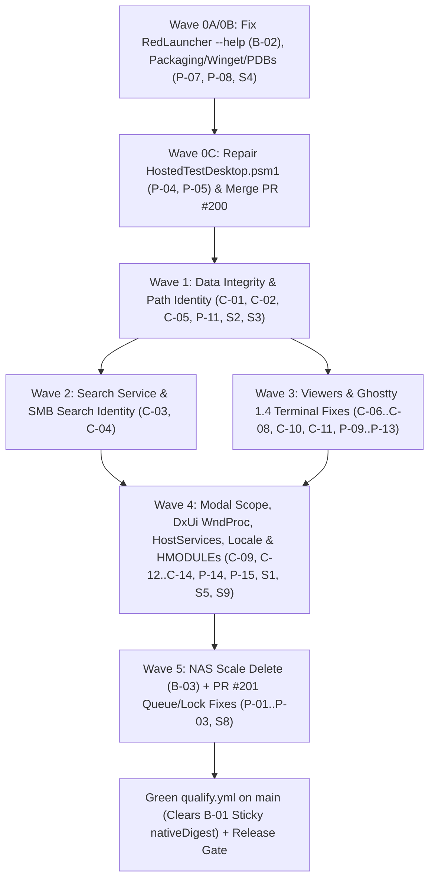

# I60 Pre-production readiness, defect remediation, and bounded simplification

> **NON-NORMATIVE ACTIVE PLAN.** Execution roadmap and implementation-ready remediation specification for the 2026-11-07 pre-production review across `main`, active release-blocking pull requests (`PR #200` and `PR #201`), and `origin/ci-state`. Current product behavior, build/release gates, ABI stability, and testing contracts remain governed by [AGENTS.md](../../../AGENTS.md), the [Specification Authority Catalog](../../README.md), public headers under `Common/PlugInterfaces/`, machine schemas/manifests, and the normative domain contracts linked below.

## Status and scope

- **State:** ACTIVE — ready for implementation; implementation has not started.
- **Priority:** P0 pre-production release gate.
- **Owner:** release engineering and subsystem maintainers (coordinate per wave with the existing indexed owners listed in [Section 2](#2-ownership-and-coordination-with-active-plans)).
- **Planned at:** `main` commit `79d861652d065b3559f6a23eb7ff9e98e476e0f5` (2026-11-07, clean checkout), cross-checked against remote CI state `origin/ci-state` (`3ea5d9b66c26f70bb3b8745ac48da33e22e34c6e`), open `PR #200` (`ej/ci-public-native-closeout-20261031` at `883ad92d9e5449f4e65d3792c2a278626df6d5fc`), open `PR #201` (`ej/fileops-waiting-state-20261031` at `cbee8aaddc6de3d00af9aa9da811e7ea24b283b7`), diagnostic probe branch `ej/pr200-wgc-api-probe-20261107` (`9c2f41135`), and archived NAS qualification evidence `ej/pr200-201-qualification-evidence-20261103` (`5d9f0baee`).
- **Authorized scope:**
  1. Unblock release qualification and publication (`Wave 0`: `B-01`, `B-02`, `P-04`–`P-08`, plus CI/packaging hardening and simplification `S4`).
  2. Eliminate silent data-corruption, wrong-target mutation, and path/cache aliasing bugs (`Wave 1`: `C-01`, `C-02`, `C-05`, `P-11`, transaction/breadcrumb/leftover-cleanup hardening, and simplifications `S2`, `S3`).
  3. Eliminate `LocalSystem` search-service DoS/cross-volume corruption, SMB identity-less search skips, and virtual-path kernel probes (`Wave 2`: `C-03`, `C-04`, broker/enumeration/MTP hardening).
  4. Eliminate viewer and embedded-terminal crashes, UI freezes, memory exhaustion, and Ghostty 1.4 runtime patch wedges (`Wave 3`: `C-06`–`C-08`, `C-10`, `C-11`, `P-09`, `P-10`, `P-12`, `P-13`, and viewer/terminal hardening).
  5. Eliminate nested Win32 modal use-after-free, `DxUi::WindowHost` teardown/DPI bugs, hot-reload UAF, off-UI-thread prompt races, `std::locale("")` startup `std::terminate`, and plugin/satellite `HMODULE` lifecycle races (`Wave 4`: `C-09`, `C-12`–`C-14`, `P-14`, `P-15`, host/dialog hardening, and simplifications `S1`, `S5`, `S9`).
  6. Repair `PR #201` queue starvation, paused exclusive-transfer lockouts, multi-item delete aborts, and the NAS `Delete_IdentityLessPinnedTreeScale` 60-second timeout (`Wave 5`: `B-03`, `P-01`–`P-03`, and simplification `S8`).
- **Explicitly deferred past the upcoming production cut:** high-churn structural refactors (`S6`, `S7`, `S10`, `S11`, `S12`) documented in [Section 10](#10-deferred-post-cut-simplifications-do-not-bundle-into-the-production-cut) so they do not destabilize release stabilization.
- **Drift check:** run the commands below and inspect dirty/untracked state in `main` and any target PR worktree before editing any wave. Re-read cited line ranges if any file in the wave has changed since `79d861652d065b3559f6a23eb7ff9e98e476e0f5`.

```powershell
git status --short
git fetch origin main ci-state
git rev-parse HEAD origin/main origin/ci-state
git diff --stat 79d861652d065b3559f6a23eb7ff9e98e476e0f5..HEAD -- .ci .ci-engine .github Common Installer Plugins RedConfigure RedLauncher RedSalamander RedSalamanderSearchService RuntimeDependencies.props Specs Tools
```

## Reading guide

- [1. Executive summary and release-cut sequencing](#1-executive-summary-and-release-cut-sequencing)
- [2. Ownership and coordination with active plans](#2-ownership-and-coordination-with-active-plans)
- [3. Authoritative contracts to keep synchronized](#3-authoritative-contracts-to-keep-synchronized)
- [4. Wave 0 — Release pipeline, launcher smoke, packaging, and PR #200 stabilization](#4-wave-0--release-pipeline-launcher-smoke-packaging-and-pr-200-stabilization)
- [5. Wave 1 — Silent data-corruption, transaction, and path-identity fixes](#5-wave-1--silent-data-corruption-transaction-and-path-identity-fixes)
- [6. Wave 2 — Search service safety, SMB search identity, and VFS enumeration fixes](#6-wave-2--search-service-safety-smb-search-identity-and-vfs-enumeration-fixes)
- [7. Wave 3 — Viewer plugins and Ghostty 1.4 terminal runtime fixes](#7-wave-3--viewer-plugins-and-ghostty-14-terminal-runtime-fixes)
- [8. Wave 4 — Modal lifetime, DxUi window teardown, HostServices, locale, and plugin HMODULE safety](#8-wave-4--modal-lifetime-dxui-window-teardown-hostservices-locale-and-plugin-hmodule-safety)
- [9. Wave 5 — NAS scale-delete RPC reduction and PR #201 queue/lock fixes](#9-wave-5--nas-scale-delete-rpc-reduction-and-pr-201-queuelock-fixes)
- [10. Deferred post-cut simplifications (do not bundle into the production cut)](#10-deferred-post-cut-simplifications-do-not-bundle-into-the-production-cut)
- [11. Verification and release-qualification matrix](#11-verification-and-release-qualification-matrix)
- [12. Out-of-scope boundaries, rollback, done criteria, and STOP conditions](#12-out-of-scope-boundaries-rollback-done-criteria-and-stop-conditions)

---

## 1. Executive summary and release-cut sequencing

Red Salamander cannot cut a production release from `main` (`79d861652d065b3559f6a23eb7ff9e98e476e0f5`) today for three immediate reasons (`B-01`–`B-03`), backed by 14 critical data-safety/memory-safety bugs (`C-01`–`C-14`) and 15 high-severity regressions (`P-01`–`P-15`):

1. **Publication is hard-blocked by CI state (`B-01`)**: `origin/ci-state` (`3ea5d9b66c26f70bb3b8745ac48da33e22e34c6e`) records `"outcome": "failed"` for `qualify.yml` run `41666575901` on `16fbcb79e1a2` (`v7.0.484`), and zero green `qualify.yml` runs exist in history. Because subsequent commits on `main` only touched docs/plans/changelog paths excluded from `nativeDigest`, `coordinate.yml` re-stamps `failure` without running `qualify.yml`, and `publish.yml` immediately aborts.
2. **Release smoke and packaging have blind spots (`B-02`, `P-07`, `P-08`)**: `RedLauncher.exe --help` spawns `App\RedSalamander.exe` asynchronously and exits `0` immediately, letting broken Release packages pass Winget smoke while racing `winget uninstall --purge`; official Portable ZIPs ship orphan `RedConfigure` satellites, test-only `FileSystemDummy.dll`, and unguarded fake MTP test code, while missing 5 vcpkg runtime DLLs in `RuntimeDependencies.props`, stripping Winget metadata, archiving zero Release `.pdb` symbols, and leaving binaries unsigned.
3. **Core user workflows have reachable data-corruption and crash paths (`C-01`–`C-14`)**, while unmerged `PR #200` (`P-04`, `P-05`) and `PR #201` (`B-03`, `P-01`–`P-03`) each carry regressions that must be fixed before merge.

### Recommended branch and merge order



- **Rule 1 — Stabilize `main` + `PR #200` before `PR #201`**: Land `Wave 0` (`RedLauncher`, packaging/Winget/PDB fixes, and repaired `PR #200` including `P-06` doc-drift repair) first so CI and hosted desktop self-tests become trustworthy.
- **Rule 2 — Ship waves as small, reviewable PRs**: Each wave (`W0`–`W5`) may be split into 1–3 focused PRs per subsystem so failures isolate cleanly and `nativeDigest` advances with real native fixes.
- **Rule 3 — Hold `PR #201` until `Wave 5` passes**: Do **not** merge `PR #201` onto `main` until `P-01` (`QueueLifecycleState`), `P-02` (paused exclusive-transfer release), `P-03` (per-item deferred delete authority), and `B-03` (NAS scale delete timeout) are fixed and proven on NAS. If the production cut must ship before `PR #201` UX changes are ready, ship `B-03` directly on `main` and hold `PR #201` for the next release.
- **Rule 4 — Enforce `AGENTS.md` C++/Win32 invariants in every fix**:
  - **Never** call `DestroyWindow(_hWnd.get())` on a `wil::unique_hwnd` owner ([AGENTS.md](../../../AGENTS.md)). Inside `WndProc(HWND hwnd, ...)`, pass `hwnd` to `DestroyWindow(hwnd)` and release smart-pointer ownership in `WM_NCDESTROY` via `if (_hWnd.get() == hwnd) { _hWnd.release(); }`; outside `WndProc`, call `_hWnd.reset()`.
  - **Never** write `catch (...)` ([AGENTS.md](../../../AGENTS.md)). Catch specific named exception types (`const std::runtime_error&`, `const std::system_error&`, `const std::exception&`) and allow `std::bad_alloc` to terminate cleanly in `noexcept` boundaries.

---

## 2. Ownership and coordination with active plans

`I60` owns bounded pre-production defect remediation and pre-cut surgical simplifications (`S1`–`S5`, `S8`–`S9`). It does **not** absorb feature roadmaps or historical evidence programs owned by existing plans:

| Existing plan | Coordination boundary with `I60` |
|---|---|
| [I5](Operation_PerfMeasurementContract_2026-07-06.md) | `I60` Wave 4 (`W4.4` / `S5`) fixes `Debug::Perf::Emit` zero-duration unit corruption (`"count"` vs `"us"`). Broader perf budget enforcement remains with `I5`. |
| [I6](Operation_RosettaLantern_RedConfigureSatelliteLocalizationReview_2026-07-17.md) | `I60` Wave 0 (`W0.2`) stops shipping orphan `RedConfigure` satellite DLLs until `fr-FR` parity and `I6` human review close; `RedConfigureSession` dual-table unification (`S11`) is deferred post-cut. |
| [I8](Win32_Inventory.md) | `I60` Wave 4 (`W4.1`) repairs live `DxUi::WindowHost` `WM_NCDESTROY`/`WM_DPICHANGED` bugs while preserving `I8`'s `wil::unique_hwnd` ownership rules. |
| [I15](Terminal_GhosttyUpgradeReviewRemediation_2026-08-28.md), [I51](Terminal_Ghostty140_Integration_2026-10-28.md), [I59](Terminal_LibGhosttyVt100_Migration_2026-11-07.md) | `I60` Wave 3 (`W3.5`) fixes defects in the currently shipped Ghostty 1.4.0 patch and `Terminal` plugin. `I59` remains the separate future `libghostty-vt 1.0.0` migration proposal (and must carry forward `W3.5`'s Kitty placement/reset fixes when executed); `I15` and `I51` retain their historical/paired evidence obligations. |
| [I18](UI_ConfirmationPreferencesAndOperationOutcomes_2026-09-08.md) | `I60` Wave 4 (`W4.2`, `W4.3`) fixes off-UI-thread consent prompt marshaling and shutdown prompt fences; broader Confirmation-page preferences remain with `I18`. |
| [I29](FileOperations_PostMergeQualification_2026-10-05.md), [I36](CodeReview_MasterMerges_2026-10-05.md), [I50](CodeReview_MainMerges_2026-10-28.md), [I57](DeliveryReview_Remediation_2026-10-31.md) | `I60` Wave 0 (`W0.4`) requires closing or explicitly reconciling `I57` workstream `W3` (`FileOperationMoveBreadcrumb` schema-1 projection + `W1.6` elevated/WerFault PID fix) before release. `I29`, `I36`, and `I50` retain their ARM64/device/qualification closeout records. |
| [I31](DxUi_HostMessagesToolsetAndRestore_2026-10-01.md) | `I60` Wave 4 (`W4.1`) adapts RedSalamander's `WndProc` callers to `DxUi::WindowHost`'s existing `handled = true` contract without changing the pinned DxUi ABI. |
| [I33](ViewerSpace_ConsolidatedRoadmapAndQualification_2026-10-22.md) | `I60` Wave 3 (`W3.4`) repairs `ViewerSpace` instance-reuse state loss (`_hostPaneExecute`/watermarks), modal generation checks, and `Color by` redraw; feature work stays in `I33`. |
| [I48](Msvc1452ReleaseOptimization_2026-10-23.md), [I53](NativeBuildPolicyCoherence_2026-10-28.md) | `I60` Wave 0 (`W0.2`, `W0.3`) adds Release `.pdb` symbol archival and keeps `/Wall` zero-warning compliance across all native edits. |
| [I52](HostedCiRepair_2026-10-28.md), [I56](CI_HostedAcceptance_2026-10-31.md) | `I60` Wave 0 (`W0.1`–`W0.4`) supplies the concrete launcher, packaging, Winget, and `HostedTestDesktop.psm1` fixes needed for `I52`/`I56` to achieve a green `qualify.yml` and unblock `publish.yml` (`B-01`). |
| [I58](PlanningLifecycleAndOwnerReconciliation_2026-11-03.md) | `I60` Wave 0 (`W0.4`) lands the `DocumentationDriftContracts.Tests.ps1:300` provenance guard repair (`P-06`) tracked in `I58` `R1`. |

---

## 3. Authoritative contracts to keep synchronized

When an implementation wave modifies durable runtime, packaging, or UI behavior, update the corresponding normative spec and `Specs/NormativeConsistency.json` in the **same** PR:

| Wave | Normative contracts and schemas to verify / update |
|---|---|
| **Wave 0** | [Build_UnifiedCI.md](../../Build/Build_UnifiedCI.md), [Installer_PortableZip.md](../../Installer/Installer_PortableZip.md), [WingetIntegration.md](../../Installer/WingetIntegration.md), [Core_StartupBootstrap.md](../../Core/Core_StartupBootstrap.md), [Testing_ToolingGovernance.md](../../Testing/Testing_ToolingGovernance.md), `Tools/tool-inventory.json` |
| **Wave 1** | [UI_BatchRenameWindow.md](../../UI/UI_BatchRenameWindow.md), [Core_DirectoryInfoCache.md](../../Core/Core_DirectoryInfoCache.md), [Core_SharedHelpers.md](../../Core/Core_SharedHelpers.md), [Plugins_ViewerText.md](../../Plugins/Plugins_ViewerText.md), [FileSystem_FileOperations.md](../../FileSystem/FileSystem_FileOperations.md) |
| **Wave 2** | [Core_Search.md](../../Core/Core_Search.md), [Plugins_VirtualFileSystem.md](../../Plugins/Plugins_VirtualFileSystem.md), [UI_FolderView.md](../../UI/UI_FolderView.md), [FileSystem_Mtp.md](../../FileSystem/FileSystem_Mtp.md) |
| **Wave 3** | [Plugins_ViewerText.md](../../Plugins/Plugins_ViewerText.md), [Plugins_ViewerVLC.md](../../Plugins/Plugins_ViewerVLC.md), [Plugins_ViewerWeb.md](../../Plugins/Plugins_ViewerWeb.md), [Plugins_ViewerSpace.md](../../Plugins/Plugins_ViewerSpace.md), [Terminal_EmbeddedPlugin.md](../../Terminal/Terminal_EmbeddedPlugin.md) |
| **Wave 4** | [Plugins_ViewerPlugins.md](../../Plugins/Plugins_ViewerPlugins.md), [Plugins_PluginAPI.md](../../Plugins/Plugins_PluginAPI.md), [UI_TopLevelToolWindows.md](../../UI/UI_TopLevelToolWindows.md), [UI_NavigationView.md](../../UI/UI_NavigationView.md), [Core_ConnectionManager.md](../../Core/Core_ConnectionManager.md), [Core_Localization.md](../../Core/Core_Localization.md), [Core_SettingsStore.md](../../Core/Core_SettingsStore.md), [UI_PreferencesDialog.md](../../UI/UI_PreferencesDialog.md) |
| **Wave 5** | [FileSystem_FileOperations.md](../../FileSystem/FileSystem_FileOperations.md), [UI_FileOperationsPopup.md](../../UI/UI_FileOperationsPopup.md), [Testing_PerformanceValidation.md](../../Testing/Testing_PerformanceValidation.md) |

---

## 4. Wave 0 — Release pipeline, launcher smoke, packaging, and PR #200 stabilization

### W0.1 — Make `RedLauncher.exe` wait on `--help` / `--version` and prevent headless `MessageBoxW` hangs (`B-02`)

- **What the problem is:**
  During CI Winget qualification (`.ci-engine/Tools/Modules/Ci.WingetInstall.psm1:103-117`), CI runs `RedSalamander.exe --help` and `red.exe --help` (both shims compiled from `RedLauncher`) and immediately runs `winget uninstall --purge`. Today, `RedLauncher` only waits for `--selftest*` flags; for `--help`, it spawns `App\RedSalamander.exe --help` asynchronously and exits `0` immediately. This creates three bugs:
  1. If `App\RedSalamander.exe` crashes on startup (for example, missing DLLs), `RedLauncher` still returns `0` and CI falsely marks smoke validation green.
  2. Two detached `App\RedSalamander.exe` processes are still loading DLLs inside `$installRoot\App` milliseconds later when `winget uninstall --purge` tries to delete the folder, causing flaky file-lock uninstall failures.
  3. Because `RedLauncher` exited without passing console handles (`bInheritHandles = FALSE`), `AttachConsole(ATTACH_PARENT_PROCESS)` in `RedSalamander/RedSalamander.cpp:7484` fails, and if headless console creation fails, line `7501` opens a blocking modal `MessageBoxW` (`ShowFatalErrorDialog`) that hangs unattended runners.
- **How to solve it:**
  1. In `RedLauncher/Main.cpp` (`ShouldWaitForTargetExit`, `lines 268-302`), extend the synchronous-wait predicate to return `true` for `--help`, `-h`, `/?`, and `--version` in addition to `--selftest*`, waiting for the child process and propagating its actual exit code.
  2. When waiting synchronously for CLI help/version/selftest invocations and parent standard handles are valid, pass standard output/error handles cleanly (or keep `AttachConsole(ATTACH_PARENT_PROCESS)` working because the parent `RedLauncher.exe` process stays alive until `App\RedSalamander.exe` exits).
  3. In `RedSalamander/RedSalamander.cpp` (`wWinMain`, `lines 7450-7508`), if writing `--help` output to an attached/allocated console is unavailable in a non-interactive session (or when `stdout`/`stderr` handles are redirected pipes), write UTF-8 help text directly to `GetStdHandle(STD_OUTPUT_HANDLE)` when valid and return a non-zero exit code without calling modal `ShowFatalErrorDialog` when running headless.
- **Verification:**
  - Add unit coverage in `RedLauncher` / `PortablePackageSmoke.Tests.ps1` proving `RedSalamander.exe --help` and `red.exe --help` block until `App\RedSalamander.exe` exits, propagate non-zero child exit codes, emit help text without opening a modal dialog, and leave zero running processes in the extracted package root upon return.

### W0.2 — Clean Portable ZIP staging, explicit `RuntimeDependencies.props`, and official release hygiene (`P-07`)

- **What the problem is:**
  1. `Installer/zip/build-zip.ps1:202-230` stages files with broad `*.dll` and `Lang\*.dll` wildcards. Every official Portable ZIP currently ships 3 orphan `Lang\RedConfigure-{cs-CZ,ja-JP,sk-SK}.dll` files (even though `RedConfigure.exe` is not in the ZIP and lacks `fr-FR`), ships test-only `Plugins\FileSystemDummy.dll`, compiles `Plugins/FileSystemMtp/FileSystemMtp.Tests.FakeBackend.cpp` unconditionally into Release `FileSystemMtp.dll`, and leaks `PerformanceTests2.dll` + `Lang\LocalizationTests-*.dll` whenever `-ProductionOnly` is omitted (such as `.github/workflows/ghostty-runtime-product-qualification.yml:204-225`).
  2. `RuntimeDependencies.props` omits 5 required vcpkg runtime DLLs (`blake3.dll`, root `yyjson.dll`, `Plugins\pe-parse.dll`, `Plugins\sqlite3.dll`, `Plugins\spng.dll`), relying on implicit MSBuild vcpkg `applocal.ps1` side effects.
  3. `Tools/Modules/Testing/PortablePackageSmoke.psm1:165-180` omits `Plugins\FileSystemMtp.dll` from its required plugin list, and `Tools/Invoke-ProjectCi.ps1` copies test-only `PluginContractTests.exe` into the sealed `-OfficialRelease` output tree.
- **How to solve it:**
  1. Guard `Plugins/FileSystemMtp/FileSystemMtp.Tests.FakeBackend.cpp` with `#ifdef ENABLE_TESTS` (or exclude it from non-test Release configurations in `FileSystemMtp.vcxproj`) so production `FileSystemMtp.dll` contains zero fake backend symbols.
  2. Declare `blake3.dll`, root `yyjson.dll`, `Plugins\pe-parse.dll`, `Plugins\sqlite3.dll`, and `Plugins\spng.dll` explicitly in `RuntimeDependencies.props`.
  3. Replace wildcard staging in `Installer/zip/build-zip.ps1` with an explicit allowlist of shipped executables, plugins, runtime DLLs, and `RedSalamander` + shipped-plugin satellite DLLs (`cs-CZ`, `fr-FR`, `ja-JP`, `sk-SK`), excluding `RedConfigure-*`, `LocalizationTests-*`, `FileSystemDummy.dll`, `PerformanceTests2.dll`, and `PluginContractTests.exe` by default (make `-ProductionOnly` default to `$true`, or require an explicit `-IncludeTestBinaries` switch for internal test archives).
  4. Stop copying `PluginContractTests.exe` into the `-OfficialRelease` build directory in `Tools/Invoke-ProjectCi.ps1` (stage it in a sibling test-runner folder instead), and add `Plugins\FileSystemMtp.dll` + forbidden-file assertions (`FileSystemDummy.dll`, `RedConfigure-*.dll`, `LocalizationTests-*.dll`, `PluginContractTests.exe`) to `Tools/Modules/Testing/PortablePackageSmoke.psm1`.
- **Verification:**
  - `Invoke-Pester .\Tools\Tests\PortablePackageSmoke.Tests.ps1 -PassThru` and a Release `build-zip.ps1` smoke run verifying exact expected manifest entries on x64 and ARM64.

### W0.3 — Unify Winget manifest generation (`S4`), fix 404 locale URLs, archive Release `.pdb`s, and wire signing readiness (`P-08`)

- **What the problem is:**
  1. `.ci-engine/Tools/Modules/Ci.Publication.psm1:119-177` (`New-CiWingetManifest`) hand-builds minimal YAML from scratch instead of calling `Installer/winget/generate-manifest.ps1`, stripping `Moniker: redsalamander`, `Tags`, `Description`, `ReleaseNotesUrl`, and documentation links. Meanwhile, `Installer/winget/templates/RedSalamanders.RedSalamander.locale.en-US.yaml:14-43` points to dead `/blob/master/...` URLs (404 on GitHub, since the default branch is `main`).
  2. Release LTCG builds emit `.pdb` symbols (`GenerateDebugInformation=true` in `Directory.Build.targets:85`), but neither `build-zip.ps1` nor `Invoke-ProjectCi.ps1` archives them as a CI/release symbol bundle, making field crash dumps unsymbolizable.
  3. No Authenticode signing step or verification hook exists in the release pipeline.
- **How to solve it:**
  1. Fix all `/blob/master/` URLs in `Installer/winget/templates/RedSalamanders.RedSalamander.locale.en-US.yaml` to `/blob/main/` (and verify every URL against the public repo layout).
  2. **Simplification `S4`**: Delete the duplicate YAML string builder inside `.ci-engine/Tools/Modules/Ci.Publication.psm1` (`New-CiWingetManifest`) or delegate project Winget generation through `Installer/winget/generate-manifest.ps1` + templates so CI and local tooling share one schema-validated `1.10.0` Winget manifest generator.
  3. Add a deterministic `RedSalamander-<version>-win-<arch>-symbols.zip` artifact in `Installer/zip/build-zip.ps1` / `Tools/Invoke-ProjectCi.ps1` containing all Release `.pdb`s matching the exact shipped `.exe`/`.dll` PE timestamps/GUIDs (never bundled inside the user-facing Portable ZIP).
  4. Add an optional, fail-closed Authenticode signing hook in `Tools/Invoke-ProjectCi.ps1` / `publish.yml` (signing all shipped `.exe` and `.dll` files before ZIP creation when signing credentials are configured, and recording `signed: true|false` honestly in the build receipt; require an explicit owner decision before cutting a public release unsigned).
- **Verification:**
  - Winget manifest unit tests + `winget validate --manifest <dir>`, symbol-archive PE/PDB GUID match check, and `Tools/Tests/CiPublication.Tests.ps1`.

### W0.4 — Repair `PR #200` `HostedTestDesktop.psm1`, land `D-09` doc-drift fix, close `I57` `W3`, and fix CI tooling (`P-04`, `P-05`, `P-06`, `B-01`)

- **What the problem is:**
  1. **`P-04` (`PR #200` `883ad92d9` & `PR #201` `cbee8aadd`)**: `Tools/Modules/Testing/HostedTestDesktop.psm1:349` creates the hosted foreground boundary window with extended style `0x08040080` (`WS_EX_NOACTIVATE | WS_EX_APPWINDOW | WS_EX_TOOLWINDOW`). As already proven on probe branch `ej/pr200-wgc-api-probe-20261107`, `WS_EX_NOACTIVATE` prevents Windows from returning activation to the boundary window when owned test dialogs close. In addition, `RestoreForeground` (`lines 316, 328`) calls `Thread.Sleep(10)` for up to 1,500ms on `handle`'s own UI thread without pumping `WM_ACTIVATE`/`WM_NCACTIVATE`/`WM_KILLFOCUS`, and `Dispose()` (`line 413`) falls back to unbounded `thread.Join()`.
  2. **`P-05` (`PR #200` `883ad92d9`)**: `AcquireWithOwnedHotkey` (`HostedTestDesktop.psm1:250-296`) sends `Alt+F24`, releases `VK_F24` and `VK_MENU` in `finally`, and immediately throws at line `294` if `GetForegroundWindow() != handle || GetFocus() != handle`, omitting the post-`VK_MENU`-release `SetForegroundWindow(handle)` + `SetFocus(handle)` retry required on Windows 11 (`Tests/TestSupport/TestSupport.Tests.DirectedSelfTestInputWarning.h:330-377`). The comment on `Invoke-RSWithHostedDefaultDesktop` also falsely states that no synthetic input is injected.
  3. **`P-06` (`main`)**: `Tools/Tests/DocumentationDriftContracts.Tests.ps1:300` fails on `main` because its all-review loop asserts July 17 Observatory metadata on `Specs/Reviews/WIP_FolderQuality_2026-11-01.md` (already fixed on `PR #200`), and [I57](DeliveryReview_Remediation_2026-10-31.md) workstream `W3` remains open on `main`.
  4. **CI & PowerShell tooling bugs**: `.github/workflows/build-reusable.yml` runs `setup-msvc` even for static `DesktopProbe` and clobbers `MSBUILD_EXE_PATH` via `vswhere -latest`; `Tools/Invoke-ProjectCi.ps1` has an unreachable duplicate `Qualification` switch branch; `Tools/Submit-ChangelogFold.ps1` runs `git fetch origin main` unconditionally even under `-WhatIf`; `Tools/Modules/Build/DxUiDependency.psm1:235` invokes legacy `powershell.exe` 5.1 instead of `pwsh`; `ClangFormat.psm1:39` and `Changelog.psm1:277` use zero-retry lock opens (`FileShare.None`); `Tools/tool-inventory.json` still lists deleted `release.yml` and `winget-release.yml`; and `GhosttyCandidateOverlay.psm1:163-197` merges `2>&1` stderr into git patch hashes.
- **How to solve it:**
  1. In `HostedTestDesktop.psm1` on `PR #200`:
     - Remove `WS_EX_NOACTIVATE` (`0x08000000`) from `CreateWindowExW` (`line 349` -> `0x00040080` or standard activatable tool boundary matching the validated probe fix).
     - After releasing `VK_F24` and `VK_MENU` in `AcquireWithOwnedHotkey`, if `GetForegroundWindow() != handle || GetFocus() != handle`, retry `SetForegroundWindow(handle)` and `SetFocus(handle)` while pumping queued activation messages before failing line `294`, and update `Invoke-RSWithHostedDefaultDesktop`'s docstring to describe the guarded `Alt+F24` chord accurately.
     - Replace `Thread.Sleep(10)` inside `RestoreForeground` (`lines 316, 328`) with `MsgWaitForMultipleObjectsEx` + `PeekMessageW`/`DispatchMessageW` so `handle`'s UI thread processes deactivation/kill-focus messages promptly, and bound `Dispose()` teardown with diagnostic thread-stack/window logging if `joinThreshold` expires.
  2. Merge repaired `PR #200` to `main` (which also lands the `DocumentationDriftContracts.Tests.ps1:300` fix for `P-06`).
  3. Fix the CI/PowerShell script issues in `.github/workflows/build-reusable.yml`, `Tools/Invoke-ProjectCi.ps1`, `Tools/Submit-ChangelogFold.ps1` (`if ($PSCmdlet.ShouldProcess(...))` around `git fetch`), `DxUiDependency.psm1` (`pwsh -NoLogo -NoProfile`), `ClangFormat.psm1` / `Changelog.psm1` (bounded retry with backoff on lock acquisition), `GhosttyCandidateOverlay.psm1` (separate `stderr` from `stdout` before hashing), and regenerate `Tools/tool-inventory.json` via `Tools/Get-ToolInventory.ps1 -Write`.
  4. Reconcile or complete [I57](DeliveryReview_Remediation_2026-10-31.md) alongside Wave 1 `W1.6` (`FileOperationMoveBreadcrumb.cpp`).
- **Verification:**
  - `Invoke-Pester .\Tools\Tests\DocumentationDriftContracts.Tests.ps1, .\Tools\Tests\HostedTestDesktop.Tests.ps1, .\Tools\Tests\ToolInventory.Tests.ps1 -PassThru` (0 failed), plus `.ci-engine/Tools/Test-Workflows.ps1`.

---

## 5. Wave 1 — Silent data-corruption, transaction, and path-identity fixes

### W1.1 — Gate `BatchRenameWindow` execution on a monotonic `_rulesRevision` (`C-01` + Simplification `S3`)

- **What the problem is:**
  In `RedSalamander/BatchRenameWindow.cpp`, editing any rule text box calls `RequestPreviewRebuild` (`lines 3455-3473`), which sets `_previewRebuildPending = true` and starts a 150ms debounce timer, **without** clearing `_currentPlan` or disabling `_renameButton` (`UpdateTaskUi`, `lines 4291-4306`). If the user edits a rule and presses `Enter` or clicks **Rename** within 150ms, `ExecuteRename()` (`lines 3882-3925`) cancels the pending preview timer (`line 3895`) and executes the stale `_currentPlan.value()` (`line 3920`) on disk—silently renaming files to the *previous* rule's names. In addition, `StartPreviewTask`/`StartCollectionTask` (`lines 789-804`) do not cancel an armed debounce timer, and `RefreshTargetAfterRename` (`line 4198`) calls local Win32 `std::filesystem::symlink_status` even on remote SFTP/S3/Archive/MTP paths (`Tier-3 #6`).
- **How to solve it (`S3`):**
  1. Add `uint64_t _rulesRevision = 1` and `uint64_t _currentPlanRevision = 0` to `BatchRenameWindow`.
  2. Increment `++_rulesRevision` on every rule, manual-text, mode, or scope mutation (`RequestPreviewRebuild`, `RebuildTargetsFromScope`, `SwitchMode`, `SetManualText`). Capture `const uint64_t planRevision = _rulesRevision` when starting a preview task and store `_currentPlanRevision = payload->rulesRevision` only when `OnPreviewCompleted` accepts a matching generation.
  3. Call `CancelPendingPreviewRebuild()` at the start of both `StartPreviewTask` and `StartCollectionTask`.
  4. In `UpdateTaskUi()`, enable `_renameButton` only when `!_executing && !_collecting && !_previewing && !_previewRebuildPending && !_targetRebuildPending && _currentPlan.has_value() && _currentPlanRevision == _rulesRevision && _previewStats.changedRows > 0 && _previewStats.errorRows == 0`.
  5. At the top of `ExecuteRename()`, if `_previewRebuildPending || _targetRebuildPending || !_currentPlan.has_value() || _currentPlanRevision != _rulesRevision`, synchronously flush/rebuild the preview (if targets are already collected) or return `HRESULT_FROM_WIN32(ERROR_BUSY)`—never execute a plan whose `_currentPlanRevision != _rulesRevision`.
  6. In `RefreshTargetAfterRename` (`line 4198`), guard `std::filesystem::symlink_status` so it runs only when the active provider is the local `file` provider; for non-local VFS plugins, refresh target metadata via `IFileSystem::GetFileBasicInformation` / re-collection.
- **Verification:**
  - Add a deterministic self-test in `Commands` / Batch Rename tests that sets rule A, waits for preview, edits rule B via `DebugSetBatchRenameWindowRuleFieldText` *without* flushing the 150ms timer, immediately invokes `ExecuteRename()` / `Enter`, and verifies that disk files are never renamed to rule A (either rule B is synchronously planned and applied, or `ERROR_BUSY` blocks stale execution while `_renameButton` is disabled).

### W1.2 — Fix `ReplaceFileSystemPathPrefix` child-segment deletion and unify root-preserving path helpers (`C-02` + Simplification `S2`)

- **What the problem is:**
  `Common/FileSystemPathIdentity.cpp` (`ReplaceFileSystemPathPrefix`, `lines 695-760`, used by `RedSalamander/BatchRenameExecutionEngine.cpp:136` when retargeting descendant paths after renaming a parent folder) trims a trailing slash inside its segment loop without checking `if (oldOffset >= oldPrefix.size()) break;`. When `oldPrefix` ends with `\` or `/` (e.g. `L"C:\\dir\\"` or `L"C:\\"`), the extra loop iteration sees `oldOffset == oldPrefix.size()`, searches `candidate` from the start of the first child segment, finds the slash *after* that child segment, and skips past it—turning `ReplaceFileSystemPathPrefix(id, L"C:\\dir\\sub\\a.txt", L"C:\\dir\\", L"C:\\renamed")` into `L"C:\\renamed\\a.txt"` and silently deleting `"sub"` from the target path!
- **How to solve it (`S2`):**
  1. In `ReplaceFileSystemPathPrefix` (`Common/FileSystemPathIdentity.cpp:703-719`), mirror `TryGetFileSystemRelativePath`: immediately break out of the segment loop when `oldOffset >= oldPrefix.size()` after skipping separator runs, or delegate prefix matching directly to `TryGetFileSystemRelativePath` so prefix-stripping logic exists in **one** place instead of two diverging loops.
  2. Consolidate root-preserving trailing-separator stripping in `Common/PathUtils.h` (`StripTrailingSeparatorsPreservingRoot`) so drive roots (`C:\`), extended roots (`\\?\C:\`, `\\?\Volume{GUID}\`), UNC share roots (`\\server\share\`), and POSIX/plugin `/` roots are handled identically across `FileSystemPathIdentity.cpp`, `DirectoryInfoCache.cpp`, `FolderWindow.LeftoverCleanup.cpp`, and `SearchServiceBroker.cpp`.
- **Verification:**
  - Add unit tests in `FileSystemPathIdentity` tests covering `oldPrefix` values with and without trailing `\` and `/` on drive roots (`C:\`), nested folders (`C:\dir\`), UNC roots (`\\srv\share\`), and POSIX plugin roots (`/`, `/bucket/dir/`).

### W1.3 — Fix `DirectoryInfoCache` case-sensitive provider aliasing and `\\?\C:\` root corruption (`C-05` + Simplification `S2`)

- **What the problem is:**
  1. `RedSalamander/DirectoryInfoCache.cpp` (`NormalizePath`, `lines 151-191`, and `MakeContextKey`, `lines 645-657`) unconditionally lowercases all `pathKey`s with `LCMapStringEx(..., LCMAP_LOWERCASE)`. On case-sensitive providers (S3, SFTP, FTP, Archive, MTP, Google Drive/OneDrive IDs, or NTFS per-directory case-sensitive folders), `/Docs` and `/docs` collide onto the same cache entry, serving `/Docs`'s cached file list/size when the user opens `/docs`.
  2. `NormalizePath` (`lines 185-188`) strips trailing backslashes whenever `normalized.size() > 3`, corrupting `"\\\\?\\C:\\"` and `"\\\\?\\Volume{GUID}\\"` into invalid rootless device names `"\\\\?\\C:"` and `"\\\\?\\Volume{GUID}"`.
- **How to solve it:**
  1. Replace the manual trailing-slash loop in `DirectoryInfoCache::NormalizePath` with `PathUtils::StripTrailingSeparatorsPreservingRoot` (`S2`), and preserve `/` vs `\` according to the provider's path syntax rather than forcing `\` on remote `/` providers.
  2. Pass an explicit `PathCaseSensitivity` policy (`CaseInsensitiveOrdinal` vs `CaseSensitive`) when querying/inserting into `DirectoryInfoCache` (derived from `FileSystemPathIdentity` / plugin capabilities: default non-local VFS plugins to `CaseSensitive` unless the provider declares case-insensitivity; for local Windows paths, use ordinal `FoldOrdinalCodeUnitUpper` rather than linguistic `LCMapStringEx`, and bypass folding or key by exact case when `FILE_CS_FLAG_CASE_SENSITIVE_DIR` is detected).
- **Verification:**
  - Add `DirectoryInfoCache` self-tests proving `/Docs` and `/docs` remain distinct on case-sensitive plugin contexts, `\\?\C:\` and `\\?\Volume{...}\` preserve their trailing root backslash, and standard `C:\Folder` vs `C:\folder` still share one ordinal-folded entry on case-insensitive local volumes.

### W1.4 — Fix `ViewerText` Parsed Diff `Save As` file corruption and off-viewport search/copy (`P-11`)

- **What the problem is:**
  In Parsed Diff mode (`Plugins/ViewerText/ViewerText.Text.cpp`), `ViewerText` stores the real patch/file text in `_diffRawTextBuffer`, while populating `_textBuffer` with synthetic display headers (`"old path: ..."`, `"new path: ..."`) and replacing off-viewport lines with spaces via `MaskDeferredDiffText` until scrolled into view. However, `SaveAsToPath` (`Plugins/ViewerText/ViewerText.cpp:8768-8792`, when re-encoding), `Find` (`line 4077`), and `Ctrl+C` copy (`line 2184`) read from `_textBuffer` instead of `_diffRawTextBuffer`—corrupting saved `.patch`/`.diff` files with fake headers and blanked-out lines, and failing to find or copy unhydrated lines!
- **How to solve it:**
  1. In `ViewerText::SaveAsToPath` (`ViewerText.cpp:8768-8792`), when `_diffModeActive && !_diffRawTextBuffer.empty()` (or when saving original file content), source the text to encode from `_diffRawTextBuffer` (or stream directly from the backing file when unmodified), never from the synthetic/masked `_textBuffer`.
  2. Before executing `Find` or copying a selection in Parsed Diff mode that spans deferred lines (`!_diffDeferredRowRanges.empty()`), either hydrate the targeted/all deferred diff rows into `_textBuffer` first or run search/copy against hydrated row text backed by `_diffRawTextBuffer`.
- **Verification:**
  - Add a `ViewerText` self-test opening a multi-hundred-line `.diff` in Parsed Diff mode without scrolling, running `SaveAsToPath` with UTF-8 BOM / UTF-16LE conversion, searching for a token near the bottom of the diff, and asserting byte-accurate patch output and successful match navigation.

### W1.5 — Harden `LocalFileTransaction`, `FolderWindow.LeftoverCleanup`, and `FileOperationMoveBreadcrumb` (`Tier-3 #2, #3, #4` + `I57` `W3`)

- **What the problem is:**
  1. `Common/LocalFileTransaction.h:163-215`: opens uncommitted `.$rs-transaction-*.tmp` staging files with `FILE_SHARE_READ` instead of `0` (allowing Defender/search indexers to open the temp file mid-write and cause `ERROR_SHARING_VIOLATION` on fallback `FileRenameInfo` commit) and accepts trailing-slash directory paths in `Create`.
  2. `RedSalamander/FolderWindow.LeftoverCleanup.cpp`: `ScanFolderTree` (`lines 884, 991, 1100`) uses `std::filesystem::path::operator/=`, injecting Windows `\` into remote `/` S3/SFTP/MTP paths; `LeftoverRelativeName` (`lines 54-68`) checks `starts_with` without a separator boundary (`C:\foo` matches `C:\foobar\x`) and is case-sensitive; `retainedPaths`/`checkStates` use case-sensitive `std::wstring` keys; and `DebugRetireLeftoverScanWorkerForSelfTest` (`lines 1457-1469`) stores a stack-allocated `HANDLE reapedEvent` in `borrowedEvent` that dangles if the wait times out.
  3. `RedSalamander/FileOperationMoveBreadcrumb.cpp:101-154`: `ObserveWriter` calls `OpenProcess(PROCESS_QUERY_LIMITED_INFORMATION | SYNCHRONIZE, ...)` in a single call—failing with `ERROR_ACCESS_DENIED` (`WriterState::Unverified`) if an elevated `RedSalamander.exe` crashed or its PID recycled to a `SYSTEM`/PPL process (because `SYNCHRONIZE` is denied even when `PROCESS_QUERY_LIMITED_INFORMATION` would succeed or reveal start-time mismatch); `ObserveLegacyPeerProcess` (`line 144`) also omits `WaitForSingleObject(process.get(), 0) == WAIT_OBJECT_0` when `WerFault.exe` holds a crashed zombie handle open.
- **How to solve it:**
  1. **Transactions**: In `Common/LocalFileTransaction.h`, reject paths ending with `\` or `/` (`ERROR_INVALID_NAME`) in `Create`, and open staging temp files with `dwShareMode = 0` (exclusive) until commit completes.
  2. **LeftoverCleanup**: Join remote child paths via `FileSystemPathIdentity` / provider separator (`S2`), use `TryGetFileSystemRelativePath` (`S2`) inside `LeftoverRelativeName`, key `retainedPaths` and `checkStates` with the provider's collision key, and replace stack `reapedEvent` / `borrowedEvent` with a heap-shared `std::shared_ptr<wil::unique_event_nothrow>` so timeout exit never leaves a dangling stack handle.
  3. **MoveBreadcrumb (`I57` `W3`)**: Split `ObserveWriter` into (a) `OpenProcess(PROCESS_QUERY_LIMITED_INFORMATION, FALSE, pid)` to compare `QueryFullProcessImageNameW` and `GetProcessTimes` `CreationTime` (treating start-time mismatch as `Dead` even without `SYNCHRONIZE`), then (b) `OpenProcess(SYNCHRONIZE, FALSE, pid)` + `WaitForSingleObject(..., 0) == WAIT_OBJECT_0` when creation time matches; apply the same `WAIT_OBJECT_0` zombie check in `ObserveLegacyPeerProcess`, and complete `I57`'s schema-1 interrupted-Move projection + locked task-id allocation if shipping `I57`.
- **Verification:**
  - Unit/self-tests in `LocalFileTransaction`, `LeftoverCleanup` (covering `/bucket/folder` `/` joins, `C:\foo` vs `C:\foobar`, and case-folded retention), and `FileOperationMoveBreadcrumb` (`WerFault` exited-process handle simulation and mismatched-creation-time PID recycling).

---

## 6. Wave 2 — Search service safety, SMB search identity, and VFS enumeration fixes

### W2.1 — Prevent `LocalSystem` Search Service reparse loops, cross-volume SQLite pollution, and `ACCESS_DENIED` scan aborts (`C-03`)

- **What the problem is:**
  `RedSalamanderSearchService.exe` runs as `NT AUTHORITY\LocalSystem` (`Common/LocalSearchIndexCore.cpp`). Today:
  1. `EnumerateLiveFileSystem` (`lines 4280-4325`) recurses into every directory without checking `(fileAttributes & FILE_ATTRIBUTE_REPARSE_POINT) == 0` and keeps no visited-directory identity set. Standard Windows profile compatibility junctions (e.g., `C:\Users\<user>\Application Data -> C:\Users\<user>\AppData\Roaming` or `Documents and Settings`) or any user-created circular directory symlink (`mklink /D loop ..`) trigger infinite path recursion until `std::bad_alloc` hits `noexcept` -> `std::terminate()`, crashing the system service.
  2. `OpenPathHandle` (`lines 1800-1840`) omits `FILE_FLAG_OPEN_REPARSE_POINT`, and `HydrateDirectorySubtreeImpl` (`lines 2735-2785`) / `QueryDirectoryFileId` (`line 3202`) discard `VolumeSerialNumber`. Any junction pointing to another volume (`D:\`) or an SMB share (`\\attacker\share`) causes `LocalSystem` to traverse the foreign volume/network share and insert foreign `FileId`s into the host volume's SQLite index (colliding MFT `NodeId`s).
  3. A single per-directory `ERROR_ACCESS_DENIED` or `ERROR_SHARING_VIOLATION` (`lines 2746, 4296`) aborts the entire root/subtree index scan instead of skipping just that inaccessible directory.
- **How to solve it:**
  1. In `EnumerateLiveFileSystem` and `HydrateDirectorySubtreeImpl`, do **not** recurse into child entries whose `dwFileAttributes & FILE_ATTRIBUTE_REPARSE_POINT` is non-zero (index the reparse entry itself as a non-traversed item for the volume index).
  2. In `OpenPathHandle` (`line 1804`), add `FILE_FLAG_OPEN_REPARSE_POINT` for internal indexer directory/node opens (excluding only explicit root-mount resolution where the volume root itself is opened), query `FILE_ID_INFO` (`VolumeSerialNumber` + 128-bit `FileId`), and reject any handle whose `VolumeSerialNumber` does not match the indexed volume's serial number.
  3. Maintain a bounded `absl::flat_hash_set` / `std::unordered_set` of visited 128-bit `FileId`s (plus a hard directory-depth cap, e.g., `512`) during tree walks as defense-in-depth against hardlinked/corrupt filesystem loops.
  4. Treat per-child `ERROR_ACCESS_DENIED`, `ERROR_SHARING_VIOLATION`, `ERROR_FILE_NOT_FOUND`, and `ERROR_PATH_NOT_FOUND` during directory enumeration/hydration as recoverable per-directory skips (incrementing a diagnostic counter in index status) rather than aborting the volume scan.
- **Verification:**
  - Add `LocalSearchIndexCore` self-tests with (a) a self-referential directory junction (`loop -> parent`), (b) a cross-volume/cross-root directory junction, and (c) an `ACCESS_DENIED` DACL subdirectory, verifying zero crash, zero foreign entries in SQLite, and complete indexing of sibling directories.

### W2.2 — Fix `FileSystem::Search` (`followSymlinks = true`) skipping all subdirectories on identity-less SMB/NAS/FAT shares (`C-04`)

- **What the problem is:**
  In `Plugins/FileSystem/FileSystem.Search.cpp`, `TryGetDirectoryVisitIdentity` (`lines 305-337`) calls 64-bit `GetFileInformationByHandle` without checking whether `fileIndex == 0` or `FILE_INVALID_FILE_ID` (and truncates 128-bit ReFS/SMB IDs). On identity-less NAS/SMB/FAT shares where the server reports `nFileIndexHigh == 0 && nFileIndexLow == 0` for every directory, `MarkQueuedDirectory` (`lines 339-397`) inserts `{volumeSerial, 0}` for the search root, and then **every single child directory** collides with `{volumeSerial, 0}` and returns `false`—silently skipping 100% of subdirectories with zero warning flags!
- **How to solve it:**
  1. Upgrade `DirectoryVisitIdentity` in `FileSystem.Search.cpp` to store `ULONGLONG volumeSerial` + `FILE_ID_128 fileId` via `GetFileInformationByHandleEx(handle, FileIdInfo, ...)` first, falling back to `GetFileInformationByHandle` only when `FileIdInfo` is unsupported (`ERROR_INVALID_PARAMETER` / `ERROR_NOT_SUPPORTED`).
  2. Treat all-zero file IDs (`fileId == 0`) and all-`0xFF` (`FILE_INVALID_FILE_ID`) as **identity-less** (`hasStableIdentity = false`). Do **not** insert identity-less directories into `queuedDirectoryIdentities`.
  3. When `followSymlinks == true` encounters an identity-less directory or reparse target, guard against cycles using canonicalized reparse-target ancestor-prefix checks + a bounded symlink-hop / depth limit (e.g., max 32 reparse hops, max 256 depth), and set an explicit search warning flag when a symlink hop limit is reached.
- **Verification:**
  - Add a unit/self-test exercising `MarkQueuedDirectory` / `FileSystem::Search` (`followSymlinks = true`) with mocked/simulated zero-file-index directories and nested subfolders, proving 100% of subdirectories are searched while symlink loops still terminate cleanly.

### W2.3 — Harden `SearchServiceBroker`, `FolderView.Enumeration`, `FileSystemRouteProviderBase`, and `FileSystemMtp` (`Tier-3 #1, #7, #8, #9`)

- **What the problem is:**
  1. `Common/SearchServiceBroker.cpp:2434-2665, 4241`: `CheckClientCanListDirectory` passes raw `>= MAX_PATH` paths to `CreateFileW` without `ToExtendedWin32Path` (silently hiding long-path search hits as `ACCESS_DENIED`) and omits `FILE_FLAG_OPEN_REPARSE_POINT` while impersonating the caller on the single-threaded pipe loop (allowing SMB tarpit/NTLM-capture junctions); `CompactRequest` (`VACUUM`) and `StatusRequest` (`activeRoot` cross-session path leak) accept any `Interactive Users` caller.
  2. `RedSalamander/FolderView.Enumeration.cpp:504-871`: calls local Win32 `IsSpecialFolder` (`line 634`) and `SHGetFileInfoW` without `SHGFI_USEFILEATTRIBUTES` (`line 845`) on virtual plugin paths, and truncates `extensionOffset` to `uint16_t` (`line 504`).
  3. `Common/FileSystemRouteProviderBase.h:262-285` & `Plugins/FileSystem/FileSystem.Path.cpp:326-389`: `GetChildNameCollisionKey` uses linguistic `LCMapStringEx` instead of ordinal `FoldOrdinalCodeUnitUpper` (`Turkish I` / `ß` mismatch vs NTFS), `TryResolveLocalRootWithoutReparse` compares root strings case-sensitively (`!=`), and `\\?\Volume{GUID}\...` skips `.`/`..` lexical normalization.
  4. `Plugins/FileSystemMtp/FileSystemMtp.Core.cpp:4719`: `CanUnloadFileSystemMtpModule()` forgets `SweepMtpQuarantinedCommands()` and joins quarantined `std::jthread`s while holding `MtpQuarantineMutex`.
- **How to solve it:**
  1. **SearchServiceBroker**: Convert paths with `PathUtils::ToExtendedWin32Path` and pass `FILE_FLAG_OPEN_REPARSE_POINT | FILE_FLAG_BACKUP_SEMANTICS` inside `CheckClientCanListDirectory`; require administrator/service-operator token membership for `CompactRequest` (`VACUUM`) and redact `activeRoot` in `StatusRequest` when the caller lacks traverse access to that root.
  2. **FolderView.Enumeration**: Widen `extensionOffset` to `uint32_t` (clamped safely), gate `IsSpecialFolder` on `isLocalFileSystem`, and always pass `SHGFI_USEFILEATTRIBUTES` when querying shell icon/type info for virtual plugin items.
  3. **Path & Collision Keys**: Switch `FileSystemRouteProviderBase::GetChildNameCollisionKey` to `FoldOrdinalCodeUnitUpper`, use ordinal case-insensitive comparison in `TryResolveLocalRootWithoutReparse`, and normalize `.`/`..` segments after `\\?\Volume{GUID}\` roots while preserving the volume root.
  4. **FileSystemMtp**: Call `SweepMtpQuarantinedCommands()` inside `CanUnloadFileSystemMtpModule()`, and move finished `std::jthread` objects into a local `std::vector<std::jthread>` before releasing `MtpQuarantineMutex` so `join()` never runs under the lock.
- **Verification:**
  - Focused unit tests for `> 260` char broker ACL checks, reparse junction rejection in `CheckClientCanListDirectory`, ordinal collision keys (`i`/`I`/`İ`), `\\?\Volume{GUID}\a\..\b` normalization, and MTP quarantine sweep unload readiness.

---

## 7. Wave 3 — Viewer plugins and Ghostty 1.4 terminal runtime fixes

### W3.1 — Replace `ViewerText::CommandFindNext`'s broken `for (;;)` loop over async stream navigation (`C-06`)

- **What the problem is:**
  `Plugins/ViewerText/ViewerText.Text.cpp` (`TryNavigateTextStream`, `lines 5001-5049`) was changed in `e44efb9568` from synchronous `LoadTextToEdit` to asynchronous `StartAsyncTextStreamLoad`, which only updates `_pendingTextStreamStartOffset` and posts a ThreadPool read without changing `_textBuffer` synchronously. However, `CommandFindNext` (`lines 4218-4264`) still runs a synchronous `for (;;)` loop calling `TryNavigateTextStream` and immediately re-searching `_textBuffer`! Searching a 10 GiB file (`10,240` chunks) when the query is not in chunk 0 re-scans chunk 0 **20,480 times** on the UI thread, queues **10,241 concurrent 1 MiB ThreadPool reads** (overflowing Win32's 10,000 `PostMessage` limit), and reports `"Search wrapped"` without ever inspecting chunks `1..10,239`.
- **How to solve it:**
  1. Introduce a dedicated, cancellable sequential background stream-search job in `ViewerText` (fenced by `_windowIdentity`, `PinModule` / worker gate, `std::stop_token`, and `_searchGeneration`).
  2. In `CommandFindNext`, first search the currently loaded `_textBuffer` synchronously. If found, select the match immediately (`0` async overhead for in-chunk hits).
  3. If not found and `_textStreamActive == true`, launch (or supersede) one sequential background stream-search worker that reads 1 MiB windows sequentially with overlap (`queryBytes - 1` boundary overlap + UTF-8/UTF-16 codepoint alignment) using a single reusable buffer, updates the status bar (`Searching...` / `Escape` to cancel), and posts a single completion payload `{matchFileOffset, matchLength, wrapped}` back to `_hWnd.get()`, which then loads that single target chunk and highlights the match.
- **Verification:**
  - Add a `ViewerText` self-test on a synthetic multi-chunk (`> 4 MiB`) streamed text file where the search term appears only in chunk 3 and across a 1 MiB chunk boundary, asserting that `Find Next` and `Find Previous` locate both matches with bounded memory (`<= 4 MiB`) and at most 1 in-flight worker.

### W3.2 — Fix `ViewerText` embedded Quick View `GetAncestor(GA_ROOT)` targeting `RedSalamander.exe`'s main window (`C-07`)

- **What the problem is:**
  Across `Plugins/ViewerText/ViewerText.Text.cpp` (`line 2164` and 15 sibling sites), `ViewerText.Hex.cpp` (`line 1332`), and `ViewerText.cpp` (`lines 5128-5174, 9504-9508`), child-control handlers resolve the viewer window via `GetAncestor(hwnd, GA_ROOT)` instead of `_hWnd.get()`. In standalone mode `_hWnd` is top-level so `GA_ROOT == _hWnd.get()`, **but in Quick View (`_embeddedMode == true`), `_hWnd` is a `WS_CHILD` window**, so `GetAncestor(..., GA_ROOT)` returns `RedSalamander.exe`'s main application frame `HWND`! Pressing `Escape` in Quick View closes the entire application; scrolling a streamed file posts async chunk loads to the main frame `HWND` (whose `GWLP_USERDATA` check fails, wedging `_textStreamLoadPending = true` forever); and `F5` reload overwrites `RedSalamander.exe`'s main window title.
- **How to solve it:**
  1. Audit every `GetAncestor(..., GA_ROOT)` call across `Plugins/ViewerText/*`. Replace all internal viewer message/stream/command targets with `_hWnd.get()` (Keep `GetAncestor(_hWnd.get(), GA_ROOT)` **only** where a Win32 modal dialog needs a top-level `hwndOwner`, never for `PostMessageW`/`SendMessageW`/`SetWindowTextW`/`StartAsyncTextStreamLoad`).
  2. Guard `VK_ESCAPE` -> `PostMessageW(_hWnd.get(), WM_CLOSE, 0, 0)` and `SetWindowTextW(_hWnd.get(), ...)` with `if (! _embeddedMode)` (in embedded Quick View, forward `Escape` to the host Quick View close command or clear active search/selection without closing the main frame).
- **Verification:**
  - Add an embedded-mode (`WS_CHILD` parent host) `ViewerText` self-test verifying that (a) `VK_ESCAPE` does not send `WM_CLOSE` to the parent top-level window, (b) `F5` reload preserves the parent window's title, and (c) scrolling a `> 2 MiB` streamed file in embedded mode completes async chunk loads cleanly.

### W3.3 — Remove cross-thread `GWLP_WNDPROC` subclassing and Quick View fullscreen corruption in `ViewerVLC` (`C-08`, `Tier-3 #19`)

- **What the problem is:**
  1. `Plugins/ViewerVLC/ViewerVLC.cpp` (`InstallVideoChildWheelForwarding`, `lines 3157-3248`, and `WheelForwardProc`, `lines 1986-2018`) calls `SetWindowLongPtrW(child, GWLP_WNDPROC, ...)` on child `HWND`s created by libVLC's internal video-output (`vout`) thread. Because `vout` windows run their message loop on libVLC's background thread, `WheelForwardProc` executes `self->OnSurfaceMouseWheel` and `std::erase(self->_wheelForwardedChildren, hwnd)` concurrently on the `vout` thread via an un-refcounted raw `ViewerVLC*`—a direct cross-thread data race and use-after-free on teardown.
  2. Double-clicking video in embedded Quick View (`_embeddedMode == true`, `ViewerVLC.cpp:2528-3394`) toggles standalone fullscreen styles (`WS_POPUP | WS_CHILD`), corrupting the Quick View pane layout.
- **How to solve it:**
  1. In `Common/Win32CallbackHelpers.h` (`InstallWndProcHook`, `lines 146-179`), enforce `GetWindowThreadProcessId(hwnd, nullptr) == GetCurrentThreadId()` before calling `SetWindowLongPtrW(hwnd, GWLP_WNDPROC, ...)`—log `Debug::Error` and return `false` (`assert(false)` in Debug) if called on a cross-thread `HWND`.
  2. In `Plugins/ViewerVLC/ViewerVLC.cpp`, delete `WheelForwardProc`, `_wheelForwardedChildren`, and `InstallVideoChildWheelForwarding` completely. Instead, call `libvlc_video_set_mouse_input(_mediaPlayer, 0)` and `libvlc_video_set_key_input(_mediaPlayer, 0)` when configuring the player so mouse-wheel, double-click, and keyboard input bubble naturally to `_hVideo` / `_hWnd` on the UI thread (or use a UI-thread low-level/parent message path if a specific vout module swallows `WM_MOUSEWHEEL`).
  3. Guard `ToggleFullScreen` in `ViewerVLC.cpp` with `if (_embeddedMode) return;` so embedded Quick View never mutates `WS_CHILD` window styles into `WS_POPUP`.
- **Verification:**
  - Add a `Win32CallbackHelpers` unit test verifying `InstallWndProcHook` rejects cross-thread `HWND`s, plus a `ViewerVLC` embedded-mode test verifying double-click/F11 is ignored safely when `_embeddedMode == true`.

### W3.4 — Fix `ViewerWeb` JSON/Markdown OOM caps, elevated `%TEMP%` PDF retention, and `ViewerSpace` instance-reuse state (`P-09`, `P-10`, `P-12`, `Tier-3 #19, #22`)

- **What the problem is:**
  1. **`P-09` (`ViewerWeb` OOM)**: `Plugins/ViewerWeb/ViewerWeb.cpp:5066-5235` parses full JSON documents (`yyjson_read_opts`), formats `YYJSON_WRITE_PRETTY`, and runs `EscapeJavaScriptStringUtf8` *before* checking `IsGeneratedOutputWithinLimit`, expanding a nested 32 MiB JSON file into multi-GiB heap allocations (unlike JSONL mode at `lines 1247-1269`, which uses a bounded arena allocator). Markdown rendering similarly lacks pre-render output bounds.
  2. **`P-10` (`ViewerWeb` confidential `%TEMP%` retention)**: `Plugins/ViewerWeb/ViewerWebCleanupTracker.h:55-63` calls `MoveFileExW(path, nullptr, MOVEFILE_DELAY_UNTIL_REBOOT)` on the very first `DeleteFileW` sharing violation when WebView2 still holds `%TEMP%\rsw-*.pdf` open. When running elevated, `MoveFileExW` succeeds immediately, erases `path` from `_pendingPaths`, leaves the confidential PDF readable on disk until Windows reboots, and reports `CanUnloadViewerWebModuleNow() == true` prematurely. Also, `CommandCopyUrl` (`ViewerWeb.cpp:5679-5713`) copies the ephemeral `file:///.../rsw-*.pdf` temp URI instead of the user's real `_currentPath`.
  3. **`P-12` & `Tier-3 #19` (`ViewerSpace`)**: `Plugins/ViewerSpace/ViewerSpace.cpp` (`OnDestroy`, `lines 3674-3686`) clears `_hostPaneExecute` and localized watermark strings that are only initialized once in `SetHost()` / `ViewerSpace()`, breaking `Focus in Pane` and scan watermarks whenever a `ViewerSpace` instance is reused across `Close()` -> `Open()`. Changing `Color by` (`lines 5498-5507`) also omits `InvalidateRect` when hover doesn't change, and `ViewerSpace.Workspace.cpp:94-168` checks `IsWindow(hwnd)` without verifying `_windowGeneration` after modal folder/export dialogs.
- **How to solve it:**
  1. **`ViewerWeb` memory bounds (`P-09`)**: Pass a bounded `yyjson_alc` (capped to e.g. `128 MiB`, matching JSONL's bounded allocator pattern) into `yyjson_read_opts` and `yyjson_write_opts` for JSON `Pretty`/`Tree` modes, and enforce input/expansion size ceilings before `EscapeJavaScriptStringUtf8` in both JSON and Markdown modes, falling back cleanly to a clear large-file banner / `ViewerText` streamed view instead of OOM-crashing.
  2. **`ViewerWeb` temp cleanup & `Copy URL` (`P-10`, `Tier-3 #22`)**: Keep locked staged `%TEMP%\rsw-*.pdf` paths in `_pendingPaths` and retry `DeleteFileW` across periodic cleanup ticks and `Shutdown` / WebView teardown; invoke `MoveFileExW(..., MOVEFILE_DELAY_UNTIL_REBOOT)` **only** as a last-resort fallback during process exit (`DLL_PROCESS_DETACH` / final host shutdown) after WebView2 child processes have closed. In `CommandCopyUrl`, copy `_currentPath` (not the internal staged temp path).
  3. **`ViewerSpace` (`P-12`, `Tier-3 #19`)**: Keep `_hostPaneExecute` alive across `OnDestroy` until `SetHost(nullptr)` / `~ViewerSpace()`, reload localized watermark strings in `OnCreate` when empty, call `InvalidateRect(_hWnd.get(), nullptr, FALSE)` unconditionally when `Color by` changes, and verify `_windowGeneration` alongside `ViewerModalScope` (`W4.1`) after modal dialogs in `ViewerSpace.Workspace.cpp`.
- **Verification:**
  - Self-tests in `ViewerWeb` (oversized JSON arena-cap graceful fallback, locked-file retry retention in `ViewerWebCleanupTracker` without premature `MOVEFILE_DELAY_UNTIL_REBOOT`, `Copy URL` returning original path) and `ViewerSpace` (`Create` -> `Destroy` -> `Create` on the same COM instance preserving `_hostPaneExecute` and watermarks).

### W3.5 — Fix Ghostty 1.4 private patch UB/Kitty wedge and `Terminal` lifetime, keyboard-wedge, quoting, and `noexcept` bugs (`C-10`, `C-11`, `P-13`, `Tier-3 #20`)

- **What the problem is:**
  1. **`C-10` & `P-13` (Ghostty 1.4 private patch `Tools/TerminalEngine/Patches/Ghostty-WindowsPrivateRuntime.patch`)**:
     - `placementCapacityForSize(1..3)` (`lines 343-350`) returns `2` or `4`, ignoring Zig `HashMapUnmanaged.grow`'s `minimal_capacity = 8`. When `placement_bytes_limit` is between `bytes(2)` and `bytes(8) - 1`, pre-validation passes, `ensureTotalCapacity` allocates `8`, and `assert(self.placementAllocatedBytes() <= self.placement_bytes_limit)` (`line 470`) hits `unreachable` LLVM undefined behavior in `-Doptimize=fast`!
     - `addPlacement` (`line 455`) checks `validated_next_count > self.placement_count_limit` **before** calling `self.reapGarbagePlacements(io, s)` (`line 471`). After 4,096 inline Kitty images (`yazi`, `chafa`, `icat`) scroll off scrollback without explicit `a=d`, garbage placements are never reaped and Kitty graphics fail permanently with `OutOfMemory`.
     - `GHOSTTY_TERMINAL_OPT_KITTY_PLACEMENT_LIMITS` (`lines 233-260`) is lost on `ESC c` full reset, `CSI ? 1049 h` lazy alt-screen creation, and alt-screen resize.
  2. **`C-11` (`Terminal` teardown races)**:
     - `Plugins/Terminal/TerminalSession.cpp` (`CommandSurfaceJoinCallback`, `lines 944-971`) decrements `_commandSurfaceJoinOutstanding` and calls `notify_all()` *before* `owned->terminal->Release()`. Stack-allocated `Terminal` instances in self-tests (`Plugins/Terminal/Terminal.cpp:255, 1327, 1336`) reuse the stack address (`_refCount = 1`), causing line `969` to decrement `1 -> 0` and execute `delete this` on a stack pointer!
     - `Plugins/Terminal/Terminal.cpp` (`routeTeardownMessage`, `line 4698`) clears `_windowHandle = nullptr` on `WM_NCDESTROY` when the parent destroys the child window, **without calling `static_cast<void>(_window.release())`**, causing `prepareClose()` / `~Terminal()` to call `DestroyWindow` a second time on a stale/recycled `HWND`.
  3. **`P-13` & `Tier-3 #20` (`Terminal` host bugs)**:
     - `Terminal::UpdateSourceLocation` (`Terminal.cpp:3680`) calls `static_cast<void>(acceptTrustedPrompt(...))` on the UI thread, consuming `_pendingPromptReplacement` while discarding its returned `PromptSuggestionReply` without posting `kTerminalSuggestionInsertionComplete`—permanently wedging `_suggestionInsertionPending = true` so all subsequent keyboard input is dropped!
     - `openCommandSurface` and `restartCommandSurfaceQuery` (`Terminal.cpp:3091, 3252`) allocate and spawn `std::jthread` inside `noexcept` without catching `const std::system_error&`.
     - `TerminalSecurity.cpp:532-552` (`quotePath`) quotes `"C:\"` with a trailing `\"`, causing `cmd.exe` / Win32 `CommandLineToArgvW` rules to escape the closing quote; `TerminalRuntimeLoader.cpp:458, 663` omits `Unload()` in `~TerminalRuntimeLoader()` and forgets `gridRefHyperlinkUri = nullptr`; and `CanUnloadTerminalModuleNow()` (`Terminal.cpp:77-80`) mutates global state (`UnregisterClassW`) inside a query predicate.
- **How to solve it:**
  1. **Ghostty 1.4 patch + runtime rebuild**:
     - In `Tools/TerminalEngine/Patches/Ghostty-WindowsPrivateRuntime.patch`: clamp `placementCapacityForSize` to `@max(capacity, 8)` for `size > 0`; replace the post-insert `assert` at line `470` with a safe error return / pre-check matching `minimal_capacity = 8`; call `self.reapGarbagePlacements(io, s)` *before* enforcing `placement_count_limit` and `placement_bytes_limit`; and store `kitty_placement_limits` on `Terminal` so `fullReset`, lazy alt-screen init, and screen resize re-apply the configured limits to every `Screen` instance.
     - Rebuild the pinned Ghostty 1.4.0 Windows x64/ARM64 runtime artifacts via the governed `Tools/TerminalEngine/` pipeline and update `External/TerminalEngine/GhosttyRuntimeLock.v1.json` + overlay hash receipts. (Also record a cross-reference note in [I59](Terminal_LibGhosttyVt100_Migration_2026-11-07.md) when `I59` is implemented later.)
  2. **`Terminal` COM & `HWND` lifetime (`C-11`)**:
     - Call `static_cast<void>(_window.release());` alongside `_windowHandle = nullptr;` in `Terminal::routeTeardownMessage` (`WM_NCDESTROY`, `line 4698`).
     - Make `Terminal::~Terminal()` `private` (accessible via `Release()`), convert all stack-allocated `Terminal` test instances (`lines 255, 1327, 1336` and siblings) to heap `wil::com_ptr<Terminal>`, and in `CommandSurfaceJoinCallback` (`TerminalSession.cpp:964-970`) capture the join-counter state/mutex, call `owned->terminal.reset()` (`Release()`) **first** (or hold the session join state in a `std::shared_ptr` decoupled from `Terminal`), and only then decrement `_commandSurfaceJoinOutstanding` and call `notify_all()`.
  3. **Keyboard wedge, `noexcept`, quoting & loader cleanup (`P-13`, `Tier-3 #20`)**:
     - Remove the discarded `acceptTrustedPrompt(...)` call from UI-thread `Terminal::UpdateSourceLocation` (`line 3680`), or route any prompt-state transition through the full reply handler so `_suggestionInsertionPending` is never stranded.
     - Wrap `std::jthread` creation in `openCommandSurface` / `restartCommandSurfaceQuery` with `try { ... } catch (const std::bad_alloc&) { std::terminate(); } catch (const std::system_error& ex) { ... }` (never `catch (...)`, per [AGENTS.md](../../../AGENTS.md)).
     - Fix `quotePath` in `TerminalSecurity.cpp:532-552` to double trailing backslashes before the closing `"` (`"C:\\"`).
     - Call `Unload()` in `~TerminalRuntimeLoader()`, reset `gridRefHyperlinkUri = nullptr` in `Unload()`, and move `UnregisterClassW` out of `CanUnloadTerminalModuleNow()` into `RedSalamanderPluginShutdown()`.
- **Verification:**
  - Ghostty VT unit/self-tests covering `placement_bytes_limit` edge capacities (`1..7`), `> 4,096` scrolled-off Kitty placements reaping cleanly without `OutOfMemory`, and `ESC c` / `CSI ? 1049 h` preserving placement limits; `Terminal` self-tests covering parent `DestroyWindow` (`WM_NCDESTROY`), rapid `UpdateSourceLocation` followed by typing, and `quotePath(L"C:\\")`.

---

## 8. Wave 4 — Modal lifetime, DxUi window teardown, HostServices, locale, and plugin HMODULE safety

### W4.1 — Shared `ViewerModalScope`, `DxModalDialogPump`, and `DxUi::WindowHost` `WM_NCDESTROY`/`WM_DPICHANGED` contract (`C-09`, `C-13`, `C-14.2`, `P-14.2`, `Tier-3 #16` + Simplification `S1`)

- **What the problem is:**
  1. **`C-09` (Nested modal UAF)**: While popup menus (`ContextMenu::Show`, `TrackPopupMenuEx`), `IHostPrompts::ShowPrompt`, or `IFileDialog::Show` run a nested Win32 message loop, closing the parent window (Quick View host, `FolderWindow`, or modeless `BatchRenameWindow`) destroys the window and frees `this` or child `DxUi` controls while the member function is still on the stack (`ViewerWeb.cpp:3539, 5514`, `ViewerSpace.cpp:5958-6283`, `ViewerSpace.NavigationHost.cpp:740-776`, `ViewerVLC.cpp:6253-6316`, `ViewerText.cpp:7189, 8399, 8865, 8985, 9052`, `BatchRenameWindow.cpp:4346-4359`, `NavigationView.Menus.cpp:1455, 1920, 2065, 2352, 2690`).
  2. **`C-13` (`DxUi::WindowHost` `WM_NCDESTROY` / `WM_DPICHANGED` short-circuit)**: `DxUi::WindowHost::HandleMessage` returns `handled = false` when passed `nullptr` and **always returns `handled = true`** for `WM_DPICHANGED` and `WM_NCDESTROY`. Unlike `BatchRenameWindow::WndProc` (`RedSalamander/BatchRenameWindow.cpp:2528-2549`), `FindFilesWindow.cpp:7396-7573`, `CommandPaletteWindow.cpp:297-368`, `ConnectionManagerWindow.cpp:4210-4290`, and `ConnectionCredentialPromptDialog.cpp:781-836` pass `_hWnd.get()` instead of `hwnd` and return early on `if (dxHandled) return dxResult;`—skipping `OnNcDestroy()`, leaking posted search payloads, leaving dangling singleton pointers, and making `case WM_DPICHANGED:` 100% dead code!
  3. **`C-14.2`, `P-14.2` & `Tier-3 #16` (Modal dialog pumps & member destruction order)**:
     - `ConnectionManagerWindow::ShowDialog` (`lines 4400-4445`) stores stack pointer `&result` in `impl->_modalResult` (`4408`); if `GetMessageW` returns `0` (`WM_QUIT`) or `-1`, `ShowDialog` returns without destroying `modalHwnd` or clearing `_modalResult`, overwriting the popped stack frame later!
     - All 4 prompt classes in `FolderWindow.FileSystem.Commands.cpp` (`lines 1808, 3550, 5081, 6220`) swallow `WM_QUIT` and declare `wil::unique_hwnd _hWnd` **before** `DxUi::WindowHost _dxHost`—in C++ reverse member destruction, `_dxHost` is destroyed *first*, and then `~unique_hwnd()` synchronously dispatches `WM_NCDESTROY` -> `_dxHost.Detach()` on the already-destroyed `_dxHost`!
     - `FileOperationsSpeedLimitPromptWindow::ShowModal` (`FolderWindow.FileOperations.Popup.cpp:2522-2618`) leaves `_ownerWindow` enabled during its modal loop.
- **How to solve it (`S1`):**
  1. **Introduce `ViewerModalScope` in `Common/ViewerWindowChrome.h`**: Holds a `wil::com_ptr<IUnknown>` self-guard + `(HWND expectedHwnd, uint64_t expectedGeneration)` snapshot, exposing `[[nodiscard]] bool StillAlive() const noexcept`. Wrap every modal popup/dialog call across `ViewerWeb`, `ViewerSpace`, `ViewerVLC`, and `ViewerText`; immediately return if `!scope.StillAlive()`.
  2. **Fix `BatchRenameWindow::ShowHelperMenu` (`lines 4346-4359`) & `NavigationView.Menus.cpp`**: In `ShowHelperMenu`, do **not** capture raw `DxUi::Button*` or `DxUi::TextField*` across `_helperMenu.Show(...)`; capture `const auto dispatch = HoldForDispatch();` + field enum ID, check `!_hWnd || _deletePending` on return, and re-resolve control pointers from `this`. In `NavigationView`, hold both `NavigationView` and an optional parent-dispatch guard callback across `Show*Dropdown` calls.
  3. **Standardize `DxUi::WindowHost` `WndProc` routing (`BatchRenameWindow.cpp:2528-2549, 2596-2601, 2684-2687` pattern — respecting [AGENTS.md](../../../AGENTS.md) `wil::unique_hwnd` rules)**:
     - Extract a small `RouteDxWindowHostMessage` helper (or apply identically) in `FindFilesWindow`, `CommandPaletteWindow`, `ConnectionManagerWindow`, and `ConnectionCredentialPromptDialog`:
       - Always pass `WndProc`'s `hwnd` parameter (never `_hWnd.get()`) to `_dxHost.HandleMessage(hwnd, message, wParam, lParam, dxHandled)` and `DrainPostedPayloadsForWindow(hwnd)`.
       - In `case WM_CLOSE:`, call `DestroyWindow(hwnd)` (never `_hWnd.reset()` inside `WndProc`, which nulls `_hWnd` before `WM_NCDESTROY`, and never `DestroyWindow(_hWnd.get())`).
       - When `dxHandled == true`, still run `OnNcDestroy(hwnd)` on `WM_NCDESTROY` (calling `if (_hWnd.get() == hwnd) { _hWnd.release(); }`) and run window-specific `OnDpiChanged` / `Layout()` on `WM_DPICHANGED` / `WM_SIZE` before returning `dxResult`.
  4. **Introduce `DxModalDialogPump` (`S1`)**: Shared RAII modal pump used by `ConnectionManagerWindow::ShowDialog`, `ConnectionCredentialPromptDialog`, `FileOperationsSpeedLimitPromptWindow`, and all 4 `FolderWindow.FileSystem.Commands.cpp` dialogs that:
     - Disables `hwndOwner` via `EnableWindow(hwndOwner, FALSE)` and restores `EnableWindow(hwndOwner, TRUE)` *before* destroying the modal `HWND` in a `wil::scope_exit` guard;
     - Re-posts `PostQuitMessage(static_cast<int>(msg.wParam))` when `GetMessageW` returns `0` (`WM_QUIT`), destroys `modalHwnd` (`_hWnd.reset()`), and clears any result pointer before returning;
     - Enforces member declaration order **`DxUi::WindowHost _dxHost` declared BEFORE `wil::unique_hwnd _hWnd`** (and calls `_hWnd.reset()` explicitly in `~Dialog()`) so `_dxHost` always outlives `WM_NCDESTROY`!
- **Verification:**
  - Self-tests closing parent/modeless windows mid-popup/mid-modal (via posted `WM_CLOSE`), `WM_DPICHANGED` delivery tests on `FindFilesWindow` and `ConnectionManagerWindow`, failed `WM_CREATE` cleanup test on `FindFilesWindow`, and `PostQuitMessage(0)` during open modal dialogs verifying clean teardown without UAF or swallowed `WM_QUIT`.

### W4.2 — Fix `HostServices` `ConnectionProfile*` hot-reload UAF, `IHostPrompts` shutdown/`--selftest` fences, and shutdown order (`C-12`, `C-14.2`, `P-14.1`, `Tier-3 #18` + Simplification `S9`)

- **What the problem is:**
  1. **`C-12`**: `RedSalamander/HostServices.cpp` (`GetConnectionSecretOnUiThread`, `lines 1701-1840`; `PromptForConnectionSecretOnUiThread`, `lines 2372-2462`; `UpgradeFtpAnonymousToPasswordOnUiThread`, `lines 2690-2758`) holds a raw `ConnectionProfile* profile` pointing into `g_settings.connections->items` while pumping modal Windows Hello / credential prompts. If `settings.json` hot-reloads on disk while the prompt is open, `g_settings = std::move(mergedSettings)` frees the vector, and post-prompt writes (`profile->userName = ...`, `profile->authMode = ...`) corrupt freed heap memory!
  2. **`P-14.1`**: `HostServices::ShowPrompt` (`lines 596-656`) bypasses `g_hostPromptShutdown` and `HostGetAutoAcceptPrompts()` (`--selftest`), and `ShowPromptOnUiThread` (`lines 2280-2345`) returns `S_OK` + `HOST_PROMPT_RESULT_OK` for `HOST_PROMPT_BUTTONS_OK` when aborted by shutdown.
  3. **`C-14.2` shutdown deadlock**: `OnMainWindowClose` (`RedSalamander/RedSalamander.cpp:11789-11798`) calls `HostBeginPromptShutdown()` *before* closing modeless `ConnectionManagerWindow`, causing `ConfirmDiscardUnsavedChanges` (`ERROR_SHUTDOWN_IN_PROGRESS`) to refuse window close and abort app exit while leaving `g_hostPromptShutdown == true` permanently!
  4. **`Tier-3 #18`**: `HostServices.cpp:1936-1944, 2878` window-scope marshaling and `_windowOverlays` cleanup on destroyed windows, plus `AlertOverlayWindow.cpp:1289-1305` calling `UiaDisconnectProvider` when UIA was never connected.
- **How to solve it (`S9`):**
  1. Snapshot `const Common::Settings::ConnectionProfile profileSnapshot = *profile;` and `const std::wstring profileId = profile->id;` **by value** before any Windows Hello or modal credential call in `HostServices.cpp`. After the modal call returns, re-lookup `FindMutableConnectionProfileById(HostSettings(), profileId)`; if deleted during hot-reload, return `HRESULT_FROM_WIN32(ERROR_NOT_FOUND)` cleanly without touching freed memory.
  2. Gate `HostServices::ShowPrompt` and `ShowPromptOnUiThread` through the same `g_hostPromptShutdown` (returning `HRESULT_FROM_WIN32(ERROR_SHUTDOWN_IN_PROGRESS)` for **all** button layouts, including `HOST_PROMPT_BUTTONS_OK`) and `HostGetAutoAcceptPrompts()` fence used by `ShowAlertPrompt`.
  3. In `OnMainWindowClose` (`RedSalamander.cpp:11789-11798`), close/confirm modeless tool windows (`ConnectionManagerWindow`, `Preferences`, `BatchRenameWindow`, `FindFilesWindow`) **before** latching `HostBeginPromptShutdown()`, and wrap `HostBeginPromptShutdown()` in a rollback guard that clears `g_hostPromptShutdown = false` if close is user-canceled.
  4. Prune dead `HWND` entries from `_windowOverlays` in `HostServices` and guard `UiaDisconnectProvider` in `AlertOverlayWindow` with `_uiaProviderConnected`.
- **Verification:**
  - Add a `HostServices` self-test triggering a settings hot-reload while a mocked/auto-responded credential prompt is in flight (good for ASan heap-UAF verification), plus a test verifying `IHostPrompts::ShowPrompt(HOST_PROMPT_BUTTONS_OK)` returns `HRESULT_FROM_WIN32(ERROR_SHUTDOWN_IN_PROGRESS)` during shutdown and canceling `ConnectionManagerWindow` discard leaves prompts functional.

### W4.3 — Fix recursive `ChangeAttributes` / `ChangeCase` off-UI-thread prompt race, plugin pinning, and worker join (`C-14.1`)

- **What the problem is:**
  In `RedSalamander/FolderWindow.FileSystem.Commands.cpp:13830-13902` and `RedSalamander/FolderWindow.FileOperations.cpp:1972-2021`, recursive `ChangeAttributes` and `ChangeCase` spawn a background `std::jthread` that:
  1. Calls `ConfirmExternalArtifactTouchForProvider` directly on the worker thread—mutating non-atomic UI-thread `_fileOperationPromptDispatchDepth` and potentially calling `_owner._fileOperations.reset()` concurrently with the UI thread;
  2. Never calls `FileSystemPluginManager::GetInstance().PinPluginForInstance(...)`, allowing plugin unload (`FreeLibrary`) while the worker executes plugin vtable methods;
  3. Is never requested to stop or joined in `FolderWindow::Destroy()` / `OnDestroy()` (`RedSalamander/FolderWindow.cpp:1140-1156`), running past `FolderWindow` destruction and `CoUninitialize()`.
- **How to solve it:**
  1. Acquire a `PinPluginForInstance` RAII lease before launching the recursive `ChangeAttributes` / `ChangeCase` worker and move it into the worker state.
  2. Perform external-artifact touch confirmation on the UI thread **before** launching the worker when possible, and marshal any dynamic provider discovery prompt back to `_owner.GetHwnd()` via synchronous UI-thread `SendMessageW` / `PostedWindowPayload` fenced by `std::stop_token` (never calling `ConfirmExternalArtifactTouchForProvider` directly on a background thread).
  3. Store active utility workers in `FolderWindow` and explicitly call `request_stop()` + `join()` (while pumping/unblocking any pending UI-thread prompt message) inside `FolderWindow::OnDestroy()` before releasing plugin interfaces.
- **Verification:**
  - Add a self-test starting a recursive `ChangeAttributes` / `ChangeCase` across a mocked slow directory tree and immediately destroying `FolderWindow`, asserting clean worker join before `FolderWindow` teardown and UI-thread-only prompt execution.

### W4.4 — Fix `LocaleFormatting::GetFormatLocale()` `std::terminate` on `LANG=C.UTF-8`, `MessageBoxThemedImpl` reentrancy, typed `Debug::Perf`, and `WM_APP` collisions (`C-14.3`, `Tier-3 #5, #11, #12` + Simplification `S5`)

- **What the problem is:**
  1. **`C-14.3`**: `Common/Helpers.h` (`LocaleFormatting::GetFormatLocale`, `lines 1041-1059`) is marked `noexcept` yet calls `std::locale("")` (`line 1052`) without `try/catch`. Whenever `LANG=C.UTF-8` or `LC_ALL=en_US.UTF-8` is set in the environment (standard in WSL, Git Bash, SSH, VS Code terminals), MSVC's `_create_locale` throws `std::runtime_error("bad locale name")`, instantly crashing `RedSalamander.exe` via `std::terminate()`! In addition, `inline` `g_formatLocaleGeneration` (`line 1028`) is duplicated in every DLL instead of shared in `Common.dll`.
  2. **`Tier-3 #11`**: `Common/Helpers.h:1118-1388` (`MessageBoxThemedImpl`) stores the original dialog `WNDPROC` in a single `thread_local WNDPROC g_msgBoxWndProc`, which is cleared to `nullptr` when an inner nested themed `MessageBox` closes, breaking the outer `MessageBox`!
  3. **`Tier-3 #12`**: `Common/Common/PerfJsonl.cpp` (`Debug::Perf::Emit`) still logs `"unit": "count"` when `elapsedUs == 0` for direct callers, while `Plugins/FileSystem/FileSystem.FileOps.cpp:8092-8110` (`CopyRecursiveParallel.Queued*`) passes item counts in `durationUs` (logging counts as `"us"`).
  4. **`Tier-3 #5`**: `RedSalamander/FolderWindow.FileOperations.Popup.cpp:526` has a duplicate `if (task.operation == FILESYSTEM_DELETE)` branch making `IDS_FMT_FILEOPS_DELETION_PROGRESS` unreachable; `Popup.cpp` `WM_APP + 0x73/0x74` collide with `WndMsg::kAlertOverlayInvokeDismiss`/`Option`; and `ViewerWeb.cpp:85-86` `WM_APP + 0x634/0x635` collide with `kViewerPeDebugReloadWithAsyncFault`/`kViewerSpaceDebugPauseNextPostUpdate`.
- **How to solve it (`S5`):**
  1. **Exported `Common.dll` locale cache (`S5`)**: Move `GetFormatLocale()` and `InvalidateFormatLocaleCache()` out of `inline` header storage into exported `Common.dll` functions (`Common/Common/`). Inside `GetFormatLocale() noexcept`, wrap `std::locale("")` in `try { return std::locale(""); } catch (const std::runtime_error&) { return std::locale::classic(); }` (**named exception only — never `catch (...)`**, per [AGENTS.md](../../../AGENTS.md), so `std::bad_alloc` still terminates).
  2. **`MessageBoxThemedImpl`**: Replace `thread_local g_msgBoxWndProc` with per-`HWND` `Win32CallbackHelpers::InstallWndProcHook` / `SetPropW` state so nested themed message boxes never clobber outer dialogs.
  3. **Typed `Debug::Perf` (`S5`)**: Provide explicit `Debug::Perf::EmitDurationUs(...)` (always `"unit": "us"`, even when `durationUs == 0`) and `Debug::Perf::EmitCount(...)` (always `"unit": "count"`), and switch `CopyRecursiveParallel.Queued*` in `FileSystem.FileOps.cpp:8092-8110` to `EmitCount`.
  4. **`WindowMessages.h` & `Popup.cpp`**: Assign unique non-overlapping `WndMsg::k...` constants in `Common/WindowMessages.h` for `Popup.cpp` and `ViewerWeb.cpp` (plus a `static_assert` uniqueness table per window class family), and remove the duplicate `FILESYSTEM_DELETE` `if` block at `Popup.cpp:518-534` so `IDS_FMT_FILEOPS_DELETION_PROGRESS` formats deletion counts as intended.
- **Verification:**
  - Add a unit test setting `_putenv_s("LC_ALL", "C.UTF-8")` and calling `LocaleFormatting::GetFormatLocale()` across `Common.dll` + host without crashing; test nested `MessageBoxThemedImpl` hook state; and verify `EmitDurationUs(..., 0)` emits `"unit": "us"` while `EmitCount` emits `"unit": "count"`.

### W4.5 — Fix dangling `HMODULE`s in `LocalizationManager`, multi-plugin unload ordering, cross-DLL string IDs, `Preferences` dirty/save bugs, `SettingsStore` log spam, and `ThemeExpression` bounds (`P-15`, `Tier-3 #10, #14, #15, #17, #21, #22` + Simplification `S9`)

- **What the problem is:**
  1. **`P-15` & `Tier-3 #10, #17`**:
     - `RedSalamander/ViewerPluginManager.cpp:400-422` (`AddCustomPluginPath`) and transient probes in `FileSystemPluginManager.cpp:851-1001` call raw `FreeLibrary` without `PluginModuleLifecycle::UnloadModule`, leaving unmapped `HMODULE`s registered in `LocalizationManager`.
     - `RedSalamander/PluginModuleLifecycle.cpp:29-56` (`UnloadAll`) calls `RedSalamanderPluginShutdown()` on Entry 1 of a multi-plugin DLL while Entry 2 in the same `HMODULE` still has live instances, and `ViewerPluginManager::Discover` (`line 744`) omits the second `SweepDeferredUnloadEntries` pass.
     - `Common/Common/LocalizationManager.cpp:296-315, 577-603`: `FindLocalizedResourceHandle` returns a raw satellite `HMODULE` after unlocking `state.mutex` (racing `ApplyLanguagePreference` `FreeLibrary`), and `DiscoverAvailableCultures` lacks a `.dll` suffix filter and truncates 3-part BCP-47 tags (`sr-Latn-RS` -> `"RS"`).
     - `Plugins/FileSystem/FileSystem.Menu.cpp:289-295` and `Plugins/FileSystemGoogleDrive/FileSystemGoogleDrive.cpp:36-1380` pass `nullptr` (`RedSalamander.exe` module) to `LoadStringResource` for host-private resource IDs, returning empty/`nullptr` labels in `PluginContractTests.exe`.
  2. **`Tier-3 #14, #15, #21, #22`**:
     - `Common/Common/ThemeExpression.cpp:699-1025`: `kSystemColors[source.systemRole]` (`line 741`) lacks a bounds check, and `measureDepth` misreports cycles `> 32` as depth errors.
     - `RedSalamander/Preferences.Dialog.cpp:2093-2112, 5384-5394`: `HasUnsavedChanges` compares 5 hidden `FileOperationsSettings` diagnostics fields skipped by `MergePreferencesOwnedFileOperationsSettings` (causing phantom "Unsaved changes" prompts after **Reset All**), and `WM_NCDESTROY` saves `*state->settings` unconditionally even on **Cancel**!
     - `Common/Common/SettingsStore.cpp:826-853`: logs ~16 spurious `Debug::Error` lines on startup whenever default-pruned keys are absent in `settings.json`.
     - `RedSalamander/Resource.h:2427-2478`: control IDs `2493`/`2494` collide across Preferences pages, `21811`/`21812` squat inside the `20000..22999` dynamic command band, and Archive Pack `Help` (`FolderWindow.FileSystem.Commands.cpp:5197-5198`) only beeps.
- **How to solve it (`S9`):**
  1. **Plugin & Satellite `HMODULE` safety (`S9`)**:
     - Route all transient plugin probes (`ViewerPluginManager::AddCustomPluginPath`, `FileSystemPluginManager` probes) through `PluginModuleLifecycle::UnloadModule` (or skip `LocalizationManager::RegisterModule` during metadata-only probes).
     - Group `PluginModuleLifecycle::UnloadAll` into two phases per unique `HMODULE`: first release all COM factories/instances across every entry sharing that `HMODULE`, then verify all entries for that `HMODULE` report `canUnload == true` before calling `RedSalamanderPluginShutdown()`, `LocalizationManager::UnregisterModule(hModule)`, and `FreeLibrary(hModule)`. Add the second `SweepDeferredUnloadEntries` pass in `ViewerPluginManager::Discover`.
     - Keep retired satellite `HMODULE`s in a small deferred-retirement list inside `LocalizationManager` (or load strings under lock / return a pinned `std::shared_ptr` lease) so `ApplyLanguagePreference` never calls `FreeLibrary` on an in-flight resource read; fix `DiscoverAvailableCultures` to require `.dll` and parse `<stem>-<bcp47>.dll` after the known owner prefix instead of `rfind(L'-')`.
     - Move the shared menu labels used by `FileSystem.Menu.cpp` and `FileSystemGoogleDrive.cpp` into each plugin's own `.rc` + 4 localized satellite `.rc` files (`cs-CZ`, `fr-FR`, `ja-JP`, `sk-SK`), loading via `g_hInstance`.
  2. **Theme, Preferences, SettingsStore & Resource IDs**:
     - Add an explicit bounds check on `source.systemRole` in `ThemeExpression.cpp:741` and detect cycles via an active-stack bitset/state before depth limit reporting.
     - In `Preferences.Dialog.cpp`, compare `FileOperationsSettings` through `NormalizePreferencesComparableSettings` (matching `MergePreferencesOwnedFileOperationsSettings`), and in `WM_NCDESTROY` persist only window placement (`WindowPlacementPersistence::Save`) when canceled—never saving unapplied `*state->settings` edits on Cancel.
     - Downgrade absent optional/default-pruned keys in `SettingsStore.cpp:826-853` from `Debug::Error` to silent default fallback (preserving `Debug::Warning`/`Error` only when a present key has an invalid JSON type/value).
     - Reassign colliding control IDs `2493`/`2494` and move `21811`/`21812` out of `20000..22999` in `RedSalamander/Resource.h`, and hide/disable the unimplemented Archive Pack `Help` button until help routing exists.
- **Verification:**
  - `PluginContractTests.exe` verifying non-empty menu labels without `RedSalamander.exe` resources, `LocalizationTests` covering `sr-Latn-RS` culture parsing + concurrent language switching, and `Preferences` self-tests covering **Reset All -> Close** (no phantom dirty prompt) and **Edit -> Cancel -> Close** (settings unchanged on disk).

---

## 9. Wave 5 — NAS scale-delete RPC reduction and PR #201 queue/lock fixes

> **Gate rule:** Execute `W5.1` before running final NAS release qualification (`B-03`), and execute `W5.2`–`W5.4` on `PR #201` (`ej/fileops-waiting-state-20261031`) **before** merging `PR #201` into `main`.

### W5.1 — Eliminate 4x SMB2 RPC amplification and 8-worker clamp in NAS scale delete (`B-03`)

- **What the problem is:**
  In archived Nov 3 NAS runs (`2026-11-03_002846` and `2026-11-03_024618`), `Delete_IdentityLessPinnedTreeScale` timed out at 60 seconds after deleting only `1,340 / 2,466` items (`348.7 ms/item`, `22.94 items/s`) over SMB2 because of four compounding bottlenecks in `Plugins/FileSystem/FileSystem.FileOps.cpp`:
  1. `DeleteRootByNameInternal` (`lines 11066, 11092`), `DeleteDirectoryRecursive`, and `ResolveDeleteIdentity` hard-clamp delete concurrency via `std::clamp(context.deleteConcurrencyBudget, 1u, 8u)` even though `kMaxDeleteMaxConcurrency` is `64u` (`Plugins/FileSystem/FileSystem.h:335`). On a high-RTT NAS share (`~3 ms` per SMB2 round-trip, `~350 ms` per multi-RPC file delete), 8 workers cap throughput at `~23 items/s`.
  2. `OpenListedEntryForDeleteByName` (`line 10646`) calls Win32 `GetFileInformationByHandle` on every single file, forcing uncached SMB2 `FileFsVolumeInformation` + `FileAllInformation` round-trips (`62.8 ms/item`) even when `manifest.identityLess == true` and `dwVolumeSerialNumber`/`fileIndex` are completely unused (`Plugins/FileSystem/FileSystem.cpp:7439-7460`).
  3. `MarkHandleForDeletion` (`lines 4764-4775`) sends `FileDispositionInfoEx` (`POSIX_SEMANTICS`) on every single file—failing `1,346 / 1,346` times with `ERROR_INVALID_PARAMETER` (`75.3 ms/item` wasted) before falling back to `FileDispositionInfo`.
  4. `OpenListedEntryForDeleteByName` (`line 10631`) and ancestor folder holds open handles with `FILE_SHARE_READ` only (omitting `FILE_SHARE_DELETE`) while keeping up to 66 ancestor directory handles open simultaneously, amplifying SMB2 lease/oplock breaks (`210.7 ms/item` open+close).
- **How to solve it:**
  1. **Memoize `FileDispositionInfoEx` support per delete operation / volume route**: Add `std::atomic<bool> posixDispositionSupported{true}` on the delete execution context (or volume capability cache). On the first `ERROR_INVALID_PARAMETER`, `ERROR_NOT_SUPPORTED`, or `ERROR_INVALID_FUNCTION` from `FileDispositionInfoEx`, flip `posixDispositionSupported` to `false` so the remaining `2,465` items go straight to `FileDispositionInfo` (saving 1 SMB2 RTT per item).
  2. **Skip `GetFileInformationByHandle` on identity-less manifests**: In `OpenListedEntryForDeleteByName` (`lines 10624-10662`), when `manifest.identityLess == true`, query lightweight `FILE_BASIC_INFO` (+ `FILE_STANDARD_INFO` only when size/link-count verification needs it) via `GetFileInformationByHandleEx`—or reuse the `NtQueryDirectoryFile` listing attributes already verified under the pinned parent directory handle—eliminating `FileFsVolumeInformation` + `FileAllInformation` SMB2 queries on every item.
  3. **Lift the hardcoded `8u` concurrency clamp for remote network shares**: Honor `std::clamp(context.deleteConcurrencyBudget, 1u, kMaxDeleteMaxConcurrency)` (e.g., `16u`–`32u` for remote SMB shares while keeping local SSD/HDD defaults unchanged so local metadata lock contention does not regress).
  4. **Share mode & ancestor handle pressure**: Include `FILE_SHARE_DELETE` on pinned parent/child delete opens where identity pinning remains race-safe (since parent directory handles remain open by handle, preventing parent path swap, and `DELETE` disposition is applied directly to the child handle), and release completed leaf-directory holds immediately upon emptying each subdirectory.
- **Verification:**
  - Re-run `Delete_IdentityLessPinnedTreeScale` against both local loopback/fault-injected SMB and the physical NAS target (`D:\RedSalamander.Perf` / configured remote share), verifying completion well under the 60s ceiling with zero regressions on pinned-parent anti-TOCTOU symlink-swap tests.

### W5.2 — Replace scattered FileOps wait booleans with a unified `QueueLifecycleState` to stop conservative/SMB starvation (`P-01` + Simplification `S8`)

- **What the problem is:**
  In `PR #201` (`cbee8aadd`, `RedSalamander/FolderWindow.FileOperations.State.Queue.cpp:2289-2315`), `olderExclusiveWaiting` checks presentation-only `_waitingForExclusiveTransfer` (`line 2294`) and requires `MutationInterlocksPermit(other, _activeMutationInterlocks)` to be currently `true` (`line 2304`). When an older exclusive task (such as a folder copy on `\\nas\share`) is blocked by a conservative share interlock, `available` is `false` (so `_waitingForExclusiveTransfer` is never set) and line `2304` returns `false`—allowing newer `parallelNewFiles` tasks to leapfrog the older task indefinitely!
- **How to solve it (`S8`):**
  1. Replace the coupled atomic wait booleans (`_waitingForQueueSlot`, `_waitingForMutationInterlock`, `_waitingForExclusiveTransfer`, etc.) with a single mutex-owned enum `QueueLifecycleState` (`QueuedForSlot`, `BlockedByInterlock`, `WaitingForExclusiveTransfer`, `AdmittedActive`, `PausedDetached`, `WaitingOnPrompt`, `Completing`) + monotonic queue-order ticket (`_queueTicket`), publishing an immutable atomic presentation snapshot for UI rendering.
  2. Enforce strict FIFO fairness in admission: a newer `parallelNewFiles` task (`candidate._queueTicket > older._queueTicket`) MUST NOT bypass an older queued task (`!older.parallelNewFiles` or conflicting interlock domain) if `candidate`'s mutation interlocks overlap `older`'s target domain or if `older` is queued for the same transfer/share lane—even when `older` is currently in `BlockedByInterlock`.
- **Verification:**
  - Add a deterministic queue-admission unit/self-test in `FileOperations` queueing (1) active task A on `\\nas\share\dir1`, (2) exclusive folder-copy task B on `\\nas\share\dir2` (blocked by conservative share interlock), and (3) a stream of `parallelNewFiles` tasks C1..C10 on `\\nas\share\dir3`, proving B runs immediately after A completes and is never starved by C1..C10.

### W5.3 — Release process-wide exclusive transfer slot while a task is `Paused` or waiting on user prompts (`P-02`)

- **What the problem is:**
  In `PR #201` (`RedSalamander/FolderWindow.FileOperations.State.cpp:10849, 11685, 12871, 13546` and `Popup.cpp:12174-12176`), 100% of folder copies, overwrites, and non-local plugin transfers (`SFTP`/`FTP`/`S3`/`MTP`/`Archive`) run with `parallelNewFiles == false` (exclusive transfer). While such a task is **Paused** by the user or sitting idle on a Conflict/Consent prompt, it keeps holding the single process-wide exclusive transfer slot—blocking every queued transfer on completely unrelated drives/windows and hiding `"Start now"`!
- **How to solve it:**
  1. Separate **mutation path interlocks** (which must remain held while an in-flight item is mid-conflict/paused so another task cannot overwrite the exact same file path) from **process-wide transfer-bandwidth slot occupancy**.
  2. When an admitted task transitions to `PausedDetached` (all active item workers quiesced at pause barrier) or `WaitingOnPrompt` (blocked waiting for user conflict/consent input), yield its transfer-slot occupancy so non-conflicting queued tasks on unrelated paths/drives can run (and `"Start now"` remains available). Upon `Resume` or prompt resolution, re-acquire transfer-slot admission in priority/ticket order before resuming worker I/O.
- **Verification:**
  - Add a self-test pausing a large folder Copy on drive/folder A (or triggering a conflict prompt on folder A) and starting a second folder Copy on unrelated folder B, verifying that folder B's Copy admits and completes while task A remains Paused, and task A resumes cleanly afterward.

### W5.4 — Isolate per-item failures and log diagnostics in `AcquireDeferredDirectoryDeleteAuthoritiesForExecution` (`P-03`)

- **What the problem is:**
  In `PR #201` (`RedSalamander/FolderWindow.FileOperations.State.cpp:12574-12655`), `AcquireDeferredDirectoryDeleteAuthoritiesForExecution` pre-acquires directory delete authorities before starting a multi-item Delete task. If item #3 of 50 selected folders hits `ERROR_SHARING_VIOLATION`, the loop logs zero diagnostics and aborts the **entire** 50-item Delete task (`outcomeKnown = FALSE`) without deleting the 49 unlocked items or routing item #3 through normal per-item retry/skip/fail reporting.
- **How to solve it:**
  1. Record per-item `HRESULT` / Win32 error + path diagnostics (`Debug::Warning` + issue-ledger entry) inside `AcquireDeferredDirectoryDeleteAuthoritiesForExecution` instead of failing the whole task batch.
  2. Store the per-root authority failure on that specific root item so execution routes it through the standard File Operations conflict/retry/skip/issues pipeline while continuing to delete the remaining unlocked items in the batch.
- **Verification:**
  - Add a multi-item Delete self-test selecting 3 folders `[dir1, locked_dir2, dir3]` where `locked_dir2` has an open handle without `FILE_SHARE_DELETE`, asserting that `dir1` and `dir3` delete cleanly while `locked_dir2` reports an explicit sharing-violation issue (`Skip` / `Retry`) instead of silently aborting all 3 items.

---

## 10. Deferred post-cut simplifications (do not bundle into the production cut)

The following five simplifications are architecturally valuable (~9,500+ LOC of complexity reduction), **but carry wide mechanical churn across stable subsystems and MUST wait until immediately after the upcoming production release tags**:

| ID | Post-cut simplification | Why defer past the imminent production cut |
|---|---|---|
| **S6** | Split O(1) pure lexical `RouteSyntax` (`separator`, ordinal/case-sensitive collision key) from `NtOpenFile` capability probes in `Common/FileSystemRouteProviderBase.h` | Touches every VFS route consumer; `W1.2`, `W1.3`, and `W2.3` already fix the concrete path/case bugs safely with minimal blast radius. |
| **S7** | Extract `#ifdef ENABLE_TESTS` self-test bridges out of `FolderWindow.FileOperations.State.cpp` (`14.7k` LOC), `Popup.cpp` (`12.9k` LOC), and `Terminal.cpp` (`4.7k` LOC) into dedicated `*TestBridge.cpp` / `Terminal.Tests.*.cpp` TUs | Moves ~7,800 LOC across build projects; high merge-conflict risk while `Wave 3` and `Wave 5` stabilize `Terminal` and `FileOperations`. |
| **S10** | Single-pass `ThemeExpression` resolver (deleting `measureDepth`) + struct-grouped `struct Exports {} _fn{};` in `TerminalRuntimeLoader.h` | `W4.5` and `W3.5` already fix the concrete bounds/cycle and `Unload()` pointer bugs in ~15 lines; full struct refactor overlaps [I46](Theme_SharedLibraryExtractionPlan_2026-10-19.md) and [I59](Terminal_LibGhosttyVt100_Migration_2026-11-07.md). |
| **S11** | Unify `RedConfigureSession.cpp` (`_translations` as a projection over `_localizationReviewRows`), include `_activeResourceOwnerName` in `EditSnapshot`, and validate before overwriting `.rc` exports (`Tier-3 #13`) | `RedConfigure.exe` is an internal localization authoring tool (not shipped in user Portable ZIPs once `W0.2` lands); coordinate with [I6](Operation_RosettaLantern_RedConfigureSatelliteLocalizationReview_2026-07-17.md) post-cut. |
| **S12** | Inline single-caller `.github/workflows/build-reusable.yml` into `qualify.yml` and data-drive hardcoded path arrays in `Tools/Modules/Tooling/SpecInformationArchitecture.psm1` | `W0.4` fixes the concrete `setup-msvc` / `vswhere` bug in `build-reusable.yml`; larger workflow/IA table restructuring should happen after a green production release is archived. |

---

## 11. Verification and release-qualification matrix

Every implementation PR closing a wave in `I60` must run the governed workflow using an existing marked test sandbox (such as `D:\RedSalamander.Perf` — **never** create a new drive-root folder):

### Per-PR static & scoped native verification

```powershell
# 1. Explain impact and run affected native/PowerShell suites in an existing marked sandbox
.\Test-Changes.ps1 -Explain -TestRoot D:\RedSalamander.Perf
.\Test-Changes.ps1 -Mode Quick -TestRoot D:\RedSalamander.Perf

# 2. Specification, changelog, tool-inventory, and formatting gates (mirrors GitHub checks / ci-gate)
.\Tools\Get-SpecInventory.ps1 -FailOnFindings
.\Tools\Get-ToolInventory.ps1 -FailOnFindings -Format Json
.\Tools\Test-Changelog.ps1 -Base origin/main
Invoke-Pester .\Tools\Tests\SpecInformationArchitecture.Tests.ps1, .\Tools\Tests\DocumentationDriftContracts.Tests.ps1 -PassThru
.\Tools\Invoke-ProjectCi.ps1 -Phase Static -EngineRoot .\.ci-engine -Base origin/main
.\.ci-engine\Tools\Invoke-Formatting.ps1 -Root . -Base origin/main
git diff --check
```

### Final pre-production release gate (after Waves 0–5 land on `main`)

1. **Zero-warning multi-configuration native builds** ([Build_ConsoleAndPaths.md](../../Build/Build_ConsoleAndPaths.md)):
   - `x64` `Debug`, `x64` `Release`, `x64` `ASan`, and `ARM64` `Release` compile with `/Wall` and **0 compiler/linker warnings**.
2. **Full local & ASan self-test qualification**:
   - `.\Test-Changes.ps1 -Mode PrePush -TestRoot D:\RedSalamander.Perf` and `.\Tools\Run-AllTests.ps1 -Suite Full -TestRoot D:\RedSalamander.Perf` pass with **0 failed** suites (including `ASan` runs over `HostServices` hot-reload, `ViewerModalScope`, `DxModalDialogPump`, `ViewerText` stream search, and `Terminal` teardown).
3. **NAS & remote provider qualification**:
   - `Delete_IdentityLessPinnedTreeScale` and File Operations queue/pause/multi-item delete suites pass on the configured SMB2/NAS target well within the 60s budget (`B-03`, `P-01`–`P-03`).
4. **Portable ZIP, Winget & symbol bundle verification**:
   - `PortablePackageSmoke.psm1` passes on official `x64` and `ARM64` Release ZIPs (`RedSalamander.exe --help` and `red.exe --help` synchronous exit `0`, zero test/dummy/orphan DLLs, matching `.pdb` symbol archive, schema-valid Winget manifests).
5. **Hosted `qualify.yml` green state (`B-01`)**:
   - `qualify.yml` completes with `outcome: "succeeded"` on the release-candidate `main` commit and updates `origin/ci-state` for that exact `nativeDigest`, enabling `publish.yml` (`Assert-CiPublicationCurrent`) to succeed cleanly without manual bypasses.

### Validation of this planning document (2026-11-07)

- This PR adds only `Specs/Plans/WIP/PreProduction_ReadinessAndSimplification_2026-11-07.md`, its single `I60` row in `Specs/Plans/WIP/README.md`, and `Changes/2026-11-07-preprod-readiness-remediation-plan.md`. Runtime source, dependencies, and native binaries are unchanged.
- Verified locally before push: `Tools/Get-SpecInventory.ps1 -FailOnFindings` (0 blocking findings), `Tools/Get-ToolInventory.ps1 -FailOnFindings -Format Json`, `Tools/Test-Changelog.ps1 -Base origin/main`, `Invoke-Pester .\Tools\Tests\SpecInformationArchitecture.Tests.ps1 -PassThru`, `Tools/Invoke-ProjectCi.ps1 -Phase Static`, `.ci-engine/Tools/Invoke-Formatting.ps1`, and `git diff --check`.
- Note on baseline `main` (`79d861652d065b3559f6a23eb7ff9e98e476e0f5`): `Tools/Tests/DocumentationDriftContracts.Tests.ps1:300` currently fails 1 pre-existing case against `Specs/Reviews/WIP_FolderQuality_2026-11-01.md` (documented in [I58](PlanningLifecycleAndOwnerReconciliation_2026-11-03.md) and scheduled for merge in `Wave 0` `W0.4`); `Test-Changes.ps1 -Mode PrePush -Explain` returns non-evaluating advisory selection and does not establish native runtime qualification.

---

## 12. Out-of-scope boundaries, rollback, done criteria, and STOP conditions

### Out of scope

- Migrating from Ghostty 1.4.0 to `libghostty-vt 1.0.0` (owned by `DECISION` plan [I59](Terminal_LibGhosttyVt100_Migration_2026-11-07.md); `I60` fixes the shipped 1.4.0 patch only).
- New product features in `ViewerSpace` ([I33](ViewerSpace_ConsolidatedRoadmapAndQualification_2026-10-22.md)), Google Drive OAuth ([I0](FileSystem_GoogleDrivePluginPlan.md)), Confirmation preferences ([I18](UI_ConfirmationPreferencesAndOperationOutcomes_2026-09-08.md)), or shared `DxTheme` extraction ([I46](Theme_SharedLibraryExtractionPlan_2026-10-19.md)).
- Editing `CHANGELOG.md` directly (fragments under `Changes/` fold on `main` via `Tools/Submit-ChangelogFold.ps1`), editing `Specs/Plans/Done/**`, or reading/modifying `Specs/Plans/WIP/Notes_Scratch.md`.
- Creating any new drive-root test directories.

### Rollback boundaries

- Every wave (`W0`–`W5`) is structured as independent, self-contained PR slices with matching unit/self-tests and changelog fragments so an unforeseen regression in one subsystem can be reverted cleanly (`git revert`) without reverting unrelated waves.
- Ghostty 1.4.0 runtime rebuilds in `W3.5` retain the previous `GhosttyRuntimeLock.v1.json` pin in git history for one-commit rollback if any VT regression appears during qualification.

### Done criteria

`I60` may be closed and moved from `Specs/Plans/WIP/` to `Specs/Plans/Done/` only when:

1. All items in **Waves 0–5** (`B-01`–`B-03`, `C-01`–`C-14`, `P-01`–`P-15`, and the scoped Tier-3 hardening items—or an explicit owner deferral recorded for `PR #201`-only items if `PR #201` is held past the release cut) are implemented and merged to `main` with focused regression tests.
2. Affected normative contracts in [Section 3](#3-authoritative-contracts-to-keep-synchronized) and `Specs/NormativeConsistency.json` are updated and report `0` findings under `Tools/Get-SpecInventory.ps1 -FailOnFindings`.
3. `qualify.yml` succeeds on `main` and updates `origin/ci-state` to `"outcome": "succeeded"` for the release `nativeDigest`.
4. Closeout moves this document to `Specs/Plans/Done/PreProduction_ReadinessAndSimplification_2026-11-07.md`, removes row `I60` from `Specs/Plans/WIP/README.md`, and adds exact-file Done admission + sibling-rejection coverage in `SpecInformationArchitecture.psm1` and `SpecInformationArchitecture.Tests.ps1` per [Specs/README.md](../../README.md).

### STOP conditions

Stop immediately, preserve diagnostics, and ask the repository owner before proceeding if:

1. **Public plugin ABI break**: Fixing a viewer, filesystem, or host-prompt bug appears to require breaking binary compatibility in `Common/PlugInterfaces/*.h` in a way that conflicts with [D0](Operation_Atlas_RemainingSpecificationDecisions_2026-08-04.md) or pinned external modules (`RedMonitor`, `DxUi`, Ghostty C ABI).
2. **Unsigned public release**: Release publication (`publish.yml`) is requested while Authenticode code-signing credentials remain unavailable and the owner has not explicitly confirmed shipping unsigned portable binaries under SmartScreen warnings (`W0.3`).
3. **NAS or hosted desktop environment block**: Physical NAS hardware (`W5.1`) or interactive desktop foreground access is unavailable or contested by another active test lease—never fake, skip, or weaken budget/timeout assertions to turn a gate green.
4. **Concurrent worktree conflict**: Another active branch (`PR #200` or `PR #201`) has unmerged local commits touching the exact target files of the current wave; rebase/coordinate with that branch rather than overwriting its changes.
