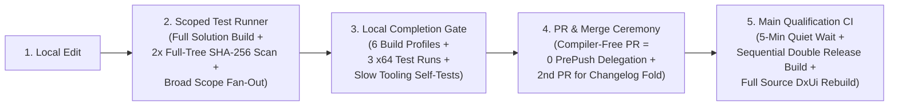

# I61 Testing and integration acceleration options across RedSalamanders

Status: **DECISION — proposal for owner review; implementation has not started.**
Priority: P0 developer velocity and integration throughput across `RedSalamander`, `DxUi`, `RedPrism`, `RedTilde`, and `RedXe`.
Owner: Build, validation, and CI maintainers. Requested reviewer: Eric.
Planned: 2026-11-09.

This document is a non-normative proposal cataloging concrete options to accelerate local inner-loop testing, scoped validation (`Test-Changes.ps1`), pre-push gates, remote CI qualification (`qualify.yml`), and cross-repository integration across all five RedSalamanders projects. Current normative requirements remain in [AGENTS.md](../../../AGENTS.md), [Testing_ValidationEvidence.md](../../Testing/Testing_ValidationEvidence.md), [Build_UnifiedCI.md](../../Build/Build_UnifiedCI.md), and the sibling repositories' owning contracts until specific options below are selected and implemented.

---

## 1. Executive Summary & Root-Cause Audit

Across all five repositories (`DxUi`, `RedPrism`, `RedSalamander`, `RedTilde`, and `RedXe`), delivering a change currently takes too long because **four independent layers of overhead compound on every edit, commit, and merge**:

### Detailed Bottleneck Inventory by Repository

| Bottleneck | Affected Repositories | Root Cause in Code / Policy | Wall-Clock Impact |
| :--- | :--- | :--- | :--- |
| **1. 6-Profile Local Mandate** | All 5 repos | `AGENTS.md` requires building `x64` & `ARM64` (`Debug`, `Release`, `ASan Debug`) and running all 3 `x64` test configurations locally before declaring any code change complete. | **3x–6x multiplier** on every local change |
| **2. Empty Rules & Disabled Reuse in `test-scopes.json` + Unmapped `Changes/*.md` in `validation-impact.json`** | `RedSalamander`, `RedPrism`, `RedTilde` | [Tests/test-scopes.json](../../../Tests/test-scopes.json) has `"rules": []` and `"reuse": false` on all 5 scopes (`PR`, `Commands`, `Compare`, `FileOps`, `Tooling`). Worse, [Tools/validation-impact.json](../../../Tools/validation-impact.json) has no rule for `Changes/**/*.md`, so **every change with a required `Changes/` fragment hits `fallback.unknown` (`advisory_build_action: full`, ~36.5 minutes)** even for a Markdown-only edit! `RedPrism/Tests/test-scopes.json` and `RedTilde/Tests/test-scopes.json` set `"reuse": false` on `Host`, `Editor`, `IO`, `Runtime`, `RecoveryRestart`, `Captures`, and `Performance`. | Re-runs **all** or most suites from scratch on every [Test-Changes.ps1](../../../Test-Changes.ps1) call |
| **3. Over-Broad Scope Fan-Out** | `DxUi`, `RedXe`, `RedPrism` | Editing one control in `DxUi/Tests/test-scopes.json` (e.g. `ComboBox` or `RichTextEditor`) selects **8–10 native suites**. Editing one plugin in `RedXe/Tests/test-scopes.json` selects **6 scopes** including `Packaging` (full portable ZIP + clean-extraction smoke). | **5x–10x** more test suites executed than necessary |
| **4. Full-Solution Build for Single-Scope Runs** | `RedSalamander`, `RedXe`, `RedPrism`, `RedTilde`, `DxUi` | `Test-Changes.ps1` calls `build.ps1` without `-ProjectName`, building all projects (e.g., 21 core projects + ~90 satellite resource DLLs in `RedSalamander`, or all plugins in `RedXe`) even when running 1 unit test binary. | **30s–3m** wasted per incremental build |
| **5. Double Full-Tree `Get-FileHash` Scans** | All 5 repos | `ScopedTesting.psm1` (`Get-ScopedSourceIdentity` and `Get-ScopedArtifactIdentity`) loops over every tracked file in the repo and every `.exe`/`.dll`/`.pdb` in `.build` using sequential PowerShell `Get-FileHash` **twice per run** (before and after tests). | **5s–20s** overhead per `Test-Changes.ps1` invocation |
| **6. Slow Tooling Self-Tests & Benchmarks in Default Runs** | `DxUi`, `RedPrism`, `RedTilde` | `validate.ps1` / `Invoke-ToolingTests.ps1` spawns intentional 10-second stalled child processes, temporary Git repos with `core.longpaths`, and 300+ ISA disassembly parser controls. `DxUi`'s `test.ps1` runs complex-UI FPS/memory benchmarks on **every** run. | **20s–60s** added to every validation pass |
| **7. Zero `PrePush` Delegation (`prCoverage: []`)** | All 5 repos | Under [Build_UnifiedCI.md](../../Build/Build_UnifiedCI.md), PRs only run compiler-free checks, so `prCoverage` in every `test-scopes.json` is `[]`. `Test-Changes.ps1 -Mode PrePush` delegates **nothing** to CI. | **100%** of native work runs locally AND again on `main` |
| **8. 5-Minute Quiet Timer on `main`** | All 5 repos | [Build_UnifiedCI.md](../../Build/Build_UnifiedCI.md) waits **5 continuous minutes** after a merge before admitting `qualify.yml`. | **5m dead wait** on every single merge |
| **9. Sequential Double-Compilation in CI** | All 5 repos | [Build_UnifiedCI.md](../../Build/Build_UnifiedCI.md) builds `Release` with test hooks, runs all tests on `x64` and `ARM64`, waits for a global `AND` gate, and then compiles `ProductionOnly` `Release` **a second time from scratch** without sharing object caches. | **~40% longer** CI critical path |
| **10. Two-PR Changelog Ceremony** | All 5 repos | Every change requires a fragment in `Changes/`, followed after merge by running [Tools/Submit-ChangelogFold.ps1](../../../Tools/Submit-ChangelogFold.ps1) to open and merge a **second PR** just to fold `CHANGELOG.md`. | **2x PR/merge overhead** per change |

---

## 2. Option Catalog

### Dimension 1: Run "Just Enough" Tests Locally (Scope Precision & Reuse)

#### Option 1A — Tiered Scope Rules: Separate Component Tests from Integration, Packaging & Perf

**Goal:** Touching one component, control, or plugin should only run that component's direct unit/contract tests during `Affected` iteration—not full application packaging, screenshot captures, or sibling suites.

* **Concrete changes across repos**:
  1. **`RedSalamander`** ([Tests/test-scopes.json](../../../Tests/test-scopes.json)):
     * Populate `"rules"` from [Tools/validation-impact.json](../../../Tools/validation-impact.json) so plugin edits select only that plugin's contract/self-test, `Compare` edits select only `Compare`, `FileOps` edits select only `FileOps`, and `Tools/**` edits select only `Tooling`.
  2. **`RedXe`** (`RedXe/Tests/test-scopes.json`):
     * Change `Plugins/<Name>/**` rules from `["<Name>", "PluginContract", "HostPlugin", "HostSmoke", "Packaging", "Settings"]` to `["<Name>", "PluginContract"]` (plus `"Settings"` only if `*Settings*` is modified).
     * Restrict `"Packaging"` to `Build/Package.psm1`, `Build/CameraPackage.psm1`, `Build/Winget.psm1`, `Installer/**`, `RedXeLauncher/**`, and `package.ps1`.
  3. **`DxUi`** (`DxUi/Tests/test-scopes.json`):
     * Narrow leaf control rules (such as `src/Controls/DxUi.ComboBox.*`, `DxUi.RichTextEditor.cpp`, `DxUi.Tree.*`) to select their owning suite (`ComboBox`, `EditorControls`, `Tree`) + `Control` + `Embedded` when embedded rendering is touched, instead of 8–10 suites (`WindowHost`, `Theme`, `Animation`, `ReadOnly`, `TextField`). Keep broad fan-out only when shared host files (`DxUi.WindowHost.*`, `DxUi.ControlHost.*`, `DxUi.Theme.*`) are modified.
  4. **`RedPrism`** (`RedPrism/Tests/test-scopes.json`) & **`RedTilde`** (`RedTilde/Tests/test-scopes.json`):
     * Remove `Performance`, `Captures`, `Crash`, and `RecoveryRestart` from general source rules unless the edited file directly implements capture scenarios, crash handlers, recovery persistence, or benchmark harnesses.

#### Option 1B — Enable Local Receipt Reuse (`"reuse": true`) for Deterministic Native Suites

* **Problem**: In `RedSalamander`, `RedPrism`, and `RedTilde`, most native scopes are marked `"reuse": false`. If you edit `Document` in commit 1 (running `Document`) and then edit `README.md` or `IoTests` in commit 2, `Test-Changes.ps1` re-runs `Host` / `Editor` / `Runtime` all over again when `"reuse": false` is set.
* **Concrete change**:
  * Set `"reuse": true` on deterministic functional suites:
    * `RedSalamander`: `PR`, `Commands`, `Compare`, `FileOps`, `Tooling`
    * `RedPrism`: `Host`, `IO`, `Runtime` (leave `Performance` and `Stress` as `reuse: false` or opt-in)
    * `RedTilde`: `Editor`, `RecoveryRestart`, `Crash` (split out the non-deterministic perf probe from functional `EditorBehavior` / `EditorRendering`)
  * Because `ScopedTesting.psm1` already hashes all compiled inputs, binaries, and environment variables, cached receipts are automatically invalidated the moment any relevant `.cpp`/`.h`/`.dll` changes.

#### Option 1C — Decouple Slow Tooling Self-Tests & Benchmarks from Default Inner-Loop Runs

* **Problem**:
  * `validate.ps1` / `Invoke-ToolingTests.ps1` runs synthetic slow fixtures on every tooling check (e.g., a 10-second stalled process watchdog test in `DxUi`, temporary Git repos with long paths, changelog fold git simulations, and 300+ synthetic x64 ISA parser controls in `RedPrism`).
  * `DxUi/test.ps1` runs complex-UI FPS and memory benchmarks on **every** test run.
* **Concrete change**:
  * Split `Tooling` into:
    * **`Tooling` (Fast, `< 2s`)**: `validate-skills.ps1`, `validate-links.ps1`, `Test-Changelog.ps1`, and fast static inventory checks.
    * **`ToolingSelfTests` (Slow, `20–45s`)**: Only triggered when files under `Tools/`, `Build/`, or `.github/` are modified.
  * In `DxUi`, gate the complex-UI FPS/memory benchmark behind `-Benchmark` or `-Full` (or a dedicated `Benchmark` scope in `test-scopes.json`), skipping it during normal functional `-Suites` runs.

---

### Dimension 2: Speed Up Local Builds & Harness Execution

#### Option 2A — Single-Profile Local Gate (`x64 Debug` Only Locally; Matrix in CI / Pre-Release)

* **Problem**: `AGENTS.md` currently states that every code change requires `test.ps1` in `x64 Debug`, `x64 Release`, and `x64 ASan Debug` plus builds in all three `ARM64` configurations locally (~75% of local build/test wall time).
* **Concrete change**:
  * Update `AGENTS.md` and the validation contracts across all 5 repositories to define a **two-tier local policy**:
    1. **Standard Change Gate (Default)**: Requires validators, format check, and `Test-Changes.ps1` in **one native configuration (`x64 Debug`)**.
    2. **Targeted Multi-Profile Triggers**:
       * Touching SIMD/intrinsics, build props/targets, or platform `#ifdef`s additionally requires `ARM64` build + `x64 Release` affected scope.
       * Touching custom allocators, raw lifetimes, COM ref-counting, or threading primitives additionally requires `x64 ASan Debug` on the affected scope.
       * Full 6-profile matrix runs in CI (`qualify.yml`) or explicit pre-release qualification.

#### Option 2B — Target-Only Compilation (`-ProjectName`) in `Test-Changes.ps1`

* **Problem**: When `Test-Changes.ps1` only needs to run `ZoomTests` in `RedXe` or `IoTests` in `RedPrism`, it still runs `.\build.ps1 -Platform $Platform -Configuration $Configuration` for the **entire Visual Studio solution**.
* **Concrete change**:
  * Add `projectBindings` to `Tests/test-scopes.json` in all repos (already partially present in `RedPrism/Tests/test-scopes.json`).
  * Update `Test-Changes.ps1` so when `$plan.full` is `$false`, it passes only the selected scopes' `.vcxproj` projects to `build.ps1` (MSBuild automatically builds their `ProjectReference` dependencies like `Common.vcxproj` without building unrelated plugins or 90 localization satellite DLLs).

#### Option 2C — Fast Git-Index Source Identity & Scoped Artifact Hashing

* **Problem**: `Get-ScopedSourceIdentity` and `Get-ScopedArtifactIdentity` in `ScopedTesting.psm1` call PowerShell `Get-FileHash` sequentially on every tracked file in the repository and every `.exe`, `.dll`, and `.pdb` in `.build/<Platform>/<Configuration>` **twice** per run.
* **Concrete change**:
  * Replace the per-file `Get-FileHash` loop in `Get-ScopedSourceIdentity` with `git status --porcelain=v2` + `git rev-parse HEAD:tree` + hashing **only** modified/untracked worktree files (Git's index already tracks exact blob hashes and stat cache in `< 50ms`).
  * In `Get-ScopedArtifactIdentity`, exclude `.pdb` files from SHA-256 hashing (or hash only `.exe`/`.dll` files belonging to the active scopes), reducing artifact hashing from seconds to milliseconds.

---

### Dimension 3: Speed Up Remote CI & Merge Qualification

#### Option 3A — Remove or Shrink the 5-Minute `main` Quiet Timer

* **Problem**: [Build_UnifiedCI.md](../../Build/Build_UnifiedCI.md) mandates: *"After main has remained unchanged for five continuous minutes, its cheap coordinator submits one native admission."* Every single merge sits idle for 5 minutes before any runner starts.
* **Concrete change**:
  * Reduce the quiet window from **5 minutes (`300s`) to `0s`–`30s`**.
  * Because `qualify.yml` already uses a non-cancelling serialized queue where a superseded queued candidate exits before provisioning a compiler, a 0–30s debounce still coalesces rapid back-to-back merges while saving **4.5–5 minutes** of wall-clock latency on every normal merge.

#### Option 3B — Eliminate Sequential Double-Compilation in `qualify.yml`

* **Problem**: Today, `qualify.yml` runs:
  `Build ReleaseTest (x64 & ARM64)` -> `Run Tests` -> `Global AND Gate` -> `Build ProductionOnly Release from scratch (x64 & ARM64)` -> `Package Smoke`.
  This compiles the entire C++ codebase **twice sequentially** on the critical path.
* **Concrete sub-options**:
  * **Option 3B-1 (Parallelize in CI — Easiest)**: Start the `ProductionOnly` build job in parallel with `ReleaseTest` (or immediately after `ReleaseTest` compiles), and place the global `AND` gate right before **Artifact Promotion / Release Publication** so production ZIPs are only published if both architectures' tests pass. Cuts CI critical-path time by **35–45%**.
  * **Option 3B-2 (Single Compilation — Architectural)**: Move remaining `#ifdef *_ENABLE_TESTS` hooks out of the main application `.exe` into standalone test harnesses/DLLs so the production binary is built **once** and tested directly.

#### Option 3C — Shared Binary Cache for Pinned `DxUi` Restore

* **Problem**: Consumer repositories (`RedPrism`, `RedTilde`, `RedXe`, `RedSalamander`) restore `DxUi` via `restore-dxui.ps1`, which sparse-clones `DxUi` and compiles `DxUi.lib` from source for each consumer/profile when not already warm in `.build`.
* **Concrete change**:
  * Use a machine-wide local cache (`%LocalAppData%\RedSalamanders\DxUiCache\<CommitHash>-<Toolset>-<Platform>-<Config>`) and a GitHub Actions cache / internal SDK artifact in CI so once `DxUi` is built for commit `X`, all four consumer apps reuse the verified `DxUi.lib` + `DxUi.pdb` in `< 2 seconds` instead of recompiling `DxUi`.

---

### Dimension 4: Streamline Multi-PR & Cross-Repo Workflows

#### Option 4A — Eliminate the Per-Merge `CHANGELOG.md` Fold PR

* **Problem**: Under [Core_Changes.md](../../Core/Core_Changes.md), every change creates a fragment in `Changes/`, and after merge [Tools/Submit-ChangelogFold.ps1](../../../Tools/Submit-ChangelogFold.ps1) opens a **second pull request** on `main` to fold the fragment into `CHANGELOG.md`.
* **Concrete change**:
  * Keep `Changes/*.md` fragments in feature PRs (so parallel PRs never conflict on `CHANGELOG.md`), but **fold fragments only at release time** or in a single automated weekly fold, cutting the number of PRs and merges in half.

#### Option 4B — Local `DxUi` Development Override (`-UseLocalDxUi`)

* **Problem**: Testing an in-progress `DxUi` change inside `RedPrism`, `RedTilde`, `RedXe`, or `RedSalamander` currently requires committing to `DxUi`, updating the lock file hash, and running `restore-dxui.ps1`.
* **Concrete change**:
  * Add a `-UseLocalDxUi <Path>` switch to `build.ps1` in consumer repos that links directly against `z:\src\DxUi\.build\<Platform>\<Config>\DxUi.lib` and `z:\src\DxUi\include`.
  * Mark the resulting build receipt as `LOCAL_UNPINNED` so `Test-Changes.ps1 -Mode PrePush` and `package.ps1` still enforce a committed pin before pushing, while local inner-loop iteration across `DxUi` + consumer takes seconds.

---

## 3. Summary Comparison Matrix

| Option | Effort | Risk | Time Saved | Where Applied |
| :--- | :---: | :---: | :--- | :--- |
| **1A. Narrow `test-scopes.json` fan-out** | Low | Low (Full still runs on `main`) | **60–80%** fewer suites in inner loop | `Tests/test-scopes.json` (all 5 repos) |
| **1B. Enable `"reuse": true` on deterministic scopes** | Low | Very Low (SHA-256 gated) | **50–90%** on multi-commit branches | `Tests/test-scopes.json` (`RedSalamander`, `RedPrism`, `RedTilde`) |
| **1C. Split `ToolingFast` vs `ToolingSelfTests` + opt-in `DxUi` benchmark** | Low | Low | **20–60s** per run | `validate.ps1`, `test.ps1`, `test-scopes.json` |
| **2A. Single-profile (`x64 Debug`) local completion gate** | Low (Policy) | Low (CI runs Release/ARM64) | **~75%** less local build/test time | `AGENTS.md`, `Testing_Validation*.md` |
| **2B. Target-only `-ProjectName` build in `Test-Changes.ps1`** | Medium | Low | **30s–3m** per scoped build | `Test-Changes.ps1`, `Tests/test-scopes.json` |
| **2C. Git-index source identity & skip `.pdb` hashing** | Low | Very Low | **5–20s** per `Test-Changes.ps1` run | `Build/ScopedTesting.psm1`, `Tools/ScopedTesting.psm1` |
| **3A. Drop 5-minute `main` CI quiet timer to `0–30s`** | Low | Very Low | **5 min** per merge | `Specs/Build/Build_UnifiedCI.md`, `.github` coordinator |
| **3B. Parallelize `ProductionOnly` & `ReleaseTest` in CI** | Medium | Low | **35–45%** faster CI wall time | `Specs/Build/Build_UnifiedCI.md`, `.github/workflows/qualify.yml` |
| **3C. Shared machine/CI binary cache for `DxUi.lib`** | Medium | Low (hash-verified) | **1–3 min** per consumer build | `Build/DxUiRestore.psm1`, `Build/DxUiPaths.psm1` |
| **4A. Fold `Changes/` only at release (no 2nd PR per merge)** | Low | Very Low | **50%** fewer PRs | `AGENTS.md`, `Specs/Core/Core_Changes.md`, `Tools/*Changelog*` |
| **4B. `-UseLocalDxUi` switch for cross-repo dev** | Low | Low (`PrePush` still checks pin) | **2–5 min** per cross-repo edit | `build.ps1`, `Build/DxUiRestore.psm1` |

---

## 4. Recommended Fast-Track Combination & Stop Conditions

### Recommended Selection
1. **Immediate Local Speedup (Options 1A + 1B + 1C + 2A + 2C)**:
   * Narrow `Tests/test-scopes.json` across all 5 repos and enable `"reuse": true` on deterministic functional suites.
   * Split slow tooling self-tests (`ToolingSelfTests`) and `DxUi` FPS benchmarks out of default inner-loop runs.
   * Require only `x64 Debug` affected scopes locally for standard changes; replace sequential full-tree `Get-FileHash` loops with Git-index identity checks.
2. **Immediate Remote & Workflow Speedup (Options 3A + 3B-1 + 4A)**:
   * Drop the 5-minute `main` quiet timer to `0–30s`.
   * Run `ProductionOnly` compilation in parallel with `ReleaseTest` in `qualify.yml`.
   * Fold `Changes/` fragments at release time rather than opening a second fold PR on every merge.

### Authoritative Specs Affected When Promoted
* [AGENTS.md](../../../AGENTS.md) and sibling repository `AGENTS.md` files
* [Testing_ValidationEvidence.md](../../Testing/Testing_ValidationEvidence.md) and sibling `Specs/Testing/Testing_Validation.md` contracts
* [Build_UnifiedCI.md](../../Build/Build_UnifiedCI.md) across all five repositories
* [Core_Changes.md](../../Core/Core_Changes.md) across all five repositories

### Verification & Done Criteria
* `.\Tools\Get-SpecInventory.ps1 -FailOnFindings` passes in `RedSalamander`.
* Each repository's `Test-Changes.ps1 -Explain` and `validate.ps1` pass with the updated `Tests/test-scopes.json` and `ScopedTesting.psm1` rules.
* Once selected options are implemented, tested, and merged into the owning domain specs, move this plan to `Specs/Plans/Done/` with exact-path admission.
