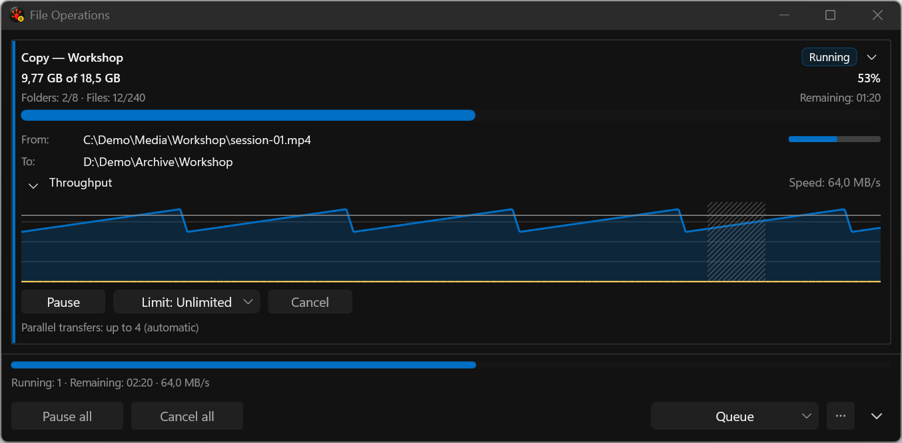
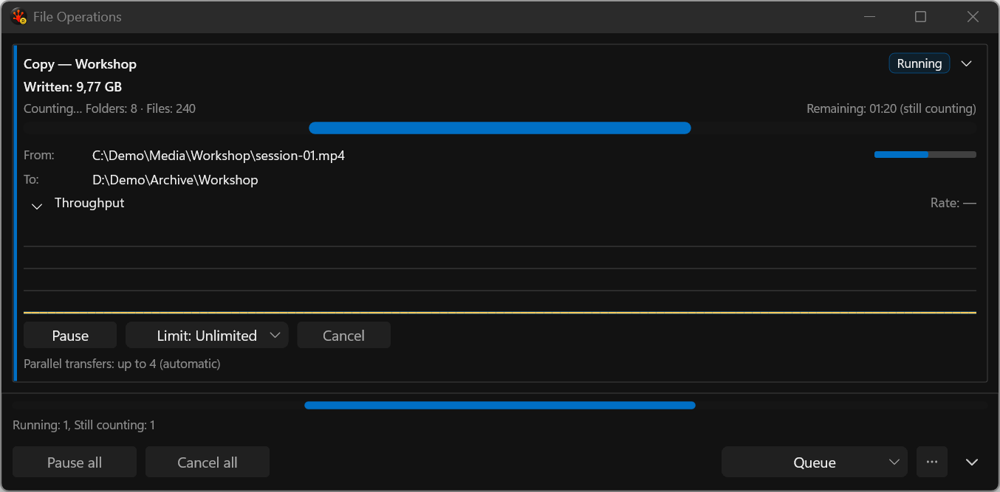
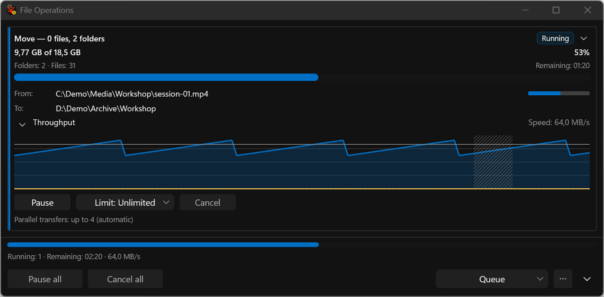
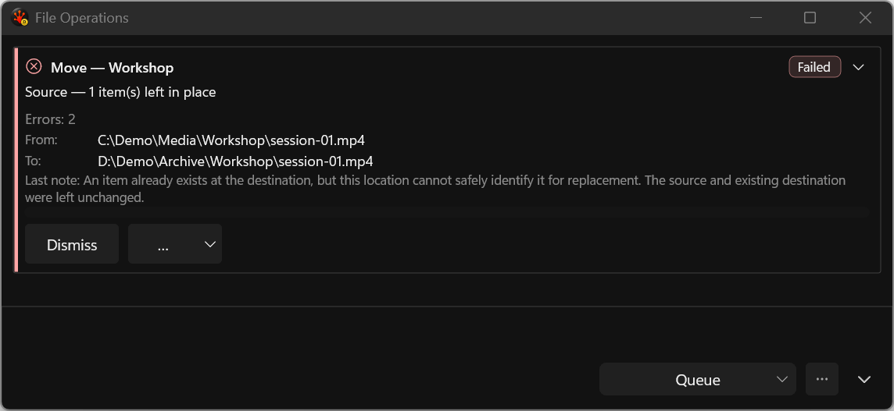
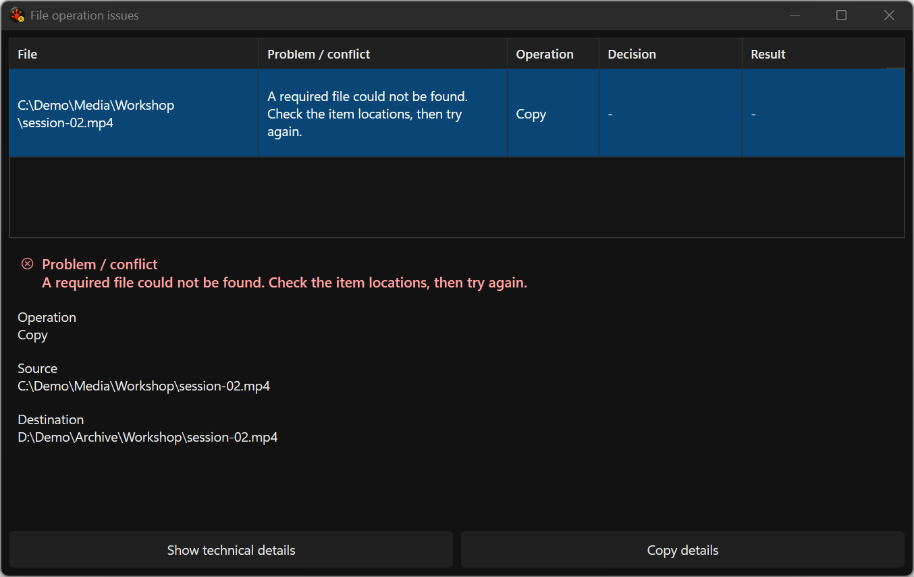

# File Operations Popup UI Contract

Last updated: 2026-10-19

This spec covers the hybrid Direct2D/DirectWrite and hosted DxUi File Operations progress popup surface in:

- `RedSalamander/FolderWindow.FileOperations.Popup.h`
- `RedSalamander/FolderWindow.FileOperations.Popup.cpp`

Engine execution, conflict semantics, streaming discovery, plugin contracts, and performance-validation
rules remain owned by `Specs/FileSystem/FileSystem_FileOperations.md`.

Implementation status, October 1: I26 adopts qualified DxUi revision
`19ca44d95a0cd493fc7fb1a57f4d4ad227bdefc1`, including the multiline caret viewport correction.
V65 x64 Debug/Release build status: passed, with zero warnings or errors. Release Full/Fresh `20261001T115346Z-104056-8e2cfb6a0b8049218c622dd915a2697e`:
2211 passed, 0 failed, 46 skipped (2257 total); see the [V65 packet](../TestRuns/4cb089111a23/Validation/2026-10-01_i26-v65-final/README.md)
and [I26 checkpoint](../Plans/Done/UI_FileOperationsReview_2026-09-16.md) for bound receipts and scope. The independent A78/B19
resource review records acceptance for I26 with stated limits: the final matched Embedded presentation and logical-resource workload, with all eight processes and outliers retained; the earlier ProgramDatabase pair stays separate, without whole-product or driver-memory claims.
The [original V55 gallery](../Plans/WIP/FileOperationsUiReview_2026-09-16/implementation/2026-10-01-v55-final/README.md)
retains 562 static and ten protected captures, 512 reviewed image hashes and its original
96/144-DPI provenance. Broad Debug FileOps remains V55 197/0/20; V56 cluster remains 21/0/0.
V65 did not recapture these images. Native 192-DPI, external AT, consumer ARM64/ASan, I19 and H4
remain separately limited; historical failures remain failures.

The [I27](../Plans/Done/UI_FileOperationsSafetyRemediation_2026-10-01.md) follow-up's [frozen Release gallery](../Plans/Done/UI_FileOperationsSafetyRemediation_2026-10-01/implementation/2026-10-04-final-gallery/20261003T232201Z-75488-0a7264eaad564dcd8aa1014d5093c463/gallery.html)
publishes all 562 static and 13 protected original captures. Static rendering uses
synthetic presentation workloads; the separate protected fixture qualifies real
pointer, keyboard, Unicode selection/caret/focus and native 144-to-96-to-144 DPI
transitions. Both bind immutable receipt `aa261e2bf802576713e3a5a739b84f9b8b23e352c62ad73049e6f9edee9d2fc4`
and its original source snapshot. The gallery does not qualify subsequent source,
Fresh Full, external AT, native 192 DPI or deferred consumer platforms. Original
assertions, displays, failures and audit scope remain linked from its navigation.

Eligible cards now expose a hosted throughput disclosure. Collapse removes the hosted graph,
retains the rate/qualified ETA summary and task actions, and preserves the outer window rectangle.
New/recreated cards inherit the remembered default; existing cards retain independent choices across
compact/footer-only suppression. Explicit changes use the existing queued settings save; painting
does not write settings. The consumer synchronizes the pinned disclosure's expanded state. Its
focused Commands journey exercises UIA Invoke, Space and pointer activation with graph/summary
and saved-preference checks. The adjacent consumer label is outside the chevron's hit rectangle.
DxUi exposes ExpandCollapse state for this retained control; the V35 application-pattern witness
passes actual Collapse/Expand, post-transition state, persistence/default omission and idempotence
checks in x64 Release. The [I26 checkpoint](../Plans/Done/UI_FileOperationsReview_2026-09-16.md) records the V65 integrated result
and the independent pair review's stated scope; neither widens this focused control witness.

The recurring missing client text/background was reproduced with S_OK legacy EndDraw results,
matching target sizes and post-draw occlusion. Client drawing now shares the DxUi presentation:
non-interactive chrome/text is prepared as a command list on the host device and replayed beneath
its controls. The harness retains its text/background witnesses and absent-color rejection.
The deterministic harness checks covered/uncovered captures, zero-size recovery and French
path/UIA behavior. Current qualification and remaining gates are listed above. See the historical
[single-surface captures and rejected baseline](../Plans/WIP/FileOperationsUiReview_2026-09-16/implementation/2026-09-19-single-surface/README.md).

Repeat scope uses a hosted Checkbox with UIA Toggle, Space and pointer/release-outside parity.
Space on this Checkbox changes scope;
the task pause shortcut must not intercept it. Its visible state comes from the acknowledged task
model, and synchronization must not trigger another user callback. Complete repeat-scope captions
wrap using their measured Body-font height; conflict actions use qualified DxUi measured action
arrangement with whole buttons wrapping to another row. Painting, hit-testing and UIA share the
measured bounds; current French/native-DPI captures are linked above.
[Before/after captures and paired redraw measurements](../Plans/WIP/FileOperationsUiReview_2026-09-16/implementation/2026-09-20-measured-conflict-actions/README.md)
retain the original clipping failure and the scoped qualification that first corrected it.

Ordinary path rows retain their complete localized label and exact Unicode value in the tooltip,
accessible name and HelpText on the same rectangle as the abbreviated painted path. Running
Copy/Move destination rows describe the destination folder; completed rows describe the recorded
destination file. Each task publishes one stable Source/Destination pair (owner decision Q7):
`FileOperations.Task.<task>.Path.Source.0` is the region on the first displayed source row and
`.Path.Destination` the destination row; neither is a durable file identity. A multi-stream Copy or
Move paints one row per active stream, but the other streams are not separate regions, Tab stops or
UIA elements: the source region's HelpText and tooltip name them after its labelled value, from one
positional resource (`IDS_FMT_FILEOPS_PATH_OTHER_STREAMS`: label, value, count, the paths one per
line; translations may reorder them; in English `<label> <value>`, then `Also in progress (<n>):`
and one path per line), so the region set does not change when the active
stream count does. Current snapshot updates replace the value, and an empty path removes its
region. Delete has no destination region. These regions offer read-only inspection and do not alter file-operation authority.
Changing the other active streams MUST refresh a focused source tooltip even when its first path
and rectangle stay unchanged; its text must match the current HelpText and omit finished streams.
The painted Source/Destination/Delete/Verify label column MUST fit its complete localized text
without overlapping the path. The consumer retains four bounded text/format measurements and
reuses them on unchanged paints; locale text and actual font/DPI recreation invalidate the affected
measurements. The column retains its ordinary minimum and grows for labels such as French
`Suppression :` and `Vérification`. The path, mini progress and destination selector use the remaining
width and retain their full tooltip/UIA value.
Path rows are focusable in visual Tab order and draw the shared contrasting focus outline. Focus
reveals the labelled value through the existing host tooltip. Left click, Enter, Space or UIA Invoke
opens a read-only full-path workspace inside the same popup HWND. UI Automation exposes each path
row (and a focusable scan-status path) as an invokable Button whose Name is its localized row label
followed by the full path; only non-focusable informational regions use the StatusBar role.
The workspace's multiline field MUST allow
selection, exact selected-text copy and scrolling through the complete Unicode value. Initial selection
covers the whole path with the viewport at its root; a separate Copy full path action always copies
the whole value. Tab cycles within the editor and its copy/close actions. Hidden task actions and
default-decision shortcuts MUST NOT run while detail is open. Escape closes only detail and returns
to the same live row, or, if that row disappeared, its task's disclosure (global Options only when
the task is gone). Showing detail MUST NOT activate
a background popup. Same-row value updates replace the detail; removal or popup hide retires its
editor and stale accessibility providers. Reflow preserves selection/focus for an unchanged value.
The row's
Ctrl+C copies only the exact underlying Unicode path. The first Escape dismisses visible detail
without invoking a task decision; subsequent Escape retains the normal popup decision/hide policy.
These path-specific keys take precedence over task shortcuts. Updating a row refreshes its value;
synchronization retains a still-live row identity, or moves focus to a live action without invoking it.
The provider MUST acknowledge UIA keyboard focus, not merely store a host focus pointer.

Static harness captures may simulate scrolling through the real TextField handler
while native editor focus is deferred. Their logical-focus and unchanged-foreground
witnesses do not qualify keyboard routing; protected Commands supplies that proof.

The current 6,155-unit Unicode/UNC fixture covers selection and exact copy, read-only input,
scrolling, Escape, stale-provider rejection, row retirement and 40 open/close cycles. Space,
pointer and UIA open the same detail with editor focus; Copy full path, Close and bidirectional
Tab use actual controls. V55 captures show the adopted caret-clipping correction at native
96/144 DPI and retain the same-HWND text/selection/focus assertions. This bounded fixture is
not proof for arbitrary-length input or external screen readers. See I26 for integrated gate
status and the earlier
[path keyboard evidence](../Plans/WIP/FileOperationsUiReview_2026-09-16/implementation/2026-09-19-path-keyboard/README.md).

## Purpose

The popup is an operational surface for long-running copy, move, delete, and informational tasks. It
MUST make the current state legible at a glance, keep active controls stable while the task list
changes, and expose enough debug state for deterministic selftests without pixel inspection.

When the active language preference changes while the popup is open, its native window title MUST
reload from the selected language resource alongside the retained content. The change MUST keep
the same popup, task, conflict decision, and focus authority. The Issues pane follows the
corresponding retained-content requirements below.

## Reference Captures

Documentation screenshots MUST be captured from the real product popup through the named test-scenario
harness. Static captures do not activate; explicitly authorized interaction captures use the existing
warning and desktop lease, then restore focus/cursor. `FileOps_VisualGallery` supplies deterministic presentation fixtures;
its capture and provenance contract is in `Specs/Testing/Testing_SelfTests.md`. Mockups remain proposals.
The current public illustrations use private deterministic Workshop fixtures, the native
production renderer and no desktop activation. Adjacent provenance records bind each image
to its source/build, scenario, dimensions, DPI, invented data and hash. Old cropped frames
and environment-derived test paths are retired from this spec's illustrations.

These are focused presentation examples, not proof of Full, other-platform, foreground-input
or storage-performance qualification. See [the public capture inventory](../../docs/res/README.md).

## Regions

Implementation observation, 2026-09-16: the I26 harness gallery at dirty `9c68026dd` exposes existing
deviations from the intended action/checkbox layout below: ordinary expanded task actions receive a
zero-height row, the hosted repeat-decision strip does not visibly convey the checked fixture state,
and some long conflict-action labels clip at minimum width. French captures on physical 96/144 DPI
displays additionally show custom-speed help/error overlap at 96 DPI and vertically clipped Issues
messages. On 2026-09-19 the ordinary action row was repaired to reserve its height independently of
conflict rows. Its settled native Debug bounds/hit-target regression and pause/resize/resume/cancel
sequence pass, with 300 French harness captures on two currently 144-DPI displays. See the
[first implementation slice](../Plans/WIP/FileOperationsUiReview_2026-09-16/implementation/2026-09-19-ordinary-actions/README.md).
The subsequent [conflict-action slice](../Plans/WIP/FileOperationsUiReview_2026-09-16/implementation/2026-09-19-conflict-actions/README.md)
removes the policy's three-primary cap and applies Replace/Remplacer. Its 300 French captures show
four direct choices, but long action labels still clipped at 480 DIP. The September 21 measured-action
candidate fixes that focused witness; it does not close the rest of the redesign.
The hosted checked-state, measured speed-dialog regions and shared complete-line Issues rendering
have since been implemented. Current gallery, mixed-DPI and full-suite qualification are recorded
at the start of this contract. These historical observations do not change the required behavior.
Evidence and proposed remediation are in
[the I26 review](../Plans/WIP/FileOperationsUiReview_2026-09-16/proposal.md).

The popup has three visible regions:

- Title bar: standard captioned tool window, independently minimizable/restorable.
- Operations list: scrollable stack of task cards.
- Global footer: always visible, including footer-only mode.

Footer-only mode hides the operations list, persists through `SettingsStore`, resizes the window to
the footer-only minimum height, and restores the previous captured rectangle when details are shown
again. The compact rectangle uses the normal `FileOperationsPopup` placement key; the last expanded
rectangle uses `FileOperationsPopupExpanded` and MUST NOT be overwritten while footer-only mode is
active.

When no valid persisted placement is restored, the popup is centered over its valid owner and clamped to the
owner monitor work area. Placement changes size neither the popup nor its z-order/activation state. This uses the
shared owner-centering geometry contract; monitor-work-area lookup failure leaves the existing position intact.

## Footer

The global footer MUST include:

- Aggregate progress bar across active file-operation work.
- Left transfer-action cluster: `Pause all` / `Resume all` first when applicable, then `Cancel all`
  while active work exists.
- Right settings/view cluster: one drop-down selector whose label is the current `Queue` or
  `Parallel` new-task mode, an `Options` overflow, then the details disclosure button.
- Status summary assembled from nonzero categories only (for example, `Running: 2`; omit
  zero-valued categories), optionally followed by aggregate ETA and throughput. Paused and
  Stopping tasks have their own `Paused: N` and `Stopping: N` clauses and are not counted in
  `Running: N`, so the footer agrees with the taskbar's paused state. Running, Paused, Stopping,
  Waiting, and Needs-attention clauses MUST use separate count-neutral localized resources in
  the source file and all four satellite resource files; a combined singular/plural format or
  a retained dead combined-summary resource is forbidden.
- Right-aligned details chevron for footer-only collapse/expand.

Cancel all asks for confirmation. Declining leaves live work, pending decisions, completed
records and informational tasks unchanged. Accepting requests cancellation of the operation
tasks present when the engine snapshots its task list after confirmation. A task admitted
while the confirmation is open is included if present in that snapshot; a later admission
is not retroactively cancelled. Completed records and informational tasks are not dismissed.
By task state (I35 R9.7):

| State when Cancel all is accepted | Result |
|---|---|
| Preparing, Waiting (queue or overlap edge), or waiting on an unanswered question | Ends Canceled with zero warnings. When no selected root crossed the mutation gate its result line is `Not started; nothing was changed` and it lists no Source facts; with auto-dismiss on it leaves no history card. A question it was waiting on keeps its unrecorded decision. |
| Running | Ends with its typed item outcomes (`Canceled: {0} of {1} copied`, kept or unknown axes); an Unknown axis keeps the card Indeterminate. |
| Stopping | Not asked again; it finishes on its own. |
| Informational task, completed record | Never touched. |

The engine returns the IDs it actually asked to cancel; a second Cancel all adds its IDs to a set that
has not resolved yet. When every one of them has finished (or left the engine; a card still inside its
reveal delay is still running) and every member of the completed group is a clean success or a clean
cancel (no Partial, Failed or Indeterminate member, no warning or error), the group collapses once so
its badges and `Clear completed` are in view. The user's own expand or collapse wins: toggling the
group before the set resolves cancels the pending collapse, and nothing is stored. A group with any
problem member keeps the state the user left it in (R9.5).

### Application close

Closing the application while File Operations work is active asks "Cancel all operations and exit?"
only when at least one task can still be canceled. When every remaining task is already Stopping,
the close is deferred without asking. After acceptance the window stays open, the popup shows each
task Stopping, queued tasks end canceled without starting, and the application closes once the last
task has been reaped. While that exit is pending:

- A further close attempt does not ask again. It brings this popup forward (without taking the
  foreground from another application) and keeps the pending exit; there is no way to withdraw it.
- Every new file operation (pane commands, drag and drop, paste, inline and Batch Rename, Change
  Case, Find Files, Compare Directories sync and Compare pane commands) is refused before any prompt
  or change: no rename prompt, Move folder picker, Change Case prompt or Batch Rename window opens.
  The pane that started it (a Compare pane for Compare work) shows a localized "Exit Application"
  alert naming the operation and saying that RedSalamander is closing and nothing was changed.

The application close covers every File Operations engine, not only the main window's: each open
Compare Directories window owns its own engine and popup. The consent is asked when any engine has
a cancelable task (also when only a Compare window has work), "Cancel all and exit" cancels the
tasks of every engine through the normal cancel path, and the application closes only once every
engine is quiet. A further close attempt brings forward the popup of an engine that still has work.

Closing a Compare Directories window whose engine has a cancelable task asks the same consent for
that window only: "Close Window", "File operations started in this window are still in progress.
Cancel them and close the window?". Declining keeps the window and its work running. Accepting
cancels that engine's tasks, keeps the window open while its popup shows them Stopping, and closes
the window once its engine is quiet; when every task is already Stopping the close is deferred
without asking. Until then a further close of that window brings its popup forward without asking,
and new work in that window is refused before any prompt with a "Close Window" pane alert saying
the window is closing and nothing was changed; the main window stays fully usable. While an
accepted application exit is pending, closing a Compare window that still has work only brings its
popup forward.

The [decision mirror](#decision-mirror) never answers for these consents. While a close consent (a
blocking prompt) is open no mirror appears; accepting it cancels the pending decisions with their
tasks, so the mirror and the status-bar segment disappear at the next presentation pass without any
decision being submitted. A Compare Directories window's mirror is torn down with that window's engine
(hidden without handing focus back, its callbacks cleared) before the window goes; the main window's
mirror is not affected.

Retained task controls share the task-list viewport clip; pointer and UIA hit testing must not
reach them through the footer. Keyboard traversal reveals the focused task control including its
outer focus chrome through the same native scroll state, without changing OS foreground. An
explicit interactive resize cancels pending automatic expansion. Collapsed completed-card content
and its child controls retire on the first frame, even while their height transition continues.
Consecutive focus requests before the next paint MUST translate retained bounds from their painted
scroll origin to the pending native offset before deciding whether to scroll. The final focused
control and its focus chrome must remain visible; an already valid pending offset is preserved.
First-frame collapse tests MUST inspect the actual raw provider tree, including offscreen children,
after witnessing each case-owned task before collapse. Missing roots, traversal failures and logical
visibility flags alone cannot establish that providers retired.

Reflow preserves the focused control's task/action identity without transferring native focus.
If that action disappears, focus moves to the same task's disclosure; if the task is no longer
present, focus moves to global Options. Neither fallback resolves an operation or selects another
task's decision. A removed focusable path uses global Options as its safe fallback.

Footer controls live outside the scrolled task-list viewport and MUST remain hit-testable there. The
`Options` overflow owns persistent preferences: auto-dismiss success/canceled and Compact/Expanded
density. Density MUST round-trip through canonical settings save even when it is the only non-default
file-operation setting. Auto-dismiss is a future-retention policy: changing it does not clear cards
already retained. `Clear completed` is an immediate bulk action for the current completed group and
MUST NOT be duplicated in the footer.

The footer has separate aggregate-progress, status-summary, and command rows. Its previous 88-DIP
height is a baseline, not a ceiling: measure the localized content and wrap whole command controls
into further rows when needed. Reserve the measured footer height before laying out task content.
The supported minimum client width is 480 DIP. At that width, every required control MUST retain a
positive, non-overlapping hit target. The square Options and details buttons remain icon-only; the
current mode selector may narrow but MUST retain its label and drop-down affordance.

The current bounded footer implementation measures the hosted Body text for Pause all, Resume all
and Cancel all, adding 12 DIP padding on each side. Pause/Resume reserves the larger label width so
an engine state change does not move the following controls. Widths retain the existing 112-DIP
minimum and no longer shrink to 72 DIP at narrow widths. A fixed three-label/format cache avoids
repeated text layout and applies DPI conversion at arrangement. French running-copy guards cover
480/640/760/480 DIP, visible label padding, non-overlapping actions and active Queue/Options targets.
The consumer footer adapter now delegates row placement to DxUi `ArrangeMeasuredActions`.
It preserves each measured transfer-action width and keeps Queue, Options and Details together as
one right-aligned group. When that group cannot fit beside the transfer actions, it moves to the
next command row; Queue MUST NOT disappear because the current row is full. Each added command
row increases footer height. Task comparison bounds, list clipping, footer painting, automatic
window sizing and footer-only minimum sizing use that same height. The fixed label cache remains
bounded and is consulted once per render. The localized summary uses one retained DirectWrite
layout keyed by current text, format identity and available width. Measurement and paint share that
layout; the summary wraps and all required lines increase the footer height before commands are
placed. An unchanged frame performs no summary layout allocation; DPI/font recreation invalidates
the retained layout. The same layout also measures the summary at minimum client width once per
cache miss; manual sizing uses that cached height, without creating text resources while dragging.
The 88-DIP height remains the one-line/one-command-row baseline. This implementation still requires
final Debug/Full, native mixed-DPI/keyboard/UIA qualification. `ProductUiTests` covers measured-width
boundaries, hidden actions, long-label row flow, wrapped-summary heights, indivisible settings,
contained nonoverlapping targets and invalid input.

The Queue/Parallel selector MUST read `GetQueueNewTasks()` on every hosted-control sync so its label
always reflects engine state. Activating it opens a radio flyout with Queue and Parallel; choosing an
item calls `ApplyQueueMode(...)`, and choosing the current item is idempotent. It MUST NOT use an
animated sliding thumb or keep a second UI-local mode state. It uses the shared DxUi current-value
selector chrome: one whole click target, flat borderless rest state, quiet chevron, shared hover
animation across the complete target, and no split-button divider or nested chevron button.

A flyout opened from a popup button MUST use the invoking button's width as its minimum root-surface
width. Longer localized labels, shortcut columns, and other flyout content may expand the surface
beyond that minimum; the monitor work area remains the final size constraint.

## Task Cards

### Information hierarchy and selected subject

The header's leading text is `Operation — subject`; the short status chip and card disclosure
occupy the trailing lane. The subject is captured at admission and retained in completed facts:
one selected file/folder uses its original name; multiple selected roots use localized file and
folder counts when every kind is known, otherwise an honest selected-item count. Recursive totals,
the current child path and terminal status MUST NOT replace this identity. A collapsed
card keeps that subject. Middle shortening retains the useful name ending/file extension; the
exact full heading remains in the task-owned `Subject` tooltip/accessibility region.

For normal expanded Copy/Move cards the order is:

1. Operation/subject at the left, status and disclosure at the right.
2. Transferred amount/known nonzero byte total at the left, known whole-task percentage at the right.
   Copy uses copied-file counts when its byte total is unknown or zero; without known file counts it
   shows bytes written. Selected-root counts never stand in for recursive Copy progress.
3. Recursive folder/file counts at the left and remaining time at the right, directly under the
   amount. With authoritative completed counts, use `Folders: {completed}/{total} · Files:
   {completed}/{total}`; a completed folder means its operation has finished, including its
   children. If only file completion is known, use `Folders: N · Files: {completed}/{total}`.
   Routes without completion receipts (including Move) use `Folders: N · Files: N`.
   These are recursive totals, not completion claims; do not add “found” to the labels.
   Missing counts show `File and folder counts unavailable`, never a fabricated zero or a
   selected-root `Items: 0/1`. While totals are open, show `Counting…` or
   `Counting… Folders: N · Files: N`, without a growing denominator or percentage.
   Byte progress remains above this row. ETA retains the existing unknown/provisional rules.
4. Full-width overall progress, then source/current-file and destination rows.
5. Full-width Throughput history, retaining its existing expanded default and remembered preference.
   Its disclosure and label lead the heading; the live speed is right-aligned on that heading.
   A long speed/stall label wraps below the label, still aligned to the content's right edge.
   Hiding the plot retains this heading and speed, and the ETA beside the counts above the paths;
   no duplicate combined summary is added. Collapsing/reopening the card preserves the plot choice.
6. Primary actions, followed by the automatic-concurrency note in smaller secondary text:
   `Parallel transfers: up to N (automatic)`. N is the effective applied budget, not the resolved
   auto-tuning recommendation and not the number of currently active streams. Do not show the
   note for an unknown/zero limit, manual mode or a completed task. It wraps at narrow widths.
   This transfer note belongs only to Copy/Move; Delete cards MUST NOT describe deletion workers as transfers.

Paired facts use measured text and wrap when they cannot fit together. The ordinary card has no
Technical details button or selected-root progress fraction. Count, ETA, speed and concurrency
regions expose their complete localized text to accessibility and tooltips; collapsing the card
removes its body regions and reopening it restores the current facts. The concurrency note is
read-only and adds no focus stop. It uses the existing secondary text color, including high-contrast
theme handling. The Issues pane retains its separate Technical details, logs and exports.
Skipped counting retains its existing completed-work summary instead of duplicating counts;
an open traversal never renders a final denominator. Error outcomes and conflict decisions retain their existing
priority, precise facts and safe actions; Delete retains its item-based presentation.

Selection facts require no new provider query or traversal. Layout caches are bounded by snapshot
rows, invalidated by text/width/format changes and share measured paired-text preparation with the
graph. `FileOps_ReviewRemediationContracts` validates owned-window captures, exact accessible
subjects, painted count/ETA and throughput/speed geometry, effective-limit text and body/plot transitions without activation. Its
`card-hierarchy/scenarios.tsv` records language, theme, client width and actual DPI; build/run
provenance and rendering metrics are archived with the captures under `Specs/TestRuns/`.

Regression checks MUST require scenario-specific percentage presence and its exact localized value
for determinate cards, and absence for open, unknown or skipped totals. An empty rectangle cannot
excuse a required percentage. Live count checks compare the complete painted and retained accessible
label with independent fixture totals and numeric completion facts from the same paint generation;
two copies of the renderer's formatted string are not an independent count oracle. Commands throughput
disclosure, reload and reopen checks require separate Rate/Eta regions in both plot states and no
obsolete combined summary, while preserving graph retirement, placement and settings-persistence checks.
These fixtures establish their own idle popup lifecycle and MUST reject active operations before
resetting presentation state. After Escape dismisses a path tooltip while retaining row focus,
the refocus witness leaves the row before checking that a new UIA focus transition reveals it again.

Every file-operation card MUST resolve exactly one `TaskSnapshot::StatusKind` before drawing. The
same resolved status drives:

- status text and any legacy heading fallback,
- status glyph,
- status stripe,
- status chip,
- graph overlay,
- caption severity,
- footer counters,
- Windows taskbar state.

The left stripe is required for every non-`None` file-operation status. A header chip is used except
for Conflict: its expanded body carries one measured waiting/loading line, while the collapsed title
carries the status. Do not duplicate that sentence in the expanded header or a fixed-width chip. Tone mapping:

| Status | Tone |
|--------|------|
| Running, Discovering, Preparing, Verifying | Accent |
| Waiting, Stopping, Canceled | Neutral |
| Paused | Muted |
| Conflict, Partial | Warning |
| Failed | Error |
| Done | Ok |

The chip uses localized short labels and MUST NOT be the only status signal. Status must remain
readable without color through glyph and/or text.
Discovering and Preparing use their short localized labels in the chip; elapsed detail remains
in full status accessibility text while the heading retains the selected subject. The chip's entire label must fit the actual
painted text lane. A finished card with a visible status chip keeps its operation and original
subject; `Done`/`Terminé` is not repeated beside it. Older records without a captured subject retain
the operation/status fallback. The exact accessible status remains available independently of color.

The card consumes the engine-owned `TaskLifecyclePhase`; it MUST NOT infer Preparing from missing
progress, zero totals, or a worker that has not emitted a transfer callback. `Preparing` and
`AwaitingAcceptance` render as Preparing. `Ready` is a transition boundary before Waiting/Running;
`Terminal` remains an engine fact. The normal finalizer also enters lifecycle `Stopping`, so
that phase alone MUST NOT imply cancellation. The popup snapshots `Task::CancelRequestedDurable`
as cancellation authority, published before `RequestCancel` exposes the lifecycle phase. An
unfinished task with that authority displays a neutral localized `Stopping` status ahead of
conflict, queue, pause, discovery and verification. Actual terminal results always win, including
success or partial/indeterminate outcomes after a late cancellation request.

Stopping contributes to active task and taskbar progress accounting, with a distinct localized
stopping count in the global summary. It is excluded from Pause all/Resume all eligibility.
Its pending conflict decisions and per-task Pause/Resume, Cancel, Start now, reorder, destination,
discovery Skip and speed decisions are withdrawn from paint, hit testing and accessibility;
stale callbacks and deferred speed decisions recheck cancellation authority. Cancel all is
unavailable when every remaining task is already stopping. Native failure-surface Cancel all
uses the same availability and consent rules; Close still only hides the window.

Stopping retains actual counters, paths, result facts and throughput history while suppressing
completion ETA, discovery activity and startup marquees. The ordinary operation/count heading
stays concise beside one explicit stopping chip; when the chip cannot fit, the heading provides
the localized status fallback. A retained status region and transition notification expose that
status without color. Read-only path inspection and history disclosure remain available. The
popup MUST NOT display Canceled until the task actually finishes with a cancellation result.

Publication does not synchronously create or show the popup. Every ordinary, clipboard, Inline
Rename, Batch Rename, and Change Case task arms the fixed 500-ms `kTaskCardRevealDelayMs` deadline.
Queue waiting and actionable conflict/failure/partial/canceled/indeterminate states reveal
immediately. Otherwise, a task that is still live at the deadline reveals its one stable card in
its current lifecycle state; a slow gate therefore appears as Preparing and later transitions in
place. Clean routine work that completes before the deadline keeps its completed-history receipt
without opening or focusing the popup. **Show File Operations** reveals a hidden live task
immediately. The delay is not a Preference, and deterministic tests use a fake clock rather than
sleeping.

### Confirmation surface

Routine accepted-default Copy/Move starts without a generic confirmation. This includes F5/F6,
destination-picker transfers, clipboard paste, and internal drag/drop when their ingress does not request a separate material
decision. The existing confirmation surface is shown only for an explicit `requireConfirmation`, a
known Copy-only Move, or an existing exact artifact/risk gate. Permanent Delete and command-owned
preview/editor/drop decisions retain their separate contracts.

When shown, Copy/Move confirmation captures the complete immutable task intent before task
publication. In addition to the operation summary and destination it exposes:

- for Copy, `Links`, with exactly `Preserve links` and `Skip links`; Follow is never displayed or
  accepted; a Move confirmation does not show the row;
- `Verify copied file contents`, initialized from `fileOperations.verifyAfterCopy` and changeable
  for this task without changing Preferences;
- the existing Queue/Parallel and bandwidth controls;
- for clipboard Move, the fixed warning that accepting the task consumes the captured cut list and
  that the list will not be restored if a source is retained.

Its source/destination text and the permanent-Delete card's source text retain the captured
provider spelling, including Unicode, case and backslashes that are key characters. Source parent
grouping uses only one qualified endpoint domain and that domain's path contract; the destination
uses its independent contract. Unknown/mixed domains and unequal provider parents show the bounded
localized Multiple locations summary. Directory markers follow the captured separator contract;
unknown contracts preserve raw text. Display formatting neither queries a provider nor changes the
operation's endpoints or consent policy.

`HostPromptRequest::fileOperationOptions` points to a caller-owned, synchronous
`HostFileOperationPromptOptions` in/out snapshot. The host renders its finite choices as four
option rows, with available choices invokable by keyboard, mouse, and UIA, and writes accepted values back only for the
affirmative action. Links exposes Preserve/Skip, Verify exposes Off/On, Start exposes Queue/Parallel,
and Bandwidth cycles Unlimited, the standard presets, plus the captured custom value when needed.
Flattening the choices into an unstructured message string or rereading Preferences/provider
configuration after acceptance is forbidden. Cancel leaves the caller snapshot unchanged, admits no
task, and consumes no clipboard sequence.

Verify also renders the caller-provided `verificationAvailability`: Supported exposes Off/On;
Unsupported and Not applicable force a disabled Off row with a localized reason; Check during
operation leaves Off/On enabled and explains that the exact route is resolved when work starts. The
prompt cannot infer support from provider name or method existence, and an accepted runtime-check
choice is not silently cleared when the per-item result later becomes Unavailable.

### Streaming discovery

There is no `Calculating` task state and no separate tree pre-calculation pass. After mandatory
Preparing/Ready, execution traversal may enter `Discovering` while the single traversal runs ahead
of execution. While discovery-ahead is active,
the card exposes the Skip discovery action, labeled `Skip counting`; selecting it atomically switches the task to just-in-time
discovery, releases discovery-ahead reservations and scheduler throttles, removes the action, and
allows eligible transfer work to use the full task bandwidth/concurrency budget. The status remains
`Running`; the skipped counting UI does not return while just-in-time enumeration continues.

A task whose selection is a single known file never presents this state during its transfer. Its
exact byte total is published and its discovery scope closes before any payload moves, so the card
shows a fixed full-file denominator, a determinate meter and a real item count from the first frame.
The denominator belongs to the primary progress row. The heading keeps the selected subject as
discovery opens or closes; a known empty Copy uses the copied-file denominator in that row.
With several selected roots an early leaf closure is still correct while another root keeps
discovering: the task aggregate stays open until every root resolves.

For a Copy/Move selection of regular files on fixed, removable or RAM disk source paths in the
Local provider, fresh metadata counting runs on the task worker
before payload admission, independently of transfer slots. The entire known file list closes its
totals promptly; the card must not keep showing discovery while it waits for the last batch of files
to start copying. Pane sizes are not reused. Mixed directory/link/unknown selections retain their
unresolved scopes until the owning traversal resolves them. Network-source selections keep their
existing producer I/O policy. Fresh byte certainty is published before the final discovery-close
notification so the closed card does not need a later payload callback to acquire its denominator.
Repeated leaf reports cannot grow the
frozen count, and a subsequently changed source size withdraws byte certainty without reopening the
counting signal. The same effective file concurrency applies whether the user selected a folder or
its individual files, including managed Move to SMB.

`Skip discovery` skips only the run-ahead user experience. It never skips recursive enumeration,
name validation, identity/containment checks, capability queries, conflicts, or revalidation before
an item is acted on. While traversal is open, the card presents discovery as a dedicated animated
three-dot activity signal and presents transfer independently: live source rows, transferred bytes,
throughput history, and the whole-task bar continue to update. Until traversal closes the whole-task
bar is indeterminate (a marquee once transfer is active). Before Skip, the card shows separate
discovered-so-far and completed-work rows (D2-A08). After Skip, it removes the discovery row and
activity signal and shows one completed-work summary: `Copied {files} files; {folders} folders;
{bytes} written`, or the corresponding `Deleted` summary. Files and folders mean successfully
completed objects, never selected roots or discovered objects. Unknown counts use a truthful
bytes-only/files-only/activity fallback, never fabricated zero folders or zero deletions.
The header uses the operation name instead of an unknown `0/?` fraction. No
growing-denominator fraction or percent is rendered. A provisional ETA, `Remaining: {0} (still
discovering)`, appears only while a usable smoothed transfer rate exists over the workload discovered
so far; it may rise or fall, is hidden while paused, after a stall has emptied the speed window (see
Speed and Stalls), or without progress callbacks, and is
replaced by the ordinary ETA once totals close. Aggregate progress reports **Known work** over the
closed-total cohort (see Progress Rules); the taskbar remains indeterminate while any included total
is open. After Skip, useful operation rate/throughput remains visible; secondary counting labels,
footer counting labels and provisional `still counting` ETA are hidden. The internal open-discovery
state and indeterminate whole-task progress remain authoritative. Once traversal closes, certified
totals become final; determinate progress and ETA
may begin when complete size is available, and the action can never reappear for that task.

The discovery and transfer counter rows are separate localized grammar-bearing resources. The
renderer MUST load the active satellite versions rather than the executable's embedded source-language
strings. Tests cover the complete French normal-discovery labels and the single completed-work
summary after Skip; byte values retain
the application's active locale formatting.
For deletion, the processed-work row says `Deleted` / `Supprimés`; it never describes deletion as transfer.
Its committed file/folder/byte counts must arrive from successful provider mutations, including
identity-bound recursive Delete. Discovery and source-root completion are not evidence that a child
was deleted. If the observer cannot certify counts, say `Deleting items…` and omit a misleading
zero-item speed. Retain committed counts across partial failure, cancellation and completed-card
retirement. Card height must include every measured summary/source/rate row; text, the whole-task
bar and the bottom action row must never overlap at narrow widths or after a language/DPI change.

The Copy/Move discovery action row measures the `Skip counting` button using the hosted Button's live Body
typography, with at least 12 DIP of horizontal padding on each side. Its logical width is cached
for the current label and retained text-format identity; unchanged paints and width-only resizing
reuse it, and DPI conversion happens when arranging. The French `Ignorer la découverte` guard
covers 480/640/760/480-DIP widths with active Skip, limit and Cancel hit targets and no overlap.
This discovery-action component does not provide general whole-button wrapping for ordinary task
actions; that remains required by the adaptive layout contract. Measured footer row and summary
height are implemented separately in the global footer described above.

### Same-host overlap warning

When Preparing finds that the new task's scopes overlap another published-prepared or active task in this host
(R4-A02-1), the task card shows one deferred-consent prompt titled "Another task is working in the
same place" whose question names the concrete problem and the first overlapping task by number, for
example "This task may remove items that task #3 is still reading." Its actions are **Queue after
these tasks** (the default and Enter action), **Run at the same time**, and **Don't start** (Escape).
Run is present only when every disclosed relation fits the fixed bound and applies only to the named
concurrently-live task IDs; another undisclosed overlap still asks independently. When an overlapping
task may delete an item by name (I35 R7.3: a delete by name, or a Recycle whose escalation could), Run
is never offered and that task is named first: "Task #3 may delete by name an item that this task writes
or changes, or a folder that holds it. The two cannot run at the same time: queued, this task starts once
task #3 has ended, and what it writes to may be gone by then." (or "reads"). Queue keeps the task
as `Waiting` behind the named tasks without a `Start now` control (the wait is the user's scheduling
choice, not the queue mode); Don't start ends the task as canceled before any mutation and leaves no
completed-history success entry. The question itself is a consent note, never a warning (I35 R5.1):
whichever answer the user gives, including Cancel all while it waits, the task counts no problem, a
canceled task stays auto-dismissable, and the question row stays in the log, the export and (with
informational notes shown) the Issues pane. The warning appears at most once per task, and a task that prepared
later than a peer still learns about that peer once the peer has decided its own warning; when it
queues after a peer whose queue place is behind its own (queue order keys are compared, not admission
age, so a reordered or late-queued peer counts where it waits) it takes a fresh place behind every
task admitted so far, which the queue order on the cards shows, and a task that queues only after
peers already ahead of it keeps its place; queue-mode
waits and the interlock wait itself remain silent. Read/read overlaps and clearly disjoint paths never warn, and
neither does the conservative wait of a provider without bound objects (its interlock cannot prove
which objects two paths name, so it serializes without naming a problem).

A Permanent Delete asks its confirmation on the card, not in a modal at ingress: once Preparing has
pinned every selected root the card shows "Permanent delete" with the question the modal used
("Permanently delete {what} from {where}. This cannot be undone."), and its actions are **Cancel**
(first, the default and Escape action) and **Permanently delete**. Cancel ends the task as canceled
before any mutation and leaves no completed-history success entry; Permanently delete lets the task
re-check the confirmed pathnames against the pinned objects and then run. Archive cleanup deletes
whose consent the archive prompt already captured do not ask again. On a location that deletes by name
the question ends with its own paragraph (the consent note): for a provider without object identity,
that this location deletes whatever the name refers to (C10); for a Local location without file
identities (I35 R7.3), the card is titled "Permanent delete by name", its affirmative action is
**Delete by name**, and the note says that only what it lists now is deleted by name (each selected item
and everything inside a selected folder), that each item is checked again right before it is deleted,
the delete stopping at an item that changed and never deleting anything added after the listing, and
that a change keeping a file's size and dates cannot be noticed and some network shares report recent
changes late, so the delete may stop after part of a folder is gone. When a selected root has a
Possible leftover name, the note adds that some items may be left over from an interrupted copy or move
and that one may be the only copy of an original.

When a task without a covering Run relation is about to delete, rename, move, or replace an exact
item that another task is still publishing, the same card changes to a deferred-consent prompt titled
**Another operation is still writing here**. The question (`Operation #N is still writing output here. Changing
this item now can invalidate that operation's result.`) names the writing operation and explains that
changing the item can invalidate its result. Actions are **Queue until the other task finishes**
(default and Enter), **Skip**, the operation-specific **Delete it anyway**, **Rename it anyway**,
**Move anyway**, or **Replace it anyway** action, and **Cancel** (Escape). Queue waits only for that
publisher and then revalidates; Skip completes the item as skipped; the destructive action applies
only to the parked effect and has no Apply-to-all/cache semantics. If the bounded exact-output index
overflows, the destructive action is withheld and the conservative Queue/Skip/Cancel surface remains.
The prompt and its task relation disappear when the publisher terminates and are never reconstructed
from completed history or shared with another app instance.

Each of these questions is also mirrored over the pane that shows the folder it is about (see
[Decision mirror](#decision-mirror)): the overlap warning over the pane that shows the task's source or
destination folder, the Permanent delete confirmation over the pane that shows the deleted items. The
mirror's Enter is the card's default (**Queue after these tasks**, **Cancel**, **Queue until the other task
finishes**) and its Escape the card's Escape action, so an accidental Enter never deletes or replaces.

### Decision mirror

A published decision has one engine owner and two renderers (I35 S5, policy P4): the task card and,
while a pane shows the folder the decision is about, a modeless overlay over that pane. Both submit
through `Task::SubmitConflictDecision(generation, action, applyToAll, placement)` with the prompt's
generation; the broker accepts the first answer and the other renderer disappears at the next
presentation pass. Implementation: `FolderWindow.FileOperations.DecisionMirror.cpp`; prompt text shared
with the card: `FolderWindow.FileOperations.PromptText.{h,cpp}`.

- **What is mirrored (R8.1, R8.2).** An actionable decision: the prompt is active, its buttons are
  published (metadata resolved), nobody answered it yet, the task is neither stopping nor hidden behind
  the reveal delay, and `fileOperations.mirrorDecisionsInPane` is on (default on). A per-item decision (a
  typed conflict, a Recycle Bin escalation, a consent asked for one item) is about its item's parent
  folders in the roles the operation changes (Copy: destination; Delete and Rename: source; Move: both).
  A task-wide decision (same-host overlap, live output, permanent delete, and the metadata loss, EFS
  plaintext, sparse inflation and placeholder hydration consents when asked for the whole task) is about
  the task's origin folders (Delete and Rename: the selected items' parents; Copy: the destination folder;
  Move: both), and only until the task's first governed change (`Task::HasMutated()`); after it only a
  per-item decision qualifies. `InsufficientSpace` and `SpaceUnknown` have policy rows but no producer
  (reserved). A decision still reading details, the Interrupted Move restart card, the possible-artifact
  touch guard and the failure surface are never mirrored.
- **Which pane (R8.1).** A pane shows the folder when its folder view is visible (a preview or terminal
  tab hides it, and nothing is mirrored over another surface), its plugin id matches, its raw instance
  context is equal and its folder is the same path under the endpoint's path contract. The pane already
  showing the mirror keeps it; otherwise the active pane, then the other one. Only one mirror is shown per
  Folder window, FIFO by (queue order key, prompt generation) across tasks; a shown decision stays on screen
  while it remains eligible, so answering one never makes the overlay jump to a different decision first.
- **What it shows (R8.3, R8.4).** Title: the card's operation title. Message: the card's shared name
  heading, question and consent facts in the card's words, then `From:`/`Deleting:` and `To:` rows.
  Buttons: the published primary actions in the published order with the card's labels; `More...` opens
  the published overflow actions in a menu; the Apply to all option (Off/On) appears only when the prompt
  is eligible; a close glyph. The published default is the primary button and carries the initial focus
  ring.
- **Answering (R8.5, R8.6).** A button submits its action with the shown generation and the Primary or
  Overflow placement; Escape submits only the prompt's own escape action with the Escape placement, so one
  keypress can never target another task. Whatever the broker returns (accepted, already decided, canceled,
  replaced), the mirror hides and requests a presentation refresh. The mirror never submits on a timer,
  focus loss, close, navigation or teardown. The close glyph only hides the mirror: the decision stays on
  the card and that prompt is not mirrored again.
- **One Apply-to-all flag.** The mirror's Apply to all option is the engine's flag of the published prompt,
  the one the card's checkbox edits: changing it on the mirror sets that flag (and the card shows it at its
  next refresh); changing it on the card (`Task::ToggleConflictApplyToAllChecked`) posts a presentation pass,
  which updates the mirror's option in place at once, without a new presentation. Like the card, the mirror
  submits no Apply-to-all value of its own (`std::nullopt`), so the broker applies the flag both surfaces
  show.
- **When it goes away (R8.7).** Every presentation pass reconciles the mirror (posted on publication, on
  resolution, on task removal and by the heartbeat while tasks exist). A pane that navigates (the four
  sites that publish its location call `FolderWindow::NotifyFileOperationsPaneChanged`, which posts a pass
  only while a decision is pending or shown), Cancel all, an answer on the card, the setting turned off,
  the pane's view hidden or destroyed and inspecting the prompt's item from the card (the inspected prompt
  is not mirrored again) all hide it at that pass. While a dialog of the owner runs its own modal loop (the
  owner's top-level window is disabled: Change attributes, Make file list, connection credentials), the
  mirror hides without taking the focus back and never shows above that dialog; it returns at the first
  pass after the owner accepts input again.
- **Lifetime (R8.8).** The mirror lives on the owner UI thread; its button and close callbacks run inside
  `FileOperationPromptDispatchScope`, and the `More...` menu completion checks the state's `_uiLifetime`
  and the shown prompt. `FileOperationState::Shutdown` tears it down first (hidden without handing focus
  back, callbacks and the destroyed-anchor callback cleared, status-bar segment cleared) before
  `_uiLifetime` ends; the overlay window is owned by the Folder window's top-level window and dies with it.
  While a blocking host prompt's nested loop runs (`HostIsBlockingPromptActive`), no mirror appears.
- **Pending indicator (R8.9, D-8.1).** While any decision of the Folder window's engine is pending (also
  with the setting off, with the mirror closed and with the popup closed), both pane status bars show the
  segment `N decision(s) pending — click to open` (see `UI_FolderWindow.md`); a click opens this popup
  through the explicit View command. The popup's taskbar button flashes (`FLASHW_TRAY | FLASHW_TIMERNOFG`)
  once per run of decisions, never per prompt, and only while the user works in the owner window (the
  foreground window is the owner's top-level window or a window it owns, directly or through an owner
  chain, so the mirror that just took the focus counts) and the popup is visible and not foreground. A run
  starts when the pending set becomes non-empty and ends only once it stayed empty for one second (the set
  empties for a moment between two prompts of one task while an answer is consumed and the next prompt
  reads its details); until then the segment keeps its text, so it never blinks between two questions.
- **Ingress prompts (R8.10).** Pre-task prompts (Copy/Move confirmation, Recycle Bin Delete confirmation,
  possible-artifact touch, including the touch guard of an external open or launch from a pane and the one
  a recursive Change attributes asks from its worker) stay blocking prompts, since no task exists yet, but
  anchor on the pane the request came from (its folder view, `HOST_ALERT_SCOPE_WINDOW` with that
  `targetWindow`), or on the Folder window when that view is hidden or the caller does not know the pane
  (Properties, a guard without a pane). A blocking prompt whose focus-return target is no longer visible (a
  mirror that went away meanwhile) gives the focus to its own anchor instead.
- **Setting (R8.11).** `fileOperations.mirrorDecisionsInPane` (Preferences > File Operations, `Also show
  file-operation questions over the pane`) is read at every reconcile; turning it off hides the mirror at
  the next pass. The card and the pending indicator are not affected.
- **Accessibility (R8.12).** The overlay's UI Automation root name is the card's title. Each prompt is
  announced exactly once, `Waiting for your decision. <name>. <question>`, from the shared prompt text: the
  mirror announces it when it takes the focus for it; the card announces it when the mirror does not. The
  card asks `FileOperationState::ClaimPromptAnnouncementForCard` (keyed by task and prompt generation): while
  no reconcile has decided about a prompt the mirror will evaluate, the answer is `Defer` and the card keeps
  the transition for its next synchronization, so the order of the popup's refresh and the presentation
  pass never decides who speaks; a prompt the mirror never evaluates (a synthetic or foreign task) is the
  card's at once. The prompts a reconcile decided about are the live pending set, rebuilt at every pass (no
  bounded history that could drop a live prompt and leave the card deferring), and the mirror records its
  own claim only after a show that succeeded, so a failed show leaves the announcement to the card or to
  the next show.
- **Focus (R8.13, D-8.2).** A newly shown mirror takes keyboard focus when the owner's top-level window
  or one of its owned windows is foreground, including when the other pane had focus; it never
  asks for the foreground. When it hides while still holding the focus it gives the focus back to the
  control that had it, and only while that control is still visible; once the user moves the focus to a
  window outside the mirror (other than its own `More...` menu), the mirror forgets that control, so a later
  hide never takes the focus back to the pane the user left. Without the focus its keys are inert until the
  user clicks it. While it has the focus, application shortcuts (the View command included) do not reach it:
  F6 or Shift+F6 sends the focus back to the pane it covers without answering anything (the mirror stays
  shown and never takes the focus again for that prompt; a click on it still focuses it), and from the pane
  the card is reachable through the View command. Alt+F4 on a focused mirror closes the owner's window (as
  it would from the pane), never the mirror's own window.
- **Immediate keyboard input (2026-10-17).** The mirror does not enable the optional modeless keyboard
  guard. Tab/Shift+Tab, arrows, Space, paging keys, Enter, Escape and mnemonics work immediately after
  showing or regaining focus, without a click, Ctrl+Tab or a typeahead delay. Tab traverses options,
  buttons and the close glyph; arrows navigate buttons or change the focused option. Enter/Space invokes
  the focused action; Escape uses the published escape action. The initial selection remains the engine's
  safe default (Cancel for permanent deletion, Queue after for an overlap, Keep the source). Navigation
  alone never submits a decision. Auto-repeated key-downs remain ignored so a held key cannot answer a
  successor prompt. These keys are also described in `docs/FileOperations.md`.

Design decisions taken where the plan or the research brief conflicted (I35 S5):

- *Global Escape router (F1).* The application's Escape router still delivers a synthetic Escape to every
  visible overlay owned by the focused window. The mirror's overlay requires the keyboard focus for keys
  (`AlertModelessShowOptions::keysRequireFocus`), so without focus it ignores that Escape, stays visible,
  and the router lets the key reach the pane as before. The router itself is unchanged.
- *Close versus Escape (F2).* `AlertOverlayWindowCallbacks::onClose` separates the close glyph from the
  escape binding: Escape runs the escape binding, the close glyph runs `onClose` when installed. The mirror
  hides and suppresses the prompt there; other alerts keep their behavior.
- *Modeless focus (F3) and first-show announcement (F4).* `AlertOverlayWindow::ShowModelessForAnchor` with
  `takeFocus` captures the current focus as the one to give back and focuses the overlay without a
  foreground request; `announcement` raises the overlay's notification on the first show. The mirror sets
  both only under the focus rule above and after winning the announcement claim.
- *Bindings cleared by Hide (F5).* The mirror installs its callbacks, key bindings and destroyed-anchor
  callback on every show. Option changes reach it through `AlertOverlayWindowCallbacks::onOptionChanged`
  (it sets the engine's Apply-to-all flag), and `AlertOverlayWindow::SetOptionValue` shows the engine's value
  in place; the answer carries no Apply-to-all value of its own.
- *Resolution refresh (F6).* Both resolution paths already post a presentation pass; only task removal
  (`RemoveTask`) and the mirror's own submit add one.
- *Pane changes (F7).* No `SetPanePathChangedCallback` subscription (a single slot that Compare windows
  own): a direct hook at the four sites that publish a pane's location posts a pass, and the reconcile
  recomputes eligibility from live pane facts (plugin, instance context, folder, view visibility).
- *Status bar (F8).* The segment is a part of both pane status bars (a single host does not exist); its
  click raises a dedicated notification routed to the View command; the bar's window text carries the
  segment so UI Automation names it. When the user hides both status bars the segment is not visible; the
  popup's footer `Needs attention` count and its taskbar state still show the pending decision.
- *Ingress anchoring (F9).* `HOST_ALERT_SCOPE_PANE` resolves only against the application's Folder window,
  so ingress prompts use `HOST_ALERT_SCOPE_WINDOW` with the originating pane's folder view
  (`FileOperationState::IngressPromptAnchor`), which also works in Compare Directories windows.
- *Default actions (F10).* The published default is the overlay's primary button, so its focus ring, Enter
  and the card agree; Escape is bound to an id no button carries and always submits the escape action.
- *Root tracking (F11).* An anchored overlay also tracks the anchor's top-level window, so it follows a
  move of the main window; with `followAnchorVisibility` it hides with its anchor and returns with it.
  Root tracking applies to every anchored overlay, including blocking pane prompts.
- *Settings plumbing (F13).* The new field is in the parser, writer and non-default test, the schema,
  `MaybeResetWorkingFileOperationsSettingsIfEmpty`, both Preferences dirty/merge projections, the
  settings round-trip and the Preferences tab-order tests.
- *Before the first change (R8.1).* `Task::HasMutated()` derives from the existing per-root result
  builders (any root in `MutationPossible`, set by a per-item dispatch or the bulk gate and never reset)
  instead of a second atomic that could disagree with them.
- *Shared prompt text (F14).* The question, fact line, shared name heading, title and announcement moved
  to `FolderWindow.FileOperations.PromptText`, taking a plain facts struct; the card's layout content
  (`ConflictPromptContent`) stays in the popup.

Red-team follow-up (2026-10-12):

- *Optional key guard.* `AlertModelessShowOptions::guardKeyboardFocus` remains available and tested for
  callers that opt in. The decision mirror leaves it disabled under the immediate-input contract above.
  Its independent auto-repeat suppression still covers a key held for the previous decision.
- *Who announces (R8.12).* Deciding by "the first claim wins" let the popup's own refresh race the
  presentation pass; the card now defers to the mirror's decision instead.
- *Foreground for the flash.* "The owner is foreground" walks the foreground window's owner chain, because
  the mirror's own focus take activates the overlay (a window the owner owns); a self-test stands in the
  foreground window, not the result of that test.
- *Z-order.* Moves of a tracked window (the anchor, its parent, its top-level window, which also reports
  activation changes) keep a non-blocking overlay's place in the z-order; only a show raises it. A blocking
  prompt is raised again on every placement, as before, so nothing of its owner ever covers it.

Second red-team follow-up (2026-10-12):

- *A keyboard way out.* Application shortcuts are not translated for a focused overlay (it is its own
  top-level window). F6 and Shift+F6 send focus back to the pane without an answer. Returning focus to the
  mirror keeps keyboard navigation immediately available.
- *Decision overlays only.* The repeat rule, F6, Tab to the close glyph and Alt+F4 forwarding apply to
  overlays that require the focus for their keys (`keysRequireFocus`); a plugin's non-modal alert keeps its
  keys and its Alt+F4.
- *Announcement and deferral bookkeeping.* The mirror's claim is recorded after its show succeeded; the
  reconcile's evaluated set is rebuilt from the live pending set; the card's Apply-to-all toggle posts a
  presentation pass.

Tests: FileOps `FileOpsFamily_DecisionMirror` (`FileOps_AlertOverlayModelessDecision`,
`FileOps_DecisionMirror`, `FileOps_DecisionMirrorSameHostOverlap`, `FileOps_DecisionMirrorIngressAnchor`,
`FileOps_DecisionMirrorCompareWindow`, `FileOps_DecisionMirrorConsecutivePrompts`,
`FileOps_DecisionMirrorQueueOrder`; they stand in the focus, the foreground window and the key message
time, hold the reconcile back to order the card first, and make a show fail) and Commands
`cmd_pane_fileops_decision_mirror_real_focus` (the real focus the mirror takes by itself, immediate Tab,
arrow, F6 and Escape key presses, status-bar segment and UI Automation names).

### Inline-F2 completion exception

A one-step `RenamePlan(InlineRename)` uses workers and the normal safety/interlock engine. It follows
the common deferred presentation rules, with one narrower clean-completion exception:

- waiting on an interlock, conflict, failure, partial, canceled, or indeterminate state reveals the
  popup and card immediately;
- a clean-running task reveals its card only if it is still running at the common fixed 500-ms deadline;
- clean success before that deadline creates no card, no completed row, and does not activate the
  popup, while telemetry, pane refresh, and identity-based focus retention still occur;
- once a card has been revealed it never becomes retroactively silent and follows ordinary
  completion/auto-dismiss behavior.

Batch Rename, `RenamePlan(ChangeCase)`, and Copy/Move/Delete keep their ordinary completed-history
receipts after a clean hidden completion; only Inline F2 suppresses the completed row. Change Case
may show a threshold-delayed informational card during command-owned discovery, but once immutable
mappings are admitted the central File Operations task is the sole mutation/progress/result card
owner.

In normal themes, `Ok` status MUST resolve through the scoped `fileOperations.successText` theme
color and MUST be visually distinct from the active `Accent` tone. High-contrast themes may map
`Ok` to the system/menu text color when that is required for contrast.

In high-contrast themes, the card-level stripe, applicable chip and tone semantics remain present, and warning/error/
ok statuses retain a glyph plus text signal. The non-client caption status glyph is suppressed in
high contrast so system caption contrast is not compromised.

Queued file-operation cards MUST expose `Start now` before the task begins. The action releases only
that task's wait gate and MUST NOT flip the global footer Queue/Parallel setting. The footer MUST
expose a bulk `Pause all` command while any active started task is running and a bulk `Resume all`
command when started tasks are paused with no unpaused running tasks. Bulk pause/resume toggles only
the per-task manual pause state for started live tasks and MUST NOT clear queue gating or change the
global Queue/Parallel mode. Discovering/preparing tasks that have not entered execution are not bulk-command
eligible and MUST NOT change a `Resume all` decision back to `Pause all`.

Queued tasks have a stable engine-owned queue-order key. The popup sorts queued cards by that key and
exposes Move Up/Move Down only when an adjacent queued task exists in the requested direction. A move
swaps the adjacent keys and the engine queue order under the queue mutex. Worker-thread start does not
make a task ineligible: queue actions remain valid until the task enters operation. `Start now` releases
only the selected task and queue reordering does not change the global Queue/Parallel mode.
Accepted Copy/Move destinations are fixed. The To row is a read-only path region for inspection;
it has no destination selector, history menu, retarget request, refusal notice or destination-change
overlap consent. To use another destination, cancel the accepted operation and submit a new one.
This does not change the source/destination inspection actions or ordinary admission overlap checks.

Completed cards auto-collapse once when they first resolve to a finished state, unless auto-dismiss
removes them or the user already has a manual expanded/collapsed override for that task. The footer
Compact/Expanded density setting applies to every visible task card as a default display state, not
as a forced stored collapse; the per-card chevron can expand a compact-density row and restore the
card's normal actions without disabling later completed-card auto-collapse. Compact rows keep the
status signal and task name on one line. A final published byte/item denominator permits a mini
progress meter plus localized percent text. While discovery is open and transfer is active, the
compact row shows a marquee and no meter or percent text. A row with completed
work but no denominator MUST NOT render a misleading `0%` meter. When at least two completed file-operation cards remain visible, the
popup groups them under `Completed (N)`, expanded by default; the one exception is the one-time
collapse after an accepted Cancel all whose members all ended clean (see Footer, Cancel all). `Clear completed` is the first control
in the group header and the disclosure chevron occupies the same trailing 18-DIP lane as task-card
chevrons. Interrupted-Move restart notices are never group members: they stay standalone cards in
both group states, so no badge hides them and the group count and badges exclude them. `Clear completed`
removes exactly the member task IDs the group header covered when it was last painted, captured with
that header; a task that finished after that paint stays, and an invocation before any header is
published removes nothing. It never acknowledges an interrupted-Move breadcrumb, and the engine's bulk
clear refuses breadcrumb-backed summaries even if one were listed. The chevron hides/shows completed
rows without dismissing them. While collapsed, the header
shows separate nonzero badges for Completed, Partial, Indeterminate, Failed, and Canceled result counts. Task-card
height and completed-group visibility animate together with bounded smoothstep easing over 260 ms.
User-triggered disclosure motion temporarily advances at a 16-ms cadence, then returns to the
telemetry timer (100 ms, or the 1 s waiting cadence when every open task waits); reduced motion snaps
both transitions to their target state.

The group header MUST measure the clear caption using the actual hosted Button Body font,
including padding. The clear action, heading and every nonzero badge retain their complete
measured sizes; overflow moves whole regions to additional rows and increases the card height.
The disclosure keeps its trailing position on the first row. No badge may disappear merely
because earlier regions used the first row. Numeric badge widths include the full count, icon
and insets. A heading longer than a full row wraps within that row. The group layout is app
policy: the pinned generic measured-action flow uses a uniform width for every row, whereas
only this header's first row reserves the disclosure lane.

Partial and Indeterminate group badges MUST use different icons as well as distinct localized
category names. Both may retain the warning tone; color alone cannot distinguish their meaning.
The actual drawn glyph and hosted accessible name must agree with the category. Availability of
the icon font is not assumed: the unknown-result fallback is an ordinary question mark.

Each nonzero collapsed-group badge has a retained DxUi status region whose tooltip explains the
category and count (successful, partial/warning, indeterminate, failed, or canceled); the same text is exposed as
its accessible name and HelpText. `Clear completed` and other text buttons MUST NOT show a tooltip
that only repeats their visible label. Glyph-only disclosure and overflow actions retain descriptive
tooltips because their action name is not visible.

All popup disclosure affordances use the shared Fluent disclosure-chevron path. A leading-edge
collapsed disclosure points right; a trailing-edge collapsed disclosure points left. File Operations
task, completed-group, and footer details chevrons occupy a trailing lane and therefore use left/down,
while trees keep right/down. The transition takes the shortest 90-degree path with the shared
`PointToPoint` easing, uses native untransformed directional glyphs at rest, and snaps under reduced motion. Task-card
and completed-group chevrons are card-integrated disclosure targets without standard button fill/border
chrome; keyboard focus remains visible. Hand-drawn stroke chevrons are forbidden.

## Hosted DxUi Control And Accessibility Contract

The popup retains one top-level HWND and its existing hand-drawn card/chrome layout, but every
interactive hit target MUST be mirrored by a real `DxUi::Button` hosted by a `DxUi::WindowHost`
attached to that same HWND. Determinate progress is exposed by hosted `DxUi::ProgressBar` controls
and bandwidth history by hosted `DxUi::ThroughputGraph` controls. Application drawing remains
responsible for non-interactive text, status decoration, and card geometry; hosted controls use the
same calculated rectangles and action descriptors. Each progress rectangle and each graph has one
pixel owner: the hosted control. There is no second, hand-painted progress or graph route and no
legacy mouse hit-testing route; when the host is unavailable the popup shows the failure surface
below instead. File Operations progress descriptors set the hosted control's explicit track height
to the complete calculated lane height; the generic 2/4-DIP ProgressBar default is too subtle for the
popup's aggregate and whole-task marquee lanes.

All normal client pixels MUST share the WindowHost presentation. The application prepares one
Direct2D command list before retained-tree painting and restores the borrowed host target, DPI,
transform and text antialias mode. A consumer root replays it in the existing physical-pixel
coordinate system beneath the hosted controls; replay performs no layout or tree mutation.
The previous prepared frame is released on replacement, theme reset or device-context change.
A frame from a different context MUST NOT be replayed. Caption GDI drawing and the native failure
surface remain separate non-client/fallback paths. No second HWND client render target is created.
After host device recreation, normal painting MUST replace the consumer's previous context and
prepared frame, restore readable text and controls, and preserve disclosure actions. Hidden timer
delivery may update taskbar progress, but MUST NOT submit hosted client frames. Showing the popup
again resumes normal painting without activation. Deterministic simulated loss and short hidden
intervals validate these transitions; they do not establish hardware-removal or memory-soak acceptance.

## Failure Surface

When the DxUi host cannot attach to the popup HWND, or the popup's Direct2D target or device
resources keep failing, the popup switches to a failure surface that needs no Direct2D,
DirectWrite, or DxUi: native `STATIC` text and two native `BUTTON` children owned by the same HWND.

Transient failures retry instead (owner decision Q6). While the host stays attached, a frame that
cannot be prepared (`PrimeForShow` fails, for example `ResizeBuffers` after a GPU reset, or the
command list, target or brushes cannot be created, including `D2DERR_RECREATE_TARGET` and
`DXGI_ERROR_DEVICE_REMOVED`/`DXGI_ERROR_DEVICE_RESET`) is skipped: the popup releases that device
generation and the host's `WM_PAINT` consumes the update region, so no paint loop starts. The popup
timer retries after a bounded backoff (100 ms doubling to 1.6 s). The failure surface is selected
only after five consecutive failed frames spanning at least two seconds, or at once when the host is
not attached. A prepared frame resets the count. Text measurement and fit failures (DirectWrite
layout errors, `ERROR_INSUFFICIENT_BUFFER` or `E_INVALIDARG` from a fit check, an overflowing
wrapped heading) never select the failure surface: conflict actions and the terminal Dismiss,
Issues and More actions fall back to one full-width 32-DIP row per action (24 DIP for the
Apply-to-all row), the completed group keeps its disclosure and a full-width Clear completed row
without the heading and badges, terminal facts and summary text are skipped, a `Debug::Warning` is
logged once per step and `FileOps.Popup.Layout.Degraded` is emitted. The next paint measures again.
The text states that the window's graphics could not start, that operations continue, and how to
stop or hide them; it carries the live global status summary and one line per operation (its kind
and status) and refreshes on the popup timer. The buttons are **Cancel all** (the same confirmation
and cancel path as the hosted footer control) and **Close** (hide-only, as the caption Close). No
task graph, queue or speed menu, Replace or Retry action, conflict decision, or other action is
reachable while the failure surface is shown; a debug or hosted-path invoke of any other action is
refused. Waiting tasks keep waiting and running tasks keep running unless Cancel all is confirmed.

`Tab` and `Shift+Tab` move between the two buttons, including ordinary navigation autorepeat. A
disabled **Cancel all** (nothing left to cancel) is not a tab stop, and disabling it first moves
keyboard focus to **Close**.
`Enter` invokes the focused button, and `Escape` hides the popup; both require a fresh key-down
and consume repeated key-down messages through both the native-button hook and popup root.
Cancel all arms on fresh Enter key-down and opens its confirmation only on matching release on
that button, so a held Enter cannot flow into the new dialog's default OK action. Focus loss, hiding,
teardown, failure-surface initialization, or another invocation clears the armed action; stray release,
release on another button, and repeat-only input after reopening cannot open consent. Close remains
hide-only. Native `Space` keeps the standard button behavior: key-down/repeats press the button,
and key-up activates it once. Pointer, native click and UIA Invoke retain the same explicit Cancel-all
confirmation. UIA names and Invoke come from the native control classes. Colors are system colors,
so high contrast applies automatically; a DPI change re-lays out the children with the system message
font for the new DPI. Close and reopen re-attempts the host on the same HWND (`WM_SHOWWINDOW`), and
the popup timer re-attempts it with backoff (1 s doubling to 60 s; every attempt lengthens it until
a frame is prepared, so a device that keeps failing after a successful attach cannot flip between
the surfaces at a fixed rate). While only a re-attach is pending, the idle popup timer wakes when it
is due and at most once a second, not at the 100 ms telemetry cadence. When it attaches, the hosted popup returns with its conflict
decisions published: the three native children are destroyed (their keyboard hooks removed first),
the failure font and every failure-surface flag are reset, and no failure-surface child remains.
Entering the failure surface and re-attaching the host both drop the conflict decision Escape was
bound to: until the first frame after the re-attach publishes the decisions again, `Escape` hides
the popup and never submits a decision the failure surface did not show.
Failure-surface selection and readiness are distinct:
all three native children MUST be created while hidden, both keyboard hooks installed, laid out,
and published as one transaction. Failure at any child creation or button-hook installation MUST destroy every partial child and leave the surface
unready. Initialization MUST reject reentrant entry while detaching the retained host or creating/layouting the native children;
a nested paint cannot publish a second set of children. Runtime assertions count actual direct child HWNDs, not only the stored handles.
A subsequent paint retries creation, while every failed paint still consumes its update
region to avoid an idle paint loop. Until creation succeeds, the popup reports through the host error
surface and Cancel all stays reachable from the main window's File Operations command. That modeless
host alert is closable and stays until the user dismisses it, even after the host re-attaches: it is
window-scoped to the main window, and clearing that scope could remove an unrelated alert.
Deterministic runtime coverage MUST force each native-child creation and button-hook setup failure independently, check
rollback and recovery, and be able to force the next host attachments, the next frame preparations
(`PrimeForShow`) and the next text measurements to fail separately, without the production
attach-error diagnostic, and prove the contract above through a real popup fixture. FileOps self-test
`FileOps_PopupFailureSurfaceRecovery` forces one failed frame and then a measurement failure and
requires the hosted popup to keep its conflict decision, then forces persistent frame failure and
requires the failure surface, which reopening the same HWND and, separately, the backoff timer must
leave once the host attaches. The reopen step asserts the hosted popup right after `ShowWindow`,
before any message is pumped, so only `WM_SHOWWINDOW` can satisfy it; at that point no escape
decision may be bound, and a routed `Escape` must hide the popup. A test-selected failure surface (`DebugEnterFailureSurface`) is pinned:
it behaves as a host that cannot attach again.

The host MUST receive the original `WM_SIZE` size type so minimize/restore lifecycle handling stays
truthful. A zero-area or minimized client MUST suspend preparation, retain resources and avoid a
permanent failure surface or forced immediate paint.

The retained hosted control tree is built once per host attachment and then reconciled by identity
(popup-b#1). When the published buttons, progress bars, graphs, regions or comparison bodies differ
from the retained controls, the popup keeps every control whose identity is still published (action
kind/task/data/generation for buttons, automation ID and kind for the others, and the same parent),
creates only the new ones, retires only the vanished ones and reorders the children to the traversal
order below. It MUST NOT reset WindowHost hover, capture or focus while the captured, hovered or
focused control survives, so a press held while a card, stream row or region changes still clicks.
A retired control leaves the tree only once the host and its ScrollPanel no longer point at it: while
a mouse capture is active it stays hidden, and the next synchronization without a capture removes it.
A retired button never acts, although a held press can still release on it: only a published button
activates. A control retired during a capture whose identity is published again before it is removed
(a card that appears and disappears while a press is held) is shown again, not recreated, so the
tree does not grow with a flapping card. DxUi can drop the host capture without telling a ScrollPanel
(`ControlHost::ReleaseMouseCapture`, and the prune `SetFocusControl` runs, notify nobody; that hiding
the captured body notifies it in DxUi `49a9988` is a side effect of the accessibility publication
re-entering the host, which the popup does not rely on), so a panel can still hold a stale captured
and hovered child when no capture is active. Before any child leaves, every surviving ScrollPanel that
loses a child therefore drops both pointers through its own `OnCaptureLost` and then `OnMouseLeave`;
host capture alone never proves a panel holds nothing. The host then drops the focus or hover pointer
it no longer finds. Every visible
conflict comparison body has its retained panel even without comparison children, so an unchanged
card never reconciles again. Only the first build after the host attaches resets the interaction
state.

Focus stays on a surviving control without a restore. A focused control that was retired is
replaced by its stable identity, then its task's disclosure, then global Options when the task is
gone; that programmatic replacement never scrolls the list (popup-b#3). The focused task's card keeps
its hosted controls while it is scrolled out of view (it is painted clipped by the list viewport), so
scrolling with the wheel or scrollbar neither moves keyboard focus to another control nor is undone by
a reveal. User focus moves (Tab, arrow keys, click, View) still reveal the focused control.
Accepted trade-off: when content above a surviving focused control grows or shrinks (a card appears,
a conflict opens, stream rows change) while the scroll position is unchanged, the popup keeps the
user's scroll position and does not follow the focused control, so it can move under the footer or
out of the viewport until the next focus move reveals it. Following live layout changes would scroll
the list on every growing card during a copy, which is what popup-b#3 forbids.

Every changed UIA Name or HelpText republishes the window's whole accessibility snapshot, so live
text on progress bars, throughput graphs and regions (rates, ETAs, current paths, counters) is
published at most once per second per control (x-perf#4); a new control, and a replaced self-test
fixture, publish at once. A progress bar's Name is its task status, so only its segment HelpText is
rate-limited: a status change (Paused, Stopping, a decision) publishes at once. Tooltips follow every frame. Pending text keeps the telemetry timer running
until a frame publishes it. Deterministic coverage: FileOps self-test `FileOps_PopupStableHostedTree`
(family `FileOpsFamily_PopupStableHostedTree`) holds a routed press while a copy's active stream
count changes and a second card appears and disappears on every frame, and requires the click, the
same pressed control, no rebuild and one source region naming the other streams, then requires the
controls retired during the press to leave the tree at the first synchronization after the release
without being counted again; it scrolls a focused
card out of view and requires unchanged scroll position and focus; it repaints a conflict body
without comparison children and requires no reconcile; it bounds live accessible-text publications
and requires the latest path to be published; and it changes scan counters on every frame and
requires no new path measurement. It then presses a path region (path detail opens on mouse-down),
drops the host capture silently, paints before the release, removes the region's descriptor and moves
the pointer over the list again once detail has closed; with removed controls kept alive and detached
for the test, no pointer input may reach the removed region. It repeats that press with the region's
own hover flag frozen (false while the panel records it as the hovered child), so the panel's hover
pointer must be dropped without trusting that flag. It records
`FileOps.Popup.StableTree.*` metrics with `FileOps.Popup.HostedControls.SyncUs` (`rebuild`,
`reconcile` or `update`) and `FileOps.Popup.HostedControls.AccessibleTextUpdates`. Perf evidence
compares the strategies on one fixed workload in one build: the self-test replays the held-press
stream churn and the three-card scroll with the test-only `debugRebuildOnStructuralChange` (the whole
tree rebuilt on every structural change, the strategy before popup-b#1) and records
`FileOps.Popup.StableTree.ChurnSyncUs` and `.ScrollSyncUs` for the rebuild baseline and the reconcile
(total, structural frames, worst frame), and requires the reconcile to create fewer controls than the
rebuild. A reconcile MUST NOT cost more per structural frame than a rebuild of the same tree.
Same-machine Debug evidence (both strategies in one run, so one workload):
[`20261009T194412Z`](../TestRuns/4cb089111a23/FileOps/20261009T194412Z-10672-ed04881477d9cb4f8c2ec94813673bb5/)
measured the churn at 8.7 ms mean / 14.5 ms worst per frame rebuilt (270 controls created) against
3.3 ms / 7.9 ms reconciled (11 created, 55 shown again), and the scroll at 12.6 ms / 13.2 ms rebuilt
against 7.5 ms / 8.4 ms reconciled. Before retired controls were shown again and stopped being
disabled,
[`20261009T185808Z`](../TestRuns/4cb089111a23/FileOps/20261009T185808Z-57408-c0f1e014618bbf3d5cf3405a27227ed0/)
measured the churn reconciled at 6.9 ms mean (66 created, 66 hidden controls left in the tree). The
earlier `20261009T142119Z` baseline ran a different workload (no second card, per-stream regions) and
is not comparable.

Hosted action automation IDs encode action kind, task ID, and action data as
`FileOperations.Action.<kind>.<task>.<data>`. Decision and inspection actions append `.<generation>` and are stable
only within that published prompt; a replacement prompt MUST expose new consent identities.
Aggregate/task progress and throughput graphs use stable
role/task IDs. Progress controls expose a read-only UIA RangeValue contract with minimum `0`, maximum
`100`, and the current displayed percentage. Throughput graphs expose a semantic Custom control.
The UIA fragment count MUST equal the popup's hosted-control debug counts; hidden or scrolled-out
legacy hit targets MUST NOT leave duplicate semantic controls.

Keyboard behavior is:

- `Tab` / `Shift+Tab` traverse hosted interactive controls in visual order.
- Path-row Enter/Space and Ctrl+C follow the read-only detail contract above before task shortcuts.
- `Enter` otherwise invokes the focused action or the actionable decision snapshot's explicit default.
- Left/Right/Up/Down move between actions belonging to the same task when a neighbor exists.
- `Space` activates the focused enabled control (standard button behavior): a task-details or
  throughput disclosure, scope Checkbox, decision or inspection control, and Cancel, Skip, the
  speed selector, Start now and every other task action, without changing task pause state.
  Only on the task's own Pause/Resume button, or on a task control that cannot act (disabled),
  does it pause or resume that live task. Disclosure state changes preserve both pending decisions.
- `Delete` cancels the focused cancellable task.
- Ctrl+ or Alt+`Space` and Ctrl+ or Alt+`Delete` (including any `WM_SYSKEYDOWN`) on a task control
  are not these shortcuts: they never pause, resume or cancel the task, and on a task action
  button they activate nothing. Decision, inspection, scope and disclosure controls keep their
  own key handling.
- Enter, Space, Escape and task Delete require a fresh key press. Repeated `WM_KEYDOWN` and
  `WM_SYSKEYDOWN` messages MUST NOT activate a newly rebound prompt, toggle a control or task,
  cancel another task, or carry a detail-dismissal Escape into the parent popup. Repeated
  navigation keys retain their ordinary behavior.
- For an actionable conflict/deferred-consent decision, `Escape` invokes that immutable snapshot's
  Cancel action and never Cancel All. The bound decision is the focused task's decision; when focus
  is on global controls or no task, `Enter`/`Escape` bind to a decision only if exactly one is
  actionable. Focus on another present task without a published decision, including its loading
  disclosure fallback, must not bind Enter/Escape to that decision. Focus on a task-owned focusable
  region (its path or scan-status region) is focus on that task exactly like focus on one of its
  buttons: Enter/Escape bind only to that task's own published decision, never to another task's.
  This task identity survives a synchronization in which the focused region disappears while its task is
  still present: focus falls back to that task's disclosure, not to a global control. Closing path
  detail clears the binding synchronized while detail was open; until the next synchronization
  re-derives it from the restored region focus, Escape hides the popup. Closing path detail whose
  row is gone, including detail that closes itself because its row vanished (a stream slot ended,
  the task became a terminal card), returns focus to the owning task's disclosure the same way;
  the global Options control is used only when that task is gone.
  Outside a bound decision, `Escape` hides the popup. Window Close always hides without resolving a
  decision.
- Window Close is the caption Close of the global File Operations popup, not a task action. It MUST
  remain hide-only and MUST NOT cancel the focused task or all tasks. The hidden surface remains
  reachable through **View > File Operations**, `cmd/app/showFileOperations`, and the default
  application shortcut `Ctrl+Shift+J`. Publishing a newly actionable decision automatically shows
  the same popup; metadata-loading attention alone does not. Explicit show and automatic show never
  submit, focus, or otherwise alter the published decision.

Hosted-control creation order is not the navigation contract. After layout, the popup
MUST derive one focus/UIA traversal list from final visible geometry: top-to-bottom,
then logical leading-to-trailing within a row (mirrored in RTL), with a stable action
identity tie-breaker. Hidden or removed controls are excluded. Forward and reverse
keyboard traversal and the UIA sibling chain MUST consume that same list, so rebuilding
cards, footer controls, or conflict actions cannot make semantic order disagree with the
painted surface.

Conflict appearance and transitions to Stopping, Done, Partial, Outcome unknown (Indeterminate), Failed,
Canceled, or Conflict raise a bounded WindowHost accessibility notification, with the card's localized
status text, when the OS provider accepts it. A task whose card first appears already Failed, Partial
or Outcome unknown (it ended before its reveal delay) is announced once when that card appears,
including on the first synchronization of a popup created for it; an interrupted-Move restart
notice and a first-seen Done or Canceled card are not announced. An actionable Conflict is announced
with the shared prompt text (`Waiting for your decision. <name>. <question>`) only when the
[decision mirror](#decision-mirror) did not take the focus for that prompt (it announced it then, and the
card stays silent); until the mirror's reconcile decided, the card keeps the transition and announces at
a later synchronization (I35 R8.12).
Notifications supplement,
and do not replace, the stable Name/AutomationId/pattern state exposed by the control tree.
The per-task notification generation/history map MUST be pruned whenever a task is no
longer in the live popup snapshot. Teardown clears it completely. Reusing a numeric task
ID after removal starts a new generation; stale history must not suppress or retain the
new task's announcement.

Conflict semantic text is exposed as stable sibling regions in visual reading order: State,
Question, Facts, From/Deleting, To, Last note, then actions. Loading-to-actionable is a real state
transition and is announced once; repaint alone never repeats it. Hidden discovery, transfer, and
graph elements do not remain in the conflict card's UIA tree.

## Progress Rules

Per-file progress has one home: the current file line. Copy/Move cards MUST NOT render a second
under-graph current-item bar. The under-graph progress region is reserved for exactly one whole-task
bar. During streaming discovery it is indeterminate: a visible marquee once transfer is active, never
a fraction over the growing discovered-so-far denominator (D2-A08). The separate discovery indicator
and the exact counters line make the open scope explicit. Compact cards show no meter or percent text
until `discoveryClosed`; percent, ordinary ETA, and the hosted progress value begin only after closure.
The cure for an indeterminate meter is an honest producer, never a forced determinate presentation:
a task that knows its total closes its scope and this rule then yields a determinate meter on its
own. ETA still waits for the estimator's normal warm-up, so a closed total does not imply an
immediate remaining-time figure.

The whole-task bar has equal semantic halves when verification is requested: the left half is
transfer/publication and the right half is verification. Verification uses the
`fileOps.progressVerify` fill plus diagonal hatching and a divider, so it remains distinct without
color; the ordinary single bar survives unchanged when verification is Off. The hosted control draws
its divider in the track color and leaves the part not verified as plain track, so the popup paints
the verification half's marks over it (a product overlay painted right after the bar, with no
semantics and no pointer input): a divider in the verification color at any share and, once the
task has finished, a hatched outline of the part not verified (a running task's pending verification
stays plain track behind the divider). An empty or partly verified half therefore never reads as an
unfinished transfer (owner decision 2026-10-13). A file row currently
being verified uses the same verification fill on its mini bar. The aggregate graph keeps transfer
as the primary series and exposes verification readback as a separate warning-tone series;
provider-proof completion advances the verification bar but creates no fake read throughput sample.
The current and footer bandwidth values include both series, while pump-only Copy/Move throughput
excludes verification. Aggregate ETA is remaining transfer time plus remaining verification time and
is hidden whenever either required denominator/rate is unknown.

The hosted DxUi `ProgressBar` remains the exclusive determinate owner for this whole-task model. For
Verify On, the popup supplies transfer and proof values to its two equal semantic halves and supplies
the themed verification color; the control owns the divider, diagonal hatch, invalidation, and
accessible state. The popup does not drop the hosted descriptor merely because verification is
enabled.

The hosted control's value MUST describe the same whole-task progress as its visible model.
With equal verification halves, completed transfer and half-completed verification report 75%,
while the independent segments remain 100% and 50%. A finished card keeps the verification bytes
in its completed record; a clean success that verified every item shows both halves full, while a
verification problem keeps the real verification counters. A finished, successful Verify On card's
transfer half is full, and its verification half and its value show the share of its bytes verified
(a task with no bytes is verified when its record says so), so it reads 100% only when every byte
was verified. Otherwise the label beside its compact meter names that share instead of a percent, in
the verification color: `Not verified`, or `Verified N%` (owner decision 2026-10-13). The finished
card is rendered from its completed record: the reveal that follows completion is requested only
after the record is published. A closed known Delete denominator, including
one known item, is determinate at zero before the first completion; absent byte and item totals
remain indeterminate. Open discovery never becomes determinate merely because provisional totals
or processed counters are nonzero.

The footer aggregate bar uses live byte totals first and live item totals second. Finished cards may
remain visible when auto-dismiss is off, but all finished cards are excluded from live footer
counters, aggregate totals, need-attention totals, and Windows taskbar progress. Their completed
status remains on the individual card. The footer aggregate is **Known work** (`FO-DISCOVERY-01`): a
compatible closed-total cohort renders determinate progress and `N% of the work counted so far` while other
included tasks still discover, and the status line adds `Still counting: N`; without a closed
cohort the footer is indeterminate and shows no percentage, and an active task whose discovery
closed without any total keeps it indeterminate (nothing is known about it and it will not close
later). The Windows taskbar model stays
indeterminate while any included total is open, even when other active tasks have known totals.

Waiting Copy/Move cards show their operation/selection, the static Waiting chip, source and fixed
destination paths, and applicable Start now / queue order / limit / cancel actions. While queued,
waiting on another operation or queue-paused, they expose no Counting text, Written: 0 B,
transfer amounts, percentages, ETA, concurrency, discovery indicator, source-row mini-bar,
whole-task progress bar/marquee or throughput graph, in either pixels or hosted accessibility.
Retained scan/stream facts do not override this state. Layout reserves only rows actually painted,
with the ordinary content/action gap. Running/discovery and manual-pause presentation resumes
normally when eligible. No waiting animation or repeated unchanged live announcement is allowed.

The no-activation `FileOps_ReviewRemediationContracts` fixture exercises these waiting surfaces
through the production painter and hosted accessibility regions, including running-to-waiting
transitions and retained scan/stream facts. It emits `FileOps.Popup.WaitingCard.FrameUs` for twelve
redraws per scenario. [October 20 evidence](../TestRuns/4cb089111a23/FileOps/2026-10-20_waiting-cards/README.md)
includes 24 English/French Copy/Move waiting scenarios, eight invented-data captures and candidate-only
timing rows; filtered evidence does not replace Full or foreground-input qualification.

One whole-task presentation decision supplies paint, hosted controls, debug snapshots, UIA,
footer, and taskbar. Unstarted Queue waiting, interlock waiting, conflict metadata loading, and
actionable conflict are excluded from the active aggregate cohort and expose no discovery activity,
transfer bar/marquee, or throughput graph. A running open-discovery card renders the marquee plus
exact counters and contributes only its open-discovery count to the footer; the footer's Known-work
denominator is the closed cohort alone and the taskbar stays indeterminate while that card is
included. Cohort membership and denominator rebasing are deterministic when tasks enter or leave
waiting/attention/running states.

Needs-attention remains visible through the taskbar's error state without publishing a progress
value or re-admitting the blocked task to the active aggregate cohort. Completed compact cards may
retain their final determinate meter as static history; they never contribute that value to the
live footer or taskbar aggregate.

All unsigned aggregate byte/item totals MUST use saturating addition. Extreme task snapshots may
clamp a displayed aggregate to `uint64_t::max`; they MUST NOT wrap backward and expose a smaller
progress value, ETA input, or taskbar total.

For a closed byte-total cohort containing verification, the footer and Windows
taskbar use each task's whole-task fraction, weighted by that task's transfer-byte
total. Transfer and verification remain equal halves regardless of their different
byte denominators. A fully transferred, half-verified task therefore contributes
75%, not 100%. Work weights are accumulated separately from the saturating actual
transfer-byte counters; neither proof bytes nor normalized work units are reported
as transferred bytes. The taskbar receives bounded normalized work units for this
cohort. Open-total, attention, pause and finished-task eligibility rules still apply.

Aggregate throughput includes only live Copy/Move rates. Aggregate ETA uses the matching determinate
task/rate set and MUST be hidden when any live Copy/Move task has unknown byte totals or lacks a
usable matching rate; throughput remains visible. While work remains owned, taskbar progress MUST
continue to update from the popup timer while the popup is hidden or minimized, without requiring
a paint. An owned terminal worker awaiting owner-thread completion is still work for this purpose.

Retained completed summaries alone MUST NOT keep telemetry running. At the quiet transition, the
popup publishes its final taskbar model and stops its telemetry timer after any visible bounded UI
motion finishes. Hidden/minimized idle windows perform no timer-driven task/rate snapshots or
taskbar submissions. Ordinary admission, terminal-worker consumption, informational updates and
show/restore re-evaluate that same policy, outside the operation-state ownership lock. A separate
owner-window completion-recovery heartbeat remains active until workers/fallbacks have drained;
it does not depend on the popup's telemetry timer. It wakes every 100 ms only while a fallback
completion is queued; otherwise it backs off to once a second, and a payload-less completion wake
for a fallback whose worker has not joined yet returns it to 100 ms (x-lifetime#7). A completion
whose every post failed is therefore adopted within about a second. Explorer's TaskbarButtonCreated notification
replays the cached progress model even when the popup is idle. No idle periodic retry is introduced.
Active telemetry retains its existing 100 ms cadence except during an explicitly armed bounded UI
motion deadline. Continuously changing progress interpolation alone must not raise that sampling
cadence. Visible idle motion may use the bounded motion cadence until its final frame settles. The
timer tick that stops the timer still requests one frame: a motion whose deadline passed since the
last frame (a late tick on a busy UI thread) settles at its target only when a frame resolves it, so
a collapsing card never keeps its expanded height (owner report 2026-10-13).
Automatic completion collapse retires the old expanded-height and disclosure animations and uses compact geometry
on its first terminal paint. It cannot rely on transfer telemetry or another repaint to finish
shrinking: the terminal presentation may already have stopped that timer. Mouse movement, forced
repaint and another task update are unnecessary. Manual disclosure retains its normal bounded
animation. Successful and indeterminate terminal cards obey the same geometry contract, including
reduced motion; changing geometry never changes their result status.
Waiting work is not active telemetry (x-perf#5): when every open task is paused, queue-paused,
held in the queue before EnterOperation admits it (queued, waiting for others or behind an overlap),
or waiting on an unanswered prompt whose metadata has loaded, the popup timer runs once a second
(elapsed text and taskbar stay current) and renders once per tick. Hosted progress motion is suspended for paused, queued and prompt-blocked cards, and for the aggregate when no task can advance. Unknown totals remain indeterminate and controls remain enabled; resuming re-seeds animation without catching up elapsed paused time. A running, discovering,
verifying, stopping (cancel requested, which may roll back or clean up) or terminal-owned task, a
prompt still loading its metadata, or an unfinished informational task keeps the 100 ms cadence.
Resuming a task, leaving the queue, lifting a queue pause, requesting cancel, and clearing an
active prompt (whether the worker consumes the user's answer or a cancel or cached decision clears
it) post a presentation change, so the 100 ms cadence returns at once rather than on the next slow
tick. Open path detail suspends auto-resize and drops any pending or running auto-resize motion, so
it never holds the 16 ms motion cadence; the next measurement after it closes starts from scratch
(x-lifetime#3).
Retained completed summaries are not copied per tick (x-perf#3, model#3): the popup shares one
immutable projection of their bounded facts (without per-root paths or issue entries), rebuilt
only when the issues revision changes, and the projectable-issue task set is likewise scanned once
per revision. The Issues pane snapshot copies only the retained issue entries.
Deterministic coverage: FileOps self-test `FileOps_PopupIdleCadence` (family
`FileOpsFamily_PopupIdleCadence`) measures a private synthetic popup in running, paused, prompting,
queued and completed states and with path detail open over a pending resize, then a real Copy with
a heavy retained history: waiting on a real published conflict prompt, with a second Copy held in
the queue behind it (Waiting) and then canceled (Active at once), answered (the 100 ms cadence must
return within 400 ms while both 1 s timers are freshly armed and no motion runs), held running,
paused and resumed, and finally completed with its completion posts failing and its worker parked
before the join, where an early payload-less wake must return the owner heartbeat to 100 ms
(at least two owner wakes within 400 ms of a freshly armed 1 s heartbeat). It records
`FileOps.PopupCadence.Counters` (timer ticks and renders per state), `FileOps.PopupCadence.OwnerHeartbeat`,
`FileOps.PopupCadence.CompletedCopies` (projection rebuilds and issue scans per ticks),
`FileOps.PopupCadence.PromptAnswerResumeUs` and `FileOps.PopupCadence.UiCpuUs`, and requires at
most two ticks per 1.2 s while waiting, no per-tick projection rebuild, the 1 s owner heartbeat
with no fallback pending, and a prompt resume of the 100 ms cadence. Evidence under
`Specs/TestRuns/4cb089111a23/FileOps/` (Debug): before, all four fixes reverted,
`20261009T170311Z-68736-578367ffe9ad3853a078d7cde206efcd` (waiting states 11-12 ticks and renders
per 1.2 s, paused Copy 21 ticks and 18 owner wakes per 2.2 s, 22 projection copies and 11 issue
scans per 11 running ticks); before, only the path-detail fix reverted,
`20261009T170745Z-37956-3d479feae3e141a36fac08343734b0c2` (44 ticks per 1.2 s at 16 ms); after,
`20261009T171201Z-32652-774ab55be8f1cc53703cf9d73c40dfef` (waiting states 1 tick and render per
1.2 s, paused Copy 2 ticks and 2 owner wakes per 2.2 s, no running projection rebuild); before,
only the prompt-answer post, the cancel classification and the payload-less-wake re-arm reverted,
`20261009T180504Z-92144-5608f6590d2e56c28c5b969fbcddd9ca` (answered prompt still at 1000 ms after
403 ms, canceled queued Copy still Waiting, no owner wake in 400 ms); after,
`20261009T180949Z-87284-55d829bfa5c96576c514e260cafe1c99` (100 ms cadence 31 ms after the answer,
canceled Copy Active, three owner wakes in 400 ms at 100 ms).
The deterministic telemetry fixture records naturally pumped visible/hidden/minimized initial-idle,
running, terminal-owned, completed-idle and informational states, observes scalar counters without
building a snapshot, and retains paired CPU/memory/handle observations with worker-barrier caveats.

Ordinary deletion cards expose a localized, accessible item rate alongside item progress
and the source path. They reserve no byte-throughput graph, graph disclosure or
empty graph body. Their compact expanded layout keeps the progress bar and actions
separate from the text rows. Copy/Move retain the saved, initially expanded byte
graph preference; deleting does not modify that preference.

## User-facing policy

Card, footer and prompt wording follow these rules (I35, 2026-10-11);
`../FileSystem/FileSystem_FileOperations.md` "Results and consumers" refers here.

- **Plain language (P5).** Card body text, its buttons and its prompts never contain a raw HRESULT, a
  zero-valued problem counter (`Warnings`, `Errors`, `Notes`), or the engine words *publish*, *artifact*,
  *identity*, *discovery* or *known work*; those stay in Technical details, the log and the export.
  A failed task that recorded no diagnostics says `The task failed without further details.`; the
  provisional remaining time reads `Remaining: <time> (still counting)`. Live progress may show a
  zero transferred amount while work starts; that is progress, not a counter. A finished card draws its counters line only when a counter is
  nonzero and names only the nonzero counters (`Warnings: N`, `Errors: N`, joined by the localized
  status separator); it never draws a `Result: 0x…` line, for any status: the result HRESULT stays in
  the Issues pane's Technical details, the log and the export header. A blocked prompt, such as the
  possible-artifact touch guard, still states the fail-closed reason in plain words and names the item;
  it may quote the technical code beside the item's name.
- **Discovery wording.** A task that is still counting says `Counting items…` (or `Counting while
  working…` after `Skip counting`), and its status chip reads `Counting`; the discovery row reads `Found so far: <size> · N items`, never a
  literal `?`: with nothing counted yet it reads `Nothing counted yet`, and without a byte total (a
  sizeless provider, or only empty files so far) it names only the items, `Found so far: N items`,
  never `0 B`. The footer cohort reads `N% of the work counted so far` and `Still counting: N`.
- **Totals are fixed when the listing ends (P6a, R6.1).** A selected folder's totals become final once
  the folder has been listed, never when its last file is copied, so the percentage and the remaining
  time appear within moments of the start; a folder wider than the copy's queue lead (beyond the Local
  count-ahead), a deep tree of busy folders or a copy through the host bridge fixes them once its
  listing has caught up with the copy. A listing that stays silent for two seconds while the transfer
  runs is recorded once as an Information note (`discovery.silence`); it never closes the count.
- **Speed and stalls (P6b, R10.2).** The speed a card shows is what the task delivered over the last 5
  seconds ([Speed and Stalls](#speed-and-stalls)): a stall lowers it honestly, and a stall longer than
  its threshold is named next to it (`Finalizing file…`, `Waiting for the destination…`) rather than
  left as an unexplained near-zero speed. The graph averages a silence followed by a burst within the
  window, never drawing a trough, and hatches a stall as a band ([Graph](#graph)).
- **Questions and expected outcomes are notes (P1, R5.1/R5.2/R5.6).** A question asked before any
  failed attempt (a deferred consent, or a first typed collision such as `Destination already exists`),
  the decision and result joined to it, a skip the user chose (`Skipped at your request.`, and the
  task-level `Skipped N item(s) at your request.`), a link skipped by the link policy, permissions
  inherited from the destination, a destination that keeps no timestamps or permissions, a Copy-only
  Move the confirmation disclosed, a Recycle Bin escalation the user accepted and a cleanup the
  location committed with an error are Information notes with typed localized text. Notes are always
  recorded (task reservoir, log, export), also when `diagnosticsInfoEnabled` is off; they never
  increment the counters, never block auto-dismiss and never replace a Warning/Error as the Last note.
  A question asked after a failed attempt or with an unknown class stays a Warning, and a failed item
  is an Error even when continue-on-error keeps the task going.
- **Notes display (P2, R5.3).** `fileOperations.showInformationalNotes` (default off) changes only what is
  shown. Off: cards show no `Notes:` count and no note as Last note, the Issues pane projects only
  Warning/Error rows, the decision and result rows joined to them and the cached apply-to-all row of a
  visible originating prompt, and the direct `Issues` action appears only when such a row exists. On:
  cards add `Notes: N` after the counters (only when N > 0), the Last note falls back to the last note
  when no Warning/Error exists, and the Issues pane shows note rows with the `Information` caption, a
  neutral tone and the information glyph; the direct `Issues` action is offered for a note-only task.
- **Status (P3, R5.7, D-5.2).** A successful task with warnings reads `Completed with warnings` (chip
  `Warnings`); `Completed with skipped items` (chip `Partial`) is used only when items were skipped or
  the result is `ERROR_PARTIAL_COPY`. A partial result fully explained by user skips (every root that
  did not complete was skipped, nothing failed, was canceled or is unknown) records the skip note
  instead of a synthesized warning and keeps its card; any failed or unknown item keeps the counted
  problem. A Move that kept sources without any counted problem reads `Copied; source kept`. A failed
  card's caption is `Failed`. The counters line is drawn only when `warningCount`, `errorCount` or,
  with notes shown, `noteCount` is nonzero (R5.8).
- **Never started (P3, R9.4).** A task that ends Canceled before any selected root crossed the
  mutation gate (no root dispatched, no owned stage created, no cut list used up, no item with an
  unknown outcome) is a plain Canceled card: no counters line, the single result line `Not started;
  nothing was changed`, and no Result/Source/Verification facts; it is eligible for auto-dismiss and
  for the one-time group collapse after Cancel all. A task that crossed the gate keeps its typed facts.
- **Decision surface (P4, D-8.1, D-8.2).** Every actionable decision is rendered on its task card and, while
  a pane of the same Folder window shows the folder it is about, mirrored over that pane by the
  [decision mirror](#decision-mirror): one engine decision, two renderers, the first answer wins and the
  other renderer disappears. Enter and Escape on the mirror bind only to the mirrored prompt's own default
  and escape actions and act only while the mirror has keyboard focus, which a new mirror takes when the
  owner or an owned window is foreground; it is never a nested message loop. Closing the
  popup while a decision is pending leaves the mirror and the pane status bars' `N decision(s) pending`
  segment in place; the popup's taskbar button flashes once when decisions start to wait.
- **Locations that cannot identify an item (P6c, R7.1-R7.3, D-7.3).** An interrupted-operation leftover, or any
  file, on a location that cannot prove which object a name refers to gets a plain-language reason, an
  `Open location in File Explorer` action and a corroborated delete by name behind one explicit consent: the
  `Permanent delete by name` card (`Delete by name`, Cancel the default and the Escape action), or the
  Recycle escalation's `Delete by name` question. Its words follow P5: the card and the notes say the
  location `cannot prove which object a name refers to`, never the engine word *identity*. An item that
  cannot even be opened is never offered a delete by name: when another program took it after the card's
  answer, the item's own question offers Retry; a root another program already held when the task
  prepared fails the task, with the open and the identity results in its details, and the user starts the
  delete again (no Retry before the card: an accepted gap of I35 S4, departure 2).
- **Completion (P7).** `autoDismissSuccess` keeps its default (off) and its combined success/canceled
  meaning (owner decision D-5.3); a separate canceled option is an optional follow-up after I18 §7.5.

## Typed results, clipboard consumption, and Issues

Cards and completed-group badges derive from the typed per-item axes rather than one HRESULT:
destination publication, verification, source disposition, and item completion. `Copied; source
kept` and `Moved; source folder kept` are Partial/warning results, never successful Move. Expanded
terminal cards expose independent, labelled Result, Source and Verification facts below the exact
result summary. Show only positive recorded counts: published/unknown publication; removed/retained/unknown
sources; verified/failed/unavailable/canceled verification. Mixed outcomes retain every applicable count;
one selected verification state MUST NOT hide the others. Do not derive complements from totals, infer
success from zero unknown, or turn missing/NotAttempted evidence into published output. The wording is
plain (P5): published items read `N item(s) copied` for Copy, `N item(s) moved` for a Move whose every
published item also removed its source (no retained or unknown source, no unknown publication) and
`N item(s) completed` otherwise, so a Move that left sources in place never claims that they moved; unknown publication reads `N item(s) with an unknown outcome`; sources
read `N item(s) left in place`, `N original item(s) removed` and `N original item(s) with an unknown
outcome`. Source retention for an ordinary Copy is its normal outcome and is not a fact: a Copy never
states `left in place`. A Move whose removed-source count equals its published count, with no retained
or unknown source and no unknown publication, states only `N item(s) moved`; any retained, unknown or
mismatched count keeps the removed clause. The native-retained subset's specific explanation remains
in the canonical result summary. Unknown/indeterminate axes never remove source rows optimistically.

A source that the host's no-follow transfer guard positively finds missing before the provider
mutation is `SourceDisposition::Missing`, distinct from Retained and Unknown. Its completed card
shows `N original item(s) not found`, never `left in place`, `Copied; source kept`, or a retained-source
recovery action for that item. The underlying missing-file/path HRESULT remains unchanged. The
`identity.sourceMissing` problem says that the source file or folder could not be found, asks the
user to check its original location and restart, and follows live language changes in both Last note
and Issues. A generic missing-path error does not establish which endpoint was missing. Missing
source evidence is reported as missing source; genuine unsupported destination behavior remains
unsupported when the source exists. Mixed results keep
the missing count alongside any actual removed/retained/unknown source facts. A missing item
prevents a blanket claim that every item moved.

When a Move stops before mutation because the existing destination cannot provide object identity,
the `identity.destinationExistsUnverifiable` problem uses
`IDS_FILEOPS_DIAG_DESTINATION_EXISTS_UNVERIFIABLE`: an item already exists at the destination,
the location cannot identify it safely for replacement, and the source and existing destination
were left unchanged. This sentence requires both the destination binding's typed Unsupported
outcome and a successful destination existence probe; an unsupported source/ancestor, a missing
destination, or a failed existence probe must not invent this collision. Matching names or bytes
do not prove that the objects are identical. The original HRESULT and refusal remain unchanged.
The typed resource follows live language changes in the running/completed Last note and Issues;
the trailing `task.result` does not replace it with the generic Windows status text.
`FileOps_ReviewRemediationContracts` covers identical/different contents, a destination root without
identity support, absent-destination and unsupported-source controls, byte preservation, and live
English/French completed/Issues text.

Deterministic no-activation coverage is part of `FileOps_ReviewRemediationContracts`: prepare Native
and Managed Moves of owned files and folders, remove the source before execution, and check the
typed result, completed counts, localized problem, absent destination and zero provider completion
callbacks. Repeat with injected destination identity unavailability and retain present-source
Managed controls that must still fail with `ERROR_NOT_SUPPORTED`. Pure popup checks cover missing
and mixed-source fact text. This error path reuses the existing no-follow bind and guard timing;
it adds no provider query or I/O on the UI thread. `FileOps.SourceMissingBeforeMutation` counts the
source-side refusals.

The facts use up to three wrapped paragraphs with explicit axis labels and complete localized count
clauses. Their meaning does not depend on color. Replace the fixed three-badge row with measured Body
text: the same retained layout supplies drawing and height before paths, progress and actions are
placed. The entire text is exposed by one `FileOperations.Task.<id>.TerminalFacts` hosted region.
Cache keys include task identity, the ten counts, the started-mutation fact, categorical verification
fallback, language revision, font identity and available width. Hidden, collapsed, removed and footer-only content releases the layout;
unchanged frames reuse it. Historical categorical verification evidence without numeric counts remains
labelled, without inventing a count. Empty/default snapshots produce no facts; interrupted-Move breadcrumbs
retain their dedicated notice rather than pretending to be per-item receipts.
The canonical result line is localized as `Copied`, `Moved`, `Copied; source kept`, `Moved; source
folder kept` (a rename merge whose emptied source directory could not be removed because a child was
skipped, conflicted, or appeared late), `Skipped`, or `Outcome unknown`; it is carried from the engine result reducer and is not reconstructed from the
aggregate HRESULT. Unknown publication/source uses its distinct indeterminate warning state and
completed-group badge, while a
planned Copy-only or exact retained-source downgrade uses the warning/partial state.
A Copy or Move that ended with a Canceled root after any selected root completed or published never
shows a plain success line. When no root failed, the user or host canceled the run and its result line
is localized `Canceled: {0} of {1} copied` or `Canceled: {0} of {1} moved`. When a root failed, that
failure stopped the run (the per-item CancelTask policy or the sequential stop cancels the roots never
reached) and nobody canceled it: the line is `Stopped after an error: {0} of {1} copied` or `Stopped
after an error: {0} of {1} moved`, beside the failure's own Issues entry. `{0}` counts selected roots
that completed and `{1}` all selected roots, so a Canceled root that had already published (for
example a folder created before the cancel) is not in `{0}`. These lines rank ahead of the
cleanup-retained, `Verified`, `Copied; source kept`/`Moved; source folder kept`, `Skipped` and
`Copied`/`Moved` lines. That is a deliberate trade-off: the result line of such a run does not name a
retained owned stage of a completed root (`Completed; cleanup item retained.`); the item's own typed
result still records it. `Copied` and `Moved` remain only
for runs where no root ended Canceled. `Outcome unknown` and the verification lines keep their
precedence. A source kept because the cancel or stop reached its root before publication
(`canceledRetainedSourceCount`: completion Canceled, publication not Published, source Retained) was
never copied: it still counts as a retained source in the Source facts and stays in the retained-source
actions, but it is not a Move downgrade, so neither the result line nor the `Copied; source
kept`/`Moved; source folder kept` terminal badge counts it.
The engine ends a task `ERROR_CANCELLED` when its only unknown-axis items were canceled. Such a
task is not a clean cancel: when any item keeps an Unknown publication or source axis, the card
renders Indeterminate (warning tone, chip, completed-group badge, caption) with `Outcome unknown`,
never the neutral Canceled state. Its completed summary carries one warning, `Task canceled; the
outcome of some items is unknown.`, so the card has an Issues entry and auto-dismiss
success/canceled never removes it. A cancel with only known axes stays Canceled.

Owned-stage cleanup is a separate axis from primary completion. When a provider proves the requested
mutation committed but reports the cleanup object `Retained`, the card remains Completed/Published,
adds exactly one localized cleanup warning, and uses the canonical result line `Completed; cleanup
item retained.` No automatic retry is attempted. `Unknown` or `RetainedIncomplete` cleanup still
renders as Indeterminate/Possible artifact; a failed or canceled primary is never rewritten to
Completed merely because its cleanup disposition is known.

Verification is a distinct labelled result axis: Verified, Failed, Unavailable and Canceled retain
their separate recorded counts. Unavailable and Canceled never claim byte equality;
NotApplicable is shown only where the detail surface needs to explain Native/directory behavior;
NotRequested adds no verification fact. A published destination with Failed/Unavailable/Canceled verification
never renders as a clean success. For Move it also carries `Copied; source kept`, because the source
cleanup gate was not crossed.

For a clipboard Move, accepted admission publishes a non-running card and a gated worker before the
clipboard barrier. Successful consumption records `Move started; the cut list was used up.` immediately.
If selected-root readiness or sequence-matched clearing fails, the accepted task terminates before
discovery/mutation. The card says that the Move did not start and the source remains unchanged; it
must not claim that the cut list was consumed. The host's bounded accepted-sequence ledger still
rejects another admission of that exact sequence. The terminal item rows are dense Failed/Canceled
`NotAttempted + Retained` truth rather than Unknown. After successful clear, the card and Issues view
retain the consumption fact after cancel, failure, Copy-only
downgrade, or `Copied; source kept`; neither Dismiss nor Retry recreates the old clipboard sequence.

When typed results contain retained sources, the completed overflow menu offers `Open source` and
`Select retained` where locations are known. `Cut retained items again` is offered only when every
retained item has a captured no-follow identity and no source disposition is Unknown. Select and
Cut-again rebind the complete set on click and compare object identities; one missing/replaced item
aborts the action and shows a warning. The current `CF_HDROP` Cut-again action is shown only for the
Local file provider. Cut-again publishes a new cut payload as an explicit user action; it never
simulates restoration of the old clipboard sequence.

A live card may render its worker's final status before the completed summary is published. Recovery
readiness requires that exact task's published summary and its completed popup projection. Validation MUST wait
for that publication boundary before checking the original retained identities and terminal facts; the card's
`finished` flag alone does not establish recovery eligibility.

If any source disposition is Unknown, the card says that some source states are unknown and that a
successfully cleared cut list was not restored. `Open source`/destination remains available where a
qualified path is known, but Select retained and Cut-again are withheld until a later operation has
an exact complete retained set.

Every skipped, warned, failed, retained-source, verification-mismatch, and indeterminate item has an
Issues record with its canonical bucket, qualified source/destination, selected conflict action or
grant, and typed axes; a skip the user chose is an Information note, so its row is shown only with
informational notes on (see "User-facing policy", P1 and P2). `Skip All` is represented as Skip plus its explicit same-bucket task grant;
Recycle escalation never gains the Apply-to-all checkbox. Its `Delete all remaining permanently`
action is recorded as Delete permanently plus its explicit task grant, and each later item that
consumes it is recorded with the cached-scope origin.

### Interrupted Move restart card

On startup, each valid non-terminal Move breadcrumb projects as a completed warning card with
`Outcome unknown`. The card identifies the last durable `Admitted` or `Executing` phase, admitted
Native/Managed/Copy-only counts, and total qualified source-root count. Its message explicitly says
that RedSalamander was interrupted, the Move outcome
cannot be inferred, and source and destination objects may both exist.

The card's live `taskId` is a newly allocated in-session card/action key. If the historical
breadcrumb identifier is shown, it is carried as `interruptedOperationId` and labeled
**Interrupted operation ID**. UI text, accessibility, commands, telemetry, and dismissal must not
call both values “task ID” or imply that the historical identifier names an active or resumable
task. Every card action continues to address the live session key; Dismiss resolves that card to and
acknowledges only its exact breadcrumb file. The notice stays outside the `Completed (N)` group and no
bulk action acknowledges it: `Clear completed` leaves both the card and its breadcrumb file in place,
so only the card's own Dismiss retires it.

The card can open a representative qualified source location or the qualified destination location
in the source/destination pane roles captured at admission; those actions perform normal pane
navigation/enumeration and do not infer item disposition. The persisted File Operations instance ID
is comparison-only canonical identity: restart navigation must decode `host/default` to the empty
pane context and `host/context/<opaque-context>` to that opaque context, and must reject any other
form rather than navigating with canonical identity text. A pane hint is presentation only and does
not weaken normal navigation/provider validation. The user
may then use the ordinary Refresh command. The card never offers Resume, Retry, Roll back, Delete
source, Delete destination, or automatic cleanup. It is distinct from a Possible name-shape warning
because its breadcrumb contains no object identity or mutation receipt.

The card uses the ordinary indeterminate warning tone without inventing an Issues payload.
`warningCount`, `errorCount`, and issue rows remain zero unless a real diagnostic exists, so Failed
items, Show log, and Export issues are absent on the breadcrumb-only notice. Open destination targets
the recorded destination folder; Reveal item is absent because the breadcrumb deliberately stores no
single destination leaf mapping.

`Dismiss` acknowledges only the card's regular non-reparse JSON breadcrumb directly beneath the
application breadcrumb directory. The host reopens the exact child no-follow beneath a still-identical
regular directory root and retires that file by handle; path text alone is not deletion authority.
It does not touch either provider namespace. Malformed, unknown-
schema, reparse, or out-of-directory records produce no actionable card and are never deleted by this
surface. If terminal retirement previously failed, the same conservative notice may reappear until
the user dismisses it; this is preferable to claiming a known outcome.

### Possible-artifact touch warning

The shared classifier projects only Ordinary or Possible name-shape state. Possible objects remain
visible and badged in FolderView, Find, Search, and Compare. The popup is not a provider-wide scanner,
does not list a recovery inventory, and exposes no Resume, Roll back, cleanup, or automatic-recovery
action. A stale badge, filename, task card, or search-index hint has no ownership authority.

When a user action or another task attempts to Copy/export, externally Open/Edit, Move, Rename,
Delete/Recycle, overwrite, write, or otherwise use a Possible item, reveal the popup/conflict surface
immediately with a prominent name-shape warning. Copy states that bytes may be incomplete;
destructive actions also state that the data may be altered or removed. Cancel is the safe default.
Continue is a one-request grant for the exact displayed identities, has no Apply-to-all/persistence,
and is revalidated immediately before the touch. It never upgrades the item to app-owned or grants
recovery/cleanup authority.

The shared host prompt uses the artifact-touch presentation: `Continue` is the affirmative label,
`Cancel` is the initial/default and Escape action, and there is no Apply-to-all control. If any
candidate cannot supply a current exact identity, the surface explains that the request is blocked
and never turns an unavailable identity into a Continue receipt. The blocked prompt (presentation
`HOST_PROMPT_PRESENTATION_ARTIFACT_BLOCKED`, titled `Leftover from an interrupted operation`) keeps the
fail-closed sentence `The operation was not started.` and names at most three items, each as
`<leaf> (0x<HRESULT>): <reason>` followed by `…and N more item(s).` when more are blocked. The reason
is `This location cannot prove which object a name refers to, so Red Salamander cannot confirm the
item is unchanged.` for an unsupported identity (P5: the card never says *identity*; the by-name consent and
notes use the same words), or `The item could not be opened (<system message>). Retry
later or close programs using it.` for a failed open. Its actions are `Retry` (only when an item
failed to open and the caller can capture the candidates again), `Open location in File Explorer`
(only when an item is a Local path; the message then ends with `To remove these items, open the location
in File Explorer.`) and `Close`, the default and Escape action. No action grants a receipt.
A Delete of a leftover that its location opened but cannot identify is not blocked here (I35 R7.3/R7.6):
a permanent Delete asks no touch-guard question and its card carries the leftover warning; a Recycle
shows the ordinary OK/Cancel warning without a receipt for that item, and a by-name escalation repeats
the warning. Move, Rename, overwrite and every other touch of such an item stay blocked.
Accepted typed File Operations requests are re-queried on their worker after queue/interlock waiting
and before I/O. FolderView/Find default Shell Open/Open With, configured external viewer/editor
launches, and user-menu programs use the same warning and immediately revalidate the exact referenced
set before process launch; internal viewer/VFS inspection remains prompt-free. Browsing the
current-directory Shell context menu is inspection. After a verb is chosen, the warning appears
before invocation. Opening the Shell Security page also warns first because that page can change
ACLs. Non-recursive Change Attributes and Change Case use this same Cancel-default warning after
their options are accepted and before mutation/worker admission. Change Case must additionally
retain the accepted receipt on its worker and revalidate immediately before each rename batch; that
worker-side step is not implied by its admission prompt. Their recursive forms must pause their
existing discovery/apply worker before the first guarded mutation and marshal the exact-set warning
to the UI thread. The popup does not invent a global artifact inventory.

Displayed speed and ETA values are display estimates and MUST be safe for extreme values. Before
converting floating-point rates or ETA seconds to integer display values, the popup MUST clamp
non-finite/negative values to zero and saturate values above `uint64_t::max`. ETA MUST not be
computed from byte rates below 1 B/s (a speed window that holds only a stall shows exactly zero);
those rates are treated as zero so the UI returns to estimating instead of showing a phantom
multi-century ETA.

## Completed Card Actions

The nonempty **Last note** on an expanded finished card MUST wrap at the available body
width and show the complete localized message, including explicit line breaks and long
tokens. It MUST NOT use a single-line rectangle, ellipsis, or a fixed line limit. Layout
and painting reuse the same measured DirectWrite paragraph; the card reserves its full
height above the progress indicator and completed actions. Resizing reflows the paragraph,
and the existing outer scrollbar exposes cards taller than the available viewport. The
complete labeled text MUST also be available through the retained accessible text region
and tooltip (`FileOperations.Task.<id>.LastNote`). Unchanged paints reuse cached text
layouts; collapse, completed-group hiding, footer-only display, removal and DPI/font
invalidation release the note layout. This does not change the Last note selection or
informational-note visibility rules above.

An expanded finished file-operation card MUST show its exact nonempty recorded result summary
as a separate wrapped body paragraph, including canceled and indeterminate outcomes. A clipped
one-line heading is not a substitute. The operation heading stays concise; the terminal status
remains visible, and the full summary has its own accessible text region. The summary precedes
diagnostics and paths, with height reserved for the progress indicator and actions below it.
Outer scrolling exposes content taller than the work area. Current text layouts are cached by
task, text, available width and font identity, and released when their task is collapsed,
hidden by the completed group or footer-only mode, or removed;
unchanged paints reuse the layout. I26 records the native rendering and interaction qualification.

Completed cards keep `Dismiss` as the first action, followed by a direct `Issues` action whenever
that task has an actual retained projectable Issues row, then `More...` for available recovery
and diagnostic commands. The same application-owned qualification predicate drives the pane
and this action: raw typed observations must pass task/prompt identity checks, and invalid typed
observations do not become ordinary problems merely because their severity is Error. Scan both
retained diagnostic reservoirs; warning/error counters alone do not establish a row.
Invocation revalidates current rows, creates or reuses the pane, and selects/reveals the originating
task in its current sort order. It does not dismiss the completed card or close an already-visible
pane. The former `Failed items` menu item is replaced by the direct action.

All terminal action captions use the hosted Body font and measured wrapping. Arrange complete
actions into rows with the pinned shared measured-action helper, reserve their height before
placing the progress indicator, and retain only current expanded-card measurements. The More
button measures its actual ellipsis plus dropdown chrome and exposes the full localized name.
Current correctness and interaction qualification is recorded in I26, including its explicit limits.
The completed-card overflow action set includes `Open destination`, `Reveal item`, `Show log`,
and `Export issues`, as well as applicable retained-source recovery commands.
`Export issues` writes the task report and opens it with its associated application. A failed
save or open shows a localized, dismissible error on the File Operations popup, without
dismissing the task or claiming the report was saved. Escaping the menu performs no export.
Explicit alert clear and popup destruction release that window-scoped overlay and its host
entry before the popup HWND can be reused. The governed test route uses its owned output
directory and suppresses external application launch; it still invokes the real menu and writer.
`Open destination` and `Reveal item` are available for completed copy/move tasks with resolved
destination data; `Open destination` navigates the destination pane to the completed destination
folder, while `Reveal item` navigates to the parent folder and selects the completed item when a
single revealable destination item is known. The direct `Issues` action opens the real File
Operations Issues pane so the user can inspect the retained problem, decision and result facts.

The task captures destination plugin ID, plugin short ID, and instance context when the operation is
accepted and the supplied destination filesystem matches that pane. Explicit provider filesystem
objects that do not belong to the pane MUST NOT inherit its identity. Completed navigation resolves
the qualified identity even if the pane later changes provider. Missing, stale, or mismatched
identity MUST fail recoverably and restore the pane's prior provider/context/path instead of
executing against the current provider. Provider changes navigate directly to the qualified target;
the UI MUST NOT visit or enumerate an intermediate provider root.

When a conflict needs metadata, the task card appears immediately with one complete **Reading
decision details...** state indicator, as specified under Conflict Layout. Its title and detail do
not repeat that state. The loading state contains no decision buttons, Apply-to-all
control, default/Escape action, Skip All eligibility, button-publishability grant, or accepted
decision. After metadata resolves, the loading state
is replaced in place by one stable, complete action set. For built-in local-to-local **Exists**
conflicts, a file-on-directory collision therefore never publishes **Overwrite**, while a replaceable
file collision includes **Overwrite** in the first actionable layout. Cross-provider prompts retain
their provider-defined action set without depending on local Win32 metadata.

## Speed-Limit Selector

The Copy/Move speed selector MUST display the complete current localized value in active,
queued and discovery states. Its preferred width comes from the actual hosted Body font and
the Selector's leading and trailing chrome lanes, with visual padding; a fixed 140-DIP cap
must not clip the caption. Value, locale and font changes invalidate the measurement. Reuse
measurements on unchanged redraws and bound live entries by the current task snapshot, with
no cache keyed by historical task identity. The selector remains an auxiliary control and
does not expand merely to consume spare row width. Complete action wrapping at smaller
available widths remains part of the adaptive layout contract.

## Custom Speed-Limit Grammar

The prompt is initially created on its owner's monitor, using that monitor's DPI before centering;
default-location creation must not apply an unrelated monitor scale first. Label and help/error
height use the actual hosted Body/Small fonts with wrapping. Size changes and validation appearance
or clearing reflow the form, preserving gaps between label, input, help/error and actions. The
window may grow to fit but does not shrink on correction. Growth is clamped to the current monitor
work area; minimized/zero-size notifications do not trigger growth, and the synchronous resize has
a reentrancy guard. When the complete form cannot fit, its label, edit and help/error occupy a
measured scrolling body above fixed OK/Cancel actions. Focus reveals the edit; overflowing help
can receive keyboard/UIA focus and scroll with arrows, Page Up/Down and Home/End. Full text is
retained. The existing modal result, parser, default Enter/Escape and shutdown semantics remain unchanged.

The existing settings/theme notification to the owning File Operations popup refreshes an open
speed prompt's caption, labels, accessible edit name, buttons and active validation resource after
a locale change. It retains the same controls, edit text, selection and focus; no polling or prompt
recreation is needed. Layout remeasures the translated strings and keeps the focused edit visible.
Native caption refresh must bypass the hosted edit's `WM_SETTEXT` compatibility route. Tests
read native chrome independently of `WM_GETTEXT` on that focused edit and retain a distinct
invalid input through English/French reload, including its selection and validation message.

The original French Debug constrained-client witness remains historical. The production-backed
132-DIP body/fixed-action case exercises validation, scrolling, retained edit identity, help focus
and live English/French reload; its capacity cap does not claim a physical short-work-area test.
The V24 Debug gallery moved the same invalid French dialog between physical 144- and 96-DPI monitors
and back, checking unchanged edit/validation/selection/focus and monitor-work-area fit. The later V32
protected Commands case exercised actual Tab/Shift+Tab, invalid Escape without applying a speed, and
valid Enter applying a changed speed. Current combined Full and the separate physical short-work-area,
native 192-DPI and external AT limitations remain recorded in I26.

The custom speed-limit prompt uses the shared binary-throughput edit grammar. Empty input means
unlimited (`0`). A bare number means KiB/s. `B`, `K`/`KB`/`KiB`, `M`/`MB`/`MiB`,
`G`/`GB`/`GiB`, `T`/`TB`/`TiB`, and `P`/`PB`/`PiB` are accepted case-insensitively, with an
optional case-insensitive `/s` suffix. Both `.` and `,` are accepted as locale-independent decimal
separators; results round to the nearest byte and saturate at `uint64_t` maximum. Signed values,
multiple decimal separators, and unknown units are invalid.

The prompt's modal message drain is part of File Operations teardown. It checks the shared host
prompt-shutdown fence before waiting and immediately after every dispatched message. Shutdown clears
the pending edit result and unwinds the prompt; it never continues pumping arbitrary thread messages
after owner teardown begins. The containing File Operations prompt-dispatch scope keeps engine state
alive until that nested modal frame returns. The prompt never retains a task pointer across the pump:
it captures the task ID, re-finds the task after a successful answer, and silently discards the edit
when shutdown or task removal won the race.

The popup preserves its existing boundary policy and trims only the six ASCII whitespace characters
space, tab, carriage return, line feed, form feed, and vertical tab. Text emitted by the paired
throughput formatter (`GiB/s`, `MiB/s`, `KiB/s`, or `B/s`) MUST round-trip through the parser.

## Speed and Stalls

The displayed speed of a Copy/Move task, and the item rate of a Delete, is what the task delivered
over the last 5 seconds of wall clock: the cumulative progress the popup reads at each timer tick,
differenced over the window and interpolated at the window start. Verification readback is its own
rate over the same window. The speed is never held and never guessed: a stall lowers it honestly, and
it is exactly zero once the window holds only the stall. The window never reaches back before the
latest restart of measuring: the first sighting of the task, the end of a pause, a queue wait or a
question for the user, and the end of a stall longer than the window, so the speed after such a stall
is measured from its end, neither averaged with the empty window nor taken over from before it. A
cumulative value that goes down (a rolled-back stage) also restarts the window rather than average a
negative delta. A restart without a full second of measurement shows `Rate: —` and plots nothing. The
5 s window is the contract; there is no smoothing preference.

A running transfer that delivered nothing for longer than its stall threshold is stalled. The
threshold is 600 ms, or 1.5 times the median gap between the task's recent byte reports when that is
longer, so the steady cadence of a slow destination or of coarse chunks (a 1 MiB chunk a second) is
not a stall; until two byte reports since measuring last started give that cadence, it is 2 s. A
transfer held at its speed limit (its window speed at least 80 % of the limit, or not measured yet) is
waiting for the limit, and a stopping task is waiting for its own abort: neither is stalled. A stalled
task's rate label and its collapsed summary then name what it waits on next to the speed (`Speed: 12
MB/s · Waiting for the destination…`): `Finalizing file…` when every stream that reported around the
last progress was committing or publishing its file (the phase the engine reported, see
FileSystem_FileOperations.md "Transfer phases, stalls and throughput tuning"), otherwise the slower
side of the transfer from the storage characteristics: `Waiting for the destination…`, `Waiting for
the source…`, or `Waiting for storage…` when neither or both sides are high-latency. A task that has
not reported progress yet is starting, not stalled. Paused and queued tasks and a task waiting for a
decision move nothing by design: they show no speed and no stall, and measuring restarts when they
continue. A deletion names no transfer stall. The stall text is part of the label's accessible text.
Copy/Move keeps the speed's right edge fixed on the Throughput heading; the ETA has its independent
row beside the counts. Measure the full current speed/stall text, wrapping it below the heading's
label when necessary and reserving that complete height above the plot. A wrapped stall label can
therefore increase the heading height. Other paired graph-label layouts retain their reserved
widest-stalled-rate slot, so the stall suffix does not change their shared-row placement.

The ETA divides the remaining work by the displayed speed (smoothed over about 1.5 s) and is hidden
while the speed is unknown or below 1 B/s. A silence of 40 s therefore ends at exactly zero with no
ETA.

## Graph

The bandwidth graph plots the displayed speed (Speed and Stalls) at the popup timer cadence, one
sample per 100 ms. A silence followed by a burst within the window is averaged, never drawn as a
trough. Every bucket spent stalled is drawn as a stall band: a product overlay painted over the
hosted graph hatches those buckets across the plot. The band carries no rate of its own (the window
average under it falls toward zero as the stall lengthens), starts where the bytes stopped rather
than where the stall threshold was crossed, and covers a stall longer than the window for its whole
length. It hatches only the plot below the labels: when the labels have no row above the plot, the
graph draws them inside it and the band starts under them. The overlay has no accessibility
semantics and takes no pointer input; the stall is named in the rate label.

The popup graph uses the shared `DxUi::ThroughputGraph` primitive. It shows:

- recent throughput history,
- per-stream colored bands when concurrent transfer streams are present,
- the current displayed speed as a labeled marker (only the speed the rate model publishes; never an
  older plotted sample),
- on ordinary Copy/Move cards, the displayed speed right-aligned beside Throughput and the smoothed
  remaining time right-aligned beside the counts above the paths; both remain outside the plot,
- on other graph presentations, paired bandwidth/remaining-time labels above the plot, wrapping
  into separate rows when the measured localized labels cannot share a row.

Throughput is expanded by default and has a keyboard-accessible `Débit` disclosure. Persist its
last explicit expanded/collapsed choice as `fileOperations.popupThroughputExpanded` (default `true`),
through the normal settings save pipeline alongside window placement. This is a remembered view
preference, never an operation option. Each new card and a recreated popup start with that preference;
an explicit disclosure changes that card and the saved default, without moving other live cards.
Retain each live card's choice across hide/show, phase changes and DPI changes; discard transient
task IDs on destruction. Last explicit choice wins when several cards differ. Footer-only mode and
compact card density temporarily suppress graphs without changing this preference.

External settings reload updates the remembered default for new cards through the normal
watcher/merge/apply route. It must not reset any live card's choice or enqueue a save merely
to display the reloaded preference. A full application process restart loads the last saved
choice before creating a card and preserves both `FileOperationsPopup` and
`FileOperationsPopupExpanded` placement records, including position, dimensions, state and DPI.
The [focused Debug reload/restart receipt](../TestRuns/4cb089111a23/Commands/2026-09-21-throughput-reload-restart/README.md)
covers the real watcher and three sequential owned application processes. Final integrated
Release, native mixed-DPI/AT and resource acceptance remain separate gates.

A collapsed graph removes its plot and graph-specific UIA child, while retaining current speed and
qualified ETA. For ordinary Copy/Move, retain speed in the Throughput heading and ETA beside the
counts above the paths, as specified in the card hierarchy; do not add a combined summary. Other
graph presentations keep their paired summary above the plot. Expanded graphs reuse their visible
labels without duplicate marker text. Cache measured DirectWrite layouts by text, font and available
width, with explicit near paragraph alignment and wrapping. When a paired row cannot fit, stack its
facts and reserve their complete measured height before positive plot bounds. Keep the numeric
current-rate marker in the shared graph. The consumer's prepared client layer paints the labels;
the shared graph remains the sole plot painter.
Graph-owned paired slots retain at most two live layouts per visible expanded graph and release
retired/collapsed slots. Copy/Move's card-owned amount, counts/ETA, heading/speed and concurrency
pairs are separately bounded by snapshot rows; plot collapse retains the heading and ETA layouts.
Each fact has its complete tooltip/UIA name and help on its actual rectangle, with stable
`FileOperations.Task.<id>.Throughput.Rate` and `.Eta` automation IDs. Copy/Move exposes these as
independent regions in either plot state; the expanded graph's accessible help also retains both
values. Unknown values remain explicit; no ETA is invented.
A conflict or queued card still has no transfer graph regardless of preference.
Disclosure has UIA ExpandCollapse state and a visible chevron; collapsing returns focus to its header
if a child owned focus. It preserves the task's scroll anchor, pause/cancel controls and window
placement. Do not resize the saved outer window merely to toggle a graph.
The first expanded-popup layout after restoring saved placement must preserve that
rectangle, including when throughput was last collapsed. Subsequent unrelated content
changes may follow the normal growth policy. Footer-only restoration remains separate.
A failed asynchronous settings save preserves the live disclosure and leaves the prior
disk state intact; a later explicit change can save successfully. Disclosure saves must
preserve both ordinary and expanded placement keys, including their DPI and window state.

Measure expanded and collapsed card heights from visible content. The former 244-DIP Copy/Move
base and 280-DIP generic base are historical metrics, not fixed layout budgets.
Waiting Copy/Move cards use only their header, source and destination rows, and action row,
separated by the ordinary content/action gap. They reserve no counters, graph area or stream rows,
including when a queue-paused snapshot retains old progress. A transfer manually paused by the
user retains its truthful progress layout. Expanded cards reserve their measured body height on
the first paint whenever content height changes or a card expands. This includes admission phases,
running stream-row growth/contraction and informational tasks; body text, graphs and live controls
must not overlap while interpolating from an obsolete smaller card. Collapse animation remains
available because the expanded body is already hidden. Hidden plot controls
do not prepare, paint, animate or request ticks. Existing bounded transfer sampling may continue
while the visible task needs current rate; collapsing adds no timer or worker. Reopening retains
the existing bounded history, without synthesizing zero samples for the hidden interval.

The configured speed limit belongs in the shared current-value selector/flyout, not as the graph
marker. Its visible value is `Limit: Unlimited` or the localized compact configured rate; the whole
selector opens the choices and it has no separate primary action.

In Rainbow theme, graph history keeps per-sample colors stable as samples scroll. It MUST NOT blink or
cycle historic samples by time.

Each active file row's mini progress bar MUST use the exact assigned color of that transfer stream's
band in the graph. The association uses the stream cookie and progress-stream ID, with the source path
as an identity guard; a path-derived hue is only a fallback before the graph has assigned a live stream
hue. Row bars and graph bands use the shared `DxUi::ThroughputGraphColorFromHue` conversion so matching
hues cannot render with different saturation or brightness.

The shared graph supports accent history, stable per-sample rainbow hue weights, per-stream bands,
the configured-limit reference, current-value overlay, and latest-value easing. High contrast uses
system-safe colors and reduced motion disables latest-value easing without suppressing the data.
History is bounded to the most recent 180 samples. Per-stream colors use at most 16 stable reusable
slots (`0..15`), hue-weight deduplication is by slot, and aggregate-only samples MUST NOT allocate a
slot or expand the palette. The shared semantic gate disables per-stream bands in high contrast;
Rainbow may show one admitted stream; the normal theme requires at least two concurrent admitted
slots. The hosted graph consumes this same gate and slot assignment.
Continuing streams MUST occupy their previously assigned slots before leftover
slots are given to newly appearing streams, so unique live-stream colors hold
when in-flight callback order permutes (same cookies, different array order).

The area and every per-stream band are translucent (18% alpha in light themes, 22% in dark themes;
High Contrast uses its explicit system-safe treatment). Hue selection MUST preserve the caller's fill
alpha instead of replacing it with an opaque hue. Discovery activity is rendered outside the graph;
status motion may draw lightweight strokes/dots over an otherwise empty plot but MUST NOT fill the
graph surface or obscure live history.

Band construction is bounded by `O(samples * activeSlots)` with a maximum of 180 by 16 logical
quads. The accepted painter rasterizes into one fixed 180x64 premultiplied-BGRA buffer, uploads one
`ID2D1Bitmap`, clips it with one covered-area geometry/layer, and issues one bitmap draw. It MUST NOT
reintroduce one geometry or draw submission per logical quad. The instrumentation contract reports
sample count, active slot count, logical quad count, rendered geometry count, and painter duration.
Per-stream bands form a complete stacked area from the graph baseline to the interpolated throughput
envelope. Adjacent band geometries MUST share exact boundaries and the area MUST retain a covered base
fill, so descending segments expose neither baseline gaps nor black seams between streams. The stack
is clipped to the envelope, so its upper edge follows and remains below the history stroke instead of
exposing square sample-column tops.

## Motion

The popup resolves reduced-motion through the app theme's DxUi palette. When reduced motion is
enabled:

- Automatic popup resize snaps to the target rectangle instead of debouncing/easing. Footer-only
  collapse still snaps to the footer minimum, and expand still restores the captured rectangle.
- Task, completed-group, and footer disclosure chevrons snap directly between their contextual
  collapsed direction and down.
- Dedicated discovery activity and graph status animation are static; neither suppresses throughput data.
- The graph latest-point easing is disabled; throughput history, rainbow/per-stream bands, and the
  current effective-bandwidth marker remain visible as static state.
- Task-card height, completed-group visibility, and hosted progress-value transitions snap to their
  target values.
- Every indeterminate global/task/file/conflict bar renders a stable centered segment instead of a
  moving marquee.

## Conflict Layout

### Reviewed question and repeat-choice contract

The conflict enum currently has 26 question categories, including Unknown. This is not the number
of literal sentences or cache keys: dynamic OS explanations and operation-specific questions vary,
and source/destination kinds, destination link kind, source/destination profiles, destination
namespace root and action-specific Keep Both context distinguish decisions. One category can
therefore require more than 64 distinct keys in one task.

Keep Both grants distinguish selected roots from descendant collisions. A selected-root choice
must not authorize a later descendant collision; a checked descendant Keep Both may cover later
matching descendants only when that provider/action context is executable. Other reusable actions
keep their existing typed scope across parent directories, except non-mutating Skip for access,
sharing, path-length and network-offline errors. Those Skip grants cover files, folders, links
and unavailable metadata within the same task, exact error class, profiles and destination root;
observed object kinds remain in diagnostics. Replacement, Keep Both, read-only deletion and
metadata consent never inherit that shape-independent grant. Metadata consent uses the admitted
destination endpoint's namespace root, not the selected destination item's pathname. Task, risk,
profile/root and per-item identity checks still apply.

The repeat cache remains bounded to 64 distinct keys. Capacity must be checked before publishing
a reusable choice and storage must be verified under the arbiter lock. Existing keys remain
updateable at capacity. A new key that cannot be remembered disables repeated choices and adds a
localized explanation; never silently accept an unrecorded promise or evict an earlier promise.

Disk-full decisions expose Retry, Skip all, Cancel directly in that order, without a More menu or
a redundant repeat checkbox. The question tells the user to free space and retry. Its Skip all
note explains that it applies to remaining items encountering that error in this task, under the
same qualified scope. Skip all is absent when the scope/capacity cannot support that grant;
the capacity explanation remains visible. Retry always performs one attempt. An early insufficient-
space estimate remains a distinct consent, since it is not proof of an actual disk-full write.

For an exact retained permanent-delete source tree, a provider-proven read-only refusal may offer
`Permanently delete read-only`. The question explicitly confirms deletion of the item, or the folder
and all its contents. This is a new explicit, non-repeatable authorization for that selected tree,
after the initial permanent-delete consent. It preserves opened-object identity checks and never
turns a generic access-denied error into permission to clear attributes. Known partial deletion
inside the owned tree may resume after that confirmation; ordinary retries after committed/unknown
mutations remain prohibited. Skip and Cancel preserve undeleted read-only items and retain actual
already-deleted counts. Unsupported/unpinned routes do not gain this action by name.

Every question must describe the observed problem in ordinary language, show only executable
actions, make destructive scope explicit, keep card/mirror/announcement wording aligned and
preserve more specific producer diagnoses. Error explanations must not substitute a policy
category for a known Windows error. Work rows distinguish discovery, publication/removal and
verification; no growing or selected-root total may masquerade as completed child work.

**Implemented R1 subset, 2026-09-20:** identical qualified leaves in ordinary collision families now
render as one bold, wrapped `.Conflict.Name` heading, followed by stacked parent folders/metadata.
Expanded conflict headers no longer duplicate the waiting/loading text; their fixed-width status
chip is removed. Different leaves and unqualified paths retain explicit context. Actual UIA count,
order and metadata pixels pass the focused French fixture (3/3); static native 144/96-DPI captures
show complete long headings/parents. [Evidence and remaining gates](../Plans/WIP/FileOperationsUiReview_2026-09-16/implementation/2026-09-20-common-name/README.md)
records the broader 34/36 run's PNG clipboard snapshot failure. That receipt qualified only its
September 20 slice. Later source and focused fixtures add measured narrow action fit, the live
blocked-metadata single subject/loading UIA hierarchy, exact path copy and inspection controls.
V34 passes the sixteen input/pane/role inspection-return routes and the two-pending-task journey;
I26 records current integrated configuration/resource qualification and external AT limits.

**Revised intended behavior, 2026-09-20:** the user's interaction review supersedes the earlier
requirement to repeat a common filename in the question and both comparison rows. This section
states the target; the [current audit](../Plans/WIP/FileOperationsUiReview_2026-09-16/interaction-review-2026-09-20/README.md)
records remaining implementation and test gaps.

For an ordinary name collision, display one complete warning indicator, for example `Conflit de nom`,
and one prominent, unquoted, full-width filename heading. The task header identifies the operation
and useful progress/count context; it MUST NOT repeat the waiting sentence. The explanation describes
the problem without interpolating the same name again: `Un fichier du même nom existe dans la
destination.` Source/Incoming then Destination/Existing remain vertically stacked at every width.
Each role shows its **parent folder only**, followed by that item's size/date/type metadata and
inspection/copy affordances. Do not repeat the common leaf in those folder rows. The filename is
decision evidence, not a fragment buried in a sentence or a full path.

Qualified transfer/delete prompts already publish display facts using the selected item's admitted
source/destination path profiles. Reuse those facts; nested collisions retain the selected root's
namespace. No provider I/O or separator guessing occurs during rendering. Display facts grant no
mutation authority. A single common heading is valid only when the qualified displayed leaf values
match exactly. Case, Unicode normalization or renamed-source differences MUST remain visible in the
relevant role; never conceal them through case-folded string deduplication. A one-item prompt uses
one item heading, without inventing a second comparison. Missing/unstable profiles, missing identity,
namespace roots and unqualified rename schedules retain labelled exact-path fallback rather than
an invented filename/folder split. Distinguish this fallback in fixtures from a qualified local item.

The common name has one semantic heading identity, proposed
`FileOperations.Task.<id>.Conflict.Name`; role folder regions retain `.From.Parent` / `.To.Parent`
(or `.Deleting.Parent`) identities. Retire duplicate per-role `.Name` providers when the common
heading applies. UIA reading order follows the visual order; hidden duplicate labels are not an
accessibility workaround. Full original paths remain available in explicitly labelled detail and
`Copier le chemin complet` actions. Copying a folder versus an item's full path has distinct wording.
Exact clipboard values, tooltips, exports and explicitly opened detail need not omit the leaf.

The [earlier provider qualification slice](../Plans/WIP/FileOperationsUiReview_2026-09-16/implementation/2026-09-20-conflict-paths/README.md)
passed 33/33 checks for separate name/parent rows. Those tests protect path interpretation; they do
not establish the new one-name hierarchy. Update semantic/count/pixel assertions together with the
presentation instead of retaining duplicate `.Name` controls to satisfy superseded expectations.

An active conflict replaces ordinary transfer detail, including its path providers, mini-progress
and concurrency text. This applies while metadata is loading and while awaiting a decision. The
decision body follows the task header; card height reserves the measured prompt plus the actual
published action/scope rows and spacing, without an ordinary transfer/graph body underneath it.
The popup retains the exact conflict context and all engine-published decision semantics. Native
checks MUST inspect actual displayed/accessible rows; a policy-only progress flag cannot prove
the absence of stale painted transfer detail. [French implementation captures](../Plans/WIP/FileOperationsUiReview_2026-09-16/implementation/2026-09-20-conflict-decision/README.md)
cover this earlier step; September 21 adds adaptive actions and short-body scrolling.

Each available comparison metadata value uses a full-width wrapped row beneath its name/location or exact-path fallback,
with normal readable text foreground. Measurement includes the row and gap in the card height;
metadata MUST NOT consume the heading/path width or be abbreviated to a narrow side column.
The path region exposes its label and exact path; the separate metadata region exposes its complete
value using `FileOperations.Task.<id>.Conflict.From.Metadata` or `.To.Metadata` (and
`.Deleting.Metadata` for the deleting context). Incoming remains above Existing. Missing metadata
does not create an empty value row or imply a zero-byte fact.

This bounded presentation passes the French 480/640/760-DIP native-144-DPI Debug fixture and the
nine-case popup regression set, 27/27. This is historical metadata evidence. September 21 adds
the single-name hierarchy, adaptive actions and short-height scrolling; general path detail and
full qualification remain required. [Before/after captures](../Plans/WIP/FileOperationsUiReview_2026-09-16/implementation/2026-09-20-conflict-metadata/README.md)
explicitly retain the remaining narrow-action clipping and duplicated progress content.

Conflict prompts are inline on the affected card. Source and destination paths MUST be stacked in
full-width rows rather than side-by-side columns so long names keep useful width. This applies at
every width: Incoming is always above Existing, including wide layouts. File names and parent
locations retain the full available width and wrap independently, without silently dropping the
root or extension. Complete values remain keyboard-accessible. For an ordinary eligible file-name
collision, the engine publishes four direct actions in this order: `Keep both`, `Replace`, `Skip`,
`Cancel task`; French: `Conserver les deux`, `Remplacer`, `Ignorer`, `Annuler la tâche`.
Omit an action the typed policy cannot authorize; never manufacture replacement eligibility.
The primary group has no three-button cap. `More...` is reserved for additional scoped actions such
as `Skip All`, not these four choices. Measure localized labels and wrap whole controls into rows when
needed, preserving published action order, default and Escape semantics. Critical action labels
MUST NOT be clipped or ellipsized. At a short work area, scroll content while keeping decisions
and safe exit reachable; do not grow beyond that monitor’s work area.

The popup is a presentation-only consumer of the immutable engine conflict policy. It copies and
renders the supplied complete action order, primary/`More...` placement, default action, Escape
action, Apply-to-all and Skip All eligibility, metadata-loading state, and button-publishability
flag. It MUST NOT switch on the conflict bucket to add, remove, reorder, place, or select a default
action. Primary clicks, `More...` selections, `Enter`, and `Escape` are accepted only when they match
the currently published snapshot placement/action. A stale or unpublishable action fails closed.

Every consent binding retains the producing task ID and prompt generation, including painted hits,
hosted/UIA control identity, delayed More selections, Escape and Apply-to-all. The engine validates
generation, publication and placement atomically; rejecting old input leaves the current prompt
unresolved. The first accepted decision is final until consumed. Repeated activation cannot replace
it or wake a successor prompt. Prompt closure, repeat-policy publication and event reset share the
arbiter transition. An event without accepted state is only a wakeup hint and never implies Cancel.
Each Recycle escalation generation starts with its safe Cancel focus even on the same task.

Path-detail reconstruction retains its full text, selection/caret and logical Text/Copy/Close target.
Native text-input restoration requires both foreground and focus ownership by the popup or its
children. A background update retains the logical target for a later explicit focus return and MUST
NOT activate a text session. The pinned host's non-text no-focus flag is not general text-focus authority.

Every active prompt has one persistent, nonanimated localized state indicator. While facts are
being decorated, use one `Chargement des détails pour la décision…` indicator and expose no
unpublished decision buttons or stale transfer progress. Do not repeat it in the task title and body.
Once actionable, the conflict/risk indicator plus the available decisions communicates the pending
choice. An ordinary name conflict MUST NOT add a second or third `En attente de votre décision`
line. Preserve the actual conflict explanation, object evidence and consequences; deduplication
does not remove a distinct warning. Do not represent waiting through a marquee, pulsing or fake
percentage, and do not repeatedly announce unchanged waiting state to assistive technology.

Status indicators, task action labels, repeat-scope text and disabled reasons use measured localized
content, including all padding and icons. When the header cannot fit, place whole regions on another
line; a badge cannot silently crop its final word. Shortening a French resource is not a substitute
for layout that also fits deliberately longer test strings. Consequential actions never use ellipsis.

Question, facts, From/Deleting, To, and Last note use measured DirectWrite wrapping; their measured
height contributes to the card height. At the supported minimum width and all supported density,
locale, and DPI combinations, these decision-critical regions must remain unclipped and must not
overlap the actions or footer.

Checked File Operations controls, including conflict `Apply to all`, render the checkmark through the
existing DirectWrite icon format (`Segoe Fluent Icons` preferred, Unicode fallback) instead of custom
line geometry. The box fill, border, theme colors, hit target, and state semantics remain unchanged.
The Recycle-failed escalation prompt never renders `Apply to all`; its Permanent delete grant is
one-shot for the exact revalidated item. Cancel is the first keyboard/default action, followed by
Delete permanently and Skip, so Enter or initial focus cannot authorize deletion. In a task with
more than one selected item the **More…** menu also offers `Delete all remaining permanently`, the
explicit task-scoped grant described in `FileSystem_FileOperations.md` (Delete and Recycle). It is
never a direct button, never the default or Escape action, and ends with the task.

Every other actionable conflict also keeps the engine-published Cancel action directly visible.
Ordinary name conflicts retain Cancel as initial focus, default and Escape action even though it is
visually last. The published placement change belongs in the engine policy, not a popup-only switch.
Read-only and link collisions retain their specific replacement labels and authority checks; apply
the same direct-action order to their eligible counterparts. Other classes keep their own typed
order and defaults, including the safe Queue-after default for same-host overlap. Hosted default
and cancel identities follow that published policy; they are not inferred from button position.
Closing the popup hides it without changing the prompt; Escape invokes Cancel for that prompt.
If Close hid the popup before the prompt became actionable, publication of the completed immutable
action set restores the popup automatically. If Close hid an already-actionable prompt, the decision
remains parked and **View > File Operations** / `Ctrl+Shift+J` restores the exact same surface.

Deferred-consent prompts reuse this inline card surface but remain distinct from ordinary retryable
conflicts. The card shows the risk-specific message and, when known, a localized fact line for item
count and/or bytes; unknown facts are omitted rather than estimated. The published action order is:

| Risk | Primary actions | Final/default action |
|---|---|---|
| Insufficient space / space unknown / sparse inflation | Continue | Cancel |
| Placeholder hydration | Download and continue | Cancel |
| EFS encryption cannot be preserved | Copy without encryption (Copy) or Move without encryption (Move); Copy and keep source on Move | Cancel |
| Metadata loss on Move | Move anyway / Copy and keep source | Cancel |
| Recycle failure | Cancel / Delete permanently / Skip (More: Delete all remaining permanently, multi-item task) | Cancel |
| Recycle failure on a location without file identities (I35 R7.3) | Cancel / Delete by name / Skip (More: Delete all remaining by name, multi-item task); the question is "Recycle Bin delete failed. This location can only delete by name." with the by-name consent note | Cancel |

Eligible non-Recycle risks may expose `Apply to all` only for the exact task/risk/destination-root
scope. Recycle never exposes it; its only broader scope is the explicit More action above. The prompt snapshot includes the deferred-consent marker, known
item/byte facts, and optional source/destination identity so tests and assistive presentation can
distinguish a consent gate from an ordinary conflict without reading path text. An action not present
in that immutable snapshot is rejected as Cancel. Closing the popup does not grant consent, persist a
choice, or make the prompt session-sticky.

For eligible non-Recycle Apply-to-all, one visible acceptance creates one receipt for the complete
task/risk/destination-root scope. Later matching gates reuse that scoped grant; the UI and receipt log
do not claim a separate object-specific acceptance. Recycle is exact-item unless the user chooses
`Delete all remaining permanently`, whose grant later Recycle failures of the same task, profile and
root consume the same way; each such item is still rebound and deleted through its own exact identity.

When metadata is available from the source/destination `IFileSystemIO`, each stacked comparison
shows its role, full parent folder and size/modified-time metadata below the single common filename.
Only a meaningful differing leaf or unqualified exact-path fallback adds item-name text to a role.
Names and locations wrap independently across the full width; metadata wraps into further rows when
necessary and never consumes the folder's width. Copy preserves the exact underlying path.
Modified times MUST convert the provider's UTC FILETIME to
local time and use the user's short-date/time formats. Provider metadata reads call
`GetFileBasicInformation` first and call `GetAttributes` only as a fallback when basic information
fails. Missing metadata is omitted rather than guessed. A Copy/Move collision exposes `Keep Both`
when the operation can retry that exact colliding item with a unique sibling destination. The
action preserves the existing destination and retries the incoming item as `name (2).ext`,
`name (3).ext`, and so on (or `folder (2)` for directories), probing existence through the
destination provider. Nested Local recursive Copy collisions are renamed in their own parent; they
never cause a second copy of the selected top-level root. Keep Both is eligible for Apply to all
only when the exact typed conflict scope permits it, and is available to same-filesystem and
cross-filesystem transfers.

The prompt action set is driven by the typed conflict class. Regular file Exists offers Overwrite;
read-only Exists offers Replace read-only; type mismatch never offers Overwrite; an exact final
destination link offers Replace link and never follows or replaces its target. Apply to all is
rendered only for an eligible exact scope. Destination-link scope includes the known link kind
(file symlink, directory symlink, or junction); an unknown kind is one-shot. `Skip All` is a
separate More-menu action that records the scoped Skip grant. Skip item honors the current checkbox:
checked records that same grant for remaining matching conflicts in this task, including conflicts
in different parent folders; unchecked skips only the current item. Retry remains one attempt even
when the checkbox is checked. Recycle escalation and semantic target-conflict retention never expose Apply to all;
Recycle escalation's task-scoped choice is a separate More-menu action, like `Skip All`.
Overwrite, Replace read-only, and Replace link are omitted when the provider cannot return and
consume an exact no-follow destination receipt; the UI never presents a destructive button that is
known to end in `ERROR_NOT_SUPPORTED`. Target conflict exposes no mutation action. Replacing a
selected-root link does not suppress a later child collision prompt.

Prompt identity and actions are published under the conflict-arbiter lock before decoration.
An unclassified conflict is not an unknown operating-system error. The card, pane decision mirror,
screen-reader announcement, Issues problem and completed last-note text MUST share
`FileOperations::FormatConflictProblemText` for the underlying problem. `ERROR_FILE_NOT_FOUND` and
`ERROR_PATH_NOT_FOUND` use localized missing-file/missing-folder guidance without guessing whether
the source, destination or an intermediate item was missing. Common failures (existing item, access
denied, item in use, full disk, long/invalid path, read-only item, unavailable network, unsupported
operation, changed item, nonempty folder and write-protected location) use resources in the selected application language.
`ERROR_WRITE_PROTECT` describes a location/device that cannot be written, not a file's read-only
attribute; its guidance names the write protection without guessing which endpoint reported it.
Uncatalogued provider failures use the available, trimmed Windows explanation; absent details use a
localized neutral failure sentence. Questions, announcements, Problems and Last notes show the plain
explanation; the original HRESULT remains in Technical details, logs and exports. Engine outcome/proof sentinels MUST retain their semantic text
instead of borrowing misleading Windows sentences. A producer's more specific localized diagnostic
still takes priority. This text selection does not change action, retry or repeat-choice eligibility.
A finished failure without a retained problem MUST also explain its result HRESULT through this
formatter, both in the popup fallback and the synthetic Issues row. Keep
`IDS_FILEOPS_DIAG_FAILED_NO_DETAILS` as a typed marker so its Last note and Issues text follow live
language changes; do not freeze the generic no-details sentence over a known error. Existing
specific diagnostics, partial-result notes and cancellation semantics retain priority.
Metadata calls and diagnostic logging run outside that lock, and late results merge only when the
same owner/bucket/status/paths are still active. Decoration MUST NOT create an `IFileReader` or read
content. The built-in local provider may use `GetFileAttributesExW`; provider paths use metadata-only
`IFileSystemIO` calls and may leave size unknown.

The Failed Items/Issues pane has one close contract regardless of whether close originates from its
window chrome or the popup toggle: save view state and placement, hide (do not destroy) the pane, then
restore active-pane FolderView focus when focus belonged to the hidden pane.

Hidden or minimized Issues panes suspend the refresh timer. Show/restore captures fresh rows before
restarting it. A minimized pane is not laid out: its empty client area never switches the grid to the
narrow presentation or rebuilds the grid model, and a restore at the same size lays out nothing
again. The technical presentation has no narrow form, so a width change there never rebuilds the model
(issues#5). Unchanged visible refreshes compare a coherent revision before copying either retained
diagnostics or completed summaries; they allocate no projection and perform no sort. The issues
revision moves only when the projectable set can change: an entry that projects no row (an Info or
Debug note, an unqualified decision or result record) leaves it unchanged, since the bounded
reservoir evicts such a note before any row. The adapter formats its labels, operation and severity
names and each status's system message once per language, not once per retained row on every
changed revision (x-perf#6). Both reservoirs
and their revision are captured consistently. Changed projections preserve stable row IDs and selected
identity; eviction clears missing selection without reusing its ID. View-state/sort changes can force
projection independently of a source revision. Decision labels are retained during the same qualified
task/generation join, including out-of-order original problems; conflicting choices show Unknown rather
than retaining a stale label.

## Debug Snapshot Contract

`PopupLayoutDebugSnapshot` is the non-pixel acceptance surface. New UI controls or durable visual
contracts MUST extend it when feasible. Current closeout fields cover:

- footer control count and overlap detection,
- selected-task button overlap detection,
- single Queue/Parallel selector visibility, current mode, and live hit target,
- Options overflow visibility and live hit target,
- hidden legacy segmented-mode, auto-dismiss, and density footer controls,
- footer bulk Pause all / Resume all visibility and target action,
- compact-density persisted state,
- footer-only details toggle placement,
- high-contrast state and color-blind-safe status signal coverage,
- reduced-motion state, active layout-motion state, and animation enablement for auto-resize,
  disclosure controls, and graph status overlays; normal-motion geometry acceptance waits for a
  synchronous settled snapshot before applying minimum-width overlap gates,
- aggregate footer progress totals,
- aggregate ETA/throughput,
- taskbar progress state/value, timer-update count, taskbar-button readiness, interface availability,
  initialization attempts, and retry-pending delay,
- status stripe/chip visibility, tone, and resolved theme color,
- queued Start now visibility,
- queued Move Up/Move Down edge visibility and queue-order keys,
- confirmation Links/Verify/clipboard-consumption control state and immutable accepted snapshot,
- discovery mode, traversal-closed state, Skip-discovery visibility/release generation, and truthful
  provisional/final denominator state,
- Inline-F2 origin, reveal reason/deadline, ever-revealed state, and silent-clean-success suppression,
- typed publication/verification/source-disposition/item-completion axes, retained-source badge, and
  clipboard-consumed detail state,
- completed Open destination / Reveal item / Failed Items menu-action visibility,
- task collapsed/compact-row state, completed auto-collapse state, and compact progress visibility,
- completed-group visibility, expanded state, total and per-result badge counts, group toggle/clear
  visibility, and per-task hidden-by-completed-group state,
- duplicate progress-bar absence,
- conflict stacked-path layout,
- conflict source/destination metadata visibility and size/date compare coverage,
- conflict waiting/loading-state visibility, prompt-before-actions order, wrapped prompt/context/
  last-note fit, and absence of conflict discovery/transfer indicators,
- asynchronous popup-setting save generation/thread ownership and bounded flush coverage,
- idle File Operations shutdown with an unrelated stalled settings save: no global flush
  for a state that admitted no save, bounded return, and unchanged worker-owned snapshots,
- shutdown after an owned density snapshot is admitted: completion before return and
  the changed value verified on disk, without an explicit test flush substituting for shutdown,
- graph current-bandwidth marker and label, right-aligned ETA label, absence of duplicate inline
  speed/ETA rows, and the operation-specific expanded base height,
- failure-surface state, native child count, and text, plus actual active-row canonical-color
  matches and mismatches,
- same-HWND WindowHost use, hosted action/progress/graph counts, focused automation ID, and accepted
  accessibility-notification count,
- task-card, completed-group, hosted-progress, and shared-graph motion state under normal and reduced
  motion.

Taskbar retry selftests drive the same `UpdateTaskbarProgress` path synchronously after injecting the
failure, capture the pending snapshot before pumping unrelated window traffic, wait the published
retry delay, and drive the retry explicitly. They do not depend on observing a one-second transient
state through a bulk message-queue drain.

The focused runtime guards `cmd_pane_fileops_popup_failure_surface_on_host_attach_failure` and
`cmd_pane_fileops_popup_failure_surface_on_d2d_target_failure` force each failure separately and
prove the failure-surface contract (native text with the live summary, Cancel all and Close, Tab,
Enter, Escape, UIA names and Invoke, high contrast and DPI, refused actions, hide and reopen, and a
hosted popup after close and reopen). `TestThroughputGraphBandsStayBelowHistoryLine` preserves
the band/history pixel contract, and `TestThroughputGraphHueChurnPerformanceScenario` records the
deterministic bounded-work metrics.

Accepted same-machine Release evidence is archived at
`Specs/TestRuns/4cb089111a23/FileOps/2026-08-15_175346_graph_before/` and
`Specs/TestRuns/4cb089111a23/FileOps/2026-08-16_064500_graph_after/`. Across five captures, median
frame time improved from 18,493 us to 16,583 us (10.3%) and mean from 18,768.4 us to 16,593.2 us
(11.6%). The accepted after captures report painter median 81 us, 180 samples, 16 slots, 2,864
logical quads, and one rendered geometry on every measured row.

The translucent-fill restoration candidate is archived separately at
`Specs/TestRuns/7d3a1247382a/FileOps/2026-08-27_165050_graph_transparency_release/`. Its five
Release captures retain the bounded 180-sample, 16-slot, 2,864-quad, one-geometry workload and
report a 111 us median band-painter cost. This is candidate-only evidence because the accepted
before/after archive belongs to a different machine profile; it does not establish a cross-profile
performance comparison.

## Inspect a pending conflict in a file pane

This is approved intended interaction, not the existing completed-task Reveal action. Beside each
qualified role location, expose `Afficher la source dans le volet actif` or `Afficher la destination
dans le volet actif`. Both are inspection actions, with the same keyboard and UIA invocation path.
Their wording and placement MUST describe browsing; the accepted task destination is fixed.
Do not hide destination inspection in a completed-only overflow menu.

Inspection targets MUST derive from the selected admitted plan partition, preserving each role's
provider/instance/profile/root, path comparison rules and exact provider path. Successful display-only
filename splitting does not establish navigation qualification. Missing qualification for one role
must not invent that role or invalidate another independently qualified role. A retained immutable
prompt-generation token must survive metadata decoration and popup hiding; equal path strings never
make an old generation current. Prompt freshness must be checked on the owning UI thread against the
live task/prompt, independently of pane-navigation completion and foreground ownership.

Implemented prerequisite (2026-09-20): snapshots carry qualified transfer/delete inspection contexts
and a UI-thread freshness check; unknown/task-wide/unmapped-rename contexts remain unavailable.
FolderView now also provides a lifetime/visit-scoped, provider-rule-aware exact-selection primitive
with pending, failed, stale, unavailable, missing/filtered and ambiguous outcomes. Its focused native
selection/failed-enumeration/reentry checks pass; it does not verify live remote endpoint identity or
foreground ownership. The owning pane now exposes success/failure enumeration settlement after
queued work, with attempted folder, exact HRESULT and visit; stale results are suppressed and
self-unsubscription is safe. `ResolvePendingConflictInspectionTarget` now retains the requested role's
admitted task adapter and raw pane context, independently of the current pane provider. Qualification
MUST use typed item and parent route facts matching the admitted provider/profile/root/path rules,
canonical instance identity and consistent parent/leaf. Reuse the existing canonical instance and
path-identity comparison helpers. Canonical `host/default` / `host/context/...` values MUST NOT be
passed as raw pane contexts. Failures clear output; stale prompt is `E_ABORT`, changed endpoint is
`ERROR_REVISION_MISMATCH`, unavailable qualification is `ERROR_NOT_SUPPORTED`, and typed provider
query failures retain their HRESULT. Recheck prompt freshness after provider calls; no borrowed task
may survive those calls. Reentrant shutdown invalidates the existing weak UI-lifetime marker and MUST
prevent further owner access. The context is retained by value before clearing output, including
when caller passes that output context back for requalification. This resolver does not navigate, focus, enumerate, mutate or grant consent.
`BeginPendingConflictInspection` now implements non-activating parent navigation and exact selection
in the captured active pane. A single accepted request completes through enumeration settlement;
a concurrent invocation returns busy and explicit cancellation reports stale. The request also ends as
stale at once, on the UI thread and outside the arbiter lock, when its prompt is answered (an accepted
decision ends the prompt's inspection freshness before the worker retires it), when its task is canceled
from the popup or by Cancel all, when its task is removed, when the popup is destroyed, and when the
inspected pane's path is cleared or the pane is prepared for a network drive disconnect (those cancel its
enumeration without a settlement), so the
next inspection is never refused as busy. A watcher or cache refresh of the target folder before
settlement does not end the request: it adopts the newer settlement of the same navigation visit
(`FolderView::IsSameNavigationVisit`) and still rejects a changed path, provider or current-item owner.
Before selecting, revalidate the original or adopted visit, live pane adapter/identity and pending prompt.
When the prompt's no-follow metadata knows the role item's kind, selection uses it to break a tie
between rows sharing the name (an S3 object beside a same-name prefix); unknown kind keeps name-only
matching.
Retain live COM ownership and strings across provider calls and reject reentrant replacement. Remove
the completed request/listener before invoking its callback, which may start another request.
A missing/filtered item is distinct from failed folder enumeration. On enumeration failure, restore
the previous qualified location; report restoration only after successful rollback settlement.
A user cancel of the pane's busy enumeration settles with `HRESULT_FROM_WIN32(ERROR_CANCELLED)` and is
handled like a failed enumeration: the previous location is restored and the result is Canceled
(localized `IDS_FILEOPS_INSPECTION_CANCELED`). Rollback failure remains explicit, including a canceled rollback. No operation decision or OS focus changes in this component.
`focusUnchanged` compares input, foreground, focus and active-pane witnesses; it is advisory and
MUST be rechecked with current prompt/control ownership immediately before any final focus commit.
Source/destination inspection controls and complete localized result presentation are now implemented.
The buttons bind to the painted immutable prompt and share the hosted keyboard/UIA action path.
One request/result is retained, late callbacks reject destroyed popups, and replacement prompts cannot
inherit prior result text or announcements. Expanded decisions immediately use their measured content
height when metadata/inspection results change; no interpolated shorter card may overlap scope/actions.
French hosted label fit and wrapped-result height/separation are tested. Guarded foreground
inspection and popup hide/return are implemented: a one-shot ticket retains the post-selection visit,
live adapter/context and unchanged input/foreground witness. It is consumed on final commit or refusal,
revalidated across synchronous Windows focus calls and invalidated by newer navigation/cancellation.
The popup retains stable invoking hit/context/scroll, never a borrowed control pointer. The explicit
View command restores foreground/keyboard focus only while the owner's input witness remains current;
automatic presentation stays non-activating. Reopening a resolved/replaced prompt never restores old
consent or control state. Decision/inspection controls own Space/Enter; the task-pause shortcut must
not intercept them. Debug UIA and Space/Enter journeys verify exact item focus, same-popup return,
scope/default/cancel preservation and changed-focus ticket refusal/replay. Native mixed-DPI/AT,
provider refusal/switching and rollback-failure acceptance remain open. Local failed-folder rollback
is covered. This implemented subset does not complete the entire interaction matrix below.

At invocation, resolve the last active file pane through the existing pane-focus service; focus
currently belonging to the popup does not select an arbitrary pane. Capture the task, prompt/item
identity and generation, role, admitted provider/instance/profile/root, exact parent and item. Use
the generation carried by the displayed inspection binding; never substitute a newer prompt's
context for an old button or UIA provider. Revalidation includes this generation through provider
qualification, asynchronous navigation, selection and focus commit, even if the context is reused.
Reuse the canonical pane navigation transaction, navigating directly to the parent without an intermediate
provider root. After enumeration settles, select, scroll into view and focus the exact conflicting
item in that captured pane. Never open/execute the file or select a neighboring item as a fallback.
No overwrite, skip, cancel, retry, repeat-scope grant or transfer retargeting follows from inspection.

On successful inspection, hide the File Operations popup through its existing hide lifecycle and
focus the pane's file list. Preserve the pending decision, checkbox state, card scroll/disclosure,
and other tasks. The ordinary File Operations command (`View > File Operations`, `Ctrl+Shift+J`)
returns to the same unresolved card and invoking inspection control. It does not change the safe
default or implicitly send Enter. If the prompt has since resolved, show the current truthful state
without resurrecting the old decision. Source inspection follows the same contract.

The first restored frame binds default/Enter and Escape to that generation-checked
inspection return's published, enabled control and task. A previous frame's focus on
another completed task must not leave those bindings empty or lend another decision's
authority. Restoring the invoking focus and preserving the safe default are one
coherent return; no answer or native activation is implied by a background rebuild.
Restore that control before resolving the current hosted tree's keyboard task;
pre-reconciliation focus identities do not determine the returned frame's bindings.
Safe initial recycle focus must not override a restored invoking inspection control.

Unavailable qualification or a disconnected provider yields a complete, accessible reason. A failed
navigation retains/rolls back the pane location using the owning navigation contract. If the folder
opens but the item was deleted, renamed or filtered out, explain that outcome and do not claim it
was selected. Do not silently remove user filters; offer their existing explicit adjustment path
where applicable. A newer pane navigation or prompt generation supersedes an older completion.
Revalidate before committing a late selection/focus result. If the user moved focus elsewhere while
navigation was pending, do not steal it back; expose a recoverable completion state instead.

Required native scenarios cover left/right last-active panes, a task created in the other pane,
local and nested provider-qualified paths, changed provider/profile, unknown qualification, missing
or filtered items, refused navigation, repeat invocation, prompt replacement/completion, multiple
pending tasks, popup close/reopen and return after inspection. Verify exact selected identity, focus,
unchanged decision/scope, and no provider mutation calls. Preserve unrelated pane state and restore
all harness-owned fixture changes. Static menus and a successful helper return are insufficient.

The local inspection journey exercises the full cross-product of source/destination, left/right
last-active pane, and UI Automation/Space/Enter/owned-pointer activation (sixteen combinations). Do not bind one
role or activation key to one pane. For each combination, the harness records exact selection and
pane focus before returning, then the same unresolved popup, invoking control, repeat scope,
disclosure/scroll state and safe default/cancel behavior. Capture both the selected pane and returned
popup through the owned-window screenshot helper, with named role/pane/activation provenance.
External foreground/input changes invalidate uninterrupted handoff acceptance; preserve that failed
trial and verify the product does not apply a late focus handoff. Do not take focus back from the
user merely to manufacture a successful test result.

Pending-disclosure fixtures must reveal the exact task/action before requesting
its focus; a saved shorter popup viewport must not make a journey depend on its
predecessors. Reuse the bounded exact-task scrolling lookup, then retain the
native focus, default/cancel, task identity, unresolved-choice and route checks.
Record visibility before reveal and resolution/focus HRESULTs for diagnosis.
A disclosure retained for offscreen keyboard focus can still expose its provider;
provider existence is insufficient. The bounded reveal must verify a nonzero UIA
rectangle before returning that disclosure for the real input routes.

A hosted focus transaction MUST update the published task/generation's default
and Escape bindings before that focus is observable to the caller, including UIA
focus and inspection return. It MUST NOT depend on a later frame or another task's
decision. Reuse a bounded per-current-task projection of the last published
decision, including nonactionable tasks so their focus cannot fall back to another
task. Reconciliation suppresses intermediate rebinding until its control arrays
are consistent. Regression coverage focuses A and B with no message pumping
between each focus request and the exact default/cancel identity assertions.

The September 30 Release journey additionally verifies an existing destination hidden by an active
filter: successful folder enumeration must report the item unavailable without selecting a neighbor,
altering the filter or resolving the conflict. Explicitly removing the filter and settling the new
folder model permits exact selection. A separate pending-navigation teardown case verifies that state
shutdown releases the request's completion owner and makes a saved late callback inert, both before
and after successful enumeration of its old target. These checks pass in the retained V17 Commands
run and the V22 combined sequence. V22 additionally switches the captured pane to the built-in
`fk:/` provider before inspecting the originally admitted local source and destination, and restores
both panes' provider/context/path before releasing fixture-owned plugin state. A two-actual-task
journey keeps one conflict unresolved while an exact Skip resolves the other, then returns to the
original task/prompt/scope. These are provider-switch and task-identity witnesses; they do not
establish live remote-endpoint or external assistive-technology qualification.

## DPI, long text and interaction acceptance

Confirmation instructions and consequences use a readable body foreground independent of the semantic
accent color. Colored icons, borders or tints must not reduce paragraph or disabled-reason legibility.

File-operation dialogs MUST remeasure text and layout after DPI, localization and validation-state
changes. Input, explanatory/error text and actions occupy separate non-overlapping measured regions.
Window geometry respects the active monitor work area. Long French sentences and names are required
fixtures, including actual 96/144 DPI monitor transitions. A future 200% run must use a genuine native
DPI environment; scaled PNGs do not qualify.

Focus, hover, pressed, disabled and checked states must remain distinct. Reflow preserves focus and
uses the same rectangles for paint, input, tooltip and UIA. A long path remains available without
requiring hover. Issues grids use readable bounded rows and accessible complete values; clipped
multiline paragraphs do not satisfy that requirement. The following I26 requirements are implemented
in the slices identified above; current consumer acceptance is recorded at the start of this contract.

Acceptance covers complete user journeys, not just the existence of a screenshot or nonzero control
bounds. Inventory every popup action kind, menu command, adjacent dialog and keyboard/window route.
For each, retain the initial state, trigger, visible result, real state/provider effect, keyboard/UIA
equivalent, cancellation/failure behavior and restoration. Reconcile that inventory when actions are
added. The [interaction matrix](../Plans/WIP/FileOperationsUiReview_2026-09-16/interaction-review-2026-09-20/README.md)
is the current implementation checklist; tests own executable outcomes, not the prose matrix.

Reserve measured global footer and task action heights before arranging scrollable bodies. A card's
controls MUST NOT paint or receive input over the global footer, including when several tasks and a
short work area coexist. Completed-group clear controls have the same full
label and hit-target requirements as conflict buttons. Distinguish local task controls from global
controls, and inspect existing/disabled/loading/removed targets after every reflow.

For an oversized conflict, the common filename and conflict state remain visible above the scrolling
folder comparison; the complete scope and decision controls remain visible below it. Wheel input over
the comparison moves that content, not its fixed decision controls. Paint, pointer hit testing and UIA
use the same nested viewport. Keyboard focus reveals the selected comparison control without resolving
the conflict, changing its scope or stealing unrelated foreground focus. Long French parent paths in a
short window must prove actual content movement and stationary subject/action bounds; inert clipping
or zero-height accessible controls cannot satisfy this contract.
Geometry snapshots compare visible comparison regions after intersection with the same viewport
against the fixed decision controls. They retain raw content extents separately; off-screen scroll
content is not visible overlap. Full-value, scroll/reveal and actual clipping checks remain required.
Inspection feedback stays outside that scrolling body, immediately above the scope and decisions.
Qualified differing filenames each use a prominent heading in their role; the question and enclosing
semantic contexts MUST NOT repeat them. Unknown provider paths retain their exact values in labelled
source/destination role rows, without guessing a leaf or parent. Their question uses the localized
conflict-bucket sentence and MUST NOT repeat either complete path. Replacing
a prompt on the same task rebuilds its panel; moving semantic regions between fixed and scrolling
content changes their retained parent too.

The [September 21 Debug implementation](../Plans/WIP/FileOperationsUiReview_2026-09-16/implementation/2026-09-21-bounded-conflict-comparison/README.md)
passes repeated single-card wheel/UIA/keyboard and inspection-return tests. The September 30 V34
Release focused packet passes the strengthened two-task reflow and inspection-return journey,
including narrow/wide geometry, safe fallback and task-specific default/cancel identity. Earlier
V33 failures/skips are retained separately and do not count as passes.
Full current-build gallery, mixed-DPI/AT and resource qualification remain separate gates. Performance
batches must retain their declared physical display device, geometry and DPI; opaque HMONITOR lifetime
is not device identity, and a pre-resize DPI cannot prove capture density. Historical V11 hosted-paint
timing outliers remain in their original evidence; current equal-feature paired measurements must
establish their disposition. Functional and pixel passes do not establish performance acceptance.

The same state is not repeated in badge, title and body merely because each accepts a status string.
Use one phase indicator and put different useful information in the remaining regions. A paused
graph may retain history, but an old sample must be labelled as the last measured rate rather than
an active transfer rate. Aggregate retained/unknown source results state their distinct item scopes.
An empty task list says that no operation is active; it must not look like failed rendering.

## Conflict, decision and result meaning

The active conflict card presents its current problem once, with the existing warning/error
header glyph. Do not add a second copy of that icon or waiting state. After acceptance, the
retained Issues detail presents original problem, accepted decision and observed result in
separate labelled regions. Text and distinct icons carry meaning in every theme; color reinforces
it and is never the only distinction. A missing or ambiguous fact uses a neutral question mark.
Decorative icons use a measured gutter inside the scrolling detail viewport; native label text,
UIA names and copied detail retain the complete localized values without duplicated glyph text.

| Fact | French example | Visual meaning |
|---|---|---|
| Problem / conflict | `La destination existe déjà.` (the fr-FR `IDS_FILEOPS_CONFLICT_EXISTS` conflict class, the same string the popup question shows) | Warning triangle and warning tone; an actual failure uses error icon/tone |
| No accepted decision yet | The conflict/risk indicator and available choices; `Décision non prise` in Issues detail if needed | One pending-state presentation, no duplicate waiting banner and no success checkmark |
| Accepted decision | `Décision : Remplacer` | Action arrow and neutral/accent tone; include scope and user/policy origin |
| Execution after acceptance | `Résultat : en cours` | Neutral activity/state text, not a success color |
| Confirmed result | `Résultat : fichier remplacé` | Success check only when typed completion and operation-specific mutation evidence confirm it |
| Partial / failed / unknown result | `Source conservée` / `Échec du remplacement` / `Résultat inconnu` | Warning / error / neutral-question icon and explicit words |

A Copy, Move or Rename check requires `Completed` and `Published`; Move and Rename additionally
require confirmed source removal. Delete has no destination publication axis and instead requires `Completed`
and confirmed source removal. Known failed/unavailable/canceled verification prevents a success
check. Missing mutation evidence remains unknown even when the HRESULT is successful; known
retained source for Move/Delete is partial, not success.

Replacing the file is not yet a result when the user clicks Remplacer. While waiting, show the
consequence of each action (preserve both with a new name, replace the destination, skip this item,
or cancel this task); this explanation is available without hover. For noneligible replacements,
explain the typed reason. A decision accepted for a scope is labelled with that exact scope; a
later automatically applied decision is not labelled as another explicit user acceptance.
Use palette semantic colors; high contrast preserves system foreground/background pairs and icons.

## Issues presentation

The default column order is affected file, problem/conflict, operation, decision, result. Technical
columns (timestamp, task ID, HRESULT, storage and concurrency) are opt-in. At narrow widths, operation
moves to a labelled secondary line/detail rather than pushing the problem or decision offscreen.
Bound summary row height and preserve stable row identity, sorting and selection. Without a sort,
rows are chronological by diagnostic time (then task ID, then first-seen identity), whatever order the
in-memory and completed-task reservoirs are read in (issues#6); the Task column sorts task IDs as
numbers (x-ux#6). The grid selects a single row, so the selected detail, its copy and the retained
selection always follow the grid's current row; Ctrl/Shift gestures do not build a multi-row
selection (issues#1). A summary may
abbreviate a path or long problem only when selection exposes the complete value; critical decision
and result labels wrap and remain distinguishable. No multiline paragraph is painted into a
single-line row rectangle.

Selecting a row exposes complete wrapped problem, operation, accepted decision and scope, result,
Incoming/Source above Existing/Destination, and eligible recovery actions below the grid. The detail
body scrolls in a short window; recovery/copy controls stay reachable. `Détails techniques` starts
collapsed, exposes the existing diagnostic fields, and retains its state only for that pane session.
The detail shows only the facts the row has (issues#9): a Delete or Recycle row has no Destination
section, and a destination-only row names its destination as its File. Decision and Result apply to a
conflict row (a prompt, decision or result record, or a legacy destination-exists status), where a
missing fact reads not recorded / unknown. An ordinary failure or note shows its Problem, which is the
failure, with no Decision or Result section; its Decision and Result cells read `-`. Copied detail uses
CRLF line endings throughout, including line breaks inside a section (issues#7). The focusable detail
region's accessible name is the selected issue, its File and Problem joined by the neutral fact
separator, and the instruction only when nothing is selected (issues#8).
No selection shows a concise instruction, including the first open with no issue, and Copy is
disabled while nothing is selected (issues#4); an empty list has a localized empty state. Refresh/sort
retains selection by stable identity; removal clears it without selecting a destructive action.
Retain existing copy, export, navigation and hide/restore lifecycle contracts.

Decisions and outcomes require typed producer data with task, item/prompt identity and generation;
do not parse translated messages or join records by path alone. Extend the existing bounded diagnostic
model for accepted action, exact scope, explicit/cached origin and correlated result as necessary.
Unknown legacy data reads `Décision non enregistrée` / `Résultat inconnu`, never an invented success.
Retention follows existing diagnostics limits; this is not a new persistent operation-history feature.
Within those limits a decision or result record never evicts an original Warning/Error problem, and
a retained problem's row keeps its decision and result; whole rows go oldest first (model#2). Cached
apply-to-all applications of one originating prompt are one Issues row (owner decision Q10),
separate from the user's own prompt row: its decision reads the action, then
`Choix automatique · éléments : 299` (`IDS_FMT_FILEOPS_ISSUES_AUTOMATIC_COUNT`, count-neutral, the
count of items the cache decided), and the selected detail adds that line under the cached origin.
Its Time is the first application's. Its result is the items' common typed result, or unknown when
any applied item has no result or a different one. While the task runs the count is refreshed at
most every 250 ms and when the task asks its next question, and is exact once the task completes.
Pending decisions are answered on the authoritative task card; Issues must not duplicate consent.

**Problem text (owner decision Q9).** The Problem column, the selected detail's Problem section and the
task card's `Last note` show localized text derived from typed facts, never the producer's free-form
`TaskDiagnosticEntry::message`, which is English engine text. The text is, in order:
0. the producer's own localized sentence, when its message is a resource: the producer records it as
   `TaskDiagnosticEntry::userText` (`LocalizedDiagnosticText`: the resource id and its positional
   argument), and the text is rendered in the live language when shown, never classified from the final
   string (their technical Message is that sentence as rendered when recorded). These producers are `delete.recycle.destroyed` (`IDS_FILEOPS_RECYCLE_DESTROYED`, a data-loss
   notice), `clipboard.move.consumeFailed` (`IDS_FILEOPS_CLIPBOARD_MOVE_CLEAR_FAILED`),
   `bridge.stage.cleanupIndeterminate` (`IDS_FILEOPS_OWNED_STAGE_CLEANUP_UNKNOWN`), `verification.failed`
   (`IDS_FILEOPS_RETAINED_VERIFICATION_FAILED`), `bridge.move.sourceRetained` when retained by verification
   (`IDS_FILEOPS_RETAINED_VERIFICATION_FAILED`, `_CANCELED`, `_UNAVAILABLE`), `item.cleanup.retained`,
   `item.mutation.indeterminate`, the Information record `clipboard.move.consumed`,
   the I35 notes `item.conflict.skip` and `bridge.conflict.skip`
   (`IDS_FILEOPS_NOTE_SKIPPED_AT_REQUEST`), `task.skippedAtRequest` (`IDS_FMT_FILEOPS_NOTE_SKIPPED_AT_REQUEST`),
   `bridge.reparse.skip` (`IDS_FILEOPS_NOTE_LINK_SKIPPED`), `delete.recycle.escalated`,
   `bridge.move.cleanupCommittedWithError`, a disclosed `move.copyOnly.sourceKept`,
   `metadata.security.inherited` (`IDS_FMT_FILEOPS_NOTE_PERMISSIONS_INHERITED`, with the item count) and
   `metadata.basic.unsupported` (`IDS_FMT_FILEOPS_NOTE_METADATA_NOT_KEPT`, naming the destination),
   `bridge.integrity.sourceSizeUnknown.server` (`IDS_FILEOPS_NOTE_SOURCE_SIZES_UNAVAILABLE`, once per task
   for a source that reports no file sizes, I35 XP-10), `discovery.silence`
   (`IDS_FMT_FILEOPS_NOTE_DISCOVERY_SILENCE`, with the silent seconds, once per task, I35 R6.10), and
   the metadata Warnings `metadata.<feature>.lost` / `metadata.security.changed` (one sentence per feature).
   A new producer whose message is a resource passes it typed the same way;
1. the conflict class of the row's `conflictPrompt` (or of its accepted decision's scope, so a cached
   apply-to-all row names its originating prompt's problem instead of `-`), using the same strings as the
   popup's plain conflict question, including when the class is unknown;
2. a localized fact for the stable producer codes `move.copyOnly.sourceKept`, `move.managed.sourceKept`,
   `bridge.move.sourceRetained` (`Copié ; source conservée`), `move.renameMerge.sourceFolderKept`,
   `item.cleanup.retained`, `verification.failed`, `bridge.verification.mismatch`,
   `bridge.proof.writerDigestMismatch` (`Échec de la vérification`), `bridge.verification.unavailable`,
   `bridge.proof.writerDigestUnavailable` (`Vérification indisponible`), `bridge.integrity.sourceSizeUnknown`
   (the file's size could not be read from the source, so it was not transferred; I35 XP-10).
   Identity refusal codes `identity.sameObject`, `identity.sameFolderMove`,
   `identity.destinationInsideSource`, `identity.ancestryLink`, `identity.sourceChanged` and
   `identity.destinationChanged` explain the actual refusal and a useful next step instead of the
   unrelated generic Win32 name/reparse/revision sentence. `identity.unsupported` explains unavailable
   reliable identity only for `ERROR_NOT_SUPPORTED`, `E_NOTIMPL` or `E_NOINTERFACE`; a path-length
   failure in that category must still explain the long path;
3. a localized fact for producer-code families: a code ending in `.unknown`, `.abortUnknown`,
   `.indeterminate` or `Indeterminate` reads `Résultat inconnu` (the source and destination may both exist),
   one ending in `.skip` reads `Ignoré`, and a `bridge.integrity.*Mismatch` code reads `Échec de la vérification`;
4. for the synthetic `task.summary` row, the completed summary's own localized fallback (typed as in 0,
   so it also follows the live language);
5. for the engine's sentinel statuses, never their system message: `ERROR_IO_INCOMPLETE` or `E_PENDING`
   reads `Résultat inconnu`; `ERROR_PARTIAL_COPY` on `task.result` reads `Terminé avec des éléments ignorés`;
   `ERROR_PARTIAL_COPY` or `E_UNEXPECTED` otherwise reads
   the neutral failure resource `IDS_FILEOPS_CONFLICT_UNKNOWN` on an Error row and the neutral note below on any other row;
6. a localized resource for the common failures listed above. `ERROR_REVISION_MISMATCH` explains that
   an item changed, without inventing which endpoint changed; `ERROR_DIR_NOT_EMPTY` says the folder
   is not empty, without claiming it is the destination. Otherwise use the trimmed system message of
   a real provider or OS failure; a failure with no system text (for example the shell copy-engine
   `0x8027xxxx` codes) never reads `HRESULT 0x…` as its problem: it reads
   the neutral failure resource `IDS_FILEOPS_CONFLICT_UNKNOWN` on an Error row and the neutral note below on any other row,
   and the `HRESULT 0x…` text stays in Technical details;
7. otherwise the neutral note `Une remarque a été enregistrée. Les détails techniques la décrivent.`,
   which makes no completion claim because it is also a running card's `Last note`.

The card's `Last note` is the text of the task's last Warning/Error by the same rules (or a completion
fallback such as `IDS_FILEOPS_DIAG_SKIPPED_ITEMS`); with informational notes shown and no Warning/Error,
it is the text of the task's last note. A task-level aggregate record (`task.result`, which
the task logs after an item failure ends it, and the trailing `move.breadcrumb.finalizeFailed`) replaces
the last problem only when that problem is less severe, so a failed task's note keeps the item's own
sentence (for example the `delete.recycle.destroyed` data-loss notice instead of the unknown-failure text
of its copy-engine `task.result` status). The task records only the typed facts; the text is
formatted when it is read, on the UI side, so a run with thousands of skipped or failed items formats
nothing per item. A running card's note is formatted when shown; a completed card's note is formatted
once at completion and again only after a live language change.

A result alone supplies no problem (`-`). The engine message appears only in the technical Message column, the
Technical details `Message:` line, copied detail, logs and exports. A row whose original Warning/Error
problem is absent (a decision or result record, which is Info) shows the severity `Information`, a neutral
row tone and the neutral question-mark problem glyph, and sorting by severity orders errors, warnings, then these rows.
An original Information note (shown only with informational notes on) uses the same `Information`
caption and neutral tone with the information glyph.

### Accepted decision observations (I26 implementation)

The worker records an offered action when it consumes the active actionable prompt, with a task-local
prompt generation, optional selected-root index, exact prompt paths, action, conflict scope and origin.
Metadata-loading, pending, invalid ingress and cancellation without an accepted choice produce no
accepted record. A cached scope application records its own prompt generation and the originating
user-choice generation; it is not presented as fresh user consent.

These observations remain within the existing bounded diagnostic and completed-task retention limits,
including when optional Info logging is disabled. The diagnostic HRESULT retains the original conflict
status; it is not the result of the accepted action. These records do not increment warning/error counts or
replace the last problem message. JSONL adds an `acceptedDecision` schema-v1 object; task-issue export
adds the same object as an optional trailing field. Missing or evicted records remain unknown.
Neither a decision record nor its selected-root index authorizes mutation or establishes a descendant
result correlation.

Inline Rename carries the exact accepted task/prompt generation through its executor. An exact
Batch Rename scheduler callback also carries an unambiguous accepted reference when that callback
consumes a conflict choice. The callback captures its conditional `RenameIfUnchanged` receipt
and accepted reference before a coarse engine result is folded across rows; preview/Run alone does
not create an accepted conflict decision. Per-item Recycle escalation carries its exact
**Delete permanently** choice through the retained bound object's single
`DeleteIfUnchanged` result. The earlier Recycle failure remains the original problem, not the
result of the accepted deletion. Bulk Recycle has no equivalent per-item carrier.

Only after first-truth terminal storage succeeds does a carrier publish a separate
`conflictResult`. The record preserves publication, verification, source disposition, completion,
owned-stage disposition and HRESULT independently; JSONL and the trailing task-issue TSV field
retain schema-v1 numeric codes. A malformed, unknown or contradictory conditional rename receipt
projects `Unknown` publication and source disposition, `Indeterminate` completion and
`ERROR_IO_INCOMPLETE`. For exact Recycle escalation, destination publication is
`NotAttempted`, content verification is `NotRequested`, and a malformed, unknown or
contradictory bound-delete receipt projects `Unknown` source disposition,
`Indeterminate` completion and `ERROR_IO_INCOMPLETE`. The UI must not show a confirmed
removal merely because the real file disappeared or the provider returned a successful HRESULT;
neither case retries the destructive mutation.

Duplicate terminal stores, invalid source indexes, foreign task references and zero generations
cannot publish a new correlated observation. Ordinary Info logging may be disabled without losing
this bounded record or incrementing warning/error counts. The observation extends no provider ABI
and grants no mutation authority.

Issues joins these results only by the explicit owner-local task/prompt reference. Original problem,
accepted decision and result can arrive in any order. Identical duplicates do not rebuild the grid;
contradictory results stay unknown while retained. A result alone does not invent a missing decision
or original problem, including Error-severity results. Raw typed fact presence prevents invalid results
or decisions from falling through as legacy problems; promptless ordinary warnings remain supported.
Until an original diagnostic arrives, the Problem field is unknown rather than copied from result prose;
an accepted decision (including a cached apply-to-all one) supplies only its typed conflict class.
The result column/detail translate the typed completion, not HRESULT or the
chosen action; complete copied technical detail preserves every independent result axis. Completed
does not imply content verification. Copy, Move, bulk Recycle and other executors without an exact
carrier remain unknown; paths, selected-root indexes and overall task completion are never
association fallbacks.

The earlier Inline Rename association was qualified in focused x64 Debug tests. The additional
Batch Rename and exact Recycle carriers pass matched red-to-green x64 Release fixtures in
[the September 26 evidence](../TestRuns/4cb089111a23/Validation/2026-09-26_exact-bound-results/README.md),
including malformed receipt rejection. The [additional Recycle Skip round](../TestRuns/4cb089111a23/Validation/2026-09-27_recycle-skip-gallery/README.md)
also passes: the real file remains intact, the result is separately `Skipped`, and task/popup/export
retain `S_FALSE` completed-with-notes truth rather than a false failure or removal.
Both carriers also pass the [broad x64 Debug/Release FileOps runs](../TestRuns/4cb089111a23/Validation/2026-09-27_default-family-dispatch/README.md).
The default-family omission exposed by the preceding Release run is repaired and guarded at compile time;
its forbidden skip remains retained as a failure.
I26 records integrated Debug/Release, native mixed-DPI and resource acceptance, with explicit
assistive-technology qualification limits.

Original conflict diagnostics and accepted/cached records carry a `conflictPrompt` observation.
Within the producing FileOperationState lifetime, the containing task ID plus prompt generation
identifies the same problem/choice; the observation
also preserves conflict class and optional selected-root index. Pending problems have no accepted
decision. Original-problem/choice projections use this explicit key, never log order or paths.
This key does not establish a later mutation result. JSONL and TSV extend additively.

Combining records from different owners or application runs requires separate provenance; numeric
task/prompt values alone cannot associate those historical records.

The Issues projection groups observations only by owner-local task and nonzero prompt generation.
Same-path conflicts with different generations remain separate. Legacy records are deduplicated only
as complete diagnostic records, never associated with a choice by text or path. An accepted observation
may arrive before its original problem; the original warning/error supplies the problem when retained.
Mismatched identity is rejected; contradictory accepted observations remain unknown. No result follows
from this join. Pane-local stable row IDs survive append, sorting and decision arrival, and are never
recycled after eviction. Projection storage is bounded by the retained input; unchanged sorted rows
must not notify/rebuild the grid. The implemented primary columns and typed later-result
association are specified below and above respectively; I26 records their integrated
configuration, interaction and resource qualification.
The adapter captures the grid's current stable selection before a changed projection and after
programmatic task selection. Grid notification alone cannot be assumed to publish a selection
delegate callback. Removing the selected stable row clears its detail and copied-detail text;
an appended observation must preserve a surviving selection.

The Issues adapter must process its own size/DPI layout even when the shared host consumes those
messages. Retained ScrollPanel children use host coordinates; only scroll offset is applied by the
panel. Fixed actions must lie inside the actual resized client bounds, proven by real harness pixels.
The Issues pane native caption identifies file-operation issues, including pending conflicts and
resolved decisions as well as failures; it MUST NOT imply that every row failed. Applying a new
language to an existing Issues pane MUST refresh its native caption, primary and
technical column titles, localized row labels, hidden-sort explanation, detail labels, action captions,
copy feedback, empty state and accessible detail name together, including the typed Problem text.
Original recorded diagnostic messages, provider names and paths remain their original facts. Relocalization retains the grid/model, stable
selection, semantic sort, disclosure, valid scroll positions and column order/width preferences;
translated detail is remeasured and scroll offsets clamp only when the content extent requires it.
Repeated theme notifications with unchanged rows MUST NOT publish a new row projection.
On destruction, application view state is saved before the retained host tree is detached. The factory
owns adapter state throughout CreateWindowEx, including failed WM_CREATE; successful creation transfers
ownership to the window. Close and creation failure release both the adapter and shared host exactly once.

The implemented selected detail uses wrapped problem, operation, accepted choice/origin/scope and explicit
unknown result (conflict rows only), then Source above Destination (each only when the row has it). Its independent scroll body supports arrows, Page Up/Down,
Home/End and complete Unicode copy; fixed measured Show/Hide Technical and Copy actions remain reachable.
Tab order is grid, detail body, technical toggle, copy, with reverse traversal and stable row selection.
Choice text uses the normal readable foreground on the detail background, with strong type and labels;
severity colors are not used to imply successful execution. Expensive test-only text measurements are
explicitly requested by layout fixtures, not part of ordinary production or churn snapshots.

Provider-qualified source/destination names and parent folders are retained as authority-free strings
on the bounded `ConflictPromptObservation`. The producer copies the already-resolved prompt display
facts under the arbiter lock; it does not retain the inspection capability or parse provider paths
again. The original warning and accepted/cached observations retain their own item's display facts.
Missing qualification leaves empty pairs and requires an exact-path fallback. JSONL and TSV extend
the existing prompt object additively; this display observation does not establish result identity.

Selected detail places the qualified common filename once in prominent type above the problem.
Differing qualified names occupy separate labelled source/destination lines. The comparison shows
parent folders only for complete name/parent pairs; partial or absent pairs preserve the exact path
fallback without guessing provider syntax. Copy preserves complete source/destination paths even
when visual comparison omits repeated leaf names. Retained child order matches visual reading order.
The filename wraps under measured Subtitle typography and remains part of the independent scroll body.

The I26 primary Issues projection uses file, problem, operation, accepted decision and result columns;
below 680 DIP of content width, operation remains available in selected detail. The technical
disclosure opts into the previous diagnostic columns as well as the technical detail. It starts
collapsed each pane session, including when reopening old technical-only saved layouts.
Primary and technical columns use independent stable IDs in the existing saved layout collection.
Hidden columns retain preferred widths/order; fitting primary widths to a smaller viewport does not
overwrite those preferences. Sort identity remains semantic across presentations; a hidden sorted
column is named above the grid. Selection and full copied model values survive presentation changes.
Migration validation MUST seed a technical-only layout before first creation, including nondefault
widths/order and a hidden sort. Showing the technical columns and recreating the pane must preserve
those values while appending the new summary defaults; an empty-settings round trip is insufficient.
The minimum client height reserves the sort explanation, header and at least one complete primary
summary row before splitting the remaining space with independently scrollable selected detail.
The proportional split must not clip the last summary line; both footer actions remain fixed and reachable.
Complete-line summary rendering uses the explicitly adopted, qualified DxUi revision.
The completed [I26 qualification](../Plans/Done/UI_FileOperationsReview_2026-09-16.md) records
consumer functional, visual, interaction and paired-resource evidence with its explicit limits.

## Folder Copy child counters and persistent file meters

Copy's expanded live card keeps a localized found-file/folder row after traversal closes, alongside
copied child files and written/total bytes. While traversal is open it shows found counts and
observed size so far, without a final denominator or percentage. Copied child counts appear only
when every public scope supports the logical-file contract; otherwise the transfer row shows
written bytes without an unlabeled selected-root item count. Unsupported copied counts or sizes
remain unavailable. English and existing satellites preserve positional resource placeholders.

An explicit regular-file row stays alive through Transferring, Finalizing, Publishing and Verifying,
even at 100% written bytes. Its known size and full meter persist until Terminal, followed by the
existing short completed-row grace. Terminal does not reset a partial or completed meter to zero.
Known-zero file work is distinct from unknown size. Producer-only semantic links do not consume
regular file meter slots, and stale events cannot retire another leaf. Providers without lifecycle
support retain the bounded legacy row fallback. Conflict presentation still replaces ordinary
work details and represents a real pause.

A Copy whole-task, compact, footer or taskbar byte fraction requires closed discovery and explicit
complete-size availability; a positive partial listing total is not a complete denominator.
A known-zero-byte folder may use copied-child/file fraction only with Verify Off. Verify On retains
its existing proof/terminal semantics and remains indeterminate before that truth, while live child
counts remain visible. No selected-root fraction substitutes for unavailable child work.

The real folder-copy regression records text/brush/rectangles at actual paint sites and requires
visible provisional-count ink inside the client area and distinct track/fill pixels for the same real
file at early and late fractions. Captures use the governed no-activation harness. Up to three
actual child attempts may provide the advancing pair; missed-window diagnostics and captures stay
retained, and the first slow-finalization witness remains independent. A separate sequential bridge
route uses 32 nonempty sibling folders beyond the four-directory listing lookahead, independently
defined positive count/size prefixes, and visible text ink. Its 32-file/33-folder/64-MiB fixture
and 2-MiB/s limit do not alter the five paired reproduction routes. The capture must finish while
the same independently expected prefix remains open and recorded at the actual paint site.
