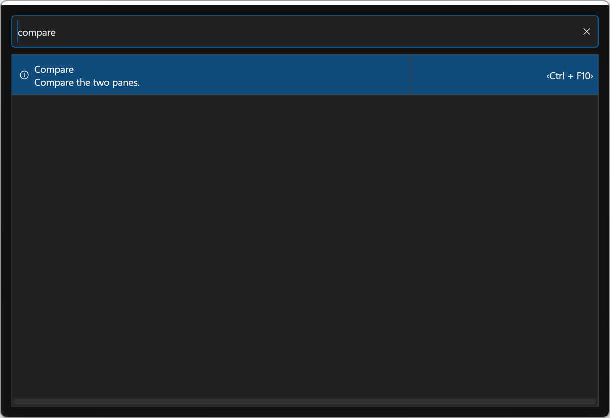

# Command Palette

Press **Ctrl+Shift+P** to open the global Command Palette from a file pane,
navigation control, preview or Terminal. It provides one searchable row per
command with an icon, its name and current shortcut chips.

## Find and run a command

1. Put the file pane or other content you intend to act on in focus.
2. Open the palette and type part of a command's name or search words.
3. Move through the matching rows with the keyboard or choose a row with the mouse.
4. Press **Enter** to run the selected command. Press **Esc** to close the palette
   without executing a command.

Search matches command information. To search for files or directories, use
[Find Files](FindFiles.md) with **Alt+F7**. To search output or command history
inside a shell, use the [Terminal](Terminal.md) commands.

Commands keep their normal context and safety checks. For example, Copy still
uses the selected/focused items and opposite pane, and a provider must support
an operation before it can run. If an action cannot run in the current context,
check the focused pane, selection and connection before trying again.

## Menus, shortcuts and configured actions

The palette is another entry point to the same command system used by menus and
shortcuts. Its shortcut chips reflect the current bindings. Change them under
**Preferences -> Keyboard**, using the appropriate Application, Function Bar,
Folder View or Terminal scope.

Parameterized actions, including configured viewers, editors, User Menu entries
and plugin choices, retain their own configuration and validation rules. Manage
those in [Preferences](Preferences.md); use **Commands -> Reread Associations**
after changing their settings externally.

For a menu-oriented tour see [Main Window](MainWindow.md); for file selections,
reports and everyday utilities see [Selections and File Lists](SelectionsAndLists.md).
