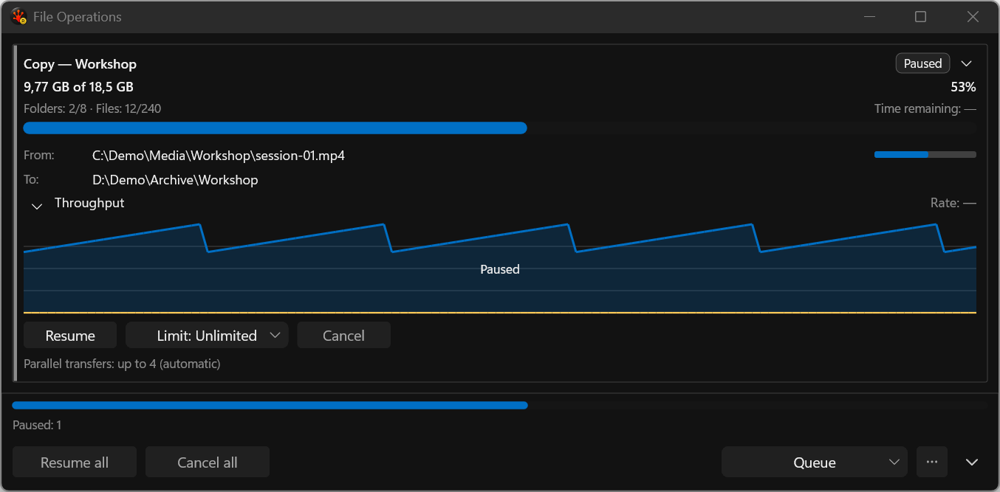
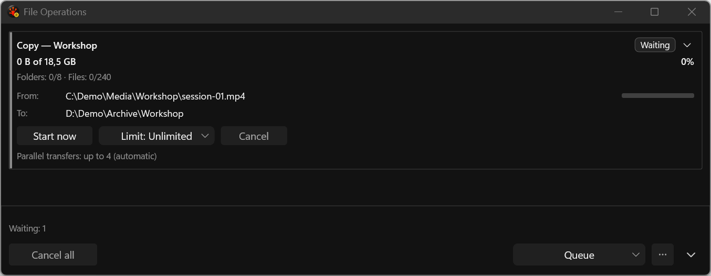
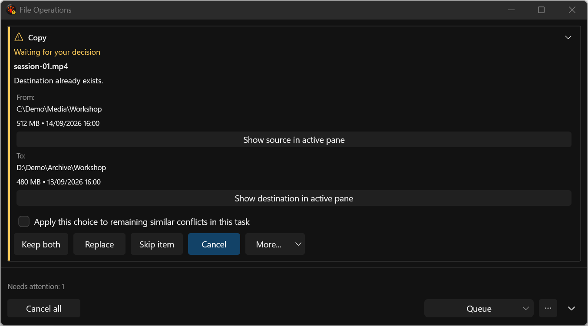
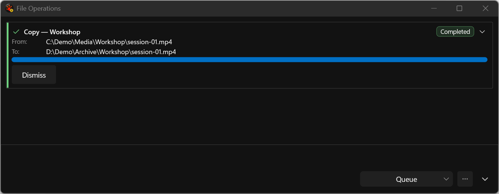

# File Operations (Copy/Move/Delete)

RedSalamander runs long operations in the background and shows progress in a dedicated UI.

This native harness capture shows the current card layout using invented file names and paths.
Its [capture provenance](res/file-operations-popup.provenance.json) records the deterministic scenario and build.

## File Operations popup (UI tour)

The **File Operations** popup opens automatically when an operation is still running after about half a second, and right away when a task has to wait, needs a decision from you, or ends with something to review. A short operation that finishes cleanly before then does not open it. It is safe to keep using the main window while it runs. Closing the popup does **not** stop the operation.

### Footer controls (global)

- **Cancel all**: requests cancellation of unfinished tasks after confirmation. Cards show Stopping while workers stop safely; the terminal result replaces that state. A task that had not changed anything yet (still preparing, waiting in the queue, or waiting for your answer before it starts) ends **Canceled** with the line **Not started; nothing was changed** and no warning, so **Auto-dismiss** clears it like any canceled task. When every finished task left in the **Completed** group ended cleanly, the group folds once after Cancel all so its badges and **Clear completed** are in view; open it again with its chevron.
- **Exiting while operations run**: RedSalamander asks whether to cancel all operations and exit (it does not ask when every task is already stopping). After you accept, it closes as soon as the tasks have stopped; waiting tasks never start. Until then, closing again just brings this popup forward, and any new copy, move, delete or rename is refused with a message in the pane, so nothing is changed. Operations running in a Compare Directories window count too: they are canceled with the others and RedSalamander waits for them before closing.
- **Closing a Compare Directories window while its operations run**: the Compare window has its own operations popup. Closing it asks whether to cancel them and close the window; choose Cancel to keep them running. After you accept, the window closes once they have stopped, and new operations in that window are refused until then.
- **Queue / Parallel**:
  - **Queue** runs tasks sequentially, one after another.
  - **Parallel** allows multiple tasks to run at the same time.
  - Parallel mode uses shared, bounded worker pools so thread count stays under control even with multiple in-flight operations.
  - Switching to **Queue** while several tasks are active pauses all but one at the next safe checkpoint.
- **Clear completed**: removes the completed task summaries shown in the **Completed** group. A task that finishes just before you click stays, and an interrupted-Move notice from a previous session stays until you dismiss it on its own card.
- The footer also shows a quick summary of how many tasks are running, paused, stopping, waiting, or need attention. While some tasks are still being counted it adds **Still counting: N** (see [“Counting items…” and totals](#counting-items-and-totals)).

### Each task card

Each task shows:

- Operation and original subject on the left, with status on the right. One selected file or folder keeps its name; a selection keeps its file/folder counts (or item count when kinds are unknown), including when the card is collapsed or finished.
- Expanded Copy/Move cards pair transferred amount with percentage. Directly below, folder/file counts sit beside remaining time. Overall progress sits above the source/destination paths and throughput history. Short facts wrap when needed.
- Folder/file fractions count successfully completed objects inside the selection, including nested files. A folder completes when its operation and children finish. When a route supplies totals without completion counts, the card shows **Folders: N · Files: N**. Fractions appear only for completion counts the route actually supplies; for example **Folders: 2/8 · Files: 12/240**, or **Folders: 8 · Files: 12/240** when folder completion is unavailable. Unavailable counts are stated explicitly.
- When a Copy's byte total is unknown, it shows copied-file counts when available, otherwise bytes written, and keeps the progress indeterminate. A known zero-byte selection can show file progress.
- **From** / **To** (or **Deleting**) paths
- Item/byte progress and “Remaining” time (once the totals are final; while items are still being counted, live counters are shown instead, see [“Counting items…” and totals](#counting-items-and-totals))
- Current file activity (including multiple in-flight files when copying/moving)
- Throughput graph colors in rainbow mode, weighted by each active stream's byte share so parallel copies show balanced color bands when streams progress evenly
- **Speed**: what the task moved over the last 5 seconds, so a pause in the transfer lowers it honestly instead of freezing it or making it jump. When nothing has moved for longer than usual for that copy (at least 0.6 seconds, more for a copy that reports in coarse steps), the card says what the copy is waiting on next to the speed (**Finalizing file…**, **Waiting for the destination…**, **Waiting for the source…** or **Waiting for storage…**) and the throughput graph hatches that stretch. A copy held at its speed limit, and a task that is stopping, are not called waiting. Paused and queued tasks, and a task waiting for your answer, show no speed. Moving files to a network share from another drive writes each block straight through to the share, so the speed shows what the share accepts as it goes. A copy to a network share lets Windows hold part of the data in memory first, so with a very large file the card can say **Waiting for the destination…** while Windows sends what it holds.

Task controls (what you can click):

- **Collapse/expand**: hide/show details while keeping the operation's original name or selection summary visible. Long names shorten in the middle; their full text remains available to accessibility and in the tooltip.
- **Throughput**: hide or show the history plot. Speed stays at the right of the Throughput heading, and remaining time stays beside the counts above the paths. Your plot choice survives collapsing the card.
- **Pause / Resume**: pauses the task at the next safe checkpoint.
- **Cancel**: requests cancellation of only that task; its card shows Stopping until the worker reaches a safe stop and the final result is known.
- **Skip counting**: shown while the card is counting ahead of the work. It stops the count from running ahead so the operation can use its full speed. It does not skip any check (see [“Counting items…” and totals](#counting-items-and-totals)).
- **Destination** *(Copy/Move, before the task starts)*: choose a different destination folder:
  - **Other panel** (the other pane’s current folder), or
  - a compatible folder from the destination pane’s **history**.
- **Speed Limit** *(Copy/Move)*: sets a per-task bandwidth cap:
  - **Unlimited**
  - presets: `1 MiB/s`, `5 MiB/s`, `10 MiB/s`, `50 MiB/s`, `100 MiB/s`, `1 GiB/s`
  - **Custom…** accepts inputs like `3KB`, `4MB`, `1GB` (optional `/s`).
- **More...** *(completed tasks with diagnostics)*: opens **Show log** and **Export issues** actions.
- **Dismiss**: removes a completed task summary from the popup.

On Copy/Move cards, when automatic parallelism is in use, a small line below the action buttons reads
**Parallel transfers: up to N (automatic)**. This is the effective maximum, so fewer files can
be active at a particular moment. These routine facts are visible directly on the expanded card;
there is no separate Technical details button. The Issues pane still provides detailed diagnostics.
Delete cards keep their item-based progress and do not show a transfer-concurrency note.
The source tooltip lists other active transfers and updates as they finish.

If a source file or folder disappears before a queued Copy or Move reaches it, the task fails with
a source-not-found explanation and asks you to check the original location and start again. Its
result lists the missing item separately; it does not say that the item was left in place or offer
to cut that missing source again. A destination that lacks a required capability still reports its
own unsupported-operation error when the source exists.

### Informational task cards

Some background work is displayed as read-only **informational** cards in the same popup (for example **Compare Directories** and **Change Case**).
To avoid clutter, informational cards are created only if the operation takes longer than ~`700ms`.
They show the current path and basic progress counters, and can be dismissed when complete.

### “Counting items…” and totals

A folder's total is fixed as soon as the folder has been listed, not when its last file is copied:
for an ordinary folder, even one with thousands of files, the percentage and remaining time appear
within moments of the start. An extremely large folder (hundreds of thousands of names), a deep tree
of busy folders, or a copy to or from another provider is listed while the first files copy, so its
total is fixed once the listing has caught up.

For Copy and Move of selected files on local disks, RedSalamander freshly checks the size of every selected file before starting payload transfers. A Ctrl+A selection therefore reaches a correct total without waiting for earlier files to finish copying. These are current disk metadata checks; the sizes displayed in the pane are not reused. Zero-byte files count too. Unreadable items, links and folders still require their normal checks or traversal. Network sources keep their existing counting path so a separate list of remote size requests does not hold up the first transfer.

RedSalamander does not scan a folder tree twice just to get totals. Copy, Move and Delete use one traversal to count a tree while handing each item to the operation as it is found. A task starts with a brief **Preparing...** step in which RedSalamander checks the selection and destination. Deleting to the Recycle Bin is carried out by Windows, which reports only the items you selected, so that card counts your selection rather than everything inside a folder.

While the count is still open, the totals are not final, so the card shows what is known instead of guessing:

- Copy/Move shows bytes written first, followed by **Counting…** or **Counting… Folders: N · Files: N**, next to the counting signal. The Counting label marks provisional totals; those numbers are not completed counts.
- Delete retains its **Found so far** row and separate work-done row, including committed file/folder counts when the provider supplies them.
- The progress bar is indeterminate (a moving bar) instead of filling to a percentage, because the total can still grow. The card never shows a fraction of a growing total.
- Once data is moving at a steady speed, a provisional **Remaining** time can appear, marked `(still counting)`. It can go up or down while the count goes on, and it is hidden while the task is paused or stalled.

When the count ends, the totals become final. The bar turns into a percentage bar, **Remaining** switches to the regular estimate (it can take a moment of steady progress before the first estimate appears), and the counting signal goes away for good. A single file of known size is counted before any data moves, so its card shows a percentage bar from the first moment. With several selected items, the card keeps counting until every one of them has been counted. For very large trees, counting can take a while; the card keeps showing live counters until it ends.

**Skip counting** appears on a card while the count is running ahead of the work. Counting ahead keeps some of the operation's parallel capacity free for the count; **Skip counting** gives that capacity back at the next safe checkpoint, so the operation can use the full parallelism and bandwidth it is configured for (a Speed Limit you set still applies). It does not skip the count or any check: every folder is still listed, every name is still validated and every conflict is still asked about. The operation now counts as it goes (the card says **Counting while working**), and the totals arrive when the whole selection has been reached. Skipping is one-way for that task; the button does not come back.

The footer follows the same rule. While some tasks are still being counted, its bar shows progress over the tasks whose totals are already final, and its summary reads `N% of the work counted so far`, followed by `Still counting: N` for the tasks that are not counted yet. If no running task has final totals yet, the footer bar stays indeterminate and shows no percentage. The Windows taskbar button also stays indeterminate while any running task is still being counted.

For developer details see [Streaming discovery and scheduling](../Specs/FileSystem/FileSystem_FileOperations.md#streaming-discovery-and-scheduling) and [dev/FileOperationsEngine.md](dev/FileOperationsEngine.md).

This synthetic harness frame shows provisional counts while the total is provisional;
its [provenance](res/file-operations-counting.provenance.json) records the capture.

### Reading counts and task states

A Move can know the recursive totals without receiving separate completed-file
and completed-folder receipts. It then shows simple totals:

A Copy can receive file completion receipts before folder completion is available.
The file fraction remains useful; the folder value remains a total:

Pausing preserves the known counts and progress. Resume continues the same task:

A queued task waits for admission; **Start now** can request that it start without
waiting for the preceding task:

Each example uses private synthetic state. The [capture inventory](res/README.md)
links the exact native images to their source/build and scenario provenance.

### Conflicts (overwrite, retry, skip…)

If a task hits a conflict (destination exists, read-only, access denied, sharing violation, disk full, path too long, etc.), the task shows an inline prompt with action buttons such as:

- **Replace**
- **Retry**
- **Skip item**
- **Cancel**
- **More...** for rarer actions such as **Replace read-only** and **Skip all similar conflicts**

Use **Apply this choice to remaining similar conflicts in this task** when offered
to apply the selected non-retry decision to future conflicts of the same kind.

The conflict example shows the decision on its task card. It does not perform an
overwrite or any other operation on the displayed example paths.

### Answering a question from the pane

When a task waits for your decision about a folder that one of the panes shows (for example, a permanent delete of items in the left pane, a name collision in the folder the right pane shows, or a warning that another task is working in the same place), the same question also appears over that pane, with the same buttons. You can answer it there or on the task card: the first answer counts, and the other copy of the question disappears. Closing the question over the pane (its **X**) does not answer it; the question stays on the task card.

- When a question appears while RedSalamander is in the foreground, it takes keyboard focus immediately, even if you were using the other pane. The initial highlighted answer is safe, such as **Cancel** for permanent deletion or **Queue after these tasks** for overlapping work. A background RedSalamander window never requests the foreground.
- Use **Tab** / **Shift+Tab** and the arrow keys immediately to move between choices; **Enter** or **Space** activates the selected choice, and **Esc** chooses the safe escape answer (usually **Cancel**). No click, **Ctrl+Tab**, or waiting period is required. Holding a key so it repeats cannot answer another decision.
- **F6** (or **Shift+F6**) on the question sends the focus back to the pane without answering: the question stays over the pane and on the task card and does not take the focus again; click it when you want to answer it there. While the question has the focus, the main window's keyboard shortcuts do not reach it, so press **F6** first to use them (for example to open the File Operations window).
- When the question over the pane is answered while it still has the focus, the focus goes back to the pane. If you moved the focus somewhere else in the meantime, it stays where you put it. **Alt+F4** while the question has the focus closes the window, as it would from the pane.
- If you move the pane to another folder, the question leaves the pane and stays on the task card; come back and it returns. While a dialog of the main window is open (for example **Change Attributes**), the question waits until the dialog is closed.
- **Apply this choice to remaining similar conflicts** is the same choice on the task card and over the pane: changing it in one place changes it in the other.
- While any decision is waiting, the status bar of each pane shows **N decision(s) pending — click to open**, even when you closed the File Operations window; click it to open the window. When decisions start to wait while you work in the main window, the File Operations window's taskbar button flashes once (once for a series of questions, not once per question).
- To keep questions only on the task cards, turn off **Also show file-operation questions over the pane** in **Preferences -> File Operations**.

Confirmations asked before a task starts (for example **Copy with Options** or a delete to the Recycle Bin that asks first) appear over the pane you started them from.

### Results: warnings, errors and notes

A finished card counts only what needs your attention: **Warnings: N** and **Errors: N**, shown only when they are not zero. Everything else the task recorded is a **note**, an expected outcome rather than a problem:

- a question you answered (for example **Replace** on an existing file, or **Queue after these tasks** when another task works in the same place);
- items you chose to skip (`Skipped N item(s) at your request.`) and links skipped because of the link setting;
- permissions the copy inherited from the destination folder, and a destination that does not keep timestamps and permissions;
- a Move that could only be done as a copy, when the confirmation already said so.

Notes never count as warnings, never keep a successful card open, and are always kept in the task log and in **Export issues**. To see them on the cards (`Notes: N`, and as **Last note** when there is no warning) and in the issues pane, turn on **Show informational notes from file operations** in Preferences -> File Operations.

On an expanded finished card, **Last note** wraps to show the complete message above the progress bar and buttons. Resizing the popup reflows the text; use the popup scrollbar if a long message makes the card taller than the window.

The [capture provenance](res/file-operations-wrapped-note.provenance.json) identifies
the invented Workshop fixture. Its layout assertions require the complete note
to fit, occupy multiple lines and precede the progress bar.

A task whose items all succeeded reads **Completed** (or **Completed with warnings** when it recorded warnings). **Completed with skipped items** means some items were skipped, by you or by a failure; the card stays so you can review it. A real failure is always counted, even when the task went on with the other items.

The completed example shows a clean terminal result. Warnings, skipped items or
retained Move sources can keep a result available for review as described above.

### What a copy keeps

A copy keeps the file content, timestamps and attributes, alternate data streams, extended attributes and the **Mark of the Web** (the mark Windows puts on downloaded files), including when it overwrites an existing file. Permissions come from the destination folder, as in File Explorer: that is a note, not a warning. Two cases are warnings, because you may need to act on them:

- a file whose own permissions you set (inheritance disabled) gets the destination folder's permissions instead;
- the destination cannot keep the Mark of the Web, alternate data streams or extended attributes (for example a FAT or exFAT drive, or a share without stream support). The copy itself completes, and the card names what was not kept.

## Copy and move between panes

These commands use the **focused pane** as the source and the **other pane’s current folder** as the destination:

- **Copy to other pane**: `F5`
- **Move to other pane**: `F6`

Notes:

- If both panes point to the same effective destination folder, RedSalamander blocks the operation to prevent accidental self-copy/self-move.
- If source/destination are different file-system contexts, RedSalamander uses a cross-filesystem bridge (read → write). Files can start copying as soon as their parent destination directory exists, while read-only destinations still reject writes.
- Clipboard paste and folder-picker move use the same File Operations task workflow as `F5`/`F6`, including the popup, conflict prompts, pause/cancel, and safe default overwrite policy.
- Providers that advertise an operation as unsupported block that command before a task starts.

## Delete vs permanent delete

- **Delete** (`Del` / `F8`): deletes to the Recycle Bin when supported by the active file system. Delete never removes an item permanently on its own: when Windows cannot recycle an item (for example on a network share, or a drive without a Recycle Bin), the item is kept and the task asks whether to delete that item permanently. For a folder, the question shows how many items and how much data the folder holds, and deleting it permanently removes the folder with everything in it. **Skip** keeps that item and the task goes on with the others. When several items are selected, **More** on that question also offers **Delete all remaining permanently**: it deletes this item and, without asking again, every later item of the same task that also cannot be recycled on the same drive or share. It never applies to an item whose outcome is unknown, and it ends with the task. If an item cannot be deleted permanently (for example because it changed after Windows failed to recycle it), the task stops there: that item and every item not yet handled are kept, without another question and without being deleted. With **Continue on error** enabled, the task never asks: it keeps each item that could not be recycled, reports it as failed and continues with the other items. If Windows ever deletes an item without moving it to the Recycle Bin, the task reports that item as failed, not as recycled.
- **Permanent Delete** (`Shift+F8` / `Shift+Del`): asks for confirmation, then bypasses the Recycle Bin. The confirmation keeps the captured provider path spelling; mixed or unknown locations use a Multiple locations summary instead of a guessed common folder.

## Progress UI: tasks, pause, cancel, mode, speed limit

When an operation starts, RedSalamander creates a **task** and shows it in the File Operations popup:

- Selected disk files get fresh sizes before Copy/Move transfers begin; folders are counted by their single traversal while work runs. Totals and **Remaining** time become final when counting ends, and **Skip counting** stops the count from running ahead of the work (see [“Counting items…” and totals](#counting-items-and-totals)).
- Tasks can be **Paused** and **Canceled**.
- Execution mode can be **Queue** (tasks run one after another) or **Parallel** (multiple tasks run concurrently).
- Copy/Move tasks support a per-task **Speed Limit**.

## Defaults and settings

### Preferences -> File Operations

This page owns host-wide defaults that apply to newly created tasks (the label in parentheses is the section heading on the page):

- **Verify copied files** (Verification): after a file is copied, compares the copy with the original, which may read every copied byte again. Off by default. With it on, a task's bar has two halves, copying then verifying; a divider in the verifying color separates them, and the verifying half fills with hatching in that color. A finished task reads **100%** only when everything was verified; otherwise its card says **Not verified** or **Verified N%** next to the bar. **Copy with Options** (`Shift+F5`) and **Move/Rename with Options** (`Shift+F6`) can change it for a single task without changing Preferences.
- **Default speed limit** (Bandwidth): seeds new copy/move tasks with **Unlimited**, a preset (`1 MiB/s` through `500 MiB/s`), or **Custom**. There is no GiB/s preset; use **Custom** for faster rates.
- **Custom limit**: the throughput used when **Custom** is selected, a value such as `128KB`, `5MB`, or `1GB`.
- **Auto-dismiss successful tasks** (Advanced): automatically clears completed tasks that succeeded or were canceled, and closes the popup when nothing remains.
- **Show informational notes from file operations** (Advanced): shows notes about expected outcomes (inherited permissions, questions you answered, skipped links) on task cards and in the issues pane. Off by default; the notes are always kept in the task log (see [Results: warnings, errors and notes](#results-warnings-errors-and-notes)).
- **Also show file-operation questions over the pane** (Advanced): when a task waits for your decision about a folder a pane shows, the question also appears over that pane (see [Answering a question from the pane](#answering-a-question-from-the-pane)). On by default; the question always stays on the task card.
- **Cross-FS bridge buffer (KB)** (Advanced): sets the per-buffer size (`512` to `16384`) used by the host bridge when copying between different file systems. Two buffers are allocated per active bridged transfer.

Counting items is automatic, so there is nothing to configure for it. The page also includes a reminder that plugin-owned settings stay under **Preferences -> Plugins -> File System**.

### Preferences -> Plugins -> File System

These plugin-owned settings control how the FileSystem plugin executes work:

- **Concurrency mode**: `Manual` uses the configured copy/move and delete budgets, while `Auto` resolves a budget from the source/destination storage characteristics at task start.
- **Copy/move max concurrency**: worker budget in Manual mode. With an effective budget of four, one folder and its equivalent selected files can both transfer four files concurrently, including managed Move to an SMB share. Auto uses its resolved budget even when an inactive Manual value of one remains saved. Verification and provider limits can narrow the budget.
- **Delete max concurrency** and **Recycle Bin delete concurrency**: plugin default worker budgets for delete paths.
- **Recycle Bin batch size**: cap used when batching recycle-bin deletes through `IFileOperation::DeleteItems()`.
- **Search max directory walkers**: worker budget used by recursive name-only search directory walking.

### Per-connection and per-task overrides

- A non-zero **per-connection** copy/move override takes precedence over the FileSystem plugin default for tasks created through that connection.
- A **per-task** speed limit chosen in the File Operations popup overrides the global default for that task only.
- Global File Operations preferences affect newly created tasks; they do not retune already-running operations.

## Diagnostics (logs and issue reports)

The popup can open/create files under your user profile:

- File-operations daily logs: `%LocalAppData%\\RedSalamander\\Logs\\FileOperations-YYYYMMDD.log`
- Per-task exported issue reports: `%LocalAppData%\\RedSalamander\\Logs\\FileOperations-Issues-Task...txt`

Advanced logging options (retention and verbosity) are in Preferences → **Advanced** → **File Operations**.

## Failed items / issues pane

When operations encounter errors, they can be reviewed in the issues UI:

- Toggle: **View → File Operations Failed Items** (default `Ctrl+J`)
- Issues are listed oldest first until you sort a column. Select one to see its details: only the facts that apply are shown (a delete has no destination, and an ordinary failure has no decision or result). **Copy details** copies the selected issue.
- A partial Move can leave some items already copied to the destination and some originals left in place. Review each item's source, destination, and cleanup result before retrying or removing either copy.

This is the current Issues pane with a selected failure and its details, using invented file names
and paths. The [capture provenance](res/file-operations-issues.provenance.json) records the synthetic scenario and build.

## Leftovers from an interrupted copy or move

If a copy or move is interrupted before it can clean up (for example when RedSalamander closes unexpectedly), a temporary file can be left next to the destination. RedSalamander recognizes these files by the long generated names it gives them (for example names with a `.rs_tmp_…` part) and never hides them: they show up in panes, Find Files and Compare Directories like any other item, with a warning icon and the label **Possibly incomplete file (left by an interrupted copy or move)**. RedSalamander also recognizes the temporary names it uses on remote and device locations (FTP, SFTP and SCP uploads, S3 backups, MTP device writes). A backup or rename leftover (names with a `.rs_bak_…`, `.rs_ren_…` or `.rs_case_tmp_…` part, an S3 `.rs-bak-…` key or a `.redsalamander-rollback-…` file) can be the only complete copy of a file, so it is labeled **Possibly an original kept by an interrupted copy or move** instead: check it before deleting anything. The mark is based on the name only, so it is a hint rather than proof, and RedSalamander never deletes or repairs these files on its own.

- Selecting, viewing, opening, copying, exporting and reading the properties of a marked file work as usual, with no extra question. **Properties** adds a **File Operations** section that explains why the file is marked.
- Focus a marked file and open its context menu: the **Leftover from an interrupted operation** submenu offers **Inspect read-only** (opens the built-in viewer, never an external program), **Reveal in pane** and, for files on a Windows drive or network share (not for remote or cloud connections), **Open location in File Explorer**.
- Renaming, moving, deleting or overwriting a marked file asks first, because its data may be incomplete. **Cancel** is the default answer.
- **Commands -> Clean Up Leftovers of Interrupted Operations...** (also in the marked file's context submenu whenever the folder has a marked file) lists the marked files of the current folder, optionally with its subfolders, with their size and date. The search of subfolders is limited (folders searched, files listed, depth) and says which limit stopped it. Files in a folder that an operation running in the same window is working in are not listed, and the list says how many were left out. Leftovers start checked; possible originals start unchecked; a box you change keeps its state when you include or leave out the subfolders. **Cancel** is the default (Enter and Esc also cancel). **Delete Selected...** deletes the checked files exactly as the Delete command does (to the Recycle Bin where there is one), with the same questions, on the location the list was opened on even if the pane has moved on; nothing is deleted automatically or at startup. On a location that cannot delete files (for example an MTP device) the list shows the leftovers but offers no **Delete Selected...** and says why.
- If RedSalamander cannot confirm that a marked file is still the same file (some network shares cannot tell, and a file that is open elsewhere cannot be checked), it does not start the operation and says so. The message names up to three of the files, each with a plain reason. **Retry** (offered when a file could not be opened; close the programs using it first), **Open location in File Explorer** (Windows drives and network shares only; check or remove the file there yourself) and **Close** (the default) are the choices. Closing the message is the whole answer: RedSalamander does not show a second error. Deleting such a file is the exception, see below.

### Network shares that cannot identify files

Some network shares (for example some NAS devices) cannot tell RedSalamander which file a name refers to. On such a share a permanent delete asks once more, on its own card: **Delete by name** or **Cancel** (the default). If a selected item changed while that question waited, nothing is deleted. Right before each selected item is deleted it is checked again: a file must still have the same size, dates and attributes (and the same file number when the share reports one). For a selected folder, RedSalamander lists everything inside it when it asks, and deletes only what it listed: if anything in the folder changed or was added by the time the delete starts, nothing is deleted; each item inside is checked again right before it is deleted, and an item added while the delete runs is never deleted: it is kept, with the folder that holds it (the delete then says how many of the listed items it deleted and that the folder and the rest were kept). An item that changed is not deleted, and RedSalamander asks what to do next. Two limits remain: a change that keeps a file's size and dates cannot be noticed, so such a file is deleted with its new content; and some network shares report a recent change late, so a delete that should have been refused may instead stop after deleting part of the folder. A folder with more than 200,000 items, more than 32 MiB of item paths in all, or nested more than 128 levels deep, cannot be deleted by name: delete its subfolders separately; the same holds for a Recycle Bin delete that falls back to deleting by name, which then says why. A delete after the Recycle Bin refused an item asks the same way, with **Skip** for that item and, when several items were selected, **Delete all remaining by name**. If another RedSalamander operation is working on the item or its folder, the delete by name is refused; an operation started later that works in that folder first asks whether to wait for the delete (**Queue after these tasks** is the default; it cannot run at the same time as the delete). Large folders are listed and deleted several items at a time, as an ordinary delete is. A file another program has open is not deleted: if the program opened it after you answered, close the program and choose **Retry**; if it was already open when the delete started, the delete stops with both reasons in its details, so close the program and start the delete again. An archive's delete-after-packing or delete-after-unpacking never deletes by name on such a share. Moving, renaming or overwriting a leftover on such a share still needs File Explorer.

## Properties

Open item properties with **Files -> Properties** or `Alt+Enter`.

Properties work through the active file-system plugin. Local files show name, path, type, size, timestamps, attributes, shortcut/link/reparse targets when present, and named streams when present. Remote/cloud plugins can expose their own metadata through the same dialog. `Ctrl+C` copies the full property text; `Esc` closes the dialog.

## Clipboard copy/paste (Windows Explorer format)

Folder view supports a basic Explorer-style clipboard for **Windows paths**:

- `Ctrl+C`: copy selection to the clipboard as `CF_HDROP`
- `Ctrl+X`: cut selection to the clipboard as `CF_HDROP` with the Explorer move drop effect
- `Ctrl+V`: paste into the current folder (copy)
- **Paste Shortcut**: create `.lnk` shortcuts in the current local folder for file paths on the clipboard, using unique shortcut names

Limitations:

- The clipboard format is Windows-path based, so file cut and Paste Shortcut are available for local `file` file-system paths.
- Clipboard paste queues a File Operations copy task; destination conflicts are handled by the same inline conflict prompt as pane copy.

## Creating files from ShellNew templates

Files -> New lists Windows ShellNew templates for local folders. Template entries prompt for a new file name, create the file from the selected `NullFile`, `Data`, or `FileName` template, refresh the pane, and focus the created item when it is visible. ShellNew command templates are not invoked by this safe path.

## ZIP Pack / Unpack

Use **Files -> Pack** (`Alt+F5`) to create a ZIP archive from the selected local files and folders, or the focused item when nothing is selected. Use **Files -> Unpack** (`Alt+F6`) on a focused or selected ZIP archive to extract it to a destination folder.

Pack writes deterministic stored ZIP entries, preserves selected empty directories, and reports the created archive. Unpack validates archive entry paths before writing so unsafe absolute, parent-relative, drive-qualified, or alternate-stream paths are rejected.

## Drag & drop

- Dragging items **between panes** queues a task and uses the same progress UI as `F5`/`F6`.
- Dragging to external apps (Explorer, editors, …) uses standard Windows drop formats when possible.
