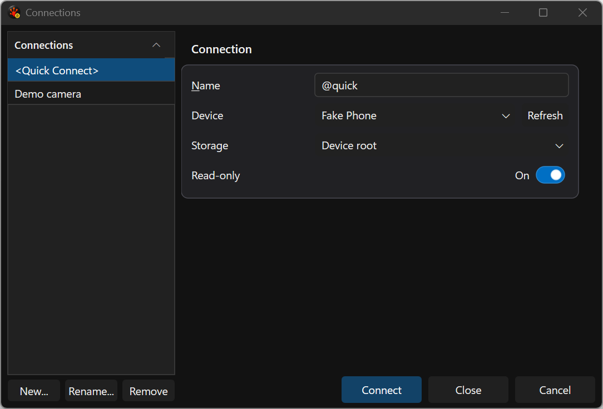
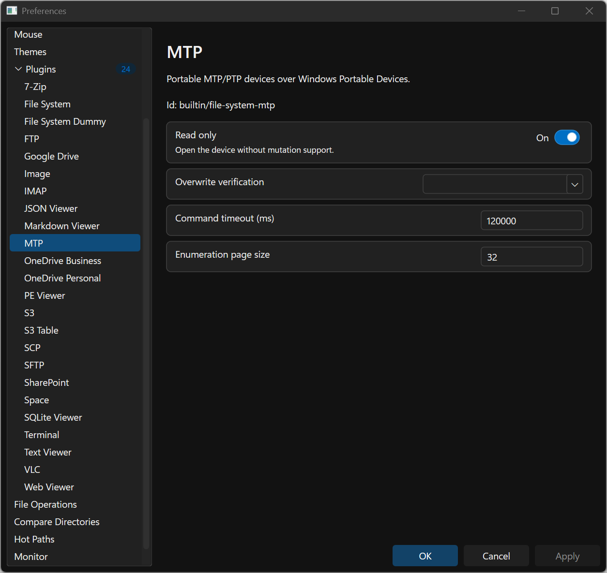
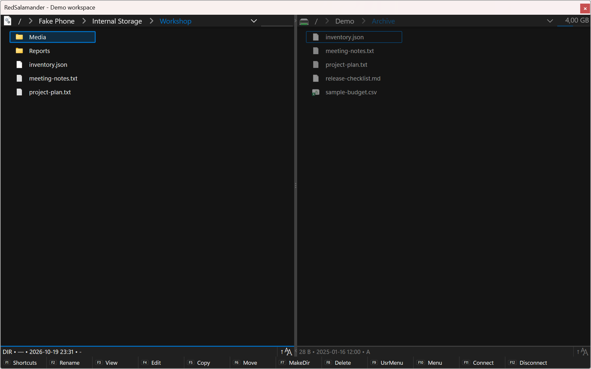

# Phones, Cameras and Portable Devices (MTP/PTP)

Use the **MTP** file-system plugin to browse phones, cameras and media players
exposed by Windows Portable Devices. A device is a virtual file system; it does
not need a Windows drive letter.

## Connect a device

1. Connect the device and unlock it. Select its file-transfer or photo-transfer
   mode if the device asks, and allow Windows access to its storage.
2. Open [Connection Manager](Connections.md), create a profile and choose **MTP**.
3. Choose the device in the device picker, then choose its storage. Device and
   storage discovery run in the background.
4. Give the profile a recognizable name, leave **Read-only** enabled for browsing,
   and connect. Reuse the saved profile for later connections.

MTP profiles have no username or password. The editor uses device and storage
pickers rather than asking you to type a device identifier. Saved identity hints
help reconnect to the selected device even if its friendly name changes.

You can also enter `mtp:/` in the address bar to browse the device namespace.
For example, an invented device might appear as
`mtp:/Demo Camera/Internal Storage/DCIM`. Friendly names are displayed as folder
names. Two connected devices with the same name receive distinct session names.
Choose them in the picker rather than guessing their identity from a name.

## Browse and copy files from a device

Open folders normally. With a device folder in one pane and a local destination
in the other, select files and press **F5** to copy them. Viewer availability
depends on the file type and the device's read/seek support. Device reads are
streamed where the device permits it.

Device transfers use the normal [File Operations](FileOperations.md) popup,
including cancellation, progress and issue reports. Device-reported sizes and
capabilities determine which operations are available. A phone can stop exposing
storage when it locks, changes USB mode or disconnects.

## Enable changes deliberately

Profiles start **read-only**. Turn that option off in the saved MTP profile only
when you intend to change the selected device's storage.

Depending on device capabilities, writable profiles can upload files, create
folders, rename, delete, copy or move objects. Some devices refuse particular
operations even when other writes work. An ambiguous object or an unavailable
identity is not permission to replace or delete an arbitrary item.

A Move may retain its source when the route cannot prove that deleting it is
safe. Read-back verification is often unavailable on MTP; the options dialog
shows the provider's reason when verification cannot be offered. Review the
terminal card and Issues pane before assuming that a Move removed its source.
Keep Both, overwrite and recovery behavior follow the device's advertised
capabilities and the host's file-operation safety checks.

## Disconnect and troubleshoot

Use the device's **Disconnect** command in the drive menu when finished. That
connection stops using the device session; reconnect before doing more work.
Unplugging a device during an operation can leave an issue to review.

| Symptom | What to check |
| --- | --- |
| No device or storage appears | Unlock the device, select its transfer mode, check the cable and confirm that Windows can access it. Refresh the picker. |
| Upload, rename or delete is unavailable | Check the profile's Read-only option, then the device's storage permissions and capabilities. |
| A saved connection no longer opens | Reconnect through the device/storage picker; a device or its storage identity may have changed. |
| Verification cannot be enabled | Read the provider explanation; support varies by device and transfer route. |
| A Move leaves the original in place | Read its result and Issues entry. Copy completion alone does not establish safe source deletion. |

The implementation and capability contract are in
[MTP/PTP File System](../Specs/FileSystem/FileSystem_Mtp.md).

## Browse generated device files

The native example uses the existing fake MTP backend entirely in memory. Its
invented Workshop documents are pre-seeded directly in RAM and browsing stays
read-only with recovery lookups confined to an empty private test profile.
No physical phone, camera, storage or device identity
is enumerated for the capture.

