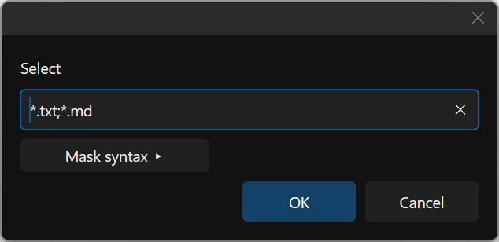
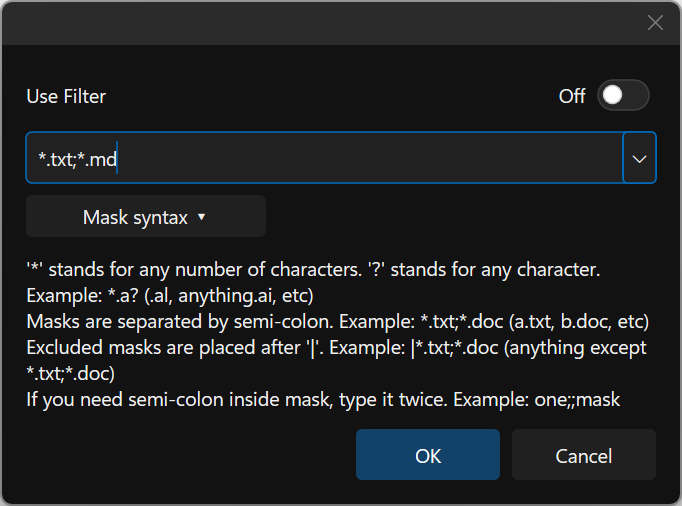
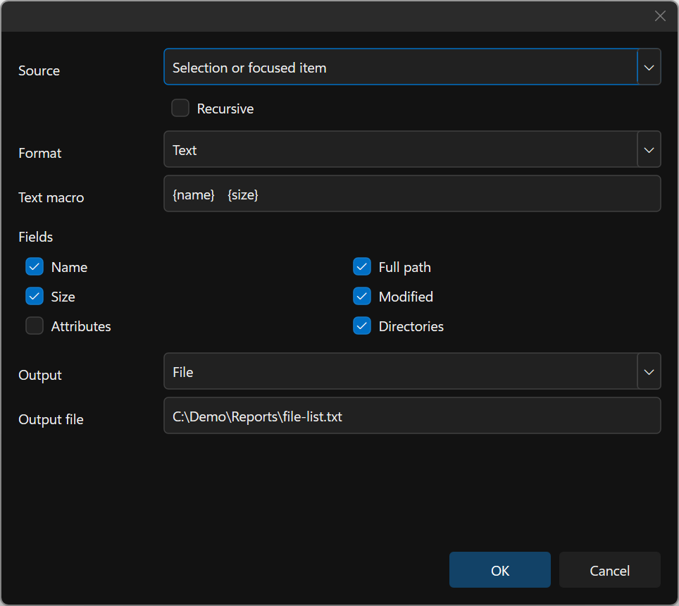
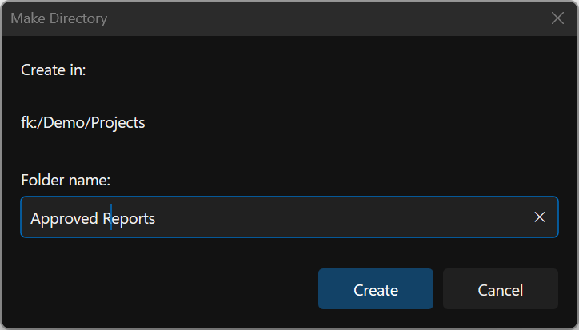
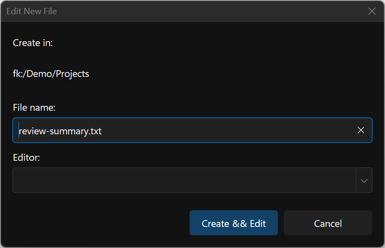
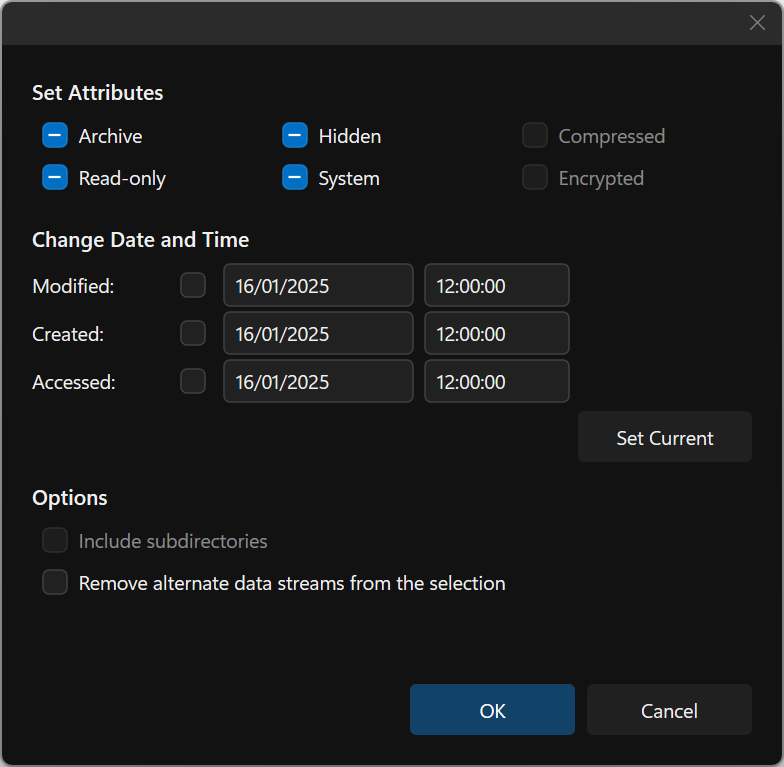
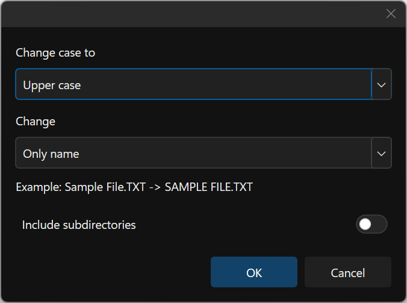
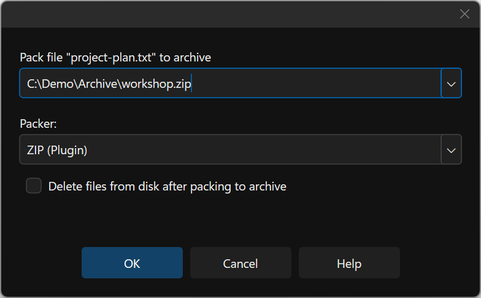
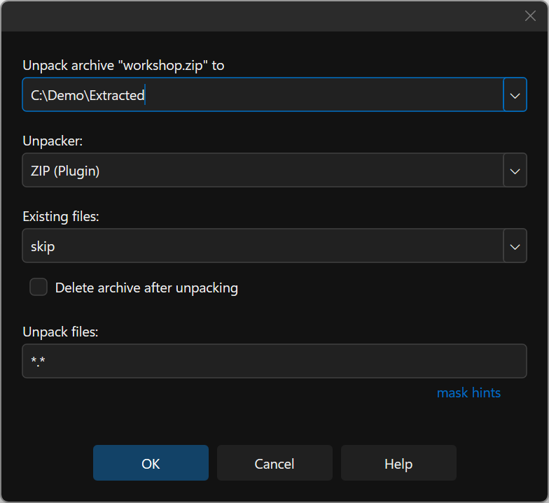
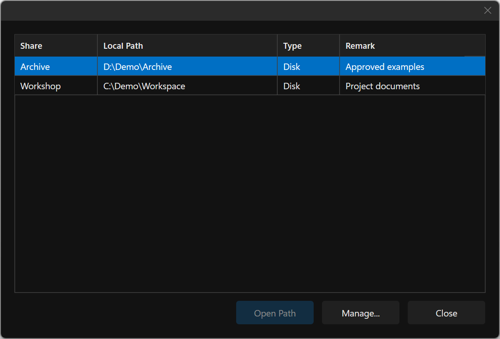

# Selections, File Lists and Everyday Tools

Most file commands use the selected items in the focused pane. When there is no
selection, many commands use the current item; check the command's dialog before
starting a change. A filter changes which items are visible, so review the pane
before applying a selection command.

## Build and reuse a selection

- **Insert** toggles the current item and advances without wrapping.
- **Space** toggles and advances too, while updating folder-size work from the
  items that remain selected. Deselecting a folder removes it from that work.
- Use **Edit** commands to select/unselect all, invert, select by mask, or match
  the current item's name or extension.
- **Alt+Up** / **Alt+Down** move to the previous/next selected name.

**Edit -> Advanced -> Save Selection** records the selected displayed items, or
the current item when nothing is selected. **Restore Selection** replaces the
selection with saved items that are visible now. Hidden or filtered-out items
are not silently selected when they later reappear; invoke Restore again.

**Hide Selected Names** and **Hide Unselected Names** temporarily narrow the
display. Use **Show Hidden Names** to undo that view filtering. These commands
do not delete files or change their Windows Hidden/System attributes.

## Search, filter and sort a pane

Quick Search moves to a matching displayed name as you type. The pane filter
narrows the displayed set. [Find Files](FindFiles.md) opens a separate search
window with its own scope and results. Use the tool that matches the task before
starting an operation on the resulting selection.

Choose name, extension, size, time, attributes or unsorted order through the
pane's sort menu. Name-based display ordering treats numeric runs naturally, so
`session-2.txt` precedes `session-12.txt`. Hidden/system visibility, file-extension
display and temporary name filtering are separate controls.

## Copy names and paths as text

The Edit/path helpers can copy the selected items' **Path and File Name**,
**Path**, **Name**, or **UNC Path and Name** to the clipboard. These produce text
for another program. Use **Copy**, **Cut** and **Paste** for file transfers, and
the [Terminal insertion commands](Terminal.md#insert-paths-from-a-file-pane)
to insert a quoted shell path without executing it.

## Make a file list

1. Select the desired items, or navigate to the folder to list.
2. Open **Commands -> Make File List** and choose selection or current-folder scope.
3. Choose whether to recurse into subfolders and include directories.
4. Select **Text**, **CSV** or **JSON**, then the fields to include.
5. Send the result to the clipboard or a UTF-8 output file.

Text output supports macros such as `{filename}`, `{name}`, `{fullPath}`, `{path}`,
`{size}`, `{modified}`, `{attributes}` and `{isDirectory}`. For example,
`{filename}|{size}` creates a simple name/size list. CSV/JSON are useful when the
next step is another program. The dialog remembers its last options; review
scope, recursion and output destination before reusing them.

The persisted options are described under
[Make File List defaults](SettingsFile.md#configure-make-file-list-defaults).

## Properties, attributes and names

Use **Alt+Enter** for the focused provider's Properties dialog. Local Windows
items can expose attributes, timestamps and security integration; remote or
device providers expose only the properties and changes they support.

Use **Files -> Change Attributes** for the offered flags/timestamps and
**Change Case** for name case changes. [Batch Rename](BatchRename.md) provides
per-item preview, templates, search/replace and manual target names for larger
renames. Review conflicts and validation results before applying a batch.

## New items, external tools and Windows shares

**Files -> New** offers applicable new-item templates. ShellNew integration and
Windows-specific utilities depend on a local Windows backing path. Provider
capabilities still govern directory creation and other remote changes.

**F9** opens the configured **User Menu**. Add entries under Preferences, using
an explicit executable path, arguments and working directory. Viewer/editor and
User Menu actions share path/selection macros; extension and computer filters
can restrict an entry. See [Preferences](Preferences.md) and
[action examples](SettingsFile.md).

**Commands -> Shared Directories** (**Ctrl+Shift+F9**) lists local Windows disk
shares and can open reachable local share paths or the Windows management
console. **Connect Network Drive** (**F11**) and **Disconnect** (**F12**) apply
to local `file:` panes. For protocol/cloud profiles use
[Connection Manager](Connections.md); for a phone or camera use
[Portable Devices](PortableDevices.md).

For occupied-space analysis, open **Calculate Occupied Space** (**Alt+F10**).
The [Space Viewer](Viewers.md#space-viewer-builtinviewer-space) provides the map,
linked table and inspector; pane selection/size calculation and opening that
viewer are separate workflows.

## Utility dialog examples

The examples below use an in-memory library. The harness cancels every dialog,
so the displayed folders, output files, editor and archives are never opened or
modified. Shared Directories uses injected invented rows and performs no Windows
share enumeration, creation or management.

