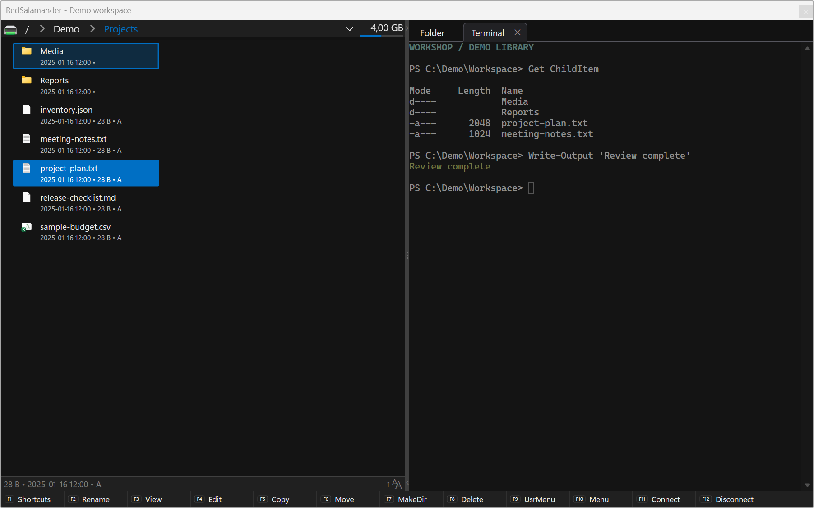
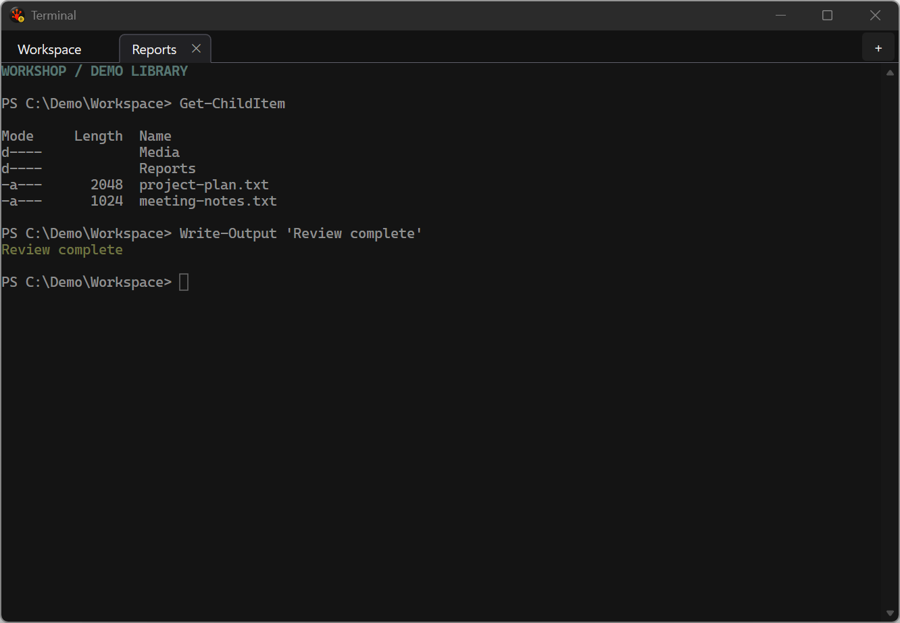
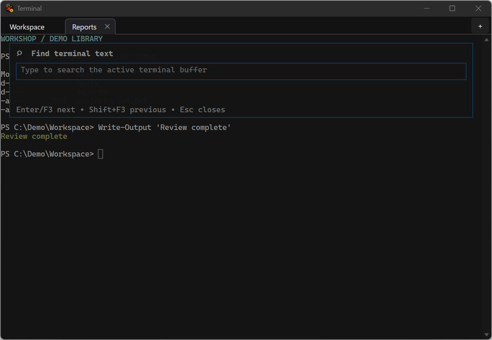

# Embedded and Floating Terminal

RedSalamander's Terminal plugin provides shells inside the file-manager panes
and in a separate window. Open **Commands -> Command Shell**, **Ctrl+Alt+T** or
**Alt+7** to open or reuse the Terminal opposite the active folder.

## Start a shell at a folder

Navigate a file pane to the folder you want, then open Command Shell. A live
Starting or Running session in the target pane is reused. Its process and work
remain alive when you switch back to folder content.

For Windows local and UNC folders, the automatic shell choice tries PowerShell
7, Windows PowerShell, then Command Prompt. The Terminal plugin's **Default
shell** setting can restrict the choice to PowerShell or Command Prompt.
Shell discovery uses registered or Windows system locations.

A WSL folder such as `\\wsl.localhost\DemoDistro\home\demo\work` starts a shell
in that distribution at its Linux path. Plugin-backed folders need a validated
Windows or WSL backing location; an unsupported location produces an explanation
instead of opening an unrelated default folder.

## Floating window and tabs

Press **Ctrl+Shift+N** to open or focus the floating Terminal window and add a
fresh tab for the invoking trusted path. RedSalamander keeps one floating window
and one embedded session per physical pane.

| Action | Default shortcut |
| --- | --- |
| New floating tab, or open/reuse Terminal in the other pane | `Ctrl+Shift+T` |
| Next / previous tab or content | `Ctrl+Tab` / `Ctrl+Shift+Tab` |
| Select content/tab 1 through 8 | `Ctrl+Alt+1` through `Ctrl+Alt+8` |
| Select the last content/tab | `Ctrl+Alt+9` |
| Close selected session | `Ctrl+Shift+W` |
| Find in terminal text | `Ctrl+Shift+F` |
| Command history suggestions | `Ctrl+Shift+.` |
| Increase / decrease / reset font size | `Ctrl++` / `Ctrl+-` / `Ctrl+0` |

Typing `exit` closes that shell after its final output drains. The floating
window closes when its last tab exits. After a clean restart, saved floating
tabs restore as fresh shells with their recorded profiles and paths. Running
programs, screen contents and process state are not restored.

## Insert paths from a file pane

Use these commands to insert a quoted path without sending Enter:

- **Insert Current Directory in Terminal**: `Ctrl+Space` or `Ctrl+Shift+Space`.
- **Insert Focused Item in Terminal**: `Ctrl+Enter`.
- **Insert Full Path in Terminal**: `Ctrl+Shift+Enter`.

The focused-item command can insert just the leaf name when an authenticated,
idle PowerShell prompt is known to be in the same parent directory. Otherwise
it uses the full path. WSL insertion uses a full Linux path in the launch
distribution. Review the inserted text before executing it.

**Follow path when idle** is off by default. When enabled, following a pane
requires trusted PowerShell prompt/current-directory information and an idle
input state. It does not interrupt a running command, infer a directory from
screen text or provide equivalent following for cmd/WSL sessions.

## Select, copy, paste and scroll

Select text in the Terminal to copy it. **Enter** or **Ctrl+C** copies and clears
an active selection; without a selection the key reaches the terminal program.
Use the context menu for the available copy, paste, selection and session actions.
The [shortcut reference](KeyboardShortcuts.md) lists scroll and selection bindings.

An unsafe paste can open a confirmation overlay before any text is sent. Keep
**Warn on unsafe paste** enabled when pasted text may contain commands or control
characters. A shell program can also request clipboard writes through OSC 52;
the separate clipboard policy controls those requests.

## Find and history suggestions

**Find** searches retained terminal text without sending it to the shell. Use
it to locate previous output; a result is limited to the retained screen and
scrollback snapshot.

**Command History Suggestions** searches trusted current-session and PowerShell
history. Choosing a suggestion inserts it into the supported idle prompt and
never executes it. Busy, unsupported or untrusted prompt state can prevent
insertion; read the explanation and return to an idle prompt before retrying.
Closing a session cancels its pending suggestion work.

## Configure the Terminal

Open **Preferences -> Plugins -> Terminal** for the plugin options:

| Option | Purpose |
| --- | --- |
| Default shell | Automatic, PowerShell or Command Prompt for Windows paths. |
| Font family / size | Monospace text appearance; a font notice explains fallback or missing prompt glyphs. |
| Formatted-screen and paste limits | Bound retained formatted text and one paste operation. |
| Warn on unsafe paste | Ask before an unsafe paste is admitted. |
| Follow path when idle | Request guarded following of the source pane at trusted idle PowerShell prompts. |
| Hyperlink policy | Disable, ask about or open supported Ctrl+click links. |
| OSC 52 clipboard policy / limit | Control clipboard-write requests from terminal applications. |

Customize key bindings under **Preferences -> Keyboard -> Terminal**. **Pass
through to terminal** forwards a chord to the shell/TUI; **No action** reserves
and consumes it. An overriding Terminal binding is identified in the shortcut
list. Application-wide bindings remain configurable in the Application scope.

See [Settings File](SettingsFile.md) for shortcut/persistence examples and
[the terminal specification](../Specs/Terminal/Terminal_EmbeddedPlugin.md) for
the developer contract.

## Native layout examples

These examples use a fixed invented transcript rendered by the real Terminal
engine. The harness starts no shell process and reads no profile or history.
They illustrate the native embedded host, floating tabs and Find surface.

