# Viewers (F3)

Viewers open the focused file in a dedicated window. Select a file in a pane and press `F3`; RedSalamander resolves the `F3 View` association in **Preferences -> Viewers** for the file extension or pattern and the current computer.

`Alt+F3` uses the configured alternate viewer action. **View With** lists the configured viewer actions that apply to the focused file. Disabled, missing, or broken actions show an in-pane alert instead of silently doing nothing.

If no specific association matches, the default `*` association normally opens the Text viewer. Folder disk usage is the exception: the Space viewer opens from **Commands -> Calculate Occupied Space** (`Alt+F10`) or the folder context menu.

The examples below use generated documentation samples, not personal files.

## Preview Pane

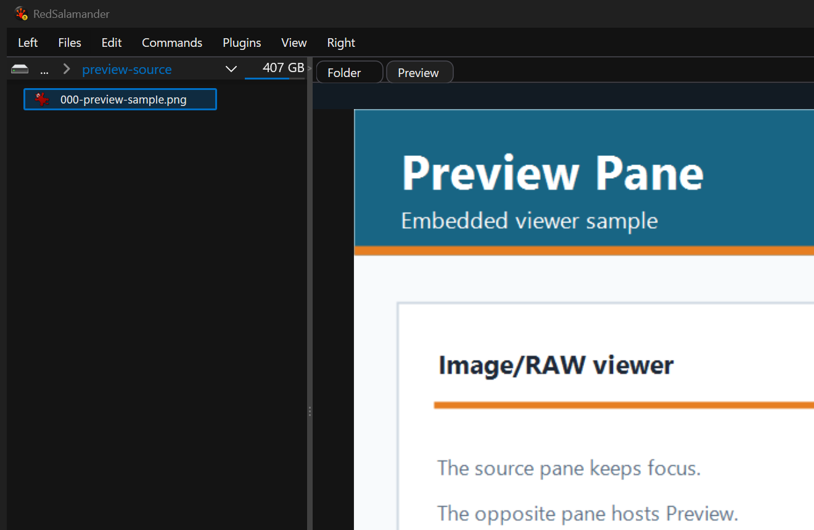

The Preview Pane hosts the viewer for the focused file in the opposite pane, using the same viewer associations where an embedded viewer is available. When no specific embedded preview is available, it shows the focused file or folder Properties as compact cards with wrapping text and an on-demand scrollbar. Rainbow theme adds subtle rainbow section accents. The source Folder view keeps keyboard focus, embedded viewers hide standalone filename/header chrome so they blend with the Preview tab, and compatible preview viewers are reused by closing the previous preview content before opening the next file.

Standalone viewers share a keyboard rule: focus starts on the main viewer surface, `Tab` / `Shift+Tab` moves through menus, dropdowns, and tool controls, and accepted combo/menu actions return focus to the main surface. `Esc` from viewer chrome returns focus to the main surface; from the main surface it cancels active long work when available, then closes when idle unless a visible alert consumes the first press.

## Default Viewer Associations

The default mapping includes:

| File type | Default viewer |
|-----------|----------------|
| `.txt`, `.log`, `.xml`, `.ini`, `.cfg`, `.csv` | Text viewer |
| `.md` | Markdown viewer, with Text fallback if ViewerWeb is unavailable |
| `.json`, `.json5` | JSON viewer, with Text fallback if ViewerWeb is unavailable |
| `.html`, `.htm`, `.pdf` | Web viewer, with Text fallback if ViewerWeb is unavailable |
| Common WIC image formats and many camera RAW formats | Image/RAW viewer |
| Common audio/video formats | VLC viewer |
| SQLite database files | SQLite viewer |
| `.exe`, `.dll`, `.sys`, and other PE files | PE viewer |

Configure this in **Preferences -> Viewers**:

- **Associations** choose the `F3 View` and `Alt+F3 Alternate View` actions for an extension, pattern, default `*` row, or computer-specific override.
- **Actions** define internal viewer-plugin actions and external viewer programs.
- The page can test a sample file path and show the resolved action plus the rule that chose it.

### Packaging note: Web, JSON, and Markdown ship together

The Web, JSON, and Markdown viewers are not three separate plugin files. They are all provided by a single optional `ViewerWeb.dll`, which exposes the `builtin/viewer-web`, `builtin/viewer-json`, and `builtin/viewer-markdown` plugins together and requires the Microsoft Edge WebView2 Runtime. Optional plugins live in the `Plugins\` folder next to `RedSalamander.exe`. Because the three viewers share one file, disabling, locating, or removing `ViewerWeb.dll` affects all three at once, and each one falls back to the Text viewer when `ViewerWeb` is unavailable. See [Plugins](Plugins.md) for the plugin folder and Plugin Manager UI.

## Viewer menu map

Standalone viewers use normal menus in addition to shortcuts and tool controls. This is the quickest way to discover viewer behavior without memorizing every shortcut.

| Viewer | Menus | Important commands |
| --- | --- | --- |
| Text / Hex / Diff | File, Search, View, Encoding | Open, Save As, Refresh, Other Files, Find, Text/Hex, diff side-by-side/inline, diff hunk navigation, line numbers, wrap, Go to offset, encoding and character-set selection. |
| Image / RAW | File, Other Files, View | Refresh, Export, next/previous/first/last image, fit/actual size, zoom, rotate, flip, reset orientation, brightness/contrast/gamma, grayscale, negative, RAW vs thumbnail source, Exif overlay. |
| PE | File, View | Export as Text, Export as Markdown, Refresh, Other Files, Go to Top, Go to Bottom. |
| Web / JSON / Markdown | File, Search, View, Tools | Save As, Refresh, Other Files, Find, zoom, DevTools when enabled, Copy URL, Open in Browser, JSON expand/collapse, Markdown source toggle. |
| SQLite | Window controls | Table selector, paged preview, custom read-only query, Run Query, Table Preview, status strip. |
| VLC | Playback controls | Play/pause/stop, seek, volume, snapshot, configured VLC/runtime settings. |
| Space | Window controls | Rescan, navigate up, cancel active scan, close when idle. |

Viewer windows follow the same focus rule: menu commands and combo selections return focus to the main viewer surface where practical, so keyboard browsing can continue after using a command.

## Text / Hex / Diff Viewer (`builtin/viewer-text`)

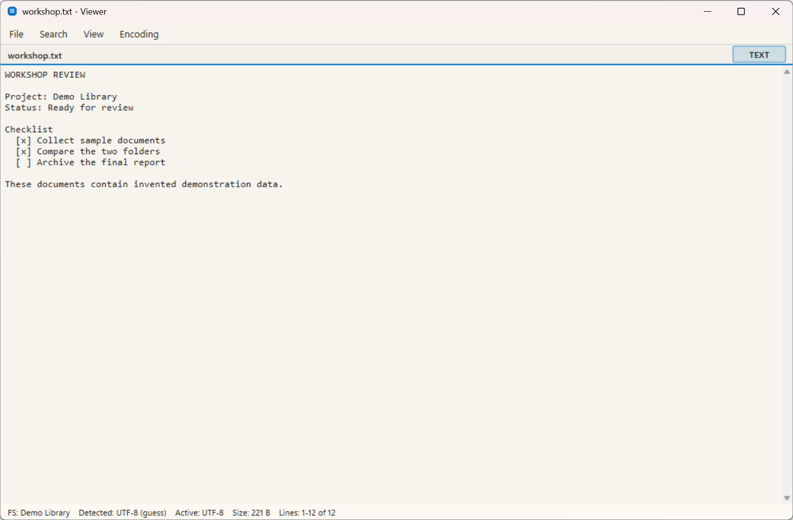

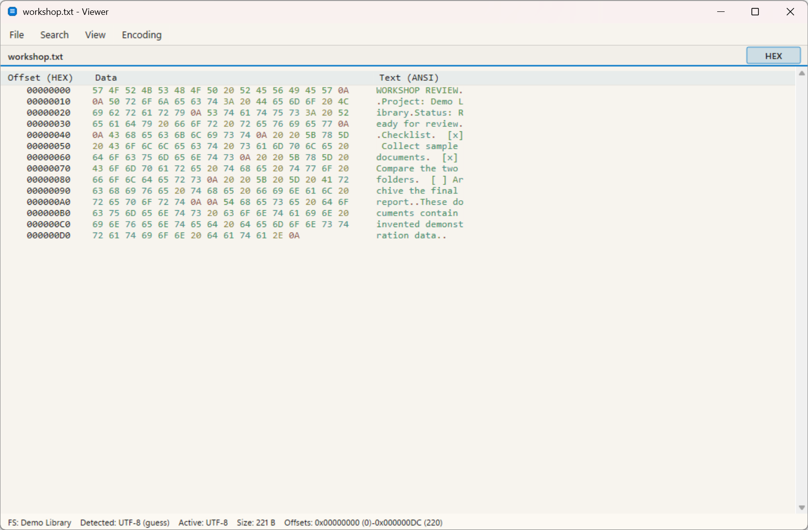

Use the Text viewer for logs, source-like files, configuration files, CSV/XML content, unknown files, and any file you want to inspect as text or bytes.

Behavior:

- Text mode with encoding detection and selectable code pages.
- Hex mode with offset, byte, and decoded-text columns.
- Diff modes for `.diff`, `.patch`, and `.rej` files, including side-by-side, inline, unchanged-lines toggle, and hunk navigation.
- Optional line numbers, wrapping, and hex byte coloring.
- Save As with optional encoding conversion.
- Peer-file navigation within the same folder.

Shortcuts:

| Shortcut | Action |
|----------|--------|
| `Ctrl+O` | Open a file from the viewer. |
| `Ctrl+S` | Save As. |
| `F5` | Refresh/reload. |
| `Ctrl+F` | Find. |
| `F3` / `Shift+F3` | Next/previous match. |
| `Home` / `End` | Top/bottom. |
| `Ctrl+G` | Go to offset. |
| `F7` / `Shift+F7` | Next/previous diff hunk. |
| `F8` / `Shift+F8` | Next/previous encoding. |
| `Space` / `Ctrl+Down` | Next peer file. |
| `Backspace` / `Ctrl+Up` | Previous peer file. |
| `Ctrl+Home` / `Ctrl+End` | First/last peer file. |
| `Esc` | Close when idle. |

## Image / RAW Viewer (`builtin/viewer-imgraw`)

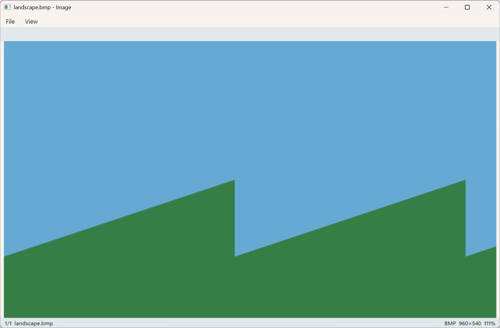

Use the Image/RAW viewer for common images and camera RAW files.

Behavior:

- Fit-to-window and actual-size viewing.
- Smooth zoom and pan.
- Rotate, flip, and reset orientation.
- Export the displayed image.
- Brightness, contrast, gamma, grayscale, and negative adjustments.
- RAW/thumbnail source switching where the file provides both.
- Exif overlay and neighbor prefetch for fast next/previous browsing.

Shortcuts:

| Shortcut | Action |
|----------|--------|
| `F5` | Refresh/reload. |
| `Ctrl+S` | Export. |
| `Right` / `PgDn` / `Space` | Next image. |
| `Left` / `PgUp` / `Backspace` | Previous image. |
| `Home` / `End` | First/last image. |
| `Ctrl+F` or double click | Fit to window. |
| `F` | Toggle fit/100%. |
| `1` | Actual size. |
| `+` / `-` / `0` | Zoom in/out/reset. |
| `R` | Rotate clockwise. |
| `Ctrl+R` / `Shift+R` | Rotate counterclockwise. |
| `H` / `V` | Flip horizontal/vertical. |
| `O` | Reset orientation. |
| `G` / `N` | Grayscale/negative. |
| `I` | Exif overlay. |
| `Ctrl+Alt+Arrow`, `Ctrl+Alt+PgUp/PgDn` | Adjustment shortcuts. |
| `Esc` | Cancel active RAW loading; close when idle. |

Mouse wheel zooms, and dragging pans when the image is zoomed.

## Space Viewer (`builtin/viewer-space`)

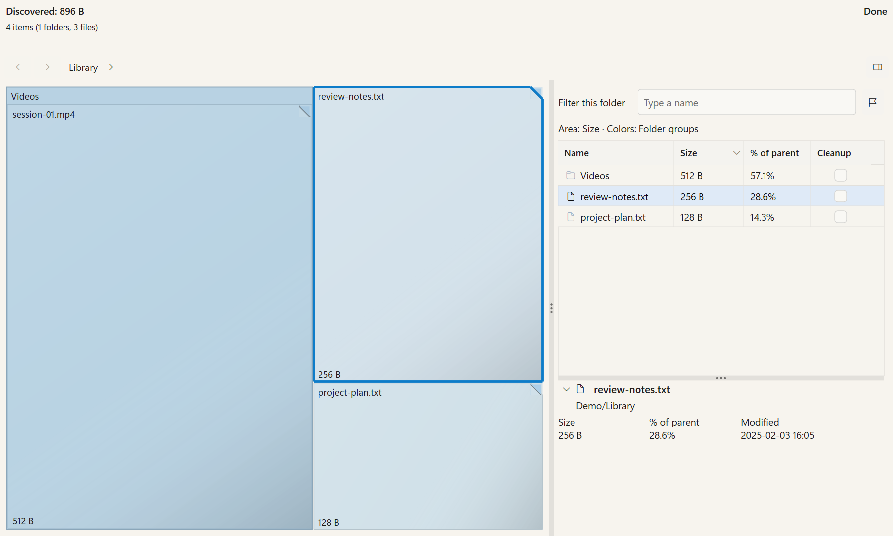

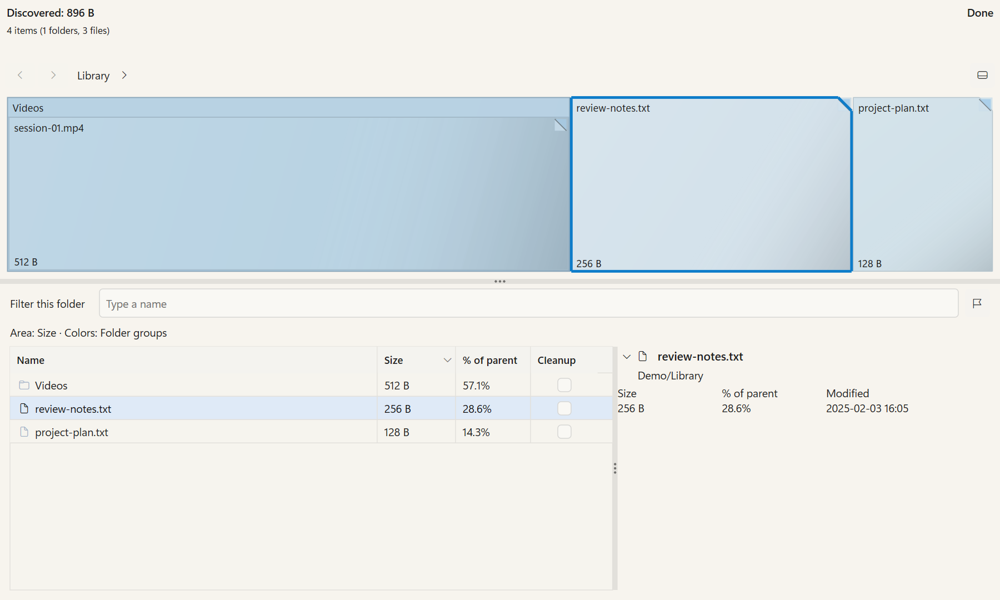

These native client frames use invented library data and the no-activation test harness. The owned capture host omits application window chrome.

Open **Commands → Calculate Occupied Space** (Alt+F10), or a folder's **View Space** context action. Exactly one selected folder is scanned; otherwise the current pane folder is used.

- **Discovered** always reports the scan-wide logical bytes and counts. **This folder / Shown** separately reports what you are exploring or computing after exclusions. Partial results, unreadable content and summarized details remain explicit. Scan rate can appear; an unreliable remaining-time estimate is omitted.
- One icon-only **Layout** control offers **Panel right**, **Panel bottom** and **Map only**, with an accessible name and tooltip. The right preference moves below the map in narrower viable windows. Splitter sizes and linked selection survive layout changes.
- The ranked table shows retained direct children with an icon/name, Size, parent share and a separate Cleanup checkbox. The compact inspector shows the name once, its parent location once, Size/share/Modified, and exceptional status. Full paths and exact bytes remain in accessible details and tooltips.
- Name, optional type and age filters apply to the current folder's retained entries. They highlight matching map items without changing areas or totals. Other contains summarized names that cannot be searched. An expandable type breakdown makes the retained scope clear.
- Optional file-type and age colors have a legend. Folder age defaults to its own Modified date; newest-contained-file age is available where retained data establishes it. Normal Salamander **Size** remains the default area; **File count** is optional. Size on disk remains unavailable until allocation and hard-link data are reliable.
- Click a file tile to select it; click a folder tile to explore it. Selecting a table row does not navigate. Enter activates the selection. Back/Forward and structural Up remain separate.
- **Copy path** is in the main/context menus and uses Alt+Insert. Ordinary text Copy remains available in editing fields. Synthetic Other has no invented copyable path.
- Use the row icon or **Exclude from view** to remove a real item and its descendants from shown sizes, percentages and map area. The row stays dimmed with an exclusion overlay and its original Size. Restore an item or **Restore all**. Exclusions survive navigation/refresh in this viewer and clear when it closes.
- Mark cleanup independently with checkboxes or explicit **Mark matching items**. **Review cleanup** shows real target paths, whole-folder consequences and a removable target list, then sends Recycle/Delete through the normal confirmed File Operations workflow. Exclusion does not mark or delete data. Refresh after the operation finishes.
- **Focus in pane** reveals a real item in the active pane. **Open folder in other pane** is an explicit action with no new shortcut. These actions retain the source provider context and refuse unavailable bindings.
- The **Problems** count/menu opens a bounded list of retained unreadable or unmeasured entries. **Export** writes the settled current projection to CSV or JSON, identifying scan/view scope, original/shown bytes, exclusions, summaries and unavailable facts. These exports do not save a reusable scan snapshot.
- Settings belong to global **Preferences → Plugins → Space**, with technical scan/cache/retention fields under **Advanced**.
- F5 bypasses the cache. A settled display remains visible during a retained refresh; refusal keeps it and offers **File → Rebuild**, which discards it before rescanning.

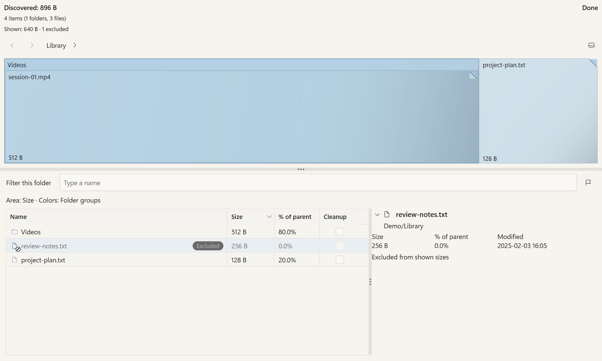

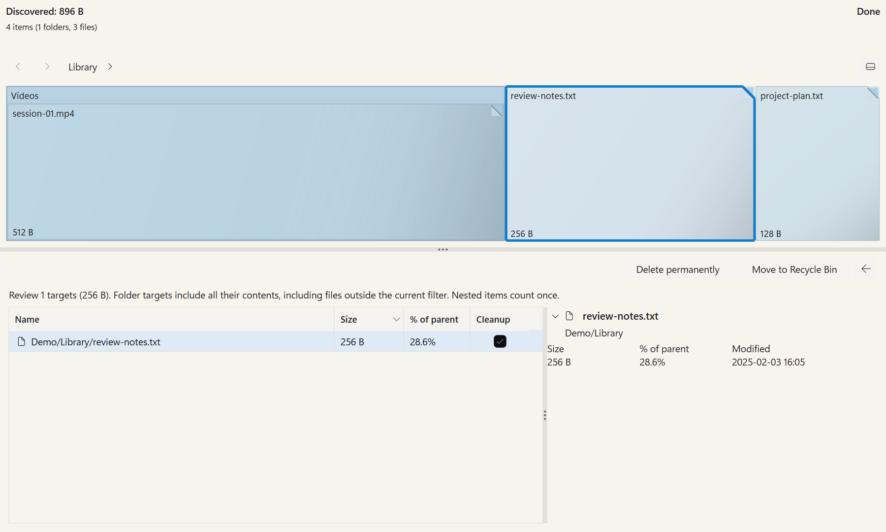

| Shortcut | Action |
|----------|--------|
| Alt+Insert | Copy the real selected path, or the current folder without a selection. |
| F5 | Fresh scan, bypassing the cache. |
| Backspace / Alt+Up | Structural Up. |
| Alt+Left / Alt+Right | Back / Forward. |
| Ctrl+1 / Ctrl+2 | Panel right / Panel bottom. |
| Enter | Explore a folder or focus a file in the host pane. |
| Esc | Dismiss a popup, leave review/Problems or clear a filter first; otherwise cancel a scan, then close when idle. |

## PE Viewer (`builtin/viewer-pe`)

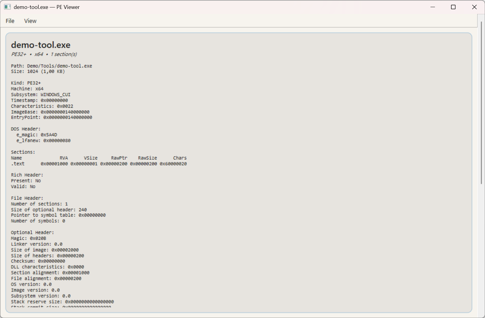

Use the PE viewer for Windows Portable Executable files such as `.exe`, `.dll`, `.sys`, and related binary formats.

Behavior:

- Parses the selected PE file and shows structured metadata.
- Shows headers, sections, import/export-related information, and other parseable PE details.
- Supports export to text or Markdown.
- Supports peer-file navigation across other PE files in the same folder.

Shortcuts:

| Shortcut | Action |
|----------|--------|
| `Ctrl+S` | Export as text. |
| `Ctrl+Shift+S` | Export as Markdown. |
| `F5` | Refresh. |
| `Home` / `End` | Top/bottom. |
| `Space` / `Ctrl+Down` | Next peer file. |
| `Backspace` / `Ctrl+Up` | Previous peer file. |
| `Ctrl+Home` / `Ctrl+End` | First/last peer file. |
| `Esc` | Close when idle. |

## SQLite Viewer (`builtin/viewer-sqlite`)

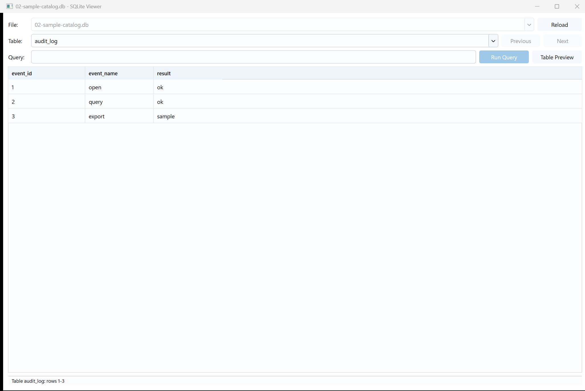

Use the SQLite viewer to inspect database files without editing them.

Behavior:

- Opens SQLite databases read-only.
- Provides a table selector and paged preview grid.
- Provides previous/next page navigation.
- Provides a read-only custom SQL query field.
- Supports **Run Query** and **Table Preview** commands.
- Settings control preview page size, custom-query row cap, and direct-open behavior for local files.
- Status text reports loading, empty tables, row ranges, query counts, and truncated-result states.

Shortcuts:

| Shortcut | Action |
|----------|--------|
| `F3` | Open the selected database from the pane. |
| `Tab` / `Shift+Tab` | Move through viewer controls. |
| `Arrow keys` | Move inside focused controls and grids. |
| `Enter` / `Space` | Activate the focused button, selector, or command. |
| `Esc` | Return focus to results grid from controls; close from the grid when idle. |

## VLC Viewer (`builtin/viewer-vlc`)

The example shows the missing-runtime state using a generated sandbox Wave file.
It illustrates setup guidance; it does not demonstrate media playback.

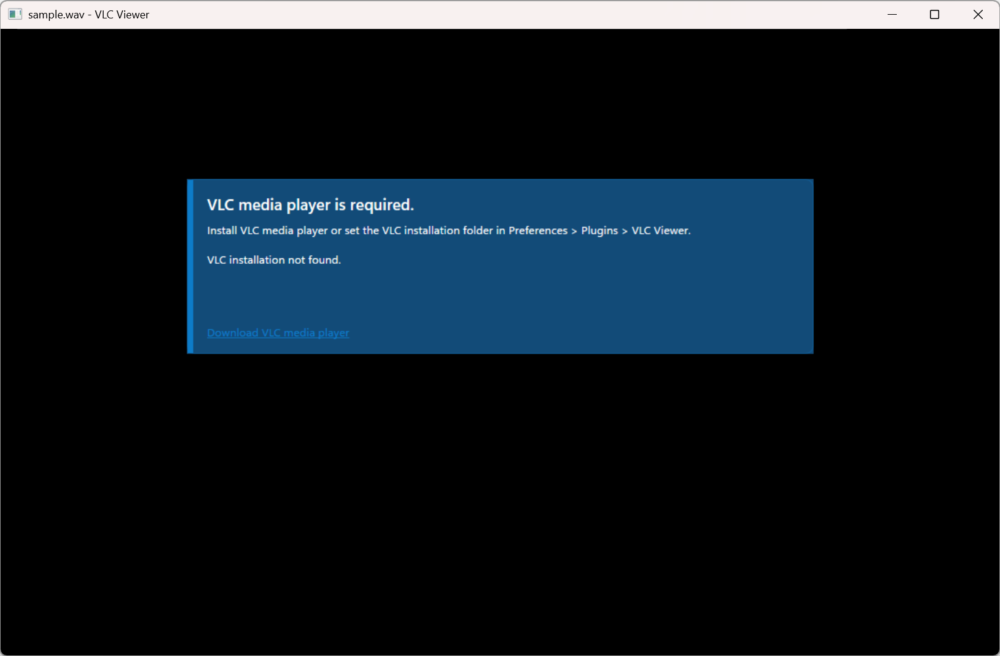

Use the VLC viewer for audio and video playback through VLC/libVLC.

Requirements:

- VLC media player must be installed, or
- a VLC installation folder must be configured in **Preferences -> Plugins -> VLC Viewer**.

Behavior:

- Opens media files mapped to the VLC viewer.
- Provides play, pause, stop, timeline/seek, time display, volume, and snapshot controls.
- Uses plugin settings for VLC path, plugin path, caching, hardware acceleration, output, visualizer, and extra VLC arguments.
- If VLC is unavailable, the viewer shows the missing-VLC state with configuration guidance.

Shortcuts:

| Shortcut | Action |
|----------|--------|
| `F3` | Open the selected media file from the pane. |
| `Tab` / `Shift+Tab` | Move through visible playback controls. |
| `Enter` / `Space` | Activate the focused control. |
| `Esc` | Close when idle. |

No separate viewer menu accelerator table is currently defined for VLC; use the visible playback controls.

## Web Viewer (`builtin/viewer-web`)

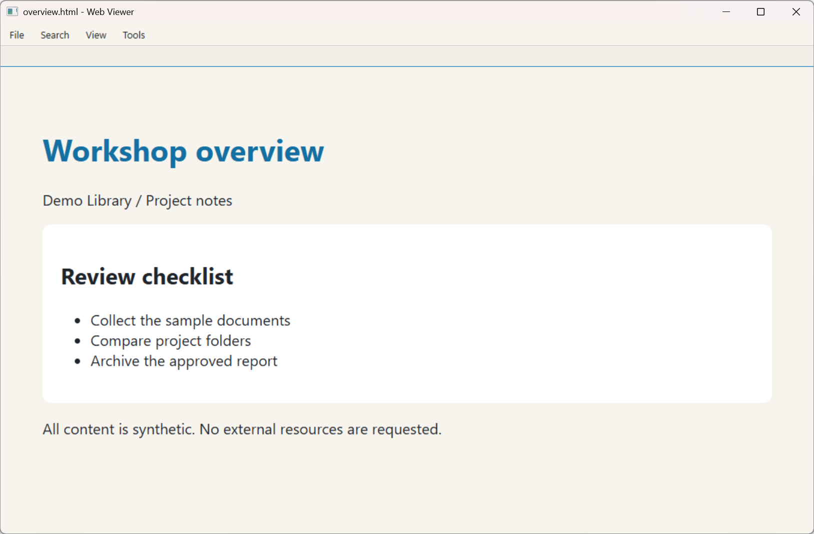

Use the Web viewer for HTML, PDF, and browser-rendered content.

Requirements:

- Microsoft Edge WebView2 Runtime.

Behavior:

- Renders local HTML/PDF-style content through WebView2.
- Supports find, zoom, refresh, save, URL copy, and opening in the system browser.
- Falls back to Text viewer when ViewerWeb is unavailable and the host can safely do so.

Shortcuts:

| Shortcut | Action |
|----------|--------|
| `Ctrl+S` | Save As. |
| `F5` | Refresh. |
| `Ctrl+F` | Find. |
| `F3` / `Shift+F3` | Find next/previous. |
| `Ctrl++` / `Ctrl+-` / `Ctrl+0` | Zoom in/out/reset. |
| `F12` | Toggle DevTools when enabled. |
| `Ctrl+L` | Copy URL. |
| `Ctrl+Enter` | Open in browser. |
| `Space` / `Ctrl+Down` | Next peer file. |
| `Backspace` / `Ctrl+Up` | Previous peer file. |
| `Esc` | Close when idle. |

## JSON Viewer (`builtin/viewer-json`)

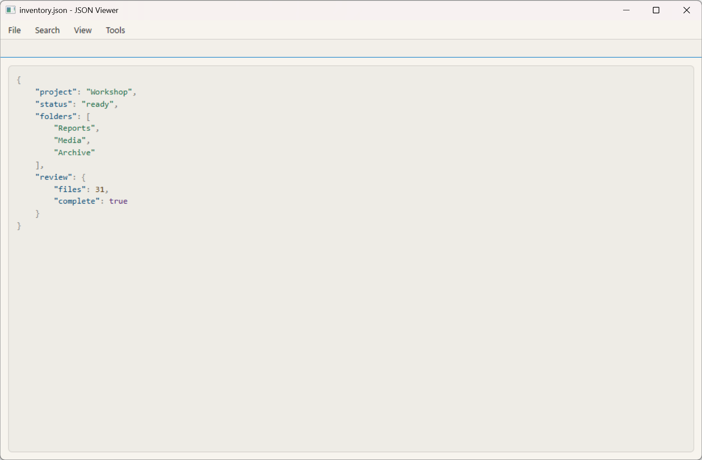

Use the JSON viewer for `.json`, `.json5`, and JSONL-style inspection.

Requirements:

- Microsoft Edge WebView2 Runtime.

Behavior:

- Formats JSON into a structured, syntax-highlighted view.
- Supports pretty, tree, and JSONL/card-style modes where available.
- Provides expand/collapse commands for structured JSON views.
- Oversized documents can be handed off to Text viewer.

Shortcuts:

| Shortcut | Action |
|----------|--------|
| `Ctrl+S` | Save As. |
| `F5` | Refresh. |
| `Ctrl+F` | Find. |
| `F3` / `Shift+F3` | Find next/previous. |
| `Ctrl++` / `Ctrl+-` / `Ctrl+0` | Zoom in/out/reset. |
| `F12` | Toggle DevTools when enabled. |
| `Ctrl+L` | Copy URL. |
| `Ctrl+Enter` | Open in browser. |
| `Space` / `Ctrl+Down` | Next peer file. |
| `Backspace` / `Ctrl+Up` | Previous peer file. |
| `Esc` | Close when idle. |

## Markdown Viewer (`builtin/viewer-markdown`)

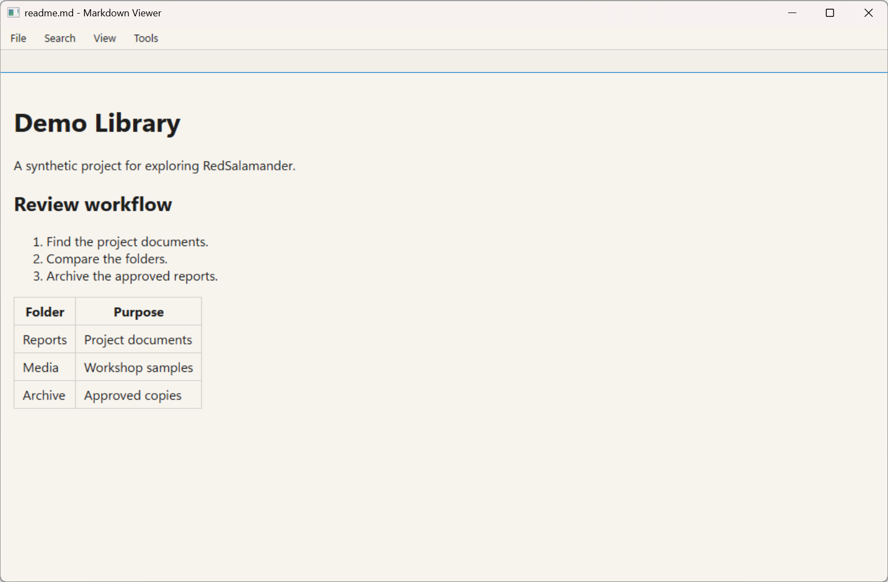

Use the Markdown viewer for `.md` documentation and notes.

Requirements:

- Microsoft Edge WebView2 Runtime.

Behavior:

- Renders headings, lists, emphasis, and code blocks.
- Supports source toggling for inspection.
- Uses WebView2 for display and Text viewer fallback when ViewerWeb is unavailable.
- Oversized documents can be handed off to Text viewer.

Shortcuts:

| Shortcut | Action |
|----------|--------|
| `Ctrl+S` | Save As. |
| `F5` | Refresh. |
| `Ctrl+F` | Find. |
| `F3` / `Shift+F3` | Find next/previous. |
| `Ctrl++` / `Ctrl+-` / `Ctrl+0` | Zoom in/out/reset. |
| `F12` | Toggle DevTools when enabled. |
| `Ctrl+L` | Copy URL. |
| `Ctrl+Enter` | Open in browser. |
| `Ctrl+Backtick` | Toggle Markdown source. |
| `Space` / `Ctrl+Down` | Next peer file. |
| `Backspace` / `Ctrl+Up` | Previous peer file. |
| `Esc` | Close when idle. |

See also: [Plugins](Plugins.md), [Preferences](Preferences.md), and [Settings File & Advanced Configuration](SettingsFile.md).

## Space scan and refresh examples

These scenarios use the same invented library. Displayed totals are observed logical
bytes, with no overall scan percentage or ETA. A refresh keeps the settled display
when retention is possible. Canceling the refresh leaves those results available.

| State | Example |
| --- | --- |
| Before results arrive | [Native frame](res/viewer-space-scanning.png) |
| Observed partial scan | [Native frame](res/viewer-space-inflight.png) |
| Refresh with retained results | [Native frame](res/viewer-space-refreshing.png) |
| Canceled refresh with retained results | [Native frame](res/viewer-space-refresh-canceled.png) |
| Refresh refused; rebuild offered | [Native frame](res/viewer-space-refresh-refused.png) |
| Empty folder | [Native frame](res/viewer-space-empty.png) |
| Provider error | [Native frame](res/viewer-space-error.png) |
| Bottom panel; inspector collapsed | [Native frame](res/viewer-space-bottom-panel.png) |
| Map only | [Native frame](res/viewer-space-map-only.png) |
| Excluded item with original size retained | [Native frame](res/viewer-space-excluded.png) |
| Reviewed cleanup targets | [Native frame](res/viewer-space-cleanup-review.png) |

## Generated media playback

These frames show a real VLC decoder playing and pausing a generated silent AVI,
using software decoding and the identified GDI video output.
The fixture checks positive decoder time and duration, an actual video child,
and a stable time after pause. The picture is generated test content and the
clip stays inside the marked sandbox. The setup-error example above remains
useful for hosts without a VLC runtime.

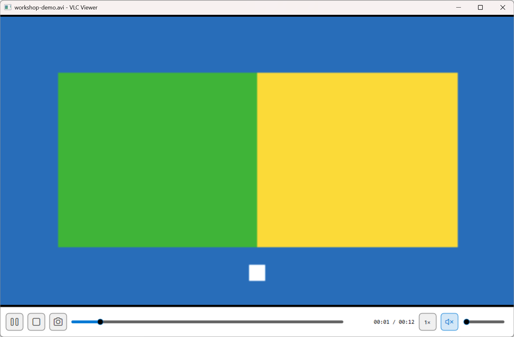

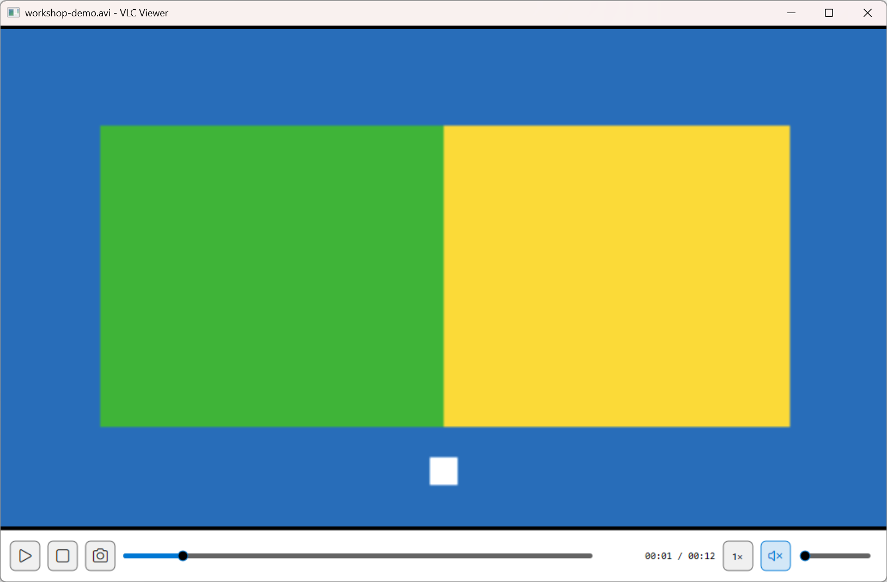
