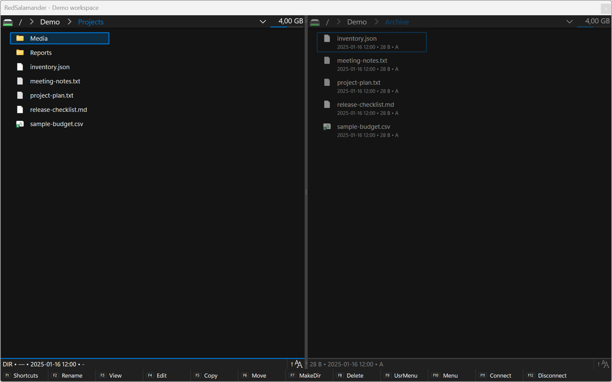
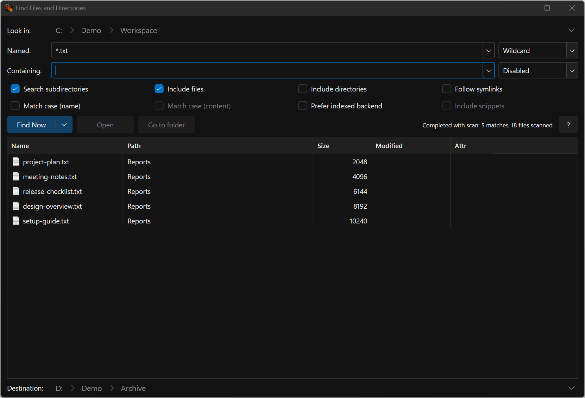
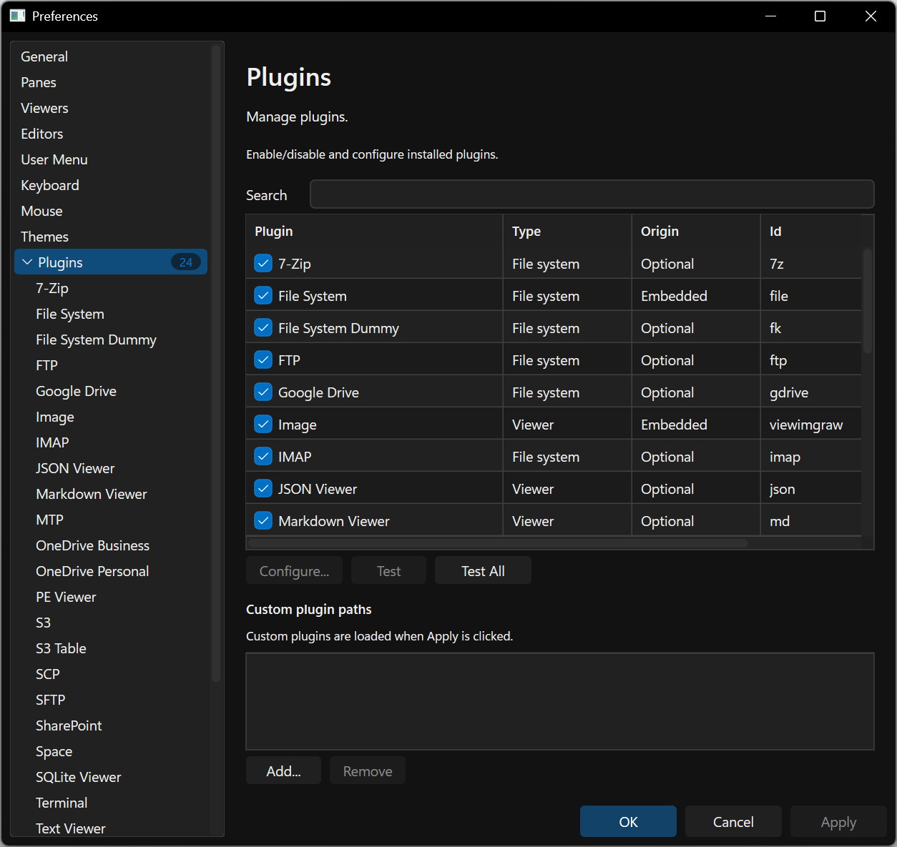

# Visual Tour

Explore the product through native application controls with invented data. These
examples are generated by the no-activation test harness. Scrollable pages show
their initial viewport; detailed guides describe the remaining controls.

| Workflow | Guide | Illustrated scenarios |
| --- | --- | --- |
| Browse and navigate | [Main Window](MainWindow.md), [Navigation](NavigationAndPaths.md) | Brief, Detailed, Extra Detailed, breadcrumbs, status and function bars |
| Find documents | [Find Files](FindFiles.md) | Completed results and no matches |
| Inspect disk usage | [Viewers](Viewers.md) | Explorer, Analyst, scanning, observed totals, refresh, cancel/refusal, empty/error, panel variants |
| Manage plugins | [Plugins](Plugins.md), [Preferences](Preferences.md) | Installed catalog and MTP configuration |
| Connect to providers | [Connections](Connections.md), [Portable Devices](PortableDevices.md) | Invented profiles, loopback FTP/cloud/S3 browsing and fake MTP files |
| Terminal layouts | [Terminal](Terminal.md#native-layout-examples) | Embedded host, floating tabs and Find with a fixed VT transcript |
| Everyday utilities | [Selections and File Lists](SelectionsAndLists.md#utility-dialog-examples) | Selection/filter masks, new items, attributes/case, reports, archives and invented shares |
| Preview files | [Viewers](Viewers.md) | Generated text/hex, bitmap, PE, HTML, JSON and Markdown; VLC setup error and generated playback/pause |
| Discover commands | [Command Palette](CommandPalette.md) | Filtered registered command and shortcut |
| Configure the application | [Preferences](Preferences.md) | All fourteen top-level pages |
| Change appearance | [Themes](Themes.md#native-workspace-examples) | Light, Dark, application High Contrast and Rainbow |
| Copy, move and recover | [File Operations](FileOperations.md) | Ten count, lifecycle, conflict and issue scenarios |

The [screenshot inventory](res/README.md) records capture provenance and remaining
visual work. [Documentation Map](DocumentationMap.md) covers the full product,
including Terminal, remote/cloud providers, comparisons, selections and diagnostics.
The playback examples exercise real decoding of generated media. Static Terminal
transcripts do not qualify shell execution. The gallery does not qualify live
accounts/devices, global keyboard interaction or every native build profile.
